# PROPOSAL ĐỒ ÁN
# HỆ THỐNG QUẢN LÝ NHÀ TRỌ

**Rental Room Management - Proposal Kiến Trúc & Dữ Liệu**  
**Phiên bản:** 1.0  
**Nền tảng chính:** Flutter mobile app + NestJS REST API + PostgreSQL

## Contents

- 1. Giới thiệu
  - 1.1. Đặt vấn đề
  - 1.2. Các giải pháp đã có
  - 1.3. Giải pháp đề xuất
- 2. Thiết kế và triển khai
  - 2.1. Các yêu cầu chức năng
  - 2.2. Các yêu cầu phi chức năng
  - 2.3. Các ràng buộc
    - 2.3.1. Các ràng buộc về triển khai
    - 2.3.2. Các ràng buộc kinh tế
    - 2.3.3. Các ràng buộc về đạo đức
    - 2.3.4. Các ràng buộc pháp lý
    - 2.3.5. Các ràng buộc về thời gian và phạm vi
  - 2.4. Mô hình hệ thống / Thiết kế giải pháp
    - 2.4.1. Các kịch bản của hệ thống (Use-cases)
    - 2.4.2. Mô hình Use-case
    - 2.4.3. Mô hình lớp và đối tượng
    - 2.4.4. Các biểu đồ tuần tự
    - 2.4.5. Các màn hình giao diện người dùng
- 3. Yêu cầu kỹ thuật
- 4. Kiến trúc phần mềm
- 5. Tổ chức dữ liệu
- 6. Tính năng nổi bật
  - 6.1. Smart Billing & Late Payment Prediction
  - 6.2. Maintenance Issue Classification
  - 6.3. Chatbot quản lý trọ tiếng Việt
  - 6.4. Tenant portal cho người thuê
  - 6.5. Quản lý vòng đời phòng và hợp đồng
  - 6.6. Phân quyền theo vai trò
  - 6.7. Báo cáo vận hành thông minh
- 7. Dữ liệu thực và dữ liệu mẫu
- 8. Kế hoạch thực hiện

## 1. Giới thiệu

### 1.1. Đặt vấn đề

Trong những năm gần đây, nhu cầu thuê phòng trọ, căn hộ mini và nhà cho thuê tại các thành phố lớn ngày càng tăng. Đối tượng thuê trọ đa dạng hơn, từ sinh viên, người lao động, nhân viên văn phòng đến các hộ gia đình nhỏ. Cùng với đó, mô hình kinh doanh nhà trọ cũng thay đổi: nhiều chủ trọ không chỉ quản lý một dãy phòng nhỏ, mà có thể vận hành nhiều khu trọ, nhiều tầng, nhiều loại phòng với mức giá, dịch vụ và chính sách thanh toán khác nhau. Khi quy mô vận hành tăng lên, việc quản lý thủ công trở nên khó kiểm soát, tốn nhiều thời gian và dễ phát sinh sai sót.

Một hoạt động quản lý nhà trọ đầy đủ không chỉ dừng lại ở việc biết phòng nào còn trống hoặc phòng nào đang có người thuê. Người quản lý còn phải theo dõi thông tin khu trọ, phòng, người thuê, hợp đồng, tiền cọc, chỉ số điện nước, hóa đơn hằng tháng, thanh toán, công nợ, chi phí vận hành, yêu cầu bảo trì, thông báo và lịch sử thao tác. Mỗi nghiệp vụ lại liên quan đến nhiều dữ liệu khác nhau. Ví dụ, khi tạo hợp đồng mới, hệ thống cần biết người thuê là ai, phòng nào còn trống, ngày bắt đầu thuê, tiền thuê hằng tháng và tiền cọc. Khi lập hóa đơn, hệ thống cần dựa vào hợp đồng đang hoạt động, tiền phòng, chỉ số điện nước, các khoản phụ thu và tình trạng thanh toán trước đó.

Trong cách quản lý truyền thống, các dữ liệu này thường bị phân tán ở nhiều nơi: thông tin phòng ghi trong sổ, hóa đơn lưu bằng file Excel, minh chứng chuyển khoản nằm trong tin nhắn, yêu cầu sửa chữa gửi qua điện thoại hoặc Zalo, còn báo cáo doanh thu lại được tổng hợp thủ công vào cuối tháng. Cách làm này có thể chấp nhận được khi số lượng phòng ít, nhưng khi số lượng phòng và người thuê tăng lên, người quản lý dễ gặp các vấn đề như lập trùng hóa đơn, quên ghi nhận thanh toán, nhập sai chỉ số điện nước, không biết chính xác phòng nào còn nợ, khó kiểm tra hợp đồng sắp hết hạn và khó truy vết lịch sử khi phát sinh tranh chấp.

Ở phía người thuê, việc thiếu một kênh thông tin tập trung cũng gây bất tiện. Người thuê thường phải liên hệ trực tiếp với chủ trọ để hỏi tiền phòng, xin lại hóa đơn, xác nhận đã chuyển khoản, báo hỏng thiết bị hoặc hỏi tiến độ xử lý bảo trì. Nếu mọi trao đổi đều nằm trong tin nhắn cá nhân, cả chủ trọ và người thuê đều khó tra cứu lại khi cần. Điều này làm giảm tính minh bạch trong quá trình thuê phòng, đặc biệt với các nghiệp vụ liên quan đến tiền, hợp đồng, tiền cọc và trạng thái thanh toán.

Trong phạm vi đồ án, bài toán được xem xét với ba nhóm người dùng chính: **Admin**, **Chủ trọ** và **Người thuê phòng**. Admin quản trị hệ thống ở cấp nền tảng; Chủ trọ trực tiếp vận hành khu trọ, phòng, người thuê, hợp đồng, hóa đơn và bảo trì; Người thuê phòng sử dụng cổng thông tin riêng để theo dõi thông tin liên quan đến quá trình thuê. Từ những vấn đề trên, có thể thấy cần xây dựng một hệ thống quản lý nhà trọ tập trung, có khả năng số hóa quy trình vận hành, giảm thao tác thủ công và hỗ trợ minh bạch thông tin giữa chủ trọ và người thuê. Đây là lý do đồ án **Hệ thống quản lý nhà trọ - Rental Room Management** được lựa chọn và phát triển.

### 1.2. Các giải pháp đã có

Hiện nay, có nhiều cách khác nhau để quản lý nhà trọ. Cách phổ biến nhất là quản lý bằng sổ sách hoặc ghi chú cá nhân. Chủ trọ ghi danh sách phòng, tên người thuê, tiền phòng và ngày đóng tiền vào sổ. Phương pháp này đơn giản, không cần công cụ kỹ thuật và phù hợp với chủ trọ có rất ít phòng. Tuy nhiên, nhược điểm lớn là dữ liệu khó tìm kiếm, khó sao lưu, khó tổng hợp báo cáo và dễ thất lạc. Khi cần kiểm tra lịch sử thanh toán hoặc thông tin hợp đồng cũ, người quản lý phải tra cứu thủ công, mất nhiều thời gian.

Một giải pháp khác thường được sử dụng là bảng tính như Excel hoặc Google Sheets. So với sổ tay, bảng tính giúp tính toán nhanh hơn, dễ lọc dữ liệu hơn và có thể tạo một số công thức tổng hợp doanh thu. Tuy nhiên, bảng tính vẫn phụ thuộc nhiều vào thao tác nhập liệu thủ công. Nếu file có nhiều sheet hoặc nhiều người cùng chỉnh sửa, dữ liệu dễ bị sai định dạng, ghi đè hoặc thiếu nhất quán. Bảng tính cũng không tự động kiểm tra các ràng buộc nghiệp vụ như phòng đã có hợp đồng hay chưa, hóa đơn tháng đó đã được lập chưa, người thuê có còn hoạt động hay không, hoặc hóa đơn đã được thanh toán đủ chưa.

Ngoài ra, nhiều chủ trọ sử dụng các ứng dụng nhắn tin như Zalo, Messenger hoặc điện thoại để trao đổi với người thuê. Các kênh này thuận tiện cho giao tiếp hằng ngày, nhưng không phù hợp để quản lý dữ liệu vận hành lâu dài. Minh chứng thanh toán, phản ánh sự cố, thông báo tiền phòng và lịch sử trao đổi có thể bị trôi trong tin nhắn. Khi cần tổng hợp công nợ hoặc kiểm tra một yêu cầu bảo trì cũ, người quản lý phải tìm kiếm thủ công trong từng cuộc trò chuyện.

Trên thị trường cũng đã có một số phần mềm quản lý nhà trọ hoặc phần mềm kế toán nhỏ. Các phần mềm này thường hỗ trợ các chức năng cơ bản như quản lý phòng, người thuê, hóa đơn và doanh thu. Tuy nhiên, một số giải pháp chưa thật sự phù hợp với nhu cầu của đồ án này vì còn thiên về quản lý trên máy tính, giao diện chưa tối ưu cho thao tác nhanh trên điện thoại, thiếu cổng thông tin riêng cho người thuê hoặc chưa liên kết đầy đủ giữa các nghiệp vụ như hợp đồng, hóa đơn, minh chứng thanh toán, bảo trì, chi phí, thông báo và báo cáo vận hành.

Có thể tổng hợp ưu điểm và hạn chế của các giải pháp hiện có như sau:

| Giải pháp | Ưu điểm | Hạn chế |
|---|---|---|
| Sổ sách, ghi chú thủ công | Dễ bắt đầu, không cần thiết bị phức tạp | Khó tìm kiếm, dễ thất lạc, khó tổng hợp báo cáo, không có kiểm tra nghiệp vụ |
| Excel/Google Sheets | Dễ tính toán, dễ lọc dữ liệu, chi phí thấp | Phụ thuộc nhập liệu thủ công, dễ sai dữ liệu, khó phân quyền và khó gắn với luồng người thuê |
| Zalo/điện thoại/tin nhắn | Giao tiếp nhanh, quen thuộc với người dùng | Dữ liệu phân tán, khó truy vết, không phù hợp để quản lý hóa đơn và công nợ lâu dài |
| Phần mềm quản lý có sẵn | Có sẵn một số chức năng quản lý phòng và hóa đơn | Có thể chưa tối ưu mobile-first, thiếu tenant portal, khó tùy biến theo nghiệp vụ của đồ án |

Từ việc phân tích các giải pháp trên, có thể thấy cần một hệ thống kết hợp được ưu điểm của nhiều hướng tiếp cận: dễ sử dụng như công cụ quen thuộc, có khả năng lưu trữ và tổng hợp như bảng tính, nhưng đồng thời phải có ràng buộc nghiệp vụ, phân quyền, báo cáo, thông báo và cổng thông tin cho người thuê. Hệ thống cũng cần có vai trò Admin để quản trị nền tảng, vai trò Chủ trọ để vận hành nghiệp vụ nhà trọ và vai trò Người thuê phòng để theo dõi thông tin thuê phòng của mình. Đây là cơ sở để đề xuất giải pháp riêng cho dự án **Rental Room Management**.

### 1.3. Giải pháp đề xuất

Giải pháp được đề xuất là xây dựng hệ thống **Rental Room Management** theo mô hình client-server, trong đó ứng dụng di động đóng vai trò giao diện chính cho người dùng, còn backend chịu trách nhiệm xử lý nghiệp vụ và lưu trữ dữ liệu. Dự án sử dụng Flutter để xây dựng ứng dụng mobile-first, NestJS để xây dựng REST API, PostgreSQL làm hệ quản trị cơ sở dữ liệu và Prisma ORM để thao tác dữ liệu có cấu trúc. Backend được tổ chức theo hướng modular monolith: các phân hệ nghiệp vụ được tách thành module rõ ràng nhưng cùng chạy trong một ứng dụng backend và dùng chung cơ sở dữ liệu. Các API được tổ chức dưới prefix `/api/v1`, giúp hệ thống có cấu trúc rõ ràng và thuận lợi khi mở rộng.

Hệ thống tập trung vào ba nhóm người dùng chính. **Admin** có vai trò quản trị nền tảng, theo dõi danh sách chủ trọ, khu trọ và dữ liệu tổng quan ở phạm vi hệ thống. **Chủ trọ** là người vận hành chính, có thể quản lý khu trọ, phòng, người thuê, hợp đồng, tiền cọc, chỉ số điện nước, hóa đơn, thanh toán, chi phí, bảo trì, thông báo và báo cáo. **Người thuê phòng** sử dụng tenant portal để xem thông tin liên quan đến mình, bao gồm hợp đồng, hóa đơn, trạng thái thanh toán, thông báo và yêu cầu bảo trì.

Đối với Chủ trọ, dashboard giúp hiển thị nhanh các thông tin quan trọng như tổng số phòng, số phòng đang thuê, phòng trống, doanh thu, tiền đã thu, công nợ, hóa đơn gần đây và các việc cần xử lý. Nhờ đó, chủ trọ có thể nắm tình hình vận hành trong thời gian ngắn thay vì phải tổng hợp từ nhiều nguồn khác nhau. Đối với Người thuê phòng, tenant portal cho phép tự xem hợp đồng hiện tại, danh sách hóa đơn, chi tiết từng hóa đơn, trạng thái thanh toán, thông báo từ chủ trọ và lịch sử liên quan. Khi đã chuyển khoản, người thuê có thể gửi minh chứng thanh toán lên hệ thống để chủ trọ kiểm tra và duyệt. Khi phòng gặp sự cố, người thuê có thể tạo yêu cầu bảo trì, đính kèm mô tả hoặc hình ảnh và theo dõi tiến độ xử lý.

Về mặt kỹ thuật, hệ thống được thiết kế theo các lớp rõ ràng. Flutter app đảm nhiệm phần giao diện, điều hướng, quản lý trạng thái và gọi API. Các thư viện chính được sử dụng gồm Riverpod để quản lý state, GoRouter để điều hướng, Dio để gọi HTTP API và flutter_secure_storage để lưu session an toàn trên thiết bị. Backend NestJS đảm nhiệm xác thực, phân quyền, kiểm tra dữ liệu đầu vào, xử lý nghiệp vụ và trả dữ liệu cho client. PostgreSQL lưu trữ các bảng chính như User, Property, Room, Tenant, Lease, Invoice, Payment, Expense, MaintenanceTicket, NotificationDelivery và AuditLog.

Hệ thống cũng chú trọng đến bảo mật và phân quyền. Người dùng đăng nhập bằng tài khoản và mật khẩu; backend sử dụng JWT access token và rotating refresh token để duy trì phiên đăng nhập. Mật khẩu được hash bằng Argon2id, refresh token được lưu dưới dạng hash thay vì lưu token gốc. Các API nghiệp vụ được bảo vệ bằng cơ chế phân quyền theo vai trò; dữ liệu của từng chủ trọ được scope theo tài khoản đăng nhập để hạn chế truy cập nhầm hoặc truy cập chéo dữ liệu. Trong phạm vi báo cáo, các vai trò chính gồm `admin`, `landlord` và `tenant`, tương ứng với Admin, Chủ trọ và Người thuê phòng.

Một điểm quan trọng của giải pháp là các nghiệp vụ có liên quan đến nhiều bảng dữ liệu được xử lý nhất quán. Ví dụ, khi tạo hợp đồng, hệ thống cần kiểm tra phòng còn khả dụng và cập nhật trạng thái phòng thành đang thuê. Khi kết thúc hợp đồng, phòng có thể được chuyển lại về trạng thái trống nếu không còn hợp đồng active. Khi lập hóa đơn, hệ thống cần kiểm tra hóa đơn trùng theo kỳ thanh toán, tính tiền phòng, tiền điện nước và các khoản phụ thu. Khi ghi nhận thanh toán, trạng thái hóa đơn cần được cập nhật tương ứng thành chưa thanh toán, thanh toán một phần hoặc đã thanh toán. Những ràng buộc này giúp giảm lỗi do nhập liệu thủ công.

Ngoài các chức năng vận hành chính, hệ thống còn có phần báo cáo để hỗ trợ ra quyết định. Màn hình báo cáo tháng tổng hợp số hợp đồng đang hoạt động, số hóa đơn, tổng tiền đã lập hóa đơn, số tiền đã thu, công nợ, chi phí và lợi nhuận ước tính. Hệ thống cũng có thể thống kê doanh thu theo phương thức thanh toán, chi phí theo danh mục, danh sách hóa đơn còn nợ và hỗ trợ xuất CSV. Đây là cơ sở để người quản lý đánh giá hiệu quả vận hành, theo dõi công nợ và phát hiện các vấn đề bất thường trong từng tháng.

Tóm lại, giải pháp đề xuất không chỉ thay thế sổ sách hoặc bảng tính bằng một ứng dụng quản lý dữ liệu, mà hướng đến xây dựng một quy trình vận hành nhà trọ tương đối khép kín. Quy trình đó bắt đầu từ quản lý khu trọ và phòng, thêm người thuê, tạo hợp đồng, lập hóa đơn, ghi nhận thanh toán, xử lý bảo trì, gửi thông báo và cuối cùng là tổng hợp báo cáo. Với định hướng mobile-first, giao diện tiếng Việt và kiến trúc Flutter + NestJS + PostgreSQL, hệ thống phù hợp với mục tiêu đồ án là xây dựng một sản phẩm thực tế, có khả năng demo, kiểm thử và mở rộng thêm trong tương lai.

## 2. Thiết kế và triển khai

### 2.1. Các yêu cầu chức năng

Các yêu cầu chức năng mô tả những nghiệp vụ mà hệ thống **Rental Room Management** cần cung cấp cho người dùng. Trong phạm vi đồ án, hệ thống tập trung vào ba tác nhân chính: **Admin**, **Chủ trọ** và **Người thuê phòng**. Các vai trò hỗ trợ nội bộ như nhân sự phụ trách vận hành có thể được xem là hướng mở rộng sau, không phải trọng tâm của phần phân tích yêu cầu.

| Tác nhân | Vai trò trong hệ thống |
|---|---|
| Admin | Quản trị hệ thống ở cấp nền tảng, theo dõi chủ trọ, khu trọ và dữ liệu tổng quan. |
| Chủ trọ | Quản lý nghiệp vụ vận hành nhà trọ: khu trọ, phòng, người thuê, hợp đồng, hóa đơn, thanh toán, bảo trì, chi phí, báo cáo và thông báo. |
| Người thuê phòng | Sử dụng tenant portal để xem hợp đồng, hóa đơn, trạng thái thanh toán, gửi minh chứng thanh toán, gửi yêu cầu bảo trì và xem thông báo. |

Các yêu cầu bên dưới được gom theo nhóm chức năng để thuận tiện cho việc thiết kế use-case, mô hình dữ liệu, giao diện và kiểm thử.

#### 2.1.1. Yêu cầu chức năng chung

Nhóm chức năng chung áp dụng cho toàn bộ hệ thống, bao gồm khởi động ứng dụng, xác thực, phiên đăng nhập, điều hướng theo vai trò, cài đặt tài khoản và upload file. Đây là các chức năng nền giúp người dùng sử dụng hệ thống ổn định và an toàn.

| Mã | Yêu cầu chức năng |
|---|---|
| FR-01 | Hệ thống hiển thị màn hình splash khi mở ứng dụng và kiểm tra trạng thái phiên đăng nhập trước khi điều hướng. |
| FR-02 | Hệ thống hiển thị onboarding cho người dùng mới và lưu trạng thái đã hoàn thành onboarding. |
| FR-03 | Người dùng có thể đăng ký tài khoản chủ trọ với thông tin cơ bản như họ tên, email, số điện thoại và mật khẩu. |
| FR-04 | Người dùng có thể đăng nhập bằng email và mật khẩu. |
| FR-05 | Hệ thống lưu phiên đăng nhập an toàn trên thiết bị sau khi đăng nhập thành công. |
| FR-06 | Hệ thống tự động khôi phục phiên đăng nhập khi người dùng mở lại ứng dụng nếu token còn hợp lệ. |
| FR-07 | Hệ thống tự động refresh access token khi token hết hạn và thử lại request đang bị lỗi xác thực một lần. |
| FR-08 | Người dùng có thể đăng xuất và xóa thông tin phiên khỏi thiết bị. |
| FR-09 | Hệ thống điều hướng người dùng đến đúng khu vực sau đăng nhập: Admin vào trang quản trị, Chủ trọ vào dashboard vận hành, Người thuê phòng vào tenant portal. |
| FR-10 | Hệ thống chặn người dùng truy cập vào màn hình hoặc API không thuộc vai trò của mình. |
| FR-11 | Người dùng đã đăng nhập có thể xem màn hình cài đặt tài khoản, thông tin phiên và cấu hình API đang sử dụng. |
| FR-12 | Người dùng đã đăng nhập có thể đổi mật khẩu bằng mật khẩu hiện tại và mật khẩu mới. |
| FR-13 | Hệ thống hỗ trợ upload file dùng chung cho các nghiệp vụ như ảnh phòng, minh chứng thanh toán, ảnh bảo trì và chứng từ chi phí. |
| FR-14 | Hệ thống kiểm tra định dạng và dung lượng file upload, chỉ chấp nhận hình ảnh hoặc PDF trong giới hạn cho phép. |
| FR-15 | Hệ thống trả về đường dẫn file sau khi upload thành công để các phân hệ khác có thể lưu và hiển thị lại. |

#### 2.1.2. Yêu cầu chức năng dành cho Admin

Admin là tác nhân quản trị ở cấp hệ thống. Trong phạm vi đồ án, Admin không trực tiếp xử lý nghiệp vụ thuê phòng hằng ngày, mà tập trung vào việc theo dõi dữ liệu nền tảng và quản lý các chủ trọ đang sử dụng hệ thống.

| Mã | Yêu cầu chức năng |
|---|---|
| FR-16 | Admin có thể xem dashboard tổng quan ở cấp hệ thống, bao gồm số lượng chủ trọ, khu trọ và các chỉ số vận hành chính. |
| FR-17 | Admin có thể xem danh sách chủ trọ đã đăng ký trên hệ thống. |
| FR-18 | Admin có thể tạo tài khoản chủ trọ mới khi cần hỗ trợ khởi tạo dữ liệu. |
| FR-19 | Admin có thể xem chi tiết thông tin một chủ trọ, bao gồm thông tin tài khoản và dữ liệu khu trọ liên quan. |
| FR-20 | Admin có thể cập nhật thông tin cơ bản của chủ trọ. |
| FR-21 | Admin có thể khóa hoặc mở khóa tài khoản chủ trọ trong trường hợp cần kiểm soát truy cập. |
| FR-22 | Admin có thể xem danh sách khu trọ trên toàn hệ thống. |
| FR-23 | Admin có thể xem chi tiết khu trọ ở phạm vi hệ thống để phục vụ kiểm tra hoặc hỗ trợ vận hành. |
| FR-24 | Admin có thể tạo hoặc cập nhật thông tin khu trọ khi thao tác ở phạm vi quản trị hệ thống. |

#### 2.1.3. Yêu cầu chức năng dashboard cho Chủ trọ

Dashboard giúp chủ trọ nắm nhanh tình trạng vận hành nhà trọ. Dữ liệu hiển thị cần phản ánh tình trạng thực tế của phòng, hợp đồng, hóa đơn, thanh toán và các việc cần xử lý.

| Mã | Yêu cầu chức năng |
|---|---|
| FR-25 | Chủ trọ có thể xem tổng số phòng, số phòng đang thuê, số phòng trống và số phòng cần chú ý. |
| FR-26 | Chủ trọ có thể xem tổng doanh thu, số tiền đã thu, số tiền còn nợ và xu hướng doanh thu theo tháng. |
| FR-27 | Chủ trọ có thể xem danh sách hóa đơn gần đây để kiểm tra nhanh trạng thái thanh toán. |
| FR-28 | Chủ trọ có thể xem các mục cần xử lý như hóa đơn quá hạn, yêu cầu bảo trì hoặc nghiệp vụ vận hành cần theo dõi. |
| FR-29 | Chủ trọ có thể lọc dashboard theo khu trọ đang chọn trong trường hợp quản lý nhiều khu trọ. |
| FR-30 | Hệ thống tổng hợp danh sách việc cần xử lý từ nhiều nguồn dữ liệu như hóa đơn quá hạn, bảo trì, thông báo và hợp đồng sắp hết hạn. |

#### 2.1.4. Yêu cầu chức năng quản lý khu trọ và phòng

Khu trọ và phòng là dữ liệu nền của hệ thống. Chủ trọ cần quản lý được thông tin khu trọ, danh sách phòng, trạng thái phòng và các dữ liệu phụ trợ như tài sản, phí dịch vụ, hình ảnh và lịch kiểm tra phòng.

| Mã | Yêu cầu chức năng |
|---|---|
| FR-31 | Chủ trọ có thể tạo khu trọ mới với tên, địa chỉ và thông tin mô tả cần thiết. |
| FR-32 | Chủ trọ có thể xem danh sách khu trọ đang hoạt động, khu trọ đã lưu trữ hoặc toàn bộ khu trọ. |
| FR-33 | Chủ trọ có thể xem chi tiết khu trọ và các chỉ số tóm tắt như số phòng, số phòng đang thuê và số phòng trống. |
| FR-34 | Chủ trọ có thể cập nhật thông tin khu trọ khi có thay đổi về tên, địa chỉ hoặc mô tả. |
| FR-35 | Chủ trọ có thể archive hoặc restore khu trọ tùy theo trạng thái vận hành thực tế. |
| FR-36 | Chủ trọ có thể xóa khu trọ nếu khu trọ chưa có dữ liệu phụ thuộc như phòng hoặc lịch sử vận hành. |
| FR-37 | Chủ trọ có thể chọn khu trọ hiện tại để lọc các màn hình liên quan như dashboard, phòng, hóa đơn và báo cáo. |
| FR-38 | Chủ trọ có thể tạo phòng trong một khu trọ với thông tin như tên phòng, tầng, diện tích, giá thuê cơ bản, sức chứa, tiện ích, hình ảnh và ghi chú. |
| FR-39 | Chủ trọ có thể xem danh sách phòng theo khu trọ và lọc theo trạng thái hoạt động. |
| FR-40 | Chủ trọ có thể xem chi tiết phòng, bao gồm thông tin cơ bản, trạng thái thuê, người thuê hiện tại và dữ liệu liên quan. |
| FR-41 | Chủ trọ có thể cập nhật thông tin phòng khi thay đổi giá thuê, tiện ích, diện tích, ghi chú hoặc hình ảnh. |
| FR-42 | Chủ trọ có thể chuyển trạng thái phòng giữa các trạng thái như trống, đang thuê, bảo trì hoặc ngừng hoạt động. |
| FR-43 | Chủ trọ có thể vô hiệu hóa, khôi phục hoặc xóa phòng theo điều kiện dữ liệu lịch sử của phòng. |
| FR-44 | Chủ trọ có thể quản lý tài sản trong phòng, phí dịch vụ riêng của phòng và lịch kiểm tra phòng. |

#### 2.1.5. Yêu cầu chức năng quản lý người thuê, hợp đồng và tiền cọc

Người thuê và hợp đồng là nhóm dữ liệu trực tiếp quyết định trạng thái thuê phòng và các hóa đơn phát sinh. Hệ thống cần bảo đảm khi tạo, cập nhật hoặc kết thúc hợp đồng thì trạng thái phòng và lịch sử dữ liệu luôn nhất quán.

| Mã | Yêu cầu chức năng |
|---|---|
| FR-45 | Chủ trọ có thể tạo hồ sơ người thuê với họ tên, số điện thoại, giấy tờ tùy thân, email và ghi chú. |
| FR-46 | Chủ trọ có thể xem danh sách người thuê theo trạng thái đang hoạt động, không hoạt động hoặc toàn bộ. |
| FR-47 | Chủ trọ có thể xem chi tiết người thuê, bao gồm thông tin cá nhân, lịch sử hợp đồng và hóa đơn liên quan. |
| FR-48 | Chủ trọ có thể cập nhật, vô hiệu hóa, khôi phục hoặc xóa hồ sơ người thuê theo điều kiện dữ liệu lịch sử. |
| FR-49 | Chủ trọ có thể gửi lời mời kích hoạt tài khoản tenant portal cho người thuê. |
| FR-50 | Người thuê phòng có thể chấp nhận lời mời, tạo tài khoản và đăng nhập vào tenant portal. |
| FR-51 | Chủ trọ có thể tạo hợp đồng gắn người thuê với một phòng còn khả dụng. |
| FR-52 | Hệ thống lưu thông tin hợp đồng gồm ngày bắt đầu, ngày kết thúc, tiền thuê hằng tháng, tiền cọc và trạng thái hợp đồng. |
| FR-53 | Hệ thống tự động chuyển phòng sang trạng thái đang thuê khi hợp đồng active được tạo thành công. |
| FR-54 | Chủ trọ có thể xem lịch sử hợp đồng theo phòng hoặc theo người thuê. |
| FR-55 | Chủ trọ có thể cập nhật thông tin hợp đồng trong phạm vi nghiệp vụ cho phép. |
| FR-56 | Chủ trọ có thể kết thúc hợp đồng và hệ thống cập nhật trạng thái phòng về trống nếu không còn hợp đồng active khác. |
| FR-57 | Chủ trọ có thể ghi nhận giao dịch tiền cọc như thu cọc, hoàn cọc hoặc khấu trừ cọc. |
| FR-58 | Hệ thống lưu lịch sử thay đổi hợp đồng để phục vụ tra cứu và kiểm tra sau này. |
| FR-59 | Hệ thống cảnh báo các hợp đồng sắp hết hạn để chủ trọ chủ động gia hạn, kết thúc hoặc kiểm tra phòng. |

#### 2.1.6. Yêu cầu chức năng quản lý hóa đơn, điện nước và thanh toán

Phân hệ hóa đơn là phần quan trọng của hệ thống vì liên quan trực tiếp đến doanh thu và công nợ. Hệ thống cần hỗ trợ ghi chỉ số điện nước, tạo hóa đơn hằng tháng, ghi nhận thanh toán, theo dõi công nợ và xử lý minh chứng thanh toán từ người thuê.

| Mã | Yêu cầu chức năng |
|---|---|
| FR-60 | Chủ trọ có thể xem danh sách hợp đồng active có thể lập hóa đơn. |
| FR-61 | Chủ trọ có thể ghi chỉ số điện, nước theo phòng và theo tháng. |
| FR-62 | Chủ trọ có thể tạo hóa đơn từ tiền phòng, tiền điện, tiền nước, phí dịch vụ và các khoản phụ thu. |
| FR-63 | Hệ thống kiểm tra trùng hóa đơn theo hợp đồng và kỳ thanh toán trước khi tạo hóa đơn mới. |
| FR-64 | Chủ trọ có thể tạo hóa đơn hàng loạt cho nhiều hợp đồng active trong cùng một kỳ. |
| FR-65 | Chủ trọ có thể xem danh sách hóa đơn, lọc theo trạng thái thanh toán, khu trọ hoặc kỳ thanh toán. |
| FR-66 | Chủ trọ và người thuê phòng có thể xem chi tiết hóa đơn, bao gồm các khoản tính tiền, số tiền đã thanh toán và số tiền còn lại. |
| FR-67 | Chủ trọ có thể ghi nhận thanh toán bằng tiền mặt, chuyển khoản hoặc phương thức khác. |
| FR-68 | Hệ thống tự động cập nhật trạng thái hóa đơn thành chưa thanh toán, thanh toán một phần hoặc đã thanh toán dựa trên số tiền đã thu. |
| FR-69 | Chủ trọ có thể hủy hóa đơn trong trường hợp hóa đơn lập sai và lưu lý do hủy. |
| FR-70 | Chủ trọ và người thuê phòng có thể tải hoặc chia sẻ hóa đơn dưới dạng PDF. |
| FR-71 | Người thuê phòng có thể gửi minh chứng thanh toán kèm hình ảnh hoặc tệp đính kèm. |
| FR-72 | Chủ trọ có thể duyệt hoặc từ chối minh chứng thanh toán do người thuê gửi. |
| FR-73 | Hệ thống hỗ trợ nhắc nợ hoặc gợi ý nội dung nhắc thanh toán cho các hóa đơn đến hạn hoặc quá hạn. |
| FR-74 | Chủ trọ có thể cấu hình, xem trước và chạy tự động hóa lập hóa đơn hằng tháng. |

#### 2.1.7. Yêu cầu chức năng bảo trì và chi phí vận hành

Phân hệ bảo trì giúp người thuê báo sự cố và giúp chủ trọ theo dõi quá trình xử lý. Phân hệ chi phí giúp chủ trọ ghi nhận các khoản chi để tính toán hiệu quả vận hành.

| Mã | Yêu cầu chức năng |
|---|---|
| FR-75 | Người thuê phòng có thể tạo yêu cầu bảo trì từ tenant portal. |
| FR-76 | Chủ trọ có thể tạo yêu cầu bảo trì thay cho người thuê khi cần. |
| FR-77 | Người dùng có thể đính kèm hình ảnh hoặc tệp liên quan đến sự cố bảo trì. |
| FR-78 | Chủ trọ và người thuê phòng có thể xem danh sách yêu cầu bảo trì, lọc theo trạng thái hoặc mức độ ưu tiên. |
| FR-79 | Chủ trọ và người thuê phòng có thể xem chi tiết yêu cầu bảo trì, bao gồm nội dung, phòng liên quan, trạng thái và phản hồi. |
| FR-80 | Chủ trọ có thể cập nhật trạng thái xử lý như mới tạo, đang xử lý, hoàn thành hoặc hủy. |
| FR-81 | Chủ trọ và người thuê phòng có thể trao đổi phản hồi trong một ticket bảo trì. |
| FR-82 | Chủ trọ có thể ghi nhận chi phí phát sinh khi xử lý bảo trì nếu có. |
| FR-83 | Chủ trọ có thể tạo khoản chi phí vận hành với số tiền, ngày phát sinh, danh mục và ghi chú. |
| FR-84 | Chủ trọ có thể gắn chi phí với khu trọ, phòng hoặc yêu cầu bảo trì nếu có liên quan. |
| FR-85 | Chủ trọ có thể xem danh sách chi phí và lọc theo thời gian, khu trọ hoặc danh mục. |
| FR-86 | Chủ trọ có thể cập nhật hoặc xóa chi phí trong phạm vi quyền hạn. |
| FR-87 | Hệ thống tổng hợp chi phí theo danh mục để phục vụ báo cáo tháng. |

#### 2.1.8. Yêu cầu chức năng báo cáo, thông báo và lịch sử hoạt động

Báo cáo giúp chủ trọ đánh giá tình hình vận hành theo tháng. Thông báo giúp giảm tình trạng quên thanh toán, còn audit log giúp truy vết các thao tác quan trọng liên quan đến tiền, hợp đồng và dữ liệu người thuê.

| Mã | Yêu cầu chức năng |
|---|---|
| FR-88 | Chủ trọ có thể xem báo cáo tháng gồm số hợp đồng active, số hóa đơn, tổng tiền đã lập hóa đơn, số tiền đã thu, công nợ, chi phí và lợi nhuận ước tính. |
| FR-89 | Hệ thống thống kê trạng thái hóa đơn theo nhóm chưa thanh toán, thanh toán một phần và đã thanh toán. |
| FR-90 | Hệ thống thống kê chi phí theo danh mục và doanh thu theo phương thức thanh toán. |
| FR-91 | Chủ trọ có thể xem danh sách hóa đơn còn nợ hoặc quá hạn để xử lý. |
| FR-92 | Chủ trọ có thể xuất báo cáo tháng dưới dạng CSV. |
| FR-93 | Chủ trọ có thể gửi hoặc ghi nhận thông báo nhắc nợ qua Zalo/ZNS hoặc kênh thông báo nội bộ. |
| FR-94 | Hệ thống lưu lịch sử gửi thông báo, trạng thái gửi, lỗi gửi và nội dung liên quan để phục vụ kiểm tra sau này. |
| FR-95 | Chủ trọ và người thuê phòng có thể xem danh sách thông báo liên quan đến mình. |
| FR-96 | Hệ thống ghi audit log cho các thao tác quan trọng như tạo hóa đơn, ghi nhận thanh toán, cập nhật hợp đồng, cập nhật phòng hoặc thay đổi trạng thái dữ liệu. |
| FR-97 | Admin và chủ trọ có thể xem danh sách audit log để truy vết lịch sử thao tác. |

#### 2.1.9. Yêu cầu chức năng tenant portal cho người thuê phòng

Tenant portal là khu vực dành riêng cho người thuê phòng. Mục tiêu của phân hệ này là giúp người thuê chủ động xem thông tin của mình, giảm việc phải hỏi lại chủ trọ qua tin nhắn và tăng tính minh bạch trong các nghiệp vụ liên quan đến tiền, hợp đồng và bảo trì.

| Mã | Yêu cầu chức năng |
|---|---|
| FR-98 | Người thuê phòng có thể xem trang tổng quan với thông tin hợp đồng, hóa đơn và trạng thái cần chú ý. |
| FR-99 | Người thuê phòng có thể xem thông tin cá nhân và hợp đồng hiện tại. |
| FR-100 | Người thuê phòng có thể xem lịch sử hợp đồng của mình. |
| FR-101 | Người thuê phòng có thể xem danh sách hóa đơn và lọc theo trạng thái. |
| FR-102 | Người thuê phòng có thể xem chi tiết hóa đơn, tải hoặc chia sẻ hóa đơn PDF. |
| FR-103 | Người thuê phòng có thể gửi minh chứng thanh toán cho hóa đơn còn nợ. |
| FR-104 | Người thuê phòng có thể tạo và theo dõi yêu cầu bảo trì. |
| FR-105 | Người thuê phòng có thể xem thông báo và tin nhắn liên quan đến phòng, hóa đơn, bảo trì hoặc hợp đồng của mình. |
| FR-106 | Người thuê phòng có thể đổi mật khẩu tài khoản portal. |

### 2.2. Các yêu cầu phi chức năng

Các yêu cầu phi chức năng mô tả những tiêu chí chất lượng mà hệ thống cần đáp ứng trong quá trình vận hành. Khác với yêu cầu chức năng, nhóm yêu cầu này không mô tả trực tiếp một nghiệp vụ cụ thể, mà tập trung vào các yếu tố như hiệu năng, bảo mật, độ tin cậy, khả năng mở rộng, tính dễ sử dụng, khả năng bảo trì và kiểm thử. Đối với hệ thống quản lý nhà trọ, các yêu cầu phi chức năng đặc biệt quan trọng vì hệ thống xử lý dữ liệu liên quan đến người thuê, hợp đồng, hóa đơn, thanh toán và lịch sử vận hành.

#### 2.2.1. Yêu cầu về hiệu năng

Hệ thống cần phản hồi đủ nhanh để phù hợp với thói quen sử dụng trên thiết bị di động. Các màn hình thường dùng như dashboard, danh sách phòng, danh sách người thuê, danh sách hóa đơn và tenant portal cần tải dữ liệu trong thời gian hợp lý, tránh gây cảm giác chậm khi chủ trọ thao tác nhiều lần trong ngày.

| Mã | Yêu cầu phi chức năng |
|---|---|
| NFR-01 | Các màn hình danh sách chính như khu trọ, phòng, người thuê, hóa đơn, bảo trì và báo cáo cần phản hồi trong thời gian chấp nhận được khi dữ liệu ở quy mô demo hoặc quy mô vận hành nhỏ - vừa. |
| NFR-02 | Dashboard cần tổng hợp dữ liệu từ backend và hiển thị nhanh các chỉ số quan trọng như số phòng, doanh thu, công nợ và hóa đơn gần đây. |
| NFR-03 | Các thao tác tạo, cập nhật, lọc và làm mới dữ liệu cần có trạng thái loading rõ ràng để người dùng biết hệ thống đang xử lý. |
| NFR-04 | Các API đọc danh sách cần hỗ trợ lọc theo các tiêu chí quan trọng như khu trọ, trạng thái, kỳ thanh toán hoặc khoảng thời gian để giảm lượng dữ liệu không cần thiết. |
| NFR-05 | Ứng dụng di động cần hạn chế thao tác tải lại không cần thiết và chỉ cập nhật lại dữ liệu khi người dùng refresh hoặc khi nghiệp vụ vừa thay đổi. |

#### 2.2.2. Yêu cầu về bảo mật và phân quyền

Hệ thống quản lý nhà trọ có nhiều dữ liệu nhạy cảm như thông tin cá nhân người thuê, hợp đồng, hóa đơn, thanh toán và minh chứng chuyển khoản. Vì vậy, bảo mật và phân quyền là yêu cầu bắt buộc. Người dùng chỉ được truy cập dữ liệu phù hợp với vai trò và phạm vi sở hữu của mình.

| Mã | Yêu cầu phi chức năng |
|---|---|
| NFR-06 | Mật khẩu người dùng phải được hash trước khi lưu vào cơ sở dữ liệu, không lưu mật khẩu dạng rõ. |
| NFR-07 | Phiên đăng nhập sử dụng JWT access token và refresh token; refresh token cần được lưu dưới dạng hash ở backend. |
| NFR-08 | Các API nghiệp vụ phải yêu cầu xác thực, trừ các endpoint công khai như đăng nhập, đăng ký, refresh token hoặc health check. |
| NFR-09 | Hệ thống phải phân quyền theo vai trò chính gồm Admin, Chủ trọ và Người thuê phòng. |
| NFR-10 | Dữ liệu của từng chủ trọ phải được giới hạn theo tài khoản đăng nhập, tránh truy cập chéo dữ liệu giữa các chủ trọ khác nhau. |
| NFR-11 | Người thuê phòng chỉ được xem dữ liệu liên quan đến tài khoản, hợp đồng, hóa đơn, thông báo và yêu cầu bảo trì của chính mình. |
| NFR-12 | Các file upload chỉ được chấp nhận ở định dạng hợp lệ như ảnh hoặc PDF và phải bị giới hạn dung lượng. |
| NFR-13 | Hệ thống không được ghi log các thông tin nhạy cảm như mật khẩu, access token, refresh token hoặc header xác thực. |

#### 2.2.3. Yêu cầu về tính toàn vẹn dữ liệu

Các nghiệp vụ trong hệ thống có quan hệ chặt chẽ với nhau. Ví dụ, hợp đồng ảnh hưởng đến trạng thái phòng; hóa đơn ảnh hưởng đến công nợ; thanh toán ảnh hưởng đến trạng thái hóa đơn; bảo trì và chi phí ảnh hưởng đến báo cáo vận hành. Do đó, hệ thống cần đảm bảo dữ liệu được cập nhật nhất quán.

| Mã | Yêu cầu phi chức năng |
|---|---|
| NFR-14 | Hệ thống phải kiểm tra ràng buộc nghiệp vụ trước khi tạo hợp đồng, lập hóa đơn, ghi nhận thanh toán hoặc thay đổi trạng thái dữ liệu. |
| NFR-15 | Khi tạo hợp đồng thành công, trạng thái phòng cần được cập nhật phù hợp để tránh một phòng có nhiều hợp đồng active không hợp lệ. |
| NFR-16 | Khi kết thúc hợp đồng, trạng thái phòng cần được cập nhật lại theo tình trạng thuê thực tế. |
| NFR-17 | Khi lập hóa đơn, hệ thống phải kiểm tra trùng hóa đơn theo hợp đồng và kỳ thanh toán. |
| NFR-18 | Khi ghi nhận thanh toán, hệ thống phải cập nhật số tiền đã thanh toán và trạng thái hóa đơn một cách nhất quán. |
| NFR-19 | Các thao tác quan trọng liên quan đến nhiều bảng dữ liệu cần được xử lý theo transaction để hạn chế dữ liệu bị lệch. |
| NFR-20 | Các thao tác thay đổi dữ liệu quan trọng cần có audit log để phục vụ truy vết khi cần kiểm tra lại. |

#### 2.2.4. Yêu cầu về độ tin cậy và khả dụng

Hệ thống cần hoạt động ổn định trong các luồng sử dụng chính như đăng nhập, xem dashboard, quản lý phòng, lập hóa đơn, ghi nhận thanh toán và gửi yêu cầu bảo trì. Khi có lỗi xảy ra, ứng dụng cần thông báo rõ ràng để người dùng biết cách xử lý.

| Mã | Yêu cầu phi chức năng |
|---|---|
| NFR-21 | Ứng dụng cần có trạng thái loading, empty, error và retry rõ ràng ở các màn hình gọi dữ liệu từ backend. |
| NFR-22 | Khi request được bảo vệ trả về lỗi xác thực do access token hết hạn, ứng dụng cần thử refresh token và retry request gốc một lần. |
| NFR-23 | Khi phiên đăng nhập không còn hợp lệ, hệ thống cần đưa người dùng về màn hình đăng nhập thay vì tiếp tục hiển thị dữ liệu cũ. |
| NFR-24 | Backend cần có health check để kiểm tra trạng thái API và kết nối cơ sở dữ liệu. |
| NFR-25 | Các lỗi nghiệp vụ cần trả về thông báo dễ hiểu, giúp frontend hiển thị nguyên nhân thất bại cho người dùng. |
| NFR-26 | Hệ thống cần hạn chế mất dữ liệu lịch sử bằng cách ưu tiên archive/deactivate đối với dữ liệu đã phát sinh nghiệp vụ thay vì xóa cứng tùy tiện. |

#### 2.2.5. Yêu cầu về khả năng sử dụng

Ứng dụng hướng đến người dùng Việt Nam và được thiết kế mobile-first. Giao diện cần dễ đọc, dễ thao tác trên điện thoại và phù hợp với các nghiệp vụ thường xuyên của chủ trọ và người thuê phòng.

| Mã | Yêu cầu phi chức năng |
|---|---|
| NFR-27 | Giao diện chính của ứng dụng sử dụng tiếng Việt, dễ hiểu với chủ trọ và người thuê phòng. |
| NFR-28 | Các màn hình nhập liệu cần có validate cơ bản để hạn chế gửi dữ liệu thiếu hoặc sai định dạng. |
| NFR-29 | Các thao tác quan trọng như tạo hóa đơn, ghi nhận thanh toán, hủy hóa đơn hoặc kết thúc hợp đồng cần hiển thị rõ trạng thái thành công hoặc thất bại. |
| NFR-30 | Các màn hình thường dùng cần có bố cục dễ quét nhanh trên thiết bị di động. |
| NFR-31 | Các thông tin tiền tệ, ngày tháng, trạng thái hóa đơn và trạng thái phòng cần được hiển thị rõ ràng, nhất quán. |
| NFR-32 | Tenant portal cần đơn giản hơn khu vực quản lý của chủ trọ, tập trung vào hợp đồng, hóa đơn, thanh toán, bảo trì và thông báo. |

#### 2.2.6. Yêu cầu về khả năng bảo trì và mở rộng

Trong phạm vi đồ án, backend được triển khai theo mô hình modular monolith. Cách tổ chức này giúp hệ thống dễ chạy, dễ kiểm thử và dễ demo, đồng thời vẫn tách rõ các phân hệ nghiệp vụ để có thể bảo trì hoặc mở rộng về sau.

| Mã | Yêu cầu phi chức năng |
|---|---|
| NFR-33 | Backend cần được chia thành các module nghiệp vụ rõ ràng như auth, property, room, tenant, lease, billing, maintenance, report, admin và tenant portal. |
| NFR-34 | Frontend cần tách các phần chính như model, data/API, provider/state và screen/widget để dễ bảo trì. |
| NFR-35 | API cần dùng prefix thống nhất `/api/v1` để thuận tiện cho việc quản lý phiên bản sau này. |
| NFR-36 | Các model dữ liệu cần được định nghĩa rõ để frontend và backend trao đổi dữ liệu nhất quán. |
| NFR-37 | Các phân hệ nên có repository/API/provider riêng ở frontend để tránh gom toàn bộ logic vào màn hình giao diện. |
| NFR-38 | Hệ thống cần có khả năng mở rộng thêm vai trò phụ, kênh thông báo hoặc báo cáo nâng cao trong tương lai mà không phải viết lại toàn bộ kiến trúc. |

#### 2.2.7. Yêu cầu về kiểm thử và triển khai

Để phục vụ báo cáo và demo đồ án, hệ thống cần có khả năng chạy ổn định trong môi trường local, có dữ liệu mẫu và có kiểm thử cho các luồng quan trọng. Các kiểm thử giúp giảm lỗi khi thay đổi chức năng hoặc khi chuẩn bị demo.

| Mã | Yêu cầu phi chức năng |
|---|---|
| NFR-39 | Dự án cần có hướng dẫn chạy local cho frontend Flutter, backend NestJS và PostgreSQL. |
| NFR-40 | Backend cần có migration cơ sở dữ liệu để tạo cấu trúc bảng một cách nhất quán. |
| NFR-41 | Hệ thống cần có dữ liệu mẫu phục vụ demo các luồng chính như tạo phòng, tạo người thuê, tạo hợp đồng, lập hóa đơn và ghi nhận thanh toán. |
| NFR-42 | Cần có kiểm thử cho các luồng quan trọng như xác thực, refresh token, route guard, API contract và các nghiệp vụ billing. |
| NFR-43 | Các luồng upload file, tenant portal, thanh toán và bảo trì cần được kiểm tra thủ công trên thiết bị hoặc simulator trước khi demo. |
| NFR-44 | Môi trường triển khai cần tách cấu hình nhạy cảm như database URL, JWT secret và thông tin kết nối dịch vụ ngoài khỏi source code. |

### 2.3. Các ràng buộc

Các ràng buộc là những giới hạn cần được xem xét trong quá trình thiết kế và triển khai hệ thống. Đối với đồ án **Rental Room Management**, các ràng buộc không chỉ đến từ công nghệ được lựa chọn, mà còn đến từ phạm vi đồ án, chi phí triển khai, dữ liệu cá nhân của người thuê và các nghiệp vụ liên quan đến tiền, hợp đồng, hóa đơn. Việc xác định rõ ràng các ràng buộc giúp hệ thống được thiết kế thực tế hơn, tránh mở rộng quá mức so với mục tiêu demo và bảo vệ đồ án.

#### 2.3.1. Các ràng buộc về triển khai

Hệ thống được triển khai theo kiến trúc client-server. Ứng dụng phía client sử dụng Flutter, backend sử dụng NestJS theo mô hình modular monolith, cơ sở dữ liệu sử dụng PostgreSQL và truy cập thông qua Prisma ORM. Đây là các lựa chọn công nghệ chính của đồ án, do đó quá trình phát triển cần bám sát các công nghệ này thay vì thay đổi kiến trúc giữa chừng.

| Mã | Ràng buộc triển khai |
|---|---|
| CON-01 | Ứng dụng client được xây dựng bằng Flutter và ưu tiên trải nghiệm mobile-first. |
| CON-02 | Backend được xây dựng bằng NestJS, tổ chức theo các module nghiệp vụ trong cùng một ứng dụng backend. |
| CON-03 | Hệ thống sử dụng PostgreSQL làm cơ sở dữ liệu chính và Prisma ORM để định nghĩa schema, migration và thao tác dữ liệu. |
| CON-04 | Các API cần được tổ chức dưới prefix thống nhất `/api/v1` để frontend gọi dữ liệu nhất quán. |
| CON-05 | Trong phạm vi đồ án, backend không triển khai microservices để tránh tăng độ phức tạp về hạ tầng, giao tiếp liên dịch vụ và đồng bộ dữ liệu. |
| CON-06 | Hệ thống cần chạy được trong môi trường local để phục vụ phát triển, kiểm thử và demo. |
| CON-07 | Các chức năng chính phải có thể demo với dữ liệu mẫu, không phụ thuộc hoàn toàn vào dịch vụ ngoài. |
| CON-08 | Các tích hợp như Zalo/ZNS được xem là kênh thông báo hoặc mô phỏng trong phạm vi đồ án; khi thiếu cấu hình thật, hệ thống vẫn cần có phương án demo hoặc ghi nhận lịch sử gửi. |
| CON-09 | Upload file chỉ giới hạn ở các loại file cần thiết như ảnh và PDF, không mở rộng sang mọi định dạng để giảm rủi ro bảo mật và lưu trữ. |
| CON-10 | Các tính năng nâng cao như dự đoán thanh toán trễ, chatbot hoặc phân tích thông minh chỉ nên trình bày như hướng phát triển nếu chưa được triển khai đầy đủ. |

Các ràng buộc trên giúp hệ thống giữ được phạm vi phù hợp với đồ án. Thay vì cố gắng triển khai nhiều công nghệ phức tạp, dự án tập trung vào việc hoàn thiện các luồng chính: đăng nhập, quản lý phòng, quản lý người thuê, tạo hợp đồng, lập hóa đơn, ghi nhận thanh toán, tenant portal, bảo trì và báo cáo.

#### 2.3.2. Các ràng buộc kinh tế

Do đây là đồ án sinh viên, hệ thống cần được thiết kế sao cho có thể phát triển, chạy thử và demo với chi phí thấp. Các lựa chọn công nghệ nên ưu tiên công cụ mã nguồn mở, môi trường local và dịch vụ miễn phí hoặc dễ thay thế. Hệ thống cũng cần tránh phụ thuộc vào những dịch vụ trả phí nếu không thật sự cần thiết cho phạm vi demo.

| Mã | Ràng buộc kinh tế |
|---|---|
| CON-11 | Dự án ưu tiên sử dụng công nghệ mã nguồn mở hoặc miễn phí như Flutter, NestJS, PostgreSQL và Prisma để giảm chi phí triển khai. |
| CON-12 | Môi trường phát triển và demo cần chạy được trên máy cá nhân, hạn chế yêu cầu hạ tầng cloud phức tạp. |
| CON-13 | Cơ sở dữ liệu demo có thể chạy local bằng PostgreSQL native hoặc Docker, không bắt buộc thuê database bên ngoài. |
| CON-14 | Các dịch vụ gửi thông báo bên thứ ba như Zalo/ZNS không được xem là bắt buộc trong demo nếu chưa có tài khoản hoặc chi phí tích hợp thật. |
| CON-15 | Dung lượng lưu trữ file upload cần được giới hạn để tránh phát sinh chi phí lưu trữ lớn. |
| CON-16 | Phạm vi chức năng cần ưu tiên các nghiệp vụ cốt lõi có giá trị demo cao, tránh mở rộng sang nhiều chức năng phụ làm tăng thời gian phát triển. |
| CON-17 | Việc kiểm thử cần kết hợp unit test, API contract test và kiểm thử thủ công trên simulator để phù hợp với thời gian và nguồn lực của đồ án. |

Nhìn chung, ràng buộc kinh tế định hướng hệ thống theo hướng thực tế và tiết kiệm: chạy được local, dễ demo, không cần hạ tầng đắt tiền nhưng vẫn thể hiện được kiến trúc, dữ liệu và nghiệp vụ chính của một hệ thống quản lý nhà trọ.

#### 2.3.3. Các ràng buộc về đạo đức

Hệ thống quản lý nhà trọ xử lý nhiều dữ liệu cá nhân và dữ liệu nhạy cảm như thông tin người thuê, số điện thoại, giấy tờ tùy thân, hợp đồng, hóa đơn, minh chứng thanh toán và lịch sử bảo trì. Vì vậy, trong quá trình thiết kế và triển khai, hệ thống cần tuân thủ các nguyên tắc đạo đức liên quan đến bảo vệ dữ liệu, minh bạch thông tin và sử dụng dữ liệu đúng mục đích.

| Mã | Ràng buộc đạo đức |
|---|---|
| CON-18 | Hệ thống chỉ thu thập các thông tin cần thiết cho nghiệp vụ quản lý nhà trọ, tránh thu thập dữ liệu không phục vụ mục đích của hệ thống. |
| CON-19 | Thông tin cá nhân của người thuê cần được bảo vệ, không hiển thị cho người không có quyền truy cập. |
| CON-20 | Người thuê phòng chỉ được xem dữ liệu liên quan đến chính mình, không được xem thông tin của người thuê khác. |
| CON-21 | Minh chứng thanh toán, ảnh bảo trì và các file đính kèm cần được sử dụng đúng mục đích, không chia sẻ ngoài phạm vi xử lý nghiệp vụ. |
| CON-22 | Mật khẩu và token xác thực không được lưu hoặc hiển thị ở dạng rõ. |
| CON-23 | Các thao tác liên quan đến tiền, hợp đồng và hóa đơn cần có lịch sử hoặc audit log để tăng tính minh bạch khi cần đối chiếu. |
| CON-24 | Khi sử dụng dữ liệu mẫu cho demo, cần tránh dùng dữ liệu cá nhân thật nếu chưa có sự đồng ý của chủ thể dữ liệu. |
| CON-25 | Các thông báo nhắc nợ cần có nội dung lịch sự, đúng mục đích, tránh gây áp lực hoặc tiết lộ thông tin tài chính của người thuê cho bên không liên quan. |
| CON-26 | Nếu bổ sung các chức năng phân tích thông minh trong tương lai, kết quả gợi ý chỉ nên đóng vai trò hỗ trợ quyết định, không tự động đưa ra kết luận gây bất lợi cho người thuê. |

Những ràng buộc đạo đức này giúp hệ thống hướng đến việc quản lý minh bạch và có trách nhiệm. Mục tiêu của hệ thống là hỗ trợ chủ trọ và người thuê phòng giảm sai sót trong vận hành, không phải giám sát quá mức hoặc sử dụng dữ liệu cá nhân sai mục đích.

#### 2.3.4. Các ràng buộc pháp lý

Hệ thống quản lý nhà trọ có liên quan đến dữ liệu cá nhân, dữ liệu hợp đồng, hóa đơn, thanh toán và file minh chứng. Vì vậy, khi thiết kế và triển khai, hệ thống cần chú ý đến các ràng buộc pháp lý liên quan đến bảo vệ thông tin cá nhân, quyền riêng tư và việc sử dụng dữ liệu đúng mục đích. Trong phạm vi đồ án, phần pháp lý được tiếp cận theo hướng nguyên tắc: không công khai dữ liệu nhạy cảm, không cho truy cập sai quyền và không sử dụng dữ liệu cá nhân thật nếu chưa có sự đồng ý.

| Mã | Ràng buộc pháp lý |
|---|---|
| CON-27 | Thông tin cá nhân của người thuê như họ tên, số điện thoại, giấy tờ tùy thân và thông tin hợp đồng cần được bảo vệ theo nguyên tắc bảo mật dữ liệu cá nhân. |
| CON-28 | Chủ trọ chỉ được truy cập dữ liệu thuộc phạm vi khu trọ và người thuê do mình quản lý. |
| CON-29 | Người thuê phòng chỉ được truy cập dữ liệu liên quan đến tài khoản, hợp đồng, hóa đơn, thanh toán, thông báo và yêu cầu bảo trì của chính mình. |
| CON-30 | Minh chứng thanh toán và file đính kèm không được công khai cho người dùng không liên quan. |
| CON-31 | Dữ liệu demo trong báo cáo hoặc khi trình bày sản phẩm nên là dữ liệu giả lập; nếu dùng dữ liệu thật cần có sự đồng ý của chủ thể dữ liệu. |
| CON-32 | Hệ thống không được lưu mật khẩu ở dạng rõ và không được hiển thị token xác thực trong giao diện hoặc log. |
| CON-33 | Các thông báo nhắc nợ cần gửi đúng người nhận, đúng nội dung nghiệp vụ và không tiết lộ thông tin tài chính cá nhân cho bên thứ ba. |
| CON-34 | Khi tích hợp dịch vụ bên thứ ba như Zalo/ZNS trong tương lai, hệ thống cần tuân thủ điều khoản sử dụng và chính sách bảo vệ dữ liệu của dịch vụ đó. |

Các ràng buộc pháp lý này giúp hệ thống giảm rủi ro khi xử lý dữ liệu thật. Đồng thời, chúng cũng thể hiện rằng hệ thống không chỉ tập trung vào chức năng, mà còn quan tâm đến quyền riêng tư và trách nhiệm khi quản lý dữ liệu người thuê.

#### 2.3.5. Các ràng buộc về thời gian và phạm vi

Do đây là đồ án có thời gian thực hiện giới hạn, phạm vi triển khai cần được kiểm soát để đảm bảo hệ thống có thể hoàn thành, kiểm thử và demo ổn định. Dự án ưu tiên các nghiệp vụ lõi của quản lý nhà trọ thay vì mở rộng quá nhiều sang các chức năng nâng cao hoặc kiến trúc phức tạp.

| Mã | Ràng buộc thời gian/phạm vi |
|---|---|
| CON-35 | Phạm vi người dùng chính của đồ án tập trung vào ba tác nhân: Admin, Chủ trọ và Người thuê phòng. |
| CON-36 | Hệ thống ưu tiên hoàn thiện các luồng cốt lõi: đăng nhập, quản lý khu trọ, quản lý phòng, quản lý người thuê, tạo hợp đồng, lập hóa đơn, ghi nhận thanh toán, bảo trì, báo cáo và tenant portal. |
| CON-37 | Các vai trò phụ hoặc phân quyền vận hành chi tiết có thể được xem là hướng mở rộng, không phải trọng tâm bắt buộc của báo cáo. |
| CON-38 | Backend giữ mô hình modular monolith trong phạm vi đồ án để giảm rủi ro triển khai, kiểm thử và demo so với microservices. |
| CON-39 | Các chức năng nâng cao như dự đoán thanh toán trễ, chatbot, phân tích thông minh hoặc tự động hóa phức tạp chỉ triển khai ở mức phù hợp với thời gian; phần chưa hoàn thiện được trình bày như hướng phát triển. |
| CON-40 | Hệ thống cần ưu tiên demo ổn định hơn là mở rộng quá nhiều tính năng nhưng thiếu kiểm thử. |
| CON-41 | Các luồng cần kiểm thử thủ công trên simulator hoặc thiết bị thật được giới hạn ở những nghiệp vụ quan trọng nhất như đăng nhập, lập hóa đơn, thanh toán, upload minh chứng, tenant portal và bảo trì. |
| CON-42 | Tài liệu báo cáo cần bám sát chức năng đã triển khai hoặc có cơ sở trong mã nguồn, tránh mô tả quá mức các chức năng chưa có. |

Nhờ xác định rõ ràng ràng buộc về thời gian và phạm vi, đồ án có thể tập trung vào chất lượng của các chức năng chính. Điều này giúp sản phẩm dễ demo, dễ bảo vệ và có lộ trình mở rộng hợp lý sau khi hoàn thành phiên bản đồ án.

### 2.4. Mô hình hệ thống / Thiết kế giải pháp

Phần này mô tả hệ thống ở mức thiết kế giải pháp, bao gồm các kịch bản sử dụng chính, mô hình use-case, mô hình lớp và đối tượng, các luồng tuần tự tiêu biểu và các màn hình giao diện người dùng. Nội dung được xây dựng theo phạm vi ba tác nhân chính của đồ án: **Admin**, **Chủ trọ** và **Người thuê phòng**. Các vai trò phụ như nhân sự vận hành có thể tồn tại như hướng mở rộng trong mã nguồn, nhưng không được đưa vào mô hình chính của báo cáo để giữ phạm vi đúng với mục tiêu đồ án.

Ở mức tổng quan, hệ thống được thiết kế theo mô hình **client-server**. Ứng dụng Flutter đảm nhiệm giao diện, điều hướng, quản lý trạng thái và gọi API. Backend NestJS xử lý xác thực, phân quyền, kiểm tra nghiệp vụ và thao tác dữ liệu thông qua Prisma. PostgreSQL lưu trữ dữ liệu chính của hệ thống. Backend được tổ chức theo hướng **modular monolith**, nghĩa là các phân hệ như auth, admin, property, room, tenant, lease, billing, maintenance, report và notification được tách thành module riêng nhưng vẫn chạy trong cùng một ứng dụng backend và dùng chung cơ sở dữ liệu.

Luồng xử lý tổng quát của hệ thống có thể mô tả như sau: người dùng thao tác trên ứng dụng Flutter, ứng dụng gửi request đến REST API dưới prefix `/api/v1`, backend xác thực JWT và kiểm tra quyền truy cập theo vai trò, sau đó service nghiệp vụ xử lý dữ liệu qua Prisma và trả kết quả về client. Với các nghiệp vụ quan trọng như tạo hợp đồng, lập hóa đơn hoặc ghi nhận thanh toán, backend cần dùng transaction hoặc kiểm tra ràng buộc dữ liệu để đảm bảo trạng thái phòng, hợp đồng, hóa đơn và thanh toán luôn nhất quán.

#### 2.4.1. Các kịch bản của hệ thống (Use-cases)

Các kịch bản use-case mô tả cách người dùng tương tác với hệ thống để hoàn thành một mục tiêu nghiệp vụ. Trong phạm vi đồ án, các use-case được chia thành ba nhóm chính: quản trị hệ thống, vận hành nhà trọ và cổng người thuê.

| Mã UC | Tên use-case | Tác nhân chính | Mô tả ngắn |
|---|---|---|---|
| UC-01 | Đăng nhập hệ thống | Admin, Chủ trọ, Người thuê phòng | Người dùng đăng nhập bằng email và mật khẩu để sử dụng chức năng theo vai trò. |
| UC-02 | Khôi phục phiên đăng nhập | Hệ thống | Hệ thống kiểm tra phiên cũ và điều hướng người dùng khi mở lại ứng dụng. |
| UC-03 | Quản lý tài khoản chủ trọ | Admin | Admin tạo, xem, cập nhật, khóa hoặc mở khóa tài khoản chủ trọ. |
| UC-04 | Xem tổng quan hệ thống | Admin | Admin xem số liệu tổng quan về chủ trọ, khu trọ và dữ liệu vận hành ở phạm vi hệ thống. |
| UC-05 | Quản lý khu trọ | Chủ trọ | Chủ trọ tạo, xem, cập nhật, archive/restore hoặc xóa khu trọ theo điều kiện dữ liệu. |
| UC-06 | Quản lý phòng | Chủ trọ | Chủ trọ tạo, xem, cập nhật, chuyển trạng thái, vô hiệu hóa hoặc xóa phòng. |
| UC-07 | Quản lý hồ sơ người thuê | Chủ trọ | Chủ trọ tạo, xem, cập nhật, vô hiệu hóa hoặc khôi phục hồ sơ người thuê. |
| UC-08 | Mời người thuê kích hoạt portal | Chủ trọ | Chủ trọ gửi lời mời để người thuê tạo tài khoản tenant portal. |
| UC-09 | Tạo hợp đồng thuê phòng | Chủ trọ | Chủ trọ lập hợp đồng giữa người thuê và phòng còn khả dụng. |
| UC-10 | Kết thúc hợp đồng | Chủ trọ | Chủ trọ kết thúc hợp đồng và hệ thống cập nhật trạng thái phòng phù hợp. |
| UC-11 | Ghi chỉ số điện nước | Chủ trọ | Chủ trọ nhập chỉ số điện nước theo phòng và theo kỳ thanh toán. |
| UC-12 | Lập hóa đơn | Chủ trọ | Chủ trọ tạo hóa đơn từ tiền phòng, điện, nước, dịch vụ và khoản phụ thu. |
| UC-13 | Ghi nhận thanh toán | Chủ trọ | Chủ trọ ghi nhận số tiền người thuê đã thanh toán và hệ thống cập nhật trạng thái hóa đơn. |
| UC-14 | Duyệt minh chứng thanh toán | Chủ trọ | Chủ trọ xem, duyệt hoặc từ chối minh chứng thanh toán do người thuê gửi. |
| UC-15 | Quản lý bảo trì | Chủ trọ | Chủ trọ tiếp nhận, tạo, cập nhật trạng thái và ghi nhận chi phí bảo trì. |
| UC-16 | Quản lý chi phí vận hành | Chủ trọ | Chủ trọ ghi nhận, phân loại, cập nhật và thống kê chi phí vận hành. |
| UC-17 | Xem báo cáo tháng | Chủ trọ | Chủ trọ xem doanh thu, công nợ, chi phí, lợi nhuận ước tính và xuất CSV. |
| UC-18 | Gửi thông báo/nhắc nợ | Chủ trọ | Chủ trọ gửi hoặc ghi nhận thông báo nhắc thanh toán cho người thuê. |
| UC-19 | Xem tenant portal | Người thuê phòng | Người thuê xem tổng quan hợp đồng, hóa đơn, thông báo và trạng thái cần chú ý. |
| UC-20 | Xem hóa đơn và gửi minh chứng | Người thuê phòng | Người thuê xem chi tiết hóa đơn, tải/chia sẻ PDF và gửi minh chứng thanh toán. |
| UC-21 | Gửi yêu cầu bảo trì | Người thuê phòng | Người thuê tạo yêu cầu bảo trì, đính kèm mô tả/hình ảnh và theo dõi trạng thái. |
| UC-22 | Xem thông báo | Người thuê phòng | Người thuê xem thông báo hoặc tin nhắn liên quan đến hóa đơn, hợp đồng và bảo trì. |

Một số use-case quan trọng có thể được đặc tả chi tiết như sau:

**UC-05 - Quản lý khu trọ**

| Thành phần | Nội dung |
|---|---|
| Tác nhân chính | Chủ trọ |
| Mục tiêu | Tạo và quản lý thông tin khu trọ làm dữ liệu nền cho phòng, hợp đồng, hóa đơn và báo cáo. |
| Điều kiện trước | Chủ trọ đã đăng nhập và có quyền truy cập khu vực vận hành. |
| Luồng chính | 1. Chủ trọ mở danh sách khu trọ.<br>2. Chủ trọ tạo khu trọ mới hoặc chọn một khu trọ đã có.<br>3. Hệ thống lưu thông tin tên, địa chỉ, mô tả và trạng thái khu trọ.<br>4. Chủ trọ có thể cập nhật, archive, restore hoặc xóa khu trọ nếu thỏa điều kiện dữ liệu.<br>5. Khi một khu trọ được chọn, các màn hình phòng, dashboard, hóa đơn và báo cáo có thể dùng khu trọ đó làm phạm vi lọc dữ liệu. |
| Ngoại lệ | Thiếu thông tin bắt buộc; khu trọ còn phòng hoặc dữ liệu phụ thuộc nên không được xóa cứng; người dùng không có quyền truy cập khu trọ. |
| Kết quả sau | Khu trọ được lưu hoặc cập nhật, trở thành phạm vi quản lý cho các nghiệp vụ phòng, hợp đồng, hóa đơn và báo cáo. |

**UC-09 - Tạo hợp đồng thuê phòng**

| Thành phần | Nội dung |
|---|---|
| Tác nhân chính | Chủ trọ |
| Mục tiêu | Tạo hợp đồng gắn người thuê với một phòng còn khả dụng. |
| Điều kiện trước | Chủ trọ đã đăng nhập; phòng còn hoạt động; người thuê đang hoạt động; phòng chưa có hợp đồng active không hợp lệ. |
| Luồng chính | 1. Chủ trọ mở hồ sơ người thuê hoặc màn hình tạo hợp đồng.<br>2. Chủ trọ chọn phòng, ngày bắt đầu, ngày kết thúc, tiền thuê và tiền cọc.<br>3. Hệ thống kiểm tra trạng thái phòng và người thuê.<br>4. Hệ thống tạo hợp đồng.<br>5. Hệ thống cập nhật trạng thái phòng thành đang thuê.<br>6. Hệ thống hiển thị hợp đồng trong lịch sử người thuê/phòng. |
| Ngoại lệ | Phòng không còn khả dụng; người thuê không hoạt động; dữ liệu hợp đồng thiếu hoặc không hợp lệ. |
| Kết quả sau | Hợp đồng được tạo, phòng chuyển sang trạng thái đang thuê và dữ liệu có thể dùng để lập hóa đơn. |

**UC-12 - Lập hóa đơn**

| Thành phần | Nội dung |
|---|---|
| Tác nhân chính | Chủ trọ |
| Mục tiêu | Tạo hóa đơn cho kỳ thanh toán của hợp đồng active. |
| Điều kiện trước | Có hợp đồng active; kỳ thanh toán chưa có hóa đơn trùng; dữ liệu tiền thuê và chỉ số điện nước hợp lệ. |
| Luồng chính | 1. Chủ trọ mở màn hình lập hóa đơn.<br>2. Chủ trọ chọn hợp đồng hoặc phòng cần lập hóa đơn.<br>3. Chủ trọ nhập kỳ thanh toán, chỉ số điện nước và các khoản phụ thu.<br>4. Hệ thống kiểm tra trùng hóa đơn.<br>5. Hệ thống tính tổng tiền hóa đơn.<br>6. Hệ thống lưu hóa đơn ở trạng thái chưa thanh toán.<br>7. Chủ trọ có thể xem, xuất PDF hoặc gửi nhắc thanh toán. |
| Ngoại lệ | Hóa đơn kỳ đó đã tồn tại; chỉ số điện nước không hợp lệ; hợp đồng không còn active. |
| Kết quả sau | Hóa đơn được tạo, xuất hiện trong danh sách hóa đơn và tenant portal của người thuê. |

**UC-20 - Người thuê gửi minh chứng thanh toán**

| Thành phần | Nội dung |
|---|---|
| Tác nhân chính | Người thuê phòng |
| Mục tiêu | Gửi minh chứng thanh toán cho hóa đơn còn nợ hoặc thanh toán một phần. |
| Điều kiện trước | Người thuê đã đăng nhập tenant portal; hóa đơn thuộc về người thuê; hóa đơn chưa thanh toán đủ. |
| Luồng chính | 1. Người thuê mở danh sách hóa đơn.<br>2. Người thuê chọn hóa đơn cần thanh toán.<br>3. Người thuê upload ảnh/PDF minh chứng thanh toán.<br>4. Hệ thống lưu minh chứng ở trạng thái chờ duyệt.<br>5. Chủ trọ kiểm tra và duyệt/từ chối minh chứng.<br>6. Nếu được duyệt, hệ thống cập nhật thanh toán và trạng thái hóa đơn. |
| Ngoại lệ | File không đúng định dạng; hóa đơn không thuộc người thuê; hóa đơn đã thanh toán đủ. |
| Kết quả sau | Minh chứng được lưu lại, chủ trọ có cơ sở xác nhận thanh toán và tenant portal hiển thị trạng thái mới. |

**UC-21 - Người thuê gửi yêu cầu bảo trì**

| Thành phần | Nội dung |
|---|---|
| Tác nhân chính | Người thuê phòng |
| Mục tiêu | Cho phép người thuê báo sự cố trong phòng và theo dõi tiến độ xử lý. |
| Điều kiện trước | Người thuê đã đăng nhập tenant portal; tài khoản người thuê có liên kết với hồ sơ thuê và phòng đang thuê. |
| Luồng chính | 1. Người thuê mở màn hình bảo trì trong tenant portal.<br>2. Người thuê nhập tiêu đề, mô tả sự cố, mức độ ưu tiên và đính kèm hình ảnh/tệp nếu có.<br>3. Hệ thống kiểm tra người thuê và phòng liên quan.<br>4. Hệ thống tạo maintenance ticket ở trạng thái mới tạo.<br>5. Chủ trọ xem ticket, cập nhật trạng thái xử lý và phản hồi trong quá trình sửa chữa.<br>6. Người thuê theo dõi trạng thái và gửi bình luận bổ sung nếu cần. |
| Ngoại lệ | Tài khoản người thuê không có hợp đồng/phòng liên quan; file đính kèm không hợp lệ; nội dung yêu cầu thiếu thông tin bắt buộc. |
| Kết quả sau | Yêu cầu bảo trì được lưu lại, xuất hiện trong danh sách xử lý của chủ trọ và trong tenant portal của người thuê. |

#### 2.4.2. Mô hình Use-case

Mô hình use-case thể hiện phạm vi chức năng của hệ thống dưới góc nhìn nghiệp vụ. Trong sơ đồ, **System Boundary** biểu diễn ranh giới của hệ thống quản lý nhà trọ; toàn bộ use-case nằm bên trong ranh giới này, còn các tác nhân nằm bên ngoài. Các use-case được sắp xếp theo một cột dọc ở trung tâm và được gom gần nhau theo nhóm chức năng để khi đưa vào báo cáo A4 vẫn dễ đọc.

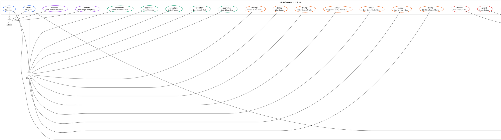

Trong sơ đồ trên, Admin và Chủ trọ được đặt ở bên trái System Boundary vì hai tác nhân này chủ yếu tương tác với các chức năng quản trị và vận hành. Người thuê phòng được đặt ở bên phải vì các use-case của tác nhân này tập trung vào tenant portal, hóa đơn, minh chứng thanh toán, bảo trì và thông báo. Cách bố trí này giúp hạn chế giao nhau giữa các đường association và giữ các use-case ở trung tâm đúng theo bố cục centralized use-case layout.

Bảng sau tóm tắt mối liên hệ giữa tác nhân và nhóm use-case:

| Nhóm use-case | Admin | Chủ trọ | Người thuê phòng |
|---|---:|---:|---:|
| Xác thực | X | X | X |
| Quản trị hệ thống | X |  |  |
| Quản lý khu trọ, phòng, người thuê, hợp đồng |  | X |  |
| Hóa đơn, thanh toán, minh chứng, chi phí |  | X | Xem/gửi minh chứng |
| Bảo trì |  | X | X |
| Báo cáo và thông báo | Xem tổng quan | X | Xem thông báo |
| Tenant portal |  |  | X |

#### 2.4.3. Mô hình lớp và đối tượng

Mô hình lớp xác định các thực thể, thuộc tính quan trọng và quan hệ của hệ thống quản lý nhà trọ. Mô hình đối tượng minh họa cách các thực thể được liên kết tại một thời điểm cụ thể. Tài liệu trình bày một sơ đồ tổng quan, tám sơ đồ lớp chi tiết theo sáu nhóm nghiệp vụ và hai góc nhìn của cùng một ví dụ đối tượng. Mục tiêu là hỗ trợ đọc hiểu thiết kế, đối chiếu đặc tả Use Case và đưa mục 2.4.3 vào báo cáo dự án.

Phạm vi gồm 23 lớp dữ liệu và 39 quan hệ cấu trúc. Sơ đồ tổng quan chỉ chọn 13 lớp và 14 quan hệ trọng tâm; toàn bộ quan hệ trong phạm vi được thể hiện ở các sơ đồ chi tiết và ma trận phụ lục. Tên lớp, tên thuộc tính và kiểu dữ liệu giữ nguyên để tránh sai lệch khi đối chiếu; phần diễn giải sử dụng ngôn ngữ nghiệp vụ.

##### 1 Phạm vi và nguyên tắc mô hình hóa

- Ba vai trò sử dụng trong báo cáo là Admin, Chủ trọ và Người thuê. Vai trò được biểu diễn bằng `User.role`; không tạo ba lớp kế thừa vì mô hình hiện hành không khai báo cấu trúc kế thừa đó.

- Hai lớp `StaffProfile` và `StaffInvite` nằm ngoài phạm vi mô hình của mục này. Giá trị `STAFF` vẫn được giữ trong danh mục `UserRole` để không làm sai tập giá trị đang tồn tại; việc giữ giá trị này không mở rộng phạm vi actor đã chốt.

- Các lớp thể hiện thực thể dữ liệu cùng quan hệ liên kết. Không đưa màn hình, biểu mẫu, lớp xử lý yêu cầu hoặc tích hợp bên ngoài thành thực thể nghiệp vụ nếu không có cấu trúc dữ liệu tương ứng.

- Không bổ sung phương thức như tạo hợp đồng, duyệt minh chứng hoặc tính tiền vào ngăn thao tác của thực thể. Các thao tác này là hành vi xử lý nghiệp vụ, chưa được định nghĩa là phương thức trên các lớp dữ liệu đang mô hình hóa.

- Chỉ sử dụng quan hệ liên kết và tham chiếu theo mã. Không suy ra quan hệ hợp thành hoặc kết tập từ cơ chế xóa dữ liệu liên quan. Bội số mô tả cấu trúc lưu trữ; các giới hạn theo trạng thái hoặc theo thời điểm được giải thích riêng.

- Các thuộc tính trong hình và bảng là thuộc tính chính, không phải toàn bộ từ điển dữ liệu. Việc lược bớt trường định danh liên kết hoặc thời điểm cập nhật không có nghĩa các trường đó không tồn tại.

##### 2 Quy ước đọc sơ đồ

| Ký hiệu | Cách hiểu |
| --- | --- |
| Hộp lớp | Ngăn trên ghi tên lớp, ngăn dưới ghi thuộc tính và kiểu. Không sử dụng dấu cộng hoặc trừ để suy đoán mức truy cập của thuộc tính. |
| Đường liền | Quan hệ cấu trúc đã khai báo giữa hai lớp. Không biểu diễn chiều gọi hàm hoặc trình tự thao tác. |
| Chú thích <<IDRef>> | Tham chiếu theo mã ở lớp nguồn đến loại đối tượng liên quan. Không phải quan hệ khóa ngoại đã khai báo và không gán bội số. |
| 1 | Mỗi đối tượng ở đầu đối diện liên kết với đúng một đối tượng ở đầu có ký hiệu 1. |
| 0..1 | Liên kết là tùy chọn và có tối đa một đối tượng ở đầu được ghi ký hiệu. |
| 0..* | Có thể chưa có hoặc có nhiều đối tượng ở đầu được ghi ký hiệu. |
| `Type?` trong bảng | Giá trị có thể chưa được ghi nhận. Trong hình tương ứng là `Type [0..1]`. |
| `Type[]` trong bảng | Danh sách giá trị. Trong hình tương ứng là `Type [0..*]`. |
| `<<reference>>` | Lớp hoặc đối tượng được nhắc lại để đọc được liên kết trong nhóm hiện tại; không phải một lớp hoặc đối tượng mới. |
| Tên đối tượng được gạch chân | Một đối tượng cụ thể, theo dạng tênĐốiTượng: TênLớp; các dòng phía dưới là giá trị thuộc tính tại thời điểm minh họa. |

Ví dụ: ở quan hệ `Property — Room`, đầu `Property` có bội số 1 và đầu `Room` có bội số 0..*. Mỗi phòng thuộc đúng một khu trọ; một khu trọ có thể chưa có phòng hoặc có nhiều phòng. Ký hiệu 0..* không được thay bằng 1..* chỉ vì màn hình thường hiển thị khu trọ đã có phòng.

##### 3 Sơ đồ lớp miền nghiệp vụ tổng quan (Domain Class Diagram)

Sơ đồ tổng quan tập trung vào chuỗi quản lý khu trọ, phòng, hồ sơ Người thuê, hợp đồng, chỉ số, hóa đơn và thanh toán, cùng các thực thể hỗ trợ tiền cọc, bảo trì, chi phí và lập hóa đơn định kỳ. Các lớp hỗ trợ tài khoản, lịch sử, thông báo và những liên kết bổ sung được tách sang sơ đồ chi tiết để giảm mật độ đường nối.

| Nhóm | Lớp chủ trì | Sơ đồ chi tiết |
| --- | --- | --- |
| Tài khoản và hồ sơ Người thuê | User, Tenant, TenantInvite, RefreshToken | CD-01 |
| Khu trọ và phòng | Property, Room, RoomAsset, RoomInspection, RoomServiceFee | CD-02 |
| Hợp đồng và tiền cọc | Lease, LeaseChange, DepositTransaction | CD-03 |
| Hóa đơn và thanh toán | MeterReading, Invoice, Payment, PaymentProof, BillingAutomation | CD-04A, CD-04B, CD-04C |
| Bảo trì và chi phí | Expense, MaintenanceTicket, MaintenanceComment | CD-05 |
| Thông báo và nhật ký | NotificationRead, NotificationDelivery, AuditLog | CD-06 |

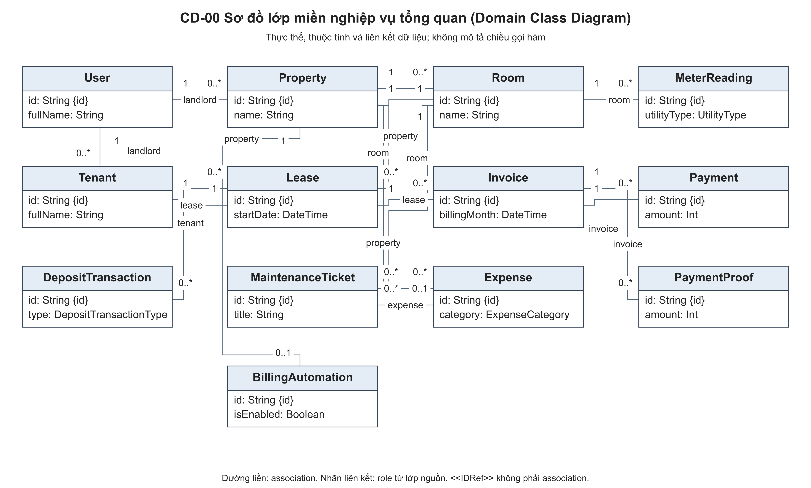

CD-00 — Sơ đồ lớp miền nghiệp vụ tổng quan (Domain Class Diagram). Sơ đồ gồm 13 lớp trọng tâm và 14 quan hệ được chọn. Đây không phải sơ đồ đầy đủ của 23 lớp.

##### 4 Các nhóm lớp chi tiết

###### 4.1 Tài khoản và hồ sơ Người thuê

Tài khoản phục vụ nhận diện người dùng và phiên đăng nhập; hồ sơ Người thuê phục vụ quản lý người thuê thuộc một Chủ trọ. Hai khái niệm này phải được phân biệt vì Chủ trọ có thể tạo hồ sơ trước khi Người thuê nhận lời mời và có tài khoản truy cập.

| Lớp và tên nghiệp vụ | Trách nhiệm | Thuộc tính chính |
| --- | --- | --- |
| `User`<br>Tài khoản người dùng | Xác định danh tính đăng nhập và vai trò; một tài khoản không đồng nhất với hồ sơ Người thuê. | `id: String`; `fullName: String`; `email: String`; `phone: String?`; `role: UserRole`; `isActive: Boolean` |
| `Tenant`<br>Hồ sơ Người thuê | Lưu thông tin người thuê do Chủ trọ quản lý; có thể chưa liên kết tài khoản truy cập. | `id: String`; `fullName: String`; `phone: String?`; `idNumber: String?`; `isActive: Boolean` |
| `TenantInvite`<br>Lời mời kích hoạt | Ghi lời mời gắn với hồ sơ Người thuê, email được mời, hạn sử dụng và thời điểm chấp nhận. | `id: String`; `email: String`;  `expiresAt: DateTime`; `acceptedAt: DateTime?` |
| `RefreshToken`<br>Phiên làm mới đăng nhập | Lưu thông tin phiên làm mới của một tài khoản, phục vụ duy trì và thu hồi phiên. | `id: String`;  `expiresAt: DateTime`; `revokedAt: DateTime?` |

Quan hệ `Tenant.landlord` xác định Chủ trọ quản lý hồ sơ: mỗi hồ sơ có một Chủ trọ, mỗi Chủ trọ có thể quản lý nhiều hồ sơ. Quan hệ `Tenant.user` là liên kết tài khoản truy cập tùy chọn và duy nhất, có bội số 0..1 ở cả hai đầu. Một tài khoản có thể chưa có hồ sơ Người thuê; một hồ sơ có thể chưa có tài khoản truy cập.

Mỗi lời mời gắn với một hồ sơ Người thuê và một Chủ trọ; một hồ sơ có thể có nhiều bản ghi lời mời theo lịch sử. `acceptedAt` có thể chưa được ghi nhận khi lời mời chưa được chấp nhận. Mỗi phiên làm mới thuộc một tài khoản; `revokedAt` để trống không phải là kết luận phiên luôn còn hiệu lực, vì còn phải xét `expiresAt`.

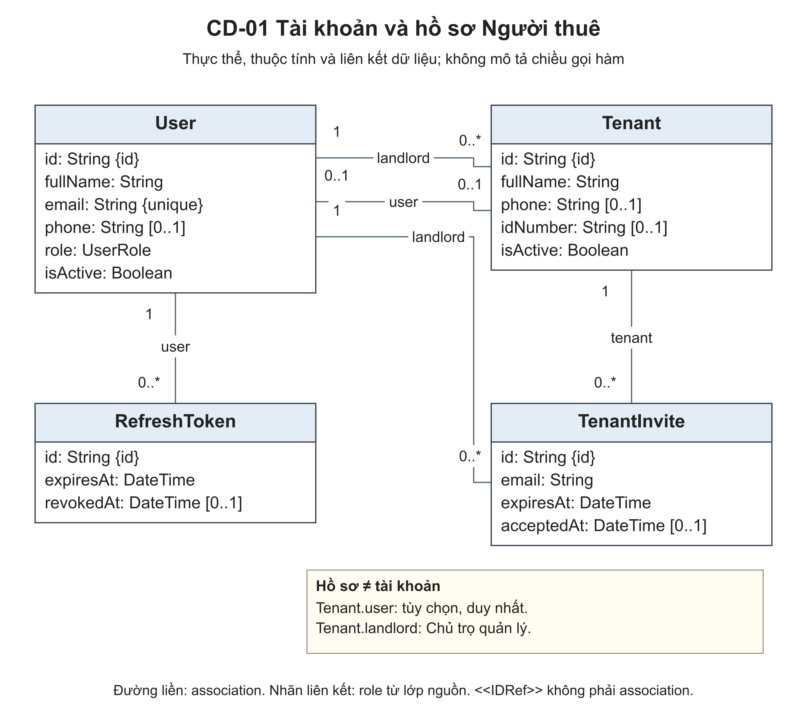

CD-01 — Phân biệt liên kết quản lý hồ sơ và liên kết tài khoản truy cập của Người thuê.

###### 4.2 Khu trọ và phòng

Khu trọ là đơn vị quản lý các phòng. Tài sản, phí dịch vụ và lịch kiểm tra đều gắn với từng phòng; không được gộp phí dịch vụ vào chỉ số điện nước hoặc xem lịch kiểm tra là một trường trên hồ sơ phòng.

| Lớp và tên nghiệp vụ | Trách nhiệm | Thuộc tính chính |
| --- | --- | --- |
| `Property`<br>Khu trọ | Nhóm các phòng thuộc một Chủ trọ và ghi nhận tình trạng lưu trữ của khu trọ. | `id: String`; `name: String`; `address: String`; `isArchived: Boolean` |
| `Room`<br>Phòng trọ | Ghi thông tin phòng, giá tham khảo và trạng thái vận hành; trạng thái sử dụng được quản lý riêng. | `id: String`; `name: String`; `basePrice: Int`; `status: RoomStatus`; `isActive: Boolean`; `capacity: Int?` |
| `RoomAsset`<br>Tài sản phòng | Theo dõi tài sản, số lượng, tình trạng và giá trị của tài sản trong một phòng. | `id: String`; `name: String`; `quantity: Int`; `condition: String`; `value: Int?` |
| `RoomInspection`<br>Lịch kiểm tra phòng | Lưu nội dung kiểm tra, ngày dự kiến và thời điểm hoàn tất của một phòng. | `id: String`; `title: String`; `dueAt: DateTime`; `completedAt: DateTime?` |
| `RoomServiceFee`<br>Phí dịch vụ phòng | Ghi khoản phí dịch vụ và tình trạng áp dụng theo từng phòng. | `id: String`; `name: String`; `amount: Int`; `isActive: Boolean`; `note: String?` |

Mỗi khu trọ thuộc một Chủ trọ; mỗi phòng thuộc một khu trọ. Một phòng có thể chưa có hoặc có nhiều tài sản, phí dịch vụ và lịch kiểm tra. `Room.status` biểu diễn Trống, Đang thuê hoặc Bảo trì; `Room.isActive` biểu diễn phòng đang được sử dụng hay ngừng sử dụng trong quản lý. `Property.isArchived` là tình trạng lưu trữ khu trọ, không được đồng nhất với trạng thái của phòng.

`Room.basePrice` là giá phòng tham khảo; tiền thuê áp dụng theo hợp đồng nằm ở `Lease.monthlyRent`. `RoomServiceFee.amount` là số tiền của khoản phí; không đổi trường này thành `unitPrice`. Tình trạng tài sản được lưu bằng `RoomAsset.condition` kiểu chuỗi; không bổ sung một tập trạng thái chuẩn nếu chưa được thống nhất.

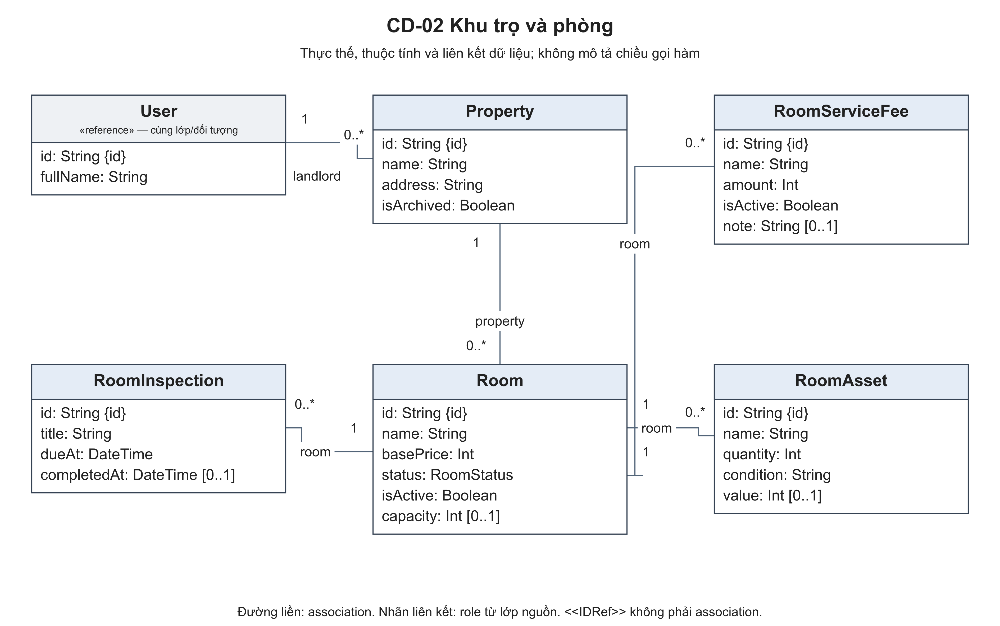

CD-02 — Tài sản, phí dịch vụ và lịch kiểm tra là ba loại dữ liệu riêng của phòng.

###### 4.3 Hợp đồng và tiền cọc

Hợp đồng kết nối một phòng và một hồ sơ Người thuê. Lịch sử thay đổi và giao dịch tiền cọc giúp theo dõi diễn biến của hợp đồng mà không làm mất thông tin đã ghi nhận.

| Lớp và tên nghiệp vụ | Trách nhiệm | Thuộc tính chính |
| --- | --- | --- |
| `Lease`<br>Hợp đồng thuê | Liên kết một phòng với một hồ sơ Người thuê và ghi điều khoản thuê, tình trạng hiệu lực. | `id: String`; `startDate: DateTime`; `endDate: DateTime?`; `monthlyRent: Int`; `deposit: Int`; `status: LeaseStatus` |
| `LeaseChange`<br>Lịch sử thay đổi hợp đồng | Lưu loại thay đổi, giá trị trước và sau cùng thời điểm ghi nhận. | `id: String`; `changeType: String`; `previousValues: Json`; `newValues: Json`; `note: String?`; `createdAt: DateTime` |
| `DepositTransaction`<br>Giao dịch tiền cọc | Theo dõi giao dịch thu, hoàn, khấu trừ hoặc điều chỉnh cọc; không đồng nhất với tiền cọc thỏa thuận. | `id: String`; `type: DepositTransactionType`; `amount: Int`; `occurredAt: DateTime`; `note: String?` |

Mỗi hợp đồng có đúng một phòng và một hồ sơ Người thuê. Mỗi phòng và mỗi hồ sơ có thể có nhiều hợp đồng trong lịch sử, nên bội số tại đầu `Lease` là 0..*. Kiểm tra không cho lập thêm hợp đồng hiệu lực trên cùng một phòng là giới hạn khi xử lý nghiệp vụ, không thay bội số lịch sử thành 0..1. Chính sách nhiều hợp đồng hiệu lực của một Người thuê vẫn thuộc điểm PX-02 cần xác nhận.

`Lease.deposit` ghi tiền cọc thỏa thuận. `DepositTransaction` ghi từng lần thu, hoàn, khấu trừ hoặc điều chỉnh; không sử dụng trực tiếp tiền cọc thỏa thuận để khẳng định số cọc đã thu hoặc số dư cọc. Mỗi giao dịch cọc có một hợp đồng và một Chủ trọ. Mỗi thay đổi hợp đồng cũng có một hợp đồng và một Chủ trọ; `previousValues` và `newValues` lưu dữ liệu trước và sau dưới dạng `Json`.

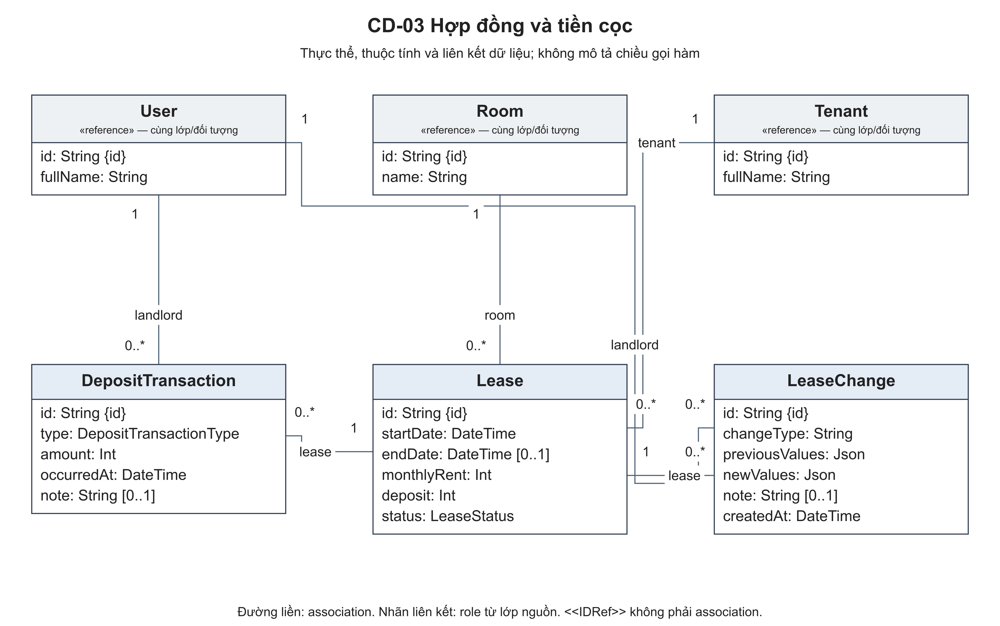

CD-03 — Bội số phản ánh lịch sử hợp đồng; số hợp đồng hiệu lực được kiểm tra riêng theo trạng thái.

###### 4.4 Hóa đơn và thanh toán

Nhóm này được chia thành ba sơ đồ để tách dữ liệu đầu vào tính tiền, kết quả thu tiền và cấu hình lập hóa đơn định kỳ. Các hộp tham chiếu đến Room, Lease, Tenant, User và Property là các lớp đã được định nghĩa ở những nhóm trước.

###### 4.4.1 Chỉ số và hóa đơn

| Lớp và tên nghiệp vụ | Trách nhiệm | Thuộc tính chính |
| --- | --- | --- |
| `MeterReading`<br>Chỉ số dịch vụ | Mỗi bản ghi lưu một loại dịch vụ điện hoặc nước của một phòng trong một kỳ. | `id: String`; `utilityType: UtilityType`; `billingMonth: DateTime`; `previousReading: Int`; `currentReading: Int`; `unitPrice: Int`; `usage: Int`; `amount: Int` |
| `Invoice`<br>Hóa đơn | Ghi các thành phần tiền và tình trạng thu tiền của một hợp đồng theo kỳ tính. | `id: String`; `billingMonth: DateTime`; `totalAmount: Int`; `paidAmount: Int`; `status: InvoiceStatus`; `dueDate: DateTime?` |

Một bản ghi `MeterReading` chỉ lưu một loại dịch vụ, xác định bằng `utilityType`, cho một phòng trong một kỳ. Điện và nước cần hai bản ghi riêng. Các thuộc tính là `previousReading`, `currentReading`, `unitPrice`, `usage` và `amount`; không có bốn trường cũ mới riêng cho điện nước trong cùng bản ghi. Tổ hợp phòng, loại dịch vụ và kỳ được xác định duy nhất.

Mỗi hóa đơn liên kết trực tiếp với một hợp đồng, một phòng và một hồ sơ Người thuê. Tổ hợp hợp đồng và kỳ hóa đơn được xác định duy nhất. Các thành phần tiền gồm `rentAmount`, `electricityAmount`, `waterAmount`, `otherAmount`; `totalAmount` là tổng tiền và `paidAmount` là tiền đã ghi nhận thu. Không vẽ liên kết trực tiếp Invoice — MeterReading vì hóa đơn không lưu mã bản ghi chỉ số; việc đối chiếu chỉ số thực hiện theo phòng, loại dịch vụ và kỳ tính.

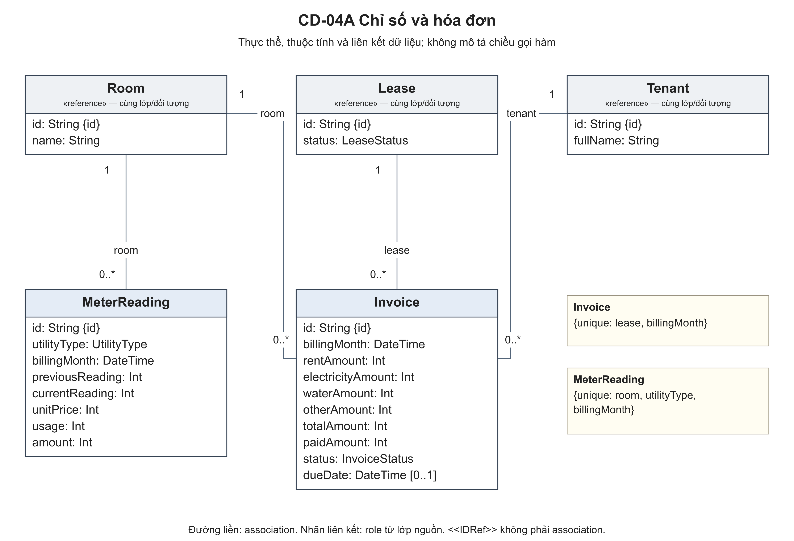

CD-04A — Bản ghi chỉ số và hóa đơn cùng liên quan đến phòng nhưng không có liên kết trực tiếp giữa hai lớp.

###### 4.4.2 Thanh toán và minh chứng

| Lớp và tên nghiệp vụ | Trách nhiệm | Thuộc tính chính |
| --- | --- | --- |
| `Payment`<br>Khoản thanh toán | Ghi tiền đã thu hoặc khoản đảo của một khoản thu; giữ liên kết với hóa đơn. | `id: String`; `amount: Int`; `method: PaymentMethod`; `type: PaymentType`;  `paidAt: DateTime` |
| `PaymentProof`<br>Minh chứng thanh toán | Ghi thông tin Người thuê gửi để đối soát và quyết định duyệt; chưa đồng nghĩa tiền đã thu. | `id: String`; `amount: Int`; `method: PaymentMethod`; `status: PaymentProofStatus`; `submittedAt: DateTime`; `reviewedAt: DateTime?`; `reviewNote: String?` |

Mỗi khoản thanh toán thuộc một hóa đơn. Khoản thu thông thường có `type = PAYMENT`; khoản đảo có `type = REVERSAL` và liên kết tùy chọn đến khoản gốc bằng `reversalOfPaymentId`. Mỗi khoản gốc được liên kết tối đa một khoản đảo và mỗi khoản đảo liên kết tối đa một khoản gốc, nên quan hệ tự liên kết có bội số 0..1 ở cả hai đầu. Khoản đảo được ghi bằng số tiền âm để bù khoản gốc, không xóa khoản thu gốc.

Mỗi minh chứng thuộc một hóa đơn và một hồ sơ Người thuê; tài khoản duyệt là liên kết tùy chọn. Trạng thái Chờ duyệt không làm tăng `Invoice.paidAmount`. Khi được duyệt hợp lệ, hệ thống ghi khoản thu và cập nhật hóa đơn. Minh chứng không có trường mã khoản thanh toán được tạo, vì vậy không vẽ quan hệ trực tiếp PaymentProof — Payment. Việc hai dữ liệu cùng liên quan đến một hóa đơn không tạo ra liên kết một một giữa chúng.

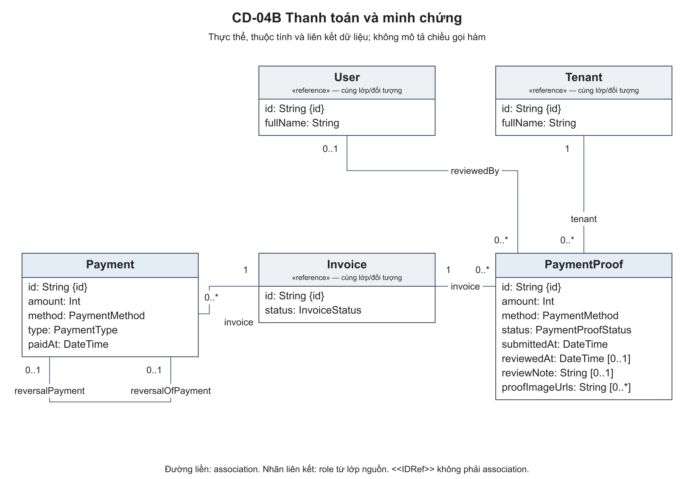

CD-04B — Phân biệt minh chứng gửi để đối soát với khoản thu đã được ghi nhận; thể hiện quan hệ tự liên kết khi đảo khoản thu.

###### 4.4.3 Cấu hình lập hóa đơn định kỳ

| Lớp và tên nghiệp vụ | Trách nhiệm | Thuộc tính chính |
| --- | --- | --- |
| `BillingAutomation`<br>Cấu hình lập hóa đơn định kỳ | Ghi bật tắt, ngày lập, ngày đến hạn và thông tin lần chạy theo khu trọ. | `id: String`; `isEnabled: Boolean`; `invoiceDay: Int`; `dueDay: Int`; `lastRunMonth: DateTime?`; `lastRunAt: DateTime?` |

Mỗi cấu hình thuộc một khu trọ và một Chủ trọ. Một khu trọ có thể chưa có cấu hình hoặc có tối đa một cấu hình, do mã khu trọ là duy nhất trong lớp này. `invoiceDay` và `dueDay` là ngày thiết lập để lập hóa đơn và xác định hạn thu; `lastRunMonth` và `lastRunAt` có thể chưa có trước lần chạy đầu tiên. Lớp này là cấu hình và thông tin lần chạy, không phải lớp hóa đơn và không có liên kết trực tiếp tới từng Invoice.

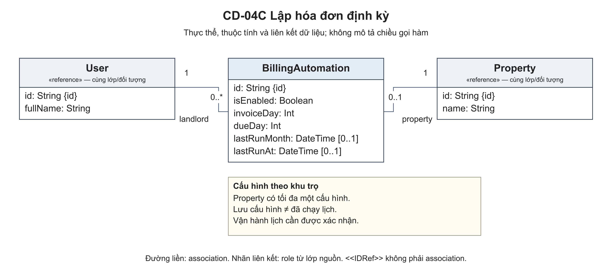

CD-04C — Một khu trọ có tối đa một cấu hình lập hóa đơn định kỳ.

###### 4.5 Bảo trì và chi phí

Yêu cầu bảo trì theo dõi sự cố và quá trình xử lý; khoản chi theo dõi số tiền vận hành. Hai dữ liệu có thể liên quan nhưng không mặc định mỗi yêu cầu bảo trì đã có khoản chi.

| Lớp và tên nghiệp vụ | Trách nhiệm | Thuộc tính chính |
| --- | --- | --- |
| `Expense`<br>Khoản chi vận hành | Lưu chi phí của khu trọ; có thể gắn thêm phòng và được liên kết từ yêu cầu bảo trì. | `id: String`; `category: ExpenseCategory`; `amount: Int`; `expenseDate: DateTime`; `title: String` |
| `MaintenanceTicket`<br>Yêu cầu bảo trì | Ghi sự cố, trạng thái, ngày xử lý và chi phí theo phòng, khu trọ; không có liên kết trực tiếp đến Tenant. | `id: String`; `title: String`; `status: MaintenanceStatus`; `priority: MaintenancePriority`; `reportedAt: DateTime`; `actualCost: Int?`; `expenseId: String?` |
| `MaintenanceComment`<br>Trao đổi bảo trì | Lưu nội dung phản hồi, ảnh và tác giả là tài khoản người dùng trong một yêu cầu bảo trì. | `id: String`; `body: String`; `authorRole: UserRole`; `imageUrls: String[]`; `createdAt: DateTime` |

Mỗi khoản chi có một Chủ trọ và một khu trọ; liên kết tới phòng là tùy chọn. Mỗi yêu cầu bảo trì có một Chủ trọ, một khu trọ và một phòng; liên kết tới khoản chi là tùy chọn. Cấu trúc hiện hành không đặt mã khoản chi là duy nhất trên yêu cầu bảo trì, nên một khoản chi có thể được 0..* yêu cầu bảo trì tham chiếu. Không tự đổi quan hệ này thành một một.

Yêu cầu bảo trì không có thuộc tính `tenantId` hoặc quan hệ trực tiếp đến `Tenant`. Người thuê có thể gửi yêu cầu thông qua phòng và hợp đồng của mình, nhưng hành vi này không tạo thêm một quan hệ lưu trữ. Mỗi phản hồi có một yêu cầu bảo trì và một tài khoản tác giả; nội dung phản hồi là `body`, ảnh đính kèm là `imageUrls` và vai trò người gửi được lưu ở `authorRole`.

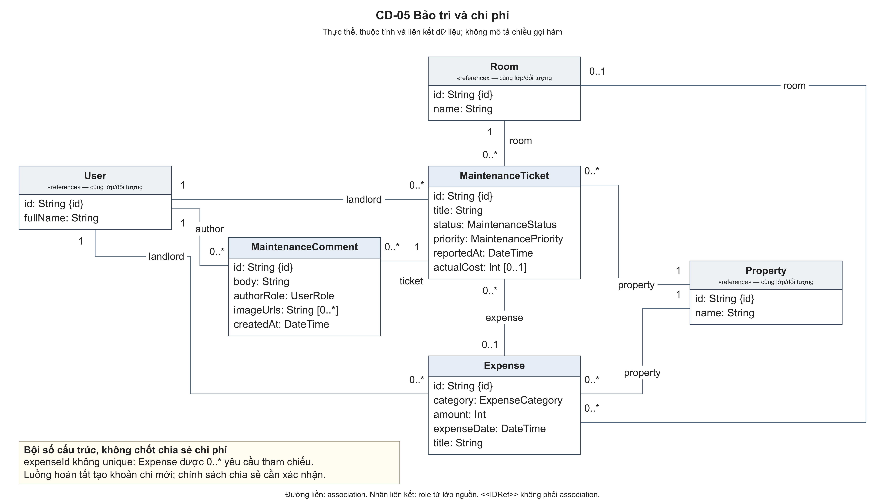

CD-05 — Yêu cầu bảo trì, trao đổi và khoản chi là các thực thể riêng; không bổ sung liên kết trực tiếp đến hồ sơ Người thuê.

###### 4.6 Thông báo và nhật ký

Nhóm này phân biệt thông tin lượt gửi, dấu đã đọc và lịch sử thao tác. Các thông tin này không được gộp thành một lớp Notification nếu chưa có thực thể dữ liệu tương ứng.

| Lớp và tên nghiệp vụ | Trách nhiệm | Thuộc tính chính |
| --- | --- | --- |
| `NotificationRead`<br>Dấu đã đọc thông báo | Ghi mã thông báo đã đọc cho từng tài khoản; không phải quan hệ đến một lớp Notification riêng. | `id: String`; `notificationId: String`; `readAt: DateTime` |
| `NotificationDelivery`<br>Lượt gửi thông báo | Ghi người nhận, kênh, mục đích và kết quả gửi; các mã liên quan chưa khai báo quan hệ trực tiếp. | `id: String`; `channel: NotificationDeliveryChannel`; `purpose: String`; `recipient: String`; `status: NotificationDeliveryStatus`; `sentAt: DateTime?`; `errorCode: String?` |
| `AuditLog`<br>Nhật ký thao tác | Ghi người thực hiện, vai trò, phạm vi Chủ trọ và đối tượng được mô tả bằng loại cùng mã. | `id: String`; `actorRole: UserRole`; `action: String`; `resourceType: String`; `resourceId: String?`; `summary: String`; `createdAt: DateTime` |

`NotificationDelivery.recipient` là chuỗi địa chỉ hoặc thông tin người nhận, không phải `recipientId` liên kết đến User. Các trường `landlordId`, `tenantId` và `invoiceId` là tham chiếu bằng mã nhưng chưa có quan hệ cấu trúc khai báo. Sơ đồ ghi các trường mã và chú thích <<IDRef>>, không vẽ đường nối tới các lớp ngữ cảnh. Tham chiếu bằng mã định danh trong dữ liệu; không phải structural association UML.

`NotificationRead` chỉ có quan hệ cấu trúc đến tài khoản. `notificationId` là chuỗi nhận diện thông báo, có thể là mã thông báo được tổng hợp hoặc mã lượt gửi trong luồng đọc tin nhắn. Mặc dù một luồng sử dụng mã lượt gửi, lớp này không có quan hệ khai báo đến `NotificationDelivery`; không vẽ đường liên kết cấu trúc giữa hai lớp. Một tài khoản chỉ có tối đa một dấu đã đọc cho cùng một mã thông báo.

`AuditLog.actor` là tài khoản thực hiện; `AuditLog.landlord` là tài khoản xác định phạm vi Chủ trọ. Đây là hai vai trò liên kết khác nhau và đều tùy chọn; mỗi tài khoản có thể xuất hiện trong nhiều bản ghi theo từng vai trò. `resourceType` và `resourceId` mô tả đối tượng được tác động bằng loại và mã, không tạo quan hệ trực tiếp từ AuditLog đến mọi lớp nghiệp vụ.

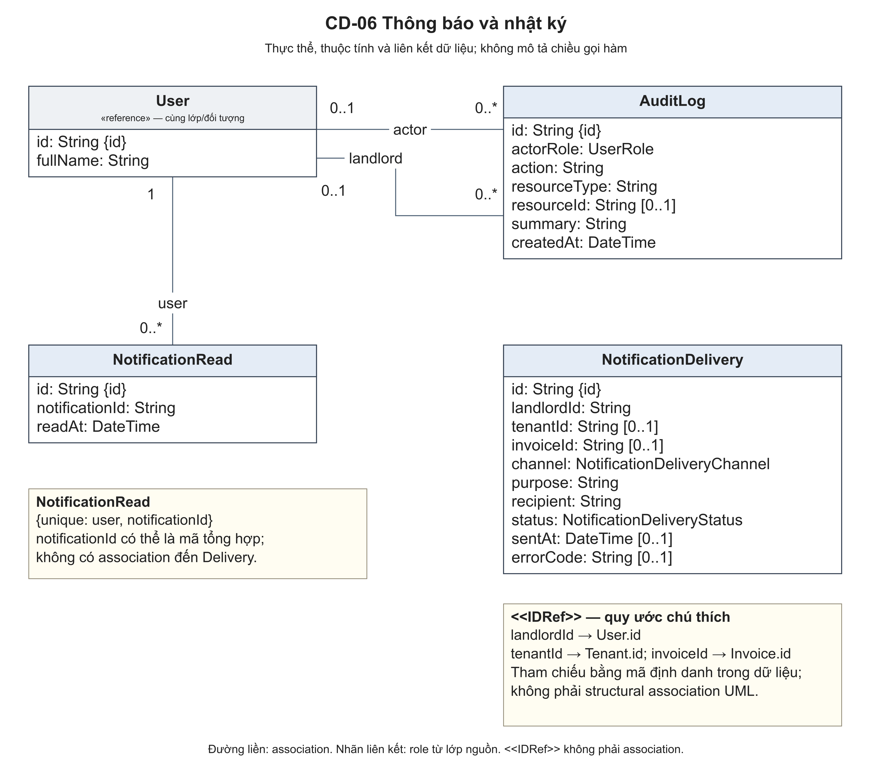

CD-06 — Tách quan hệ tài khoản của dấu đã đọc và nhật ký khỏi các tham chiếu theo mã của lượt gửi.

##### 5 Các ràng buộc cần đọc cùng sơ đồ

| Mã | Ràng buộc hoặc ý nghĩa | Tác động đến cách hiểu |
| --- | --- | --- |
| CL-01 | Tài khoản và hồ sơ Người thuê là hai thực thể; liên kết tài khoản truy cập là tùy chọn và duy nhất. | Không tạo Tenant bắt buộc cho mọi User; không đồng nhất người quản lý hồ sơ với tài khoản của Người thuê. |
| CL-02 | Phòng có nhiều hợp đồng theo lịch sử. Xử lý lập hợp đồng kiểm tra phòng chưa có hợp đồng hiệu lực. | Bội số Room — Lease là 1 và 0..*, không phải 1 và 0..1. Đây là kiểm tra khi xử lý, không phải ràng buộc duy nhất tổng quát trên roomId. |
| CL-03 | Phòng và hồ sơ phải còn được sử dụng; khu trọ chưa lưu trữ khi lập hợp đồng. | Không rút gọn điều kiện thành “phòng Trống” khi chính sách trạng thái Bảo trì chưa thống nhất tại PX-02. |
| CL-04 | Tiền cọc thỏa thuận và giao dịch cọc được lưu riêng. | Thu, hoàn, khấu trừ và điều chỉnh là lịch sử giao dịch. Cách ghi nhận thu cọc khi lập hợp đồng cần chốt tại PX-03. |
| CL-05 | Một bản ghi chỉ số cho mỗi tổ hợp phòng, loại dịch vụ và kỳ. | Không gộp điện nước vào bốn trường của một MeterReading. Chênh lệch chỉ số tạo usage; usage nhân unitPrice tạo amount. |
| CL-06 | Một hóa đơn cho mỗi tổ hợp hợp đồng và kỳ. | Tính duy nhất áp dụng theo leaseId và billingMonth; không chuyển sang tính duy nhất toàn hệ thống theo tháng. |
| CL-07 | Minh chứng Chờ duyệt chưa là khoản thu. Duyệt hợp lệ mới ghi nhận thanh toán và cập nhật hóa đơn. | Không cộng tiền của PaymentProof đang PENDING vào paidAmount. Không suy ra quan hệ trực tiếp PaymentProof — Payment. |
| CL-08 | Một khoản thu gốc được đảo tối đa một lần trong luồng xử lý hiện hành; khoản đảo không được đảo tiếp. | Giữ khoản gốc, tạo khoản REVERSAL có amount âm và liên kết tới khoản gốc. |
| CL-09 | Mỗi khu trọ có tối đa một cấu hình lập hóa đơn định kỳ. | Bội số Property — BillingAutomation là 1 và 0..1, không phải một nhiều. |
| CL-10 | Một yêu cầu bảo trì có thể chưa gắn khoản chi; expenseId không được đặt duy nhất. | Một Expense có thể được nhiều yêu cầu tham chiếu ở mức cấu trúc. Nếu nghiệp vụ muốn một một, cần quyết định và thay đổi riêng. |
| CL-11 | Các mã ngữ cảnh trong lượt gửi và mã đối tượng trong nhật ký không phải toàn bộ là quan hệ cấu trúc. | Không vẽ đường liền chỉ dựa vào tên trường có hậu tố Id. |

##### 6 Mô hình đối tượng minh họa

Ví dụ sau là dữ liệu giả định tại ngày 6 tháng 10 năm 2026, không được trích từ dữ liệu vận hành. Các mã như ct01, phongA01 và hopDong01 là ký hiệu rút gọn để đọc sơ đồ, không phải mã UUID hợp lệ. Sơ đồ chỉ chọn một số thuộc tính và liên kết; không sử dụng trực tiếp làm dữ liệu khởi tạo hoặc nội dung yêu cầu gửi lên hệ thống.

Một Chủ trọ quản lý Khu trọ A; phòng A01 đang có hợp đồng hiệu lực với một hồ sơ Người thuê đã liên kết tài khoản truy cập. Hợp đồng bắt đầu ngày 1 tháng 10 năm 2026, tiền thuê 3.000.000 đồng và tiền cọc thỏa thuận 0 đồng. Chọn cọc 0 trong ví dụ để không giả định quyết định đang chờ xác nhận ở PX-03.

| Đối tượng | Lớp | Giá trị hoặc liên kết quan trọng |
| --- | --- | --- |
| chuTro01 | User | role = LANDLORD; isActive = true |
| taiKhoanThue01 | User | role = TENANT; isActive = true |
| khuA | Property | name = Khu trọ A; landlord = chuTro01 |
| phongA01 | Room | name = A01; property = khuA; status = OCCUPIED; basePrice = 3.000.000 |
| hoSo01 | Tenant | landlord = chuTro01; user = taiKhoanThue01; isActive = true |
| hopDong01 | Lease | room = phongA01; tenant = hoSo01; monthlyRent = 3.000.000; deposit = 0; status = ACTIVE |
| chiSoDien01 | MeterReading | room = phongA01; utilityType = ELECTRICITY; billingMonth = 2026-10-01 |
| chiSoNuoc01 | MeterReading | room = phongA01; utilityType = WATER; billingMonth = 2026-10-01 |
| hoaDon01 | Invoice | lease = hopDong01; room = phongA01; tenant = hoSo01; totalAmount = 3.120.000; paidAmount = 2.000.000; status = PARTIAL |
| khoanThu01 | Payment | invoice = hoaDon01; amount = 2.000.000; method = BANK_TRANSFER; type = PAYMENT; paidAt = 2026-10-05 |
| minhChung01 | PaymentProof | invoice = hoaDon01; tenant = hoSo01; amount = 1.120.000; status = PENDING; submittedAt = 2026-10-06 |

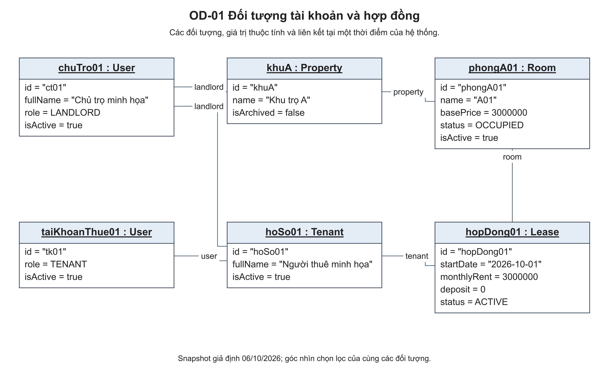

OD-01 — Góc nhìn tài khoản, khu trọ, phòng, hồ sơ và hợp đồng của ví dụ giả định.

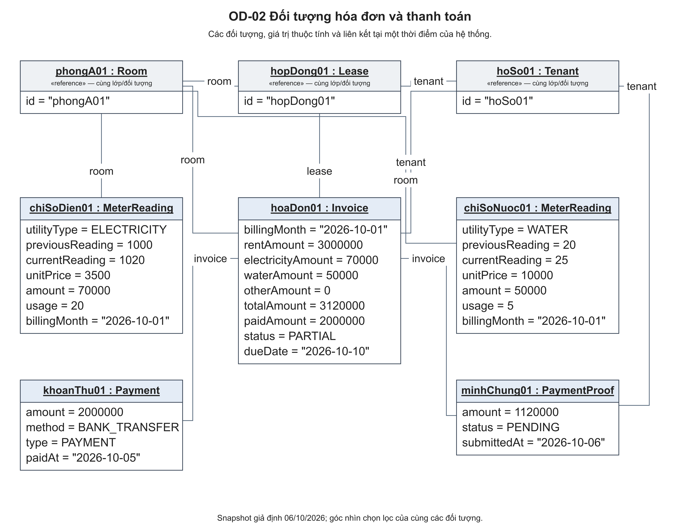

OD-02 — Góc nhìn chỉ số, hóa đơn, khoản thu và minh chứng của cùng ví dụ; các hộp tham chiếu là cùng các đối tượng ở OD-01.

| Thành phần | Cách tính hoặc căn cứ | Số tiền đồng |
| --- | --- | --- |
| Tiền phòng | Tiền thuê tháng của hợp đồng | 3.000.000 |
| Tiền điện | (1.020 − 1.000) × 3.500 = 20 × 3.500 | 70.000 |
| Tiền nước | (25 − 20) × 10.000 = 5 × 10.000 | 50.000 |
| Khoản khác | Không phát sinh trong ví dụ | 0 |
| Tổng hóa đơn | 3.000.000 + 70.000 + 50.000 + 0 | 3.120.000 |
| Đã ghi nhận thu | Khoản thu khoanThu01 ngày 5 tháng 10 năm 2026 | 2.000.000 |
| Còn phải thu | 3.120.000 − 2.000.000 | 1.120.000 |
| Minh chứng Chờ duyệt | minhChung01 gửi để đối soát, chưa cộng vào tiền đã thu | 1.120.000 |

Tại thời điểm minh họa, hóa đơn vẫn ở trạng thái Thanh toán một phần vì chỉ có 2.000.000 đồng được ghi nhận thu. Minh chứng 1.120.000 đồng đang Chờ duyệt không làm hóa đơn chuyển thành Đã thanh toán. Kỳ 2026-10-01 biểu diễn tháng 10 năm 2026; ngày đến hạn của hóa đơn trong ví dụ là 10 tháng 10 năm 2026. Đây là ảnh chụp trạng thái, không phải biểu đồ trình tự duyệt minh chứng.

##### 7 Liên hệ với đặc tả Use Case

Bảng dưới đây chọn các Use Case tiêu biểu đã có trong đặc tả để truy vết từ chức năng đến dữ liệu. Một Use Case có thể sử dụng nhiều nhóm lớp; bảng này không phân chia cứng trách nhiệm và không thay thế danh mục 67 Use Case.

| Nhóm dữ liệu | Use Case tiêu biểu | Lớp liên quan |
| --- | --- | --- |
| Tài khoản và hồ sơ | UC-SYS-01; UC-SYS-01.01; UC-SYS-02; UC-OPT-04.06; UC-TEN-01 | User, RefreshToken, Tenant, TenantInvite |
| Khu trọ và phòng | UC-OPT-02.01; UC-OPT-03.02; UC-OPT-03.07; UC-OPT-03.08; UC-OPT-03.09 | Property, Room, RoomAsset, RoomServiceFee, RoomInspection |
| Hợp đồng và tiền cọc | UC-OPT-05.02; UC-OPT-05.03; UC-OPT-05.04; UC-OPT-05.06; UC-TEN-02 | Lease, LeaseChange, DepositTransaction, Room, Tenant |
| Hóa đơn và thanh toán | UC-BIL-01; UC-BIL-02.01; UC-BIL-02.07; UC-BIL-03.01; UC-BIL-04; UC-TEN-04 | MeterReading, Invoice, BillingAutomation, Payment, PaymentProof |
| Bảo trì và chi phí | UC-OPT-06.01; UC-OPT-06.04; UC-BIL-05.02; UC-TEN-05.01; UC-TEN-05.02 | MaintenanceTicket, MaintenanceComment, Expense |
| Thông báo và nhật ký | UC-BIL-07.01; UC-BIL-07.02; UC-TEN-06; UC-ADM-02.04 | NotificationRead, NotificationDelivery, AuditLog, User |

##### 8 Các điểm cần xác nhận và giới hạn

Mô hình mô tả cấu trúc hiện hành, không thay thế quyết định nghiệp vụ và không chứng nhận mọi xử lý đã được nghiệm thu. Các điểm dưới đây kế thừa mã PX trong đặc tả Use Case để tránh âm thầm chọn một cách diễn giải mới.

| Điểm | Nội dung cần xác nhận | Cách xử lý trong tài liệu này |
| --- | --- | --- |
| PX-01 | Có cho phép giá thuê 0 đồng hay không; yêu cầu nhập liệu và xử lý tiếp nhận chưa thống nhất. | Giữ monthlyRent kiểu Int; không tự đưa điều kiện lớn hơn 0 thành ràng buộc chung của lớp. Ví dụ sử dụng giá thuê dương. |
| PX-02 | Phòng Bảo trì có được lập hợp đồng không; một Người thuê có được nhiều hợp đồng hiệu lực không. | Giữ bội số lịch sử 0..*. Không tuyên bố phòng đủ điều kiện luôn phải là phòng Trống; không tự giới hạn Tenant — Lease thành một một. |
| PX-03 | Nhập tiền cọc khi lập hợp đồng là tiền cọc thỏa thuận hay khoản đã thực thu. | Mô hình giữ Lease.deposit riêng DepositTransaction. Xử lý hiện tại tạo khoản Thu cọc ban đầu nếu cọc dương; chính sách vẫn cần xác nhận. |
| PX-32 | Khi thay khu trọ của khoản chi nhưng giữ phòng cũ, chưa bảo đảm phòng còn thuộc khu trọ đã chọn. | Quan hệ riêng đến Property và Room chưa bảo đảm tính nhất quán giữa hai liên kết. Ghi nhận thiếu sót, không khẳng định đã sửa mã nguồn. |
| Quan hệ tham chiếu bằng mã | Có nâng các mã ngữ cảnh của lượt gửi thành quan hệ cấu trúc hay không. | Giữ chú thích <<IDRef>>, không vẽ đường nối và không gán bội số. Nếu bổ sung khóa ngoại, cần cập nhật mô hình sau thay đổi thiết kế. |
| Bảo trì và khoản chi | Có yêu cầu một khoản chi chỉ được gắn với một yêu cầu bảo trì hay không. | Chưa có ràng buộc duy nhất expenseId; giữ bội số 0..* ở đầu MaintenanceTicket. Không tự áp đặt quy tắc một một. |

Các lớp không có ngăn phương thức không có nghĩa hệ thống không có hành vi. Hành vi được phân tích trong đặc tả Use Case và biểu đồ tuần tự; nếu cần sơ đồ lớp thiết kế ở mức xử lý, phải lập một sơ đồ khác và chỉ bổ sung các phương thức có định nghĩa thực. Mô hình này không liệt kê toàn bộ quy tắc kiểm tra đầu vào, không mô tả chuyển trạng thái đầy đủ và không suy đoán chính sách chưa được chốt.

##### 9 Nhật ký hiệu chỉnh mô hình cũ

Bảng ghi những thay đổi so với nội dung mục 2.4.3 trước lần triển khai này. Đây là hiệu chỉnh tài liệu, không phải danh sách thay đổi mã nguồn hoặc hiệu chỉnh lại 67 Use Case.

| Mã | Nội dung trước | Nội dung sau và lý do |
| --- | --- | --- |
| CD-HC-01 | RoomServiceFee có unitPrice. | Đổi thành amount kiểu Int, đúng thuộc tính khoản phí đang tồn tại. |
| CD-HC-02 | MeterReading có oldElectric, newElectric, oldWater, newWater. | Thay bằng utilityType, previousReading, currentReading, unitPrice, usage, amount và billingMonth; một bản ghi cho một loại dịch vụ. |
| CD-HC-03 | MaintenanceTicket có tenantId và quan hệ đến Tenant. | Bỏ thuộc tính và quan hệ không tồn tại; bổ sung liên kết thực đến User, Property, Room và Expense tùy chọn. |
| CD-HC-04 | MaintenanceComment sử dụng content. | Đổi thành body; giữ tác giả, vai trò tác giả và ảnh theo cấu trúc hiện hành. |
| CD-HC-05 | NotificationDelivery có recipientId và được nối đến User như người nhận. | Đổi thành recipient kiểu String; các mã landlordId, tenantId, invoiceId được thể hiện bằng chú thích <<IDRef>>, không vẽ đường nối, không gán bội số. |
| CD-HC-06 | Liên kết tài khoản của Tenant thể hiện một User bắt buộc. | Sửa quan hệ truy cập thành 0..1 ở cả hai đầu; tách rõ với quan hệ Chủ trọ quản lý hồ sơ. |
| CD-HC-07 | Quan hệ AuditLog chỉ thể hiện người thực hiện bắt buộc. | Tách actor và landlord, đều có bội số 0..1 tại đầu User; phân biệt tài khoản thực hiện và phạm vi Chủ trọ. |
| CD-HC-08 | Thiếu hộp RoomInspection, DepositTransaction, BillingAutomation và RefreshToken. | Bổ sung bốn lớp cùng thuộc tính và liên kết. RefreshToken trước đây chỉ được nhắc trong bảng diễn giải. |
| CD-HC-09 | Payment chưa thể hiện loại giao dịch và liên kết khoản đảo. | Bổ sung type, reversalOfPaymentId và quan hệ tự liên kết 0..1 — 0..1. |
| CD-HC-10 | Nhiều liên kết thực bị lược bỏ và bội số nhiều ghi chung là many. | Chuẩn hóa 39 quan hệ trong phạm vi; phân biệt 0..*, 0..1 và 1, gồm liên kết người duyệt, Chủ trọ, phòng, khu trọ và cấu hình định kỳ. |
| CD-HC-11 | Nhiều trạng thái, ngày và trường tùy chọn chỉ ghi String hoặc Date, không nêu tùy chọn. | Giữ đúng các kiểu enum, DateTime, Json và khả năng để trống; bảng và hình dùng quy ước tùy chọn thống nhất. |
| CD-HC-12 | Chưa có sơ đồ đối tượng và đối chiếu số tiền. | Bổ sung cùng một ví dụ giả định ở hai góc nhìn và bảng kiểm tra tổng hóa đơn, đã thu, còn phải thu; không dùng dữ liệu vận hành. |

##### Phụ lục A Ma trận quan hệ cấu trúc

Bảng dưới liệt kê đủ 39 quan hệ trong phạm vi. “Nguồn trên một đích” là số đối tượng của lớp nguồn có thể liên kết với một đối tượng của lớp đích; “Đích trên một nguồn” đọc theo chiều ngược lại. Vai trò là tên liên kết từ lớp nguồn. Mỗi quan hệ chỉ liệt kê một lần dù cả hai lớp có thể xuất hiện trong nhiều hình. Ba trường IDRef của NotificationDelivery không nằm trong tổng 39 này.

| Lớp nguồn và vai trò | Lớp đích | Nguồn trên một đích | Đích trên một nguồn |
| --- | --- | --- | --- |
| `AuditLog.landlord` | `User` | 0..* | 0..1 |
| `AuditLog.actor` | `User` | 0..* | 0..1 |
| `Property.landlord` | `User` | 0..* | 1 |
| `Room.property` | `Property` | 0..* | 1 |
| `RoomAsset.room` | `Room` | 0..* | 1 |
| `RoomInspection.room` | `Room` | 0..* | 1 |
| `RoomServiceFee.room` | `Room` | 0..* | 1 |
| `Tenant.landlord` | `User` | 0..* | 1 |
| `Tenant.user` | `User` | 0..1 | 0..1 |
| `TenantInvite.landlord` | `User` | 0..* | 1 |
| `TenantInvite.tenant` | `Tenant` | 0..* | 1 |
| `Lease.room` | `Room` | 0..* | 1 |
| `Lease.tenant` | `Tenant` | 0..* | 1 |
| `DepositTransaction.lease` | `Lease` | 0..* | 1 |
| `DepositTransaction.landlord` | `User` | 0..* | 1 |
| `LeaseChange.lease` | `Lease` | 0..* | 1 |
| `LeaseChange.landlord` | `User` | 0..* | 1 |
| `NotificationRead.user` | `User` | 0..* | 1 |
| `MeterReading.room` | `Room` | 0..* | 1 |
| `Invoice.lease` | `Lease` | 0..* | 1 |
| `Invoice.room` | `Room` | 0..* | 1 |
| `Invoice.tenant` | `Tenant` | 0..* | 1 |
| `PaymentProof.invoice` | `Invoice` | 0..* | 1 |
| `PaymentProof.tenant` | `Tenant` | 0..* | 1 |
| `PaymentProof.reviewedBy` | `User` | 0..* | 0..1 |
| `Payment.invoice` | `Invoice` | 0..* | 1 |
| `Payment.reversalOfPayment` | `Payment` | 0..1 | 0..1 |
| `BillingAutomation.landlord` | `User` | 0..* | 1 |
| `BillingAutomation.property` | `Property` | 0..1 | 1 |
| `Expense.landlord` | `User` | 0..* | 1 |
| `Expense.property` | `Property` | 0..* | 1 |
| `Expense.room` | `Room` | 0..* | 0..1 |
| `MaintenanceTicket.landlord` | `User` | 0..* | 1 |
| `MaintenanceTicket.property` | `Property` | 0..* | 1 |
| `MaintenanceTicket.room` | `Room` | 0..* | 1 |
| `MaintenanceTicket.expense` | `Expense` | 0..* | 0..1 |
| `MaintenanceComment.ticket` | `MaintenanceTicket` | 0..* | 1 |
| `MaintenanceComment.author` | `User` | 0..* | 1 |
| `RefreshToken.user` | `User` | 0..* | 1 |

##### Phụ lục B Danh mục kiểu liệt kê

Các giá trị dưới đây giữ nguyên để đối chiếu, không tự bổ sung trạng thái mới. Một số trường như purpose, changeType hoặc condition là chuỗi trong mô hình hiện hành, không được chuyển thành enum chỉ vì có thể đặt tên một nhóm giá trị.

| Kiểu liệt kê | Giá trị hiện hành |
| --- | --- |
| UserRole | LANDLORD, ADMIN, TENANT, STAFF |
| RoomStatus | OCCUPIED, VACANT, MAINTENANCE |
| LeaseStatus | ACTIVE, ENDED |
| UtilityType | ELECTRICITY, WATER |
| InvoiceStatus | UNPAID, PARTIAL, PAID, CANCELLED |
| PaymentMethod | CASH, BANK_TRANSFER, OTHER |
| PaymentType | PAYMENT, REVERSAL |
| PaymentProofStatus | PENDING, APPROVED, REJECTED |
| NotificationDeliveryChannel | ZALO |
| NotificationDeliveryStatus | PENDING, SENT, FAILED, SKIPPED |
| DepositTransactionType | COLLECTED, REFUNDED, DEDUCTED, ADJUSTMENT |
| ExpenseCategory | REPAIR, UTILITIES, INTERNET, CLEANING, FURNITURE, SALARY, TAX, OTHER |
| MaintenanceStatus | OPEN, IN_PROGRESS, DONE, CANCELLED |
| MaintenancePriority | LOW, MEDIUM, URGENT |

##### Phụ lục C Căn cứ đối chiếu và phiên bản

Ngày lập tài liệu: 6 tháng 10 năm 2026. Các căn cứ kỹ thuật được đặt ở phụ lục để phần chính tập trung vào mô hình và ý nghĩa nghiệp vụ. Tài liệu không chứa dữ liệu cá nhân vận hành, mật khẩu hoặc mã thông báo phiên thực tế.

| Căn cứ | Vị trí và nội dung đối chiếu |
| --- | --- |
| Cấu trúc dữ liệu | `backend/prisma/schema.prisma:1` — 25 mô hình, 14 enum; lựa chọn 23 lớp, loại StaffProfile và StaffInvite khỏi phạm vi báo cáo. |
| Tạo hợp đồng | `backend/src/leases/leases.service.ts:85` — phạm vi quản lý, phòng và hồ sơ đang sử dụng, khu trọ chưa lưu trữ, phòng chưa có hợp đồng hiệu lực; ghi cọc ban đầu khi cọc dương. |
| Chỉ số và hóa đơn | `backend/src/billing/billing.service.ts:215` và `:279` — ghi chỉ số, chênh lệch, đơn giá, tìm chỉ số theo phòng và kỳ; các thành phần tiền hóa đơn. |
| Duyệt và đảo khoản thu | `backend/src/billing/billing.service.ts:1057` và `:1163` — duyệt minh chứng ghi khoản thu, cập nhật tiền đã thu; tạo giao dịch đảo có amount âm và mã khoản gốc. |
| Thông báo đã đọc | `backend/src/notifications/notifications.service.ts:58`; `backend/src/tenant-portal/tenant-portal.service.ts:246` và `:322` — đọc theo mã thông báo; luồng tin nhắn dùng deliveryId làm notificationId. |
| Điểm chưa thống nhất | `Rental_room_management/docs/ba/USE_CASE_SPECIFICATION.md` — PX-01, PX-02, PX-03 và PX-32. Không đưa các quyết định còn mở thành quy tắc đã chốt. |

Gói tài liệu đi kèm gồm bản Markdown, bản Word độc lập của mục 2.4.3, 11 ảnh PNG, 11 ảnh SVG, 11 tệp nguồn PlantUML và một tệp draw.io gồm 11 trang. Tệp class-model.json lưu danh mục lớp và quan hệ; diagram-manifest.json lưu bố cục và kết quả dựng hình. Các tệp nguồn sơ đồ được cung cấp để tiếp tục chỉnh sửa, không chỉ có ảnh chụp.

#### 2.4.4. Các biểu đồ tuần tự

Biểu đồ tuần tự mô tả thứ tự tương tác của 10 kịch bản nghiệp vụ trọng tâm, liên quan 15 Use Case, giữa Admin, Chủ trọ, Người thuê, giao diện, các bộ phận xử lý nghiệp vụ và kho dữ liệu. Các luồng dài được phân rã thành 22 hình; không tương đương một sơ đồ riêng cho toàn bộ 67 Use Case.

##### 2.4.4.1. Quy ước và điều kiện dùng chung

Lifeline dùng tên thành phần hoặc đối tượng: Controller/Service giữ tên lớp thực tế; giao diện và kho dữ liệu dùng danh từ tiếng Việt. Thông điệp ưu tiên ngôn ngữ nghiệp vụ, thể hiện hành động, dữ liệu trao đổi, kết quả và điều kiện; băm mật khẩu được gọi đúng thuật ngữ. Tên hàm, thuật toán, đường dẫn API, mã lỗi, biến và trạng thái trong mã nguồn được giữ ở bảng chi tiết triển khai của đặc tả độc lập khi cần đối chiếu.

Ký hiệu dùng form vàng nhạt #FFFFB9, viền đỏ nâu #800000, chữ Tahoma trên nền trắng, không có khung bao ngoài hoặc tab sd. Đây là bản mô phỏng phong cách StarUML cổ điển, không phải dự án .mdj. Actor dùng hình người; boundary cho giao diện và Controller; control cho Service; cylinder cho kho dữ liệu.

Đường liền là lời gọi; nét đứt là phản hồi; thanh vàng mảnh biểu diễn thực thi khái quát. alt chọn một nhánh theo điều kiện, opt biểu diễn thao tác tùy chọn, loop lặp theo danh sách, break kết thúc tương tác khi có lỗi, ref dẫn tới đoạn được phân rã. Các nhánh alt không chạy lần lượt trong cùng một yêu cầu. Số thông điệp bắt đầu từ 1 trong mỗi hình.

Hệ thống kiểm tra phiên đăng nhập, tình trạng sử dụng tài khoản, vai trò, quyền thao tác và dữ liệu đầu vào trước khi xử lý nghiệp vụ. Biểu mẫu sai chưa gửi yêu cầu. Khi không đủ điều kiện, tương tác không đi tiếp nhánh thành công.

Lỗi trước khi lưu thành công hủy các thay đổi trong lần ghi nhận. Lỗi sau khi lưu hoặc mất phản hồi không chứng minh dữ liệu đã bị hủy; cần tra cứu trước khi gửi lại. Ghi nhật ký không làm hủy kết quả nghiệp vụ đã lưu thành công.

##### 2.4.4.2. Danh mục sơ đồ

| Kịch bản | Nội dung | Use Case | Hình |
| --- | --- | --- | --- |
| SD-01 | Đăng nhập và điều hướng theo vai trò | UC-SYS-01 | SD-01A, SD-01B, SD-01C |
| SD-02 | Mời và kích hoạt tài khoản người thuê | UC-OPT-04.06, UC-SYS-01.01 | SD-02A, SD-02B |
| SD-03 | Admin tạo tài khoản chủ trọ | UC-ADM-02.02 | SD-03A |
| SD-04 | Tạo hợp đồng thuê phòng | UC-OPT-05.02 | SD-04A, SD-04B |
| SD-05 | Kết thúc hợp đồng và giải phóng phòng | UC-OPT-05.05 | SD-05A |
| SD-06 | Lập hóa đơn cho một hợp đồng | UC-BIL-02.01 | SD-06A, SD-06B |
| SD-07 | Ghi nhận thanh toán hóa đơn | UC-BIL-03.01 | SD-07A, SD-07B |
| SD-08 | Gửi và xét duyệt minh chứng thanh toán | UC-TEN-04, UC-BIL-04 | SD-08A, SD-08B, SD-08C, SD-08D |
| SD-09 | Gửi xử lý và hoàn tất bảo trì | UC-TEN-05.01, UC-OPT-06.03, UC-OPT-06.04 | SD-09A, SD-09B, SD-09C |
| SD-10 | Xem và xuất báo cáo tháng | UC-BIL-06.01, UC-BIL-06.02 | SD-10A, SD-10B |

##### 2.4.4.3. Đăng nhập và điều hướng theo vai trò

**Điều kiện trước:** Chưa đăng nhập, hoặc ứng dụng đang kiểm tra phiên đã lưu.

**Dữ liệu đầu vào:** Email, mật khẩu; phiên lưu trên thiết bị nếu có.

**Điều kiện sau khi thành công:** Phiên hợp lệ được lưu an toàn; mở đúng khu vực Admin, Chủ trọ hoặc Người thuê.

**Khi bị từ chối:** Không đi tiếp nhánh thành công. Nếu kết quả đã được lưu nhưng mất phản hồi, cần kiểm tra trước khi thực hiện lại.

**Lưu ý nghiệp vụ**

- Bộ sơ đồ tập trung vào ba vai trò Admin, Chủ trọ và Người thuê.
- Sự cố khi khôi phục không đồng nghĩa phiên đã bị thu hồi. Chỉ xóa phiên khi việc gia hạn bị từ chối do thông tin xác thực không còn hợp lệ.
- Các đoạn tham chiếu tránh lặp lại phần tạo phiên và điều hướng.

**SD-01A Kiểm tra thông tin đăng nhập**

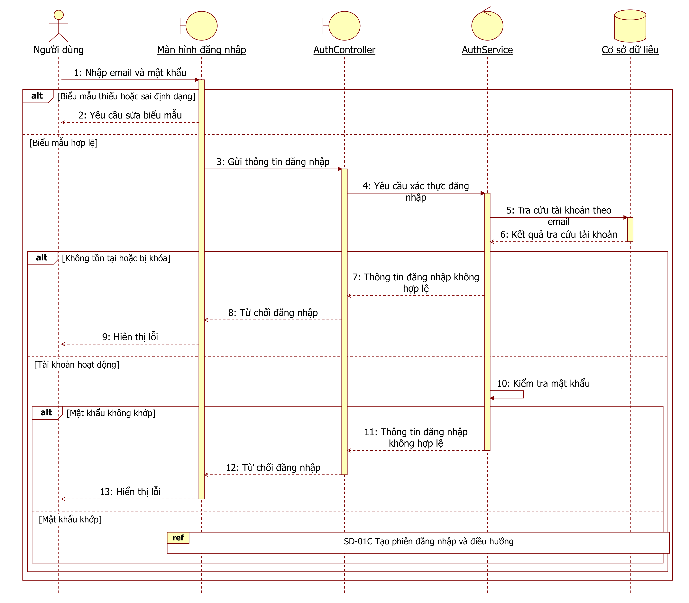

[SVG vector](docs/ba/sequence-diagrams/full/sd-01a-credentials.svg) · [Nguồn draw.io](docs/ba/sequence-diagrams/full/sd-01a-credentials.drawio)

| Bước | Bên gửi → Bên nhận | Điều kiện nhánh | Diễn giải nghiệp vụ |
| --- | --- | --- | --- |
| 1 | Người dùng → Màn hình đăng nhập | Luồng chung | Nhập email và mật khẩu |
| 2 | Màn hình đăng nhập → Người dùng | alt Biểu mẫu thiếu hoặc sai định dạng | Yêu cầu sửa biểu mẫu; chưa gửi yêu cầu đăng nhập khi biểu mẫu chưa hợp lệ. |
| 3 | Màn hình đăng nhập → AuthController | alt Biểu mẫu hợp lệ | Gửi thông tin đăng nhập |
| 4 | AuthController → AuthService | alt Biểu mẫu hợp lệ | Yêu cầu xác thực đăng nhập |
| 5 | AuthService → Cơ sở dữ liệu | alt Biểu mẫu hợp lệ | Tra cứu tài khoản theo email |
| 6 | Cơ sở dữ liệu → AuthService | alt Biểu mẫu hợp lệ | Kết quả tra cứu tài khoản |
| 7 | AuthService → AuthController | alt Biểu mẫu hợp lệ / alt Không tồn tại hoặc bị khóa | Thông tin đăng nhập không hợp lệ |
| 8 | AuthController → Màn hình đăng nhập | alt Biểu mẫu hợp lệ / alt Không tồn tại hoặc bị khóa | Từ chối đăng nhập |
| 9 | Màn hình đăng nhập → Người dùng | alt Biểu mẫu hợp lệ / alt Không tồn tại hoặc bị khóa | Hiển thị lỗi |
| 10 | AuthService → AuthService | alt Biểu mẫu hợp lệ / alt Tài khoản hoạt động | Kiểm tra mật khẩu |
| 11 | AuthService → AuthController | alt Biểu mẫu hợp lệ / alt Tài khoản hoạt động / alt Mật khẩu không khớp | Thông tin đăng nhập không hợp lệ |
| 12 | AuthController → Màn hình đăng nhập | alt Biểu mẫu hợp lệ / alt Tài khoản hoạt động / alt Mật khẩu không khớp | Từ chối đăng nhập |
| 13 | Màn hình đăng nhập → Người dùng | alt Biểu mẫu hợp lệ / alt Tài khoản hoạt động / alt Mật khẩu không khớp | Hiển thị lỗi |

**SD-01B Khôi phục phiên trên thiết bị**

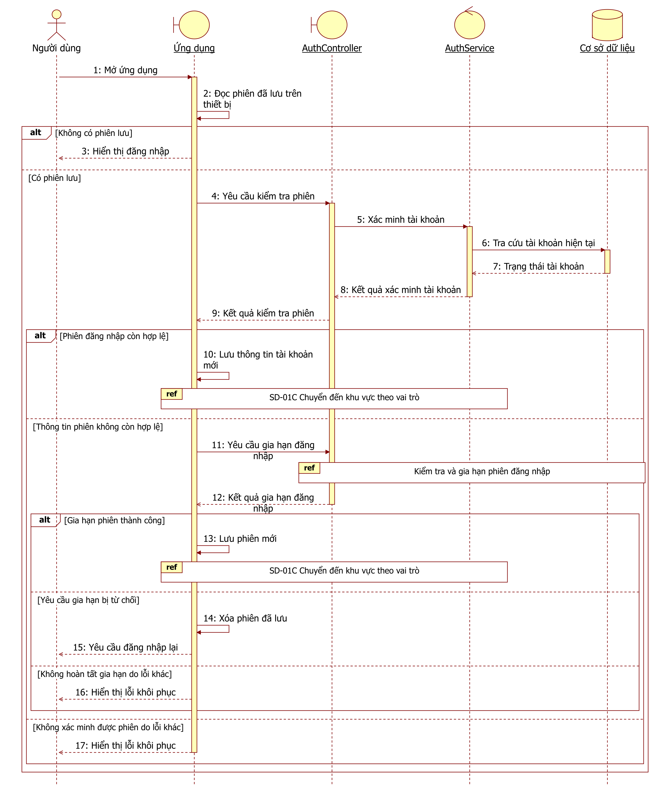

[SVG vector](docs/ba/sequence-diagrams/full/sd-01b-restore-session.svg) · [Nguồn draw.io](docs/ba/sequence-diagrams/full/sd-01b-restore-session.drawio)

| Bước | Bên gửi → Bên nhận | Điều kiện nhánh | Diễn giải nghiệp vụ |
| --- | --- | --- | --- |
| 1 | Người dùng → Ứng dụng | Luồng chung | Mở ứng dụng |
| 2 | Ứng dụng → Ứng dụng | Luồng chung | Đọc phiên đã lưu trên thiết bị |
| 3 | Ứng dụng → Người dùng | alt Không có phiên lưu | Hiển thị đăng nhập |
| 4 | Ứng dụng → AuthController | alt Có phiên lưu | Yêu cầu kiểm tra phiên |
| 5 | AuthController → AuthService | alt Có phiên lưu | Xác minh tài khoản |
| 6 | AuthService → Cơ sở dữ liệu | alt Có phiên lưu | Tra cứu tài khoản hiện tại |
| 7 | Cơ sở dữ liệu → AuthService | alt Có phiên lưu | Trạng thái tài khoản |
| 8 | AuthService → AuthController | alt Có phiên lưu | Kết quả xác minh tài khoản |
| 9 | AuthController → Ứng dụng | alt Có phiên lưu | Kết quả kiểm tra phiên |
| 10 | Ứng dụng → Ứng dụng | alt Có phiên lưu / alt Phiên đăng nhập còn hợp lệ | Lưu thông tin tài khoản mới |
| 11 | Ứng dụng → AuthController | alt Có phiên lưu / alt Thông tin phiên không còn hợp lệ | Yêu cầu gia hạn đăng nhập |
| 12 | AuthController → Ứng dụng | alt Có phiên lưu / alt Thông tin phiên không còn hợp lệ | Kết quả gia hạn đăng nhập |
| 13 | Ứng dụng → Ứng dụng | alt Có phiên lưu / alt Thông tin phiên không còn hợp lệ / alt Gia hạn phiên thành công | Lưu phiên mới |
| 14 | Ứng dụng → Ứng dụng | alt Có phiên lưu / alt Thông tin phiên không còn hợp lệ / alt Yêu cầu gia hạn bị từ chối | Xóa phiên đã lưu |
| 15 | Ứng dụng → Người dùng | alt Có phiên lưu / alt Thông tin phiên không còn hợp lệ / alt Yêu cầu gia hạn bị từ chối | Yêu cầu đăng nhập lại |
| 16 | Ứng dụng → Người dùng | alt Có phiên lưu / alt Thông tin phiên không còn hợp lệ / alt Không hoàn tất gia hạn do lỗi khác | Hiển thị lỗi khôi phục |
| 17 | Ứng dụng → Người dùng | alt Có phiên lưu / alt Không xác minh được phiên do lỗi khác | Hiển thị lỗi khôi phục; không tự xóa phiên đã lưu vì lỗi mạng hoặc lỗi máy chủ. |

**SD-01C Tạo phiên đăng nhập và điều hướng theo vai trò**

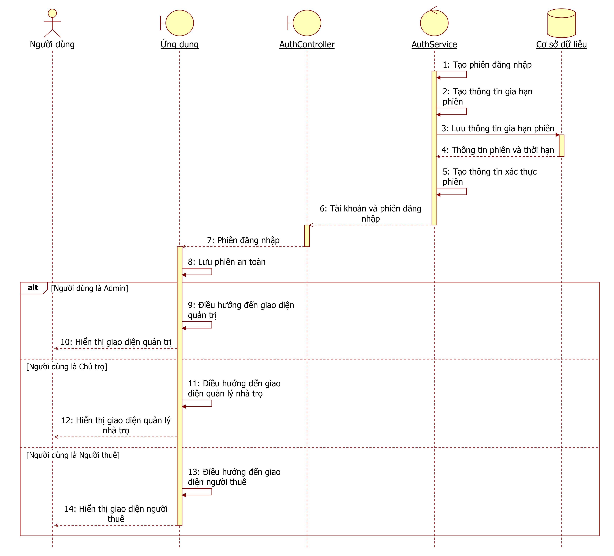

[SVG vector](docs/ba/sequence-diagrams/full/sd-01c-session-routing.svg) · [Nguồn draw.io](docs/ba/sequence-diagrams/full/sd-01c-session-routing.drawio)

| Bước | Bên gửi → Bên nhận | Điều kiện nhánh | Diễn giải nghiệp vụ |
| --- | --- | --- | --- |
| 1 | AuthService → AuthService | Luồng chung | Tạo phiên đăng nhập |
| 2 | AuthService → AuthService | Luồng chung | Tạo thông tin gia hạn phiên |
| 3 | AuthService → Cơ sở dữ liệu | Luồng chung | Lưu thông tin gia hạn phiên |
| 4 | Cơ sở dữ liệu → AuthService | Luồng chung | Thông tin phiên và thời hạn |
| 5 | AuthService → AuthService | Luồng chung | Tạo thông tin xác thực phiên |
| 6 | AuthService → AuthController | Luồng chung | Tài khoản và phiên đăng nhập |
| 7 | AuthController → Ứng dụng | Luồng chung | Phiên đăng nhập |
| 8 | Ứng dụng → Ứng dụng | Luồng chung | Lưu phiên an toàn |
| 9 | Ứng dụng → Ứng dụng | alt Người dùng là Admin | Điều hướng đến giao diện quản trị |
| 10 | Ứng dụng → Người dùng | alt Người dùng là Admin | Hiển thị giao diện quản trị |
| 11 | Ứng dụng → Ứng dụng | alt Người dùng là Chủ trọ | Điều hướng đến giao diện quản lý nhà trọ |
| 12 | Ứng dụng → Người dùng | alt Người dùng là Chủ trọ | Hiển thị giao diện quản lý nhà trọ |
| 13 | Ứng dụng → Ứng dụng | alt Người dùng là Người thuê | Điều hướng đến giao diện người thuê |
| 14 | Ứng dụng → Người dùng | alt Người dùng là Người thuê | Hiển thị giao diện người thuê |

##### 2.4.4.4. Mời và kích hoạt tài khoản người thuê

**Điều kiện trước:** Chủ trọ có hồ sơ người thuê; kích hoạt dùng mã lời mời chưa hết hạn và chưa sử dụng.

**Dữ liệu đầu vào:** Hồ sơ người thuê được chọn, email; mã lời mời và mật khẩu mới khi kích hoạt.

**Điều kiện sau khi thành công:** Tạo lời mời chưa tạo tài khoản đăng nhập. Kích hoạt thành công tạo tài khoản người thuê và liên kết với hồ sơ.

**Khi bị từ chối:** Không đi tiếp nhánh thành công. Nếu kết quả đã được lưu nhưng mất phản hồi, cần kiểm tra trước khi thực hiện lại.

**Lưu ý nghiệp vụ**

- Lời mời có thời hạn 7 ngày. Chủ trọ cung cấp mã hoặc đường dẫn cho người thuê; luồng này không tự động gửi email.
- Tài khoản được lưu trước khi tạo phiên đăng nhập. Nếu lỗi phát sinh sau khi lưu, tài khoản có thể đã tồn tại; cần kiểm tra trước khi kích hoạt lại.
- PX-12 cần chốt việc gửi lại lời mời và xử lý phiên sau kích hoạt. Hiện trạng chưa kiểm tra lại tình trạng sử dụng hồ sơ tại bước kích hoạt.

**SD-02A Tạo lời mời kích hoạt tài khoản**

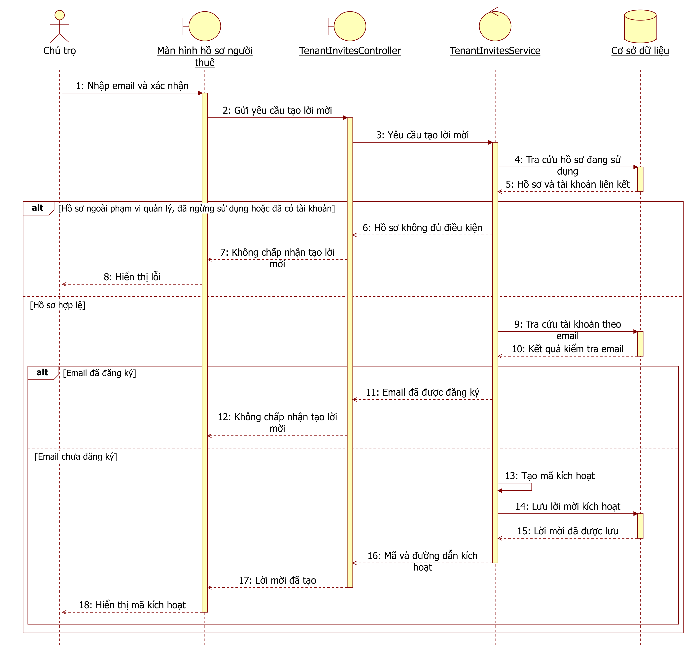

[SVG vector](docs/ba/sequence-diagrams/full/sd-02a-create-invite.svg) · [Nguồn draw.io](docs/ba/sequence-diagrams/full/sd-02a-create-invite.drawio)

| Bước | Bên gửi → Bên nhận | Điều kiện nhánh | Diễn giải nghiệp vụ |
| --- | --- | --- | --- |
| 1 | Chủ trọ → Màn hình hồ sơ người thuê | Luồng chung | Nhập email và xác nhận |
| 2 | Màn hình hồ sơ người thuê → TenantInvitesController | Luồng chung | Gửi yêu cầu tạo lời mời |
| 3 | TenantInvitesController → TenantInvitesService | Luồng chung | Yêu cầu tạo lời mời |
| 4 | TenantInvitesService → Cơ sở dữ liệu | Luồng chung | Tra cứu hồ sơ đang sử dụng |
| 5 | Cơ sở dữ liệu → TenantInvitesService | Luồng chung | Hồ sơ và tài khoản liên kết |
| 6 | TenantInvitesService → TenantInvitesController | alt Hồ sơ ngoài phạm vi quản lý, đã ngừng sử dụng hoặc đã có tài khoản | Hồ sơ không đủ điều kiện |
| 7 | TenantInvitesController → Màn hình hồ sơ người thuê | alt Hồ sơ ngoài phạm vi quản lý, đã ngừng sử dụng hoặc đã có tài khoản | Không chấp nhận tạo lời mời |
| 8 | Màn hình hồ sơ người thuê → Chủ trọ | alt Hồ sơ ngoài phạm vi quản lý, đã ngừng sử dụng hoặc đã có tài khoản | Hiển thị lỗi |
| 9 | TenantInvitesService → Cơ sở dữ liệu | alt Hồ sơ hợp lệ | Tra cứu tài khoản theo email |
| 10 | Cơ sở dữ liệu → TenantInvitesService | alt Hồ sơ hợp lệ | Kết quả kiểm tra email |
| 11 | TenantInvitesService → TenantInvitesController | alt Hồ sơ hợp lệ / alt Email đã đăng ký | Email đã được đăng ký |
| 12 | TenantInvitesController → Màn hình hồ sơ người thuê | alt Hồ sơ hợp lệ / alt Email đã đăng ký | Không chấp nhận tạo lời mời |
| 13 | TenantInvitesService → TenantInvitesService | alt Hồ sơ hợp lệ / alt Email chưa đăng ký | Tạo mã kích hoạt |
| 14 | TenantInvitesService → Cơ sở dữ liệu | alt Hồ sơ hợp lệ / alt Email chưa đăng ký | Lưu lời mời kích hoạt |
| 15 | Cơ sở dữ liệu → TenantInvitesService | alt Hồ sơ hợp lệ / alt Email chưa đăng ký | Lời mời đã được lưu |
| 16 | TenantInvitesService → TenantInvitesController | alt Hồ sơ hợp lệ / alt Email chưa đăng ký | Mã và đường dẫn kích hoạt |
| 17 | TenantInvitesController → Màn hình hồ sơ người thuê | alt Hồ sơ hợp lệ / alt Email chưa đăng ký | Lời mời đã tạo |
| 18 | Màn hình hồ sơ người thuê → Chủ trọ | alt Hồ sơ hợp lệ / alt Email chưa đăng ký | Hiển thị mã kích hoạt để Chủ trọ cung cấp mã hoặc đường dẫn cho Người thuê. Không tự động gửi email. |

**SD-02B Kích hoạt và liên kết tài khoản**

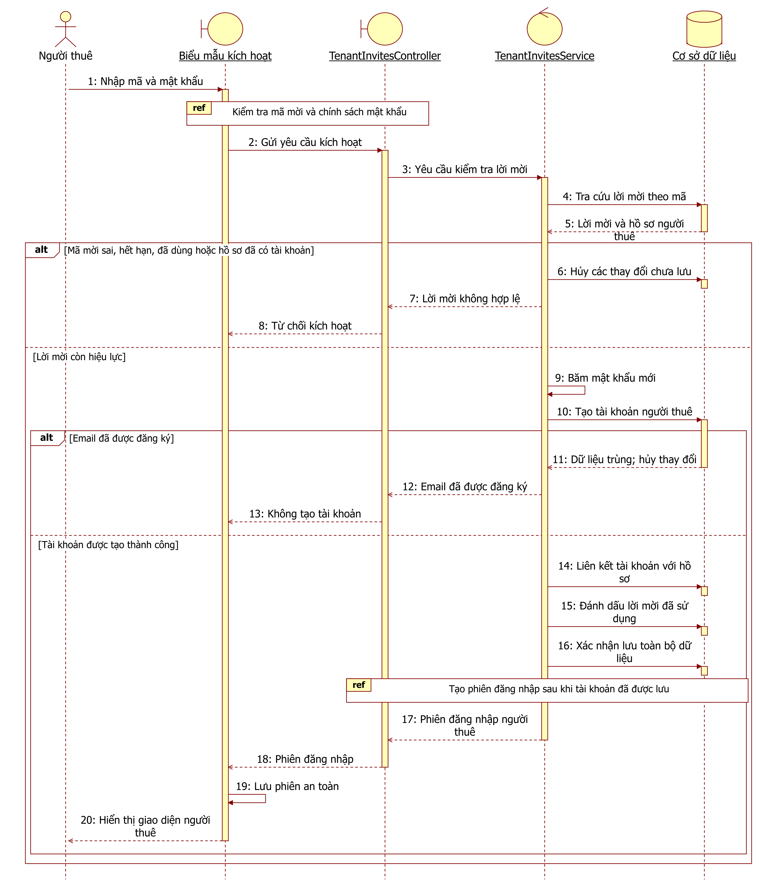

[SVG vector](docs/ba/sequence-diagrams/full/sd-02b-accept-invite.svg) · [Nguồn draw.io](docs/ba/sequence-diagrams/full/sd-02b-accept-invite.drawio)

| Bước | Bên gửi → Bên nhận | Điều kiện nhánh | Diễn giải nghiệp vụ |
| --- | --- | --- | --- |
| 1 | Người thuê → Biểu mẫu kích hoạt | Luồng chung | Nhập mã và mật khẩu |
| 2 | Biểu mẫu kích hoạt → TenantInvitesController | Luồng chung | Gửi yêu cầu kích hoạt |
| 3 | TenantInvitesController → TenantInvitesService | Luồng chung | Yêu cầu kiểm tra lời mời |
| 4 | TenantInvitesService → Cơ sở dữ liệu | Luồng chung | Tra cứu lời mời theo mã |
| 5 | Cơ sở dữ liệu → TenantInvitesService | Luồng chung | Lời mời và hồ sơ người thuê |
| 6 | TenantInvitesService → Cơ sở dữ liệu | alt Mã mời sai, hết hạn, đã dùng hoặc hồ sơ đã có tài khoản | Hủy các thay đổi chưa lưu |
| 7 | TenantInvitesService → TenantInvitesController | alt Mã mời sai, hết hạn, đã dùng hoặc hồ sơ đã có tài khoản | Lời mời không hợp lệ |
| 8 | TenantInvitesController → Biểu mẫu kích hoạt | alt Mã mời sai, hết hạn, đã dùng hoặc hồ sơ đã có tài khoản | Từ chối kích hoạt |
| 9 | TenantInvitesService → TenantInvitesService | alt Lời mời còn hiệu lực | Băm mật khẩu mới |
| 10 | TenantInvitesService → Cơ sở dữ liệu | alt Lời mời còn hiệu lực | Tạo tài khoản người thuê |
| 11 | Cơ sở dữ liệu → TenantInvitesService | alt Lời mời còn hiệu lực / alt Email đã được đăng ký | Dữ liệu trùng; hủy thay đổi |
| 12 | TenantInvitesService → TenantInvitesController | alt Lời mời còn hiệu lực / alt Email đã được đăng ký | Email đã được đăng ký |
| 13 | TenantInvitesController → Biểu mẫu kích hoạt | alt Lời mời còn hiệu lực / alt Email đã được đăng ký | Không tạo tài khoản |
| 14 | TenantInvitesService → Cơ sở dữ liệu | alt Lời mời còn hiệu lực / alt Tài khoản được tạo thành công | Liên kết tài khoản với hồ sơ |
| 15 | TenantInvitesService → Cơ sở dữ liệu | alt Lời mời còn hiệu lực / alt Tài khoản được tạo thành công | Đánh dấu lời mời đã sử dụng |
| 16 | TenantInvitesService → Cơ sở dữ liệu | alt Lời mời còn hiệu lực / alt Tài khoản được tạo thành công | Xác nhận lưu toàn bộ dữ liệu |
| 17 | TenantInvitesService → TenantInvitesController | alt Lời mời còn hiệu lực / alt Tài khoản được tạo thành công | Phiên đăng nhập người thuê |
| 18 | TenantInvitesController → Biểu mẫu kích hoạt | alt Lời mời còn hiệu lực / alt Tài khoản được tạo thành công | Phiên đăng nhập |
| 19 | Biểu mẫu kích hoạt → Biểu mẫu kích hoạt | alt Lời mời còn hiệu lực / alt Tài khoản được tạo thành công | Lưu phiên an toàn |
| 20 | Biểu mẫu kích hoạt → Người thuê | alt Lời mời còn hiệu lực / alt Tài khoản được tạo thành công | Hiển thị giao diện người thuê |

##### 2.4.4.5. Admin tạo tài khoản chủ trọ

**Điều kiện trước:** Admin đã đăng nhập và có quyền quản trị.

**Dữ liệu đầu vào:** Họ tên, email, mật khẩu; điện thoại tùy chọn.

**Điều kiện sau khi thành công:** Tạo tài khoản chủ trọ được phép sử dụng; không đăng nhập thay tài khoản vừa tạo.

**Khi bị từ chối:** Không đi tiếp nhánh thành công. Nếu kết quả đã được lưu nhưng mất phản hồi, cần kiểm tra trước khi thực hiện lại.

**Lưu ý nghiệp vụ**

- Mật khẩu dài từ 12 đến 128 ký tự và đáp ứng chính sách đã xác định.
- Không tạo tài khoản bằng email đã được đăng ký. Kiểm tra trùng được thực hiện khi lưu tài khoản.

**SD-03A Tạo tài khoản chủ trọ và kiểm tra email**

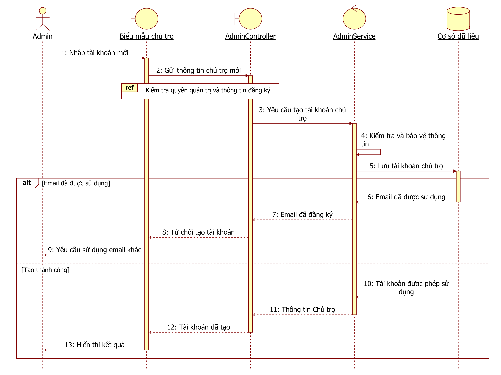

[SVG vector](docs/ba/sequence-diagrams/full/sd-03a-create-landlord.svg) · [Nguồn draw.io](docs/ba/sequence-diagrams/full/sd-03a-create-landlord.drawio)

| Bước | Bên gửi → Bên nhận | Điều kiện nhánh | Diễn giải nghiệp vụ |
| --- | --- | --- | --- |
| 1 | Admin → Biểu mẫu chủ trọ | Luồng chung | Nhập tài khoản mới |
| 2 | Biểu mẫu chủ trọ → AdminController | Luồng chung | Gửi thông tin chủ trọ mới |
| 3 | AdminController → AdminService | Luồng chung | Yêu cầu tạo tài khoản chủ trọ |
| 4 | AdminService → AdminService | Luồng chung | Kiểm tra và bảo vệ thông tin |
| 5 | AdminService → Cơ sở dữ liệu | Luồng chung | Lưu tài khoản chủ trọ |
| 6 | Cơ sở dữ liệu → AdminService | alt Email đã được sử dụng | Email đã được sử dụng |
| 7 | AdminService → AdminController | alt Email đã được sử dụng | Email đã đăng ký |
| 8 | AdminController → Biểu mẫu chủ trọ | alt Email đã được sử dụng | Từ chối tạo tài khoản |
| 9 | Biểu mẫu chủ trọ → Admin | alt Email đã được sử dụng | Yêu cầu sử dụng email khác |
| 10 | Cơ sở dữ liệu → AdminService | alt Tạo thành công | Tài khoản được phép sử dụng |
| 11 | AdminService → AdminController | alt Tạo thành công | Thông tin Chủ trọ |
| 12 | AdminController → Biểu mẫu chủ trọ | alt Tạo thành công | Tài khoản đã tạo |
| 13 | Biểu mẫu chủ trọ → Admin | alt Tạo thành công | Hiển thị kết quả |

##### 2.4.4.6. Tạo hợp đồng thuê phòng

**Điều kiện trước:** Chủ trọ đã chọn khu trọ và hồ sơ người thuê; xác nhận thông tin trên biểu mẫu.

**Dữ liệu đầu vào:** Phòng thuê, hồ sơ người thuê, giá thuê tháng, tiền cọc mặc định 0 và ngày bắt đầu tùy chọn.

**Điều kiện sau khi thành công:** Tạo hợp đồng có hiệu lực và chuyển phòng sang Đang thuê. Nếu tiền cọc lớn hơn 0, hiện trạng ghi nhận khoản thu cọc ban đầu.

**Khi bị từ chối:** Không đi tiếp nhánh thành công. Nếu kết quả đã được lưu nhưng mất phản hồi, cần kiểm tra trước khi thực hiện lại.

**Lưu ý nghiệp vụ**

- PX-01 đến PX-04 chưa chốt giá thuê 0, trạng thái phòng đủ điều kiện, cách thu cọc ban đầu và ngày kết thúc.
- SD-04A và SD-04B là hai đoạn của cùng một lần tạo hợp đồng. Các thay đổi được ghi nhận cùng nhau hoặc hủy nếu chưa lưu thành công.
- Điều kiện kiểm tra là phòng chưa có hợp đồng hiệu lực; không mặc định phòng phải ở trạng thái Trống. Hiện trạng chưa ngăn một người thuê có nhiều hợp đồng hiệu lực.
- Việc ghi nhận cùng nhau chưa đủ để khẳng định đã ngăn mọi trường hợp tạo hợp đồng đồng thời; cần kiểm chứng riêng.

**SD-04A Kiểm tra điều kiện lập hợp đồng**

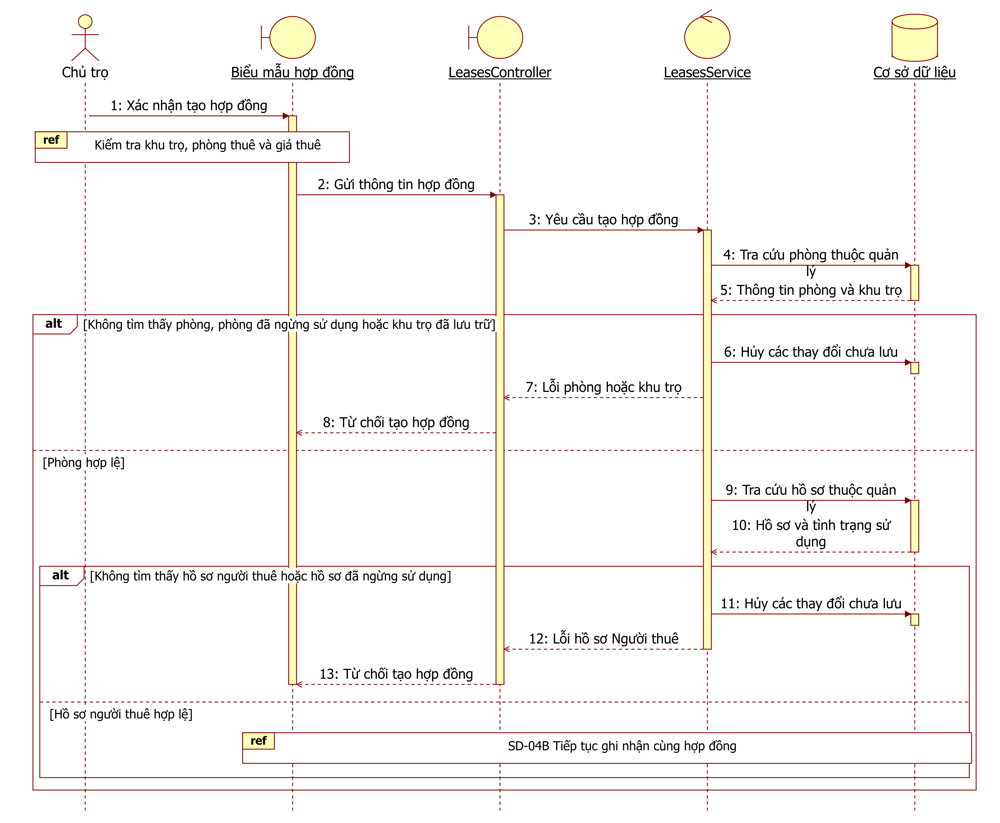

[SVG vector](docs/ba/sequence-diagrams/full/sd-04a-lease-validation.svg) · [Nguồn draw.io](docs/ba/sequence-diagrams/full/sd-04a-lease-validation.drawio)

| Bước | Bên gửi → Bên nhận | Điều kiện nhánh | Diễn giải nghiệp vụ |
| --- | --- | --- | --- |
| 1 | Chủ trọ → Biểu mẫu hợp đồng | Luồng chung | Xác nhận tạo hợp đồng |
| 2 | Biểu mẫu hợp đồng → LeasesController | Luồng chung | Gửi thông tin hợp đồng |
| 3 | LeasesController → LeasesService | Luồng chung | Yêu cầu tạo hợp đồng |
| 4 | LeasesService → Cơ sở dữ liệu | Luồng chung | Tra cứu phòng thuộc quản lý |
| 5 | Cơ sở dữ liệu → LeasesService | Luồng chung | Thông tin phòng và khu trọ |
| 6 | LeasesService → Cơ sở dữ liệu | alt Không tìm thấy phòng, phòng đã ngừng sử dụng hoặc khu trọ đã lưu trữ | Hủy các thay đổi chưa lưu |
| 7 | LeasesService → LeasesController | alt Không tìm thấy phòng, phòng đã ngừng sử dụng hoặc khu trọ đã lưu trữ | Lỗi phòng hoặc khu trọ |
| 8 | LeasesController → Biểu mẫu hợp đồng | alt Không tìm thấy phòng, phòng đã ngừng sử dụng hoặc khu trọ đã lưu trữ | Từ chối tạo hợp đồng |
| 9 | LeasesService → Cơ sở dữ liệu | alt Phòng hợp lệ | Tra cứu hồ sơ thuộc quản lý |
| 10 | Cơ sở dữ liệu → LeasesService | alt Phòng hợp lệ | Hồ sơ và tình trạng sử dụng |
| 11 | LeasesService → Cơ sở dữ liệu | alt Phòng hợp lệ / alt Không tìm thấy hồ sơ người thuê hoặc hồ sơ đã ngừng sử dụng | Hủy các thay đổi chưa lưu |
| 12 | LeasesService → LeasesController | alt Phòng hợp lệ / alt Không tìm thấy hồ sơ người thuê hoặc hồ sơ đã ngừng sử dụng | Lỗi hồ sơ Người thuê |
| 13 | LeasesController → Biểu mẫu hợp đồng | alt Phòng hợp lệ / alt Không tìm thấy hồ sơ người thuê hoặc hồ sơ đã ngừng sử dụng | Từ chối tạo hợp đồng |

**SD-04B Tạo hợp đồng và ghi nhận tiền cọc**

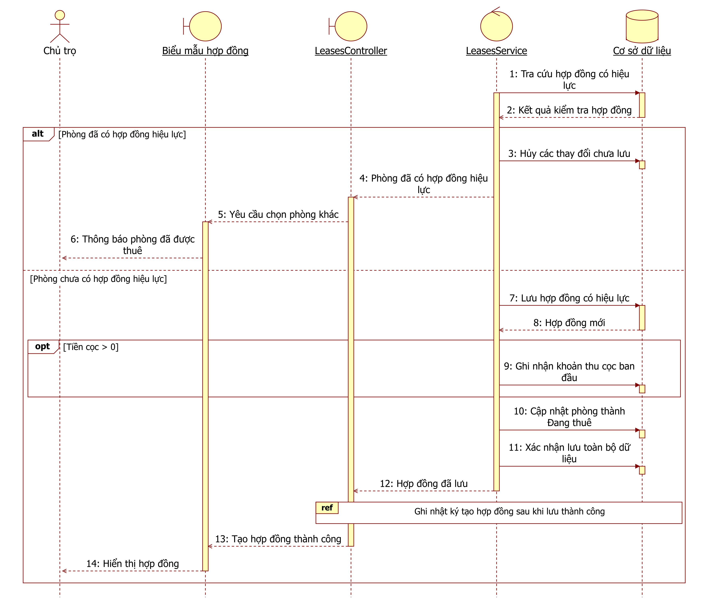

[SVG vector](docs/ba/sequence-diagrams/full/sd-04b-lease-persistence.svg) · [Nguồn draw.io](docs/ba/sequence-diagrams/full/sd-04b-lease-persistence.drawio)

| Bước | Bên gửi → Bên nhận | Điều kiện nhánh | Diễn giải nghiệp vụ |
| --- | --- | --- | --- |
| 1 | LeasesService → Cơ sở dữ liệu | Luồng chung | Tra cứu hợp đồng có hiệu lực |
| 2 | Cơ sở dữ liệu → LeasesService | Luồng chung | Kết quả kiểm tra hợp đồng |
| 3 | LeasesService → Cơ sở dữ liệu | alt Phòng đã có hợp đồng hiệu lực | Hủy các thay đổi chưa lưu |
| 4 | LeasesService → LeasesController | alt Phòng đã có hợp đồng hiệu lực | Phòng đã có hợp đồng hiệu lực |
| 5 | LeasesController → Biểu mẫu hợp đồng | alt Phòng đã có hợp đồng hiệu lực | Yêu cầu chọn phòng khác |
| 6 | Biểu mẫu hợp đồng → Chủ trọ | alt Phòng đã có hợp đồng hiệu lực | Thông báo phòng đã được thuê |
| 7 | LeasesService → Cơ sở dữ liệu | alt Phòng chưa có hợp đồng hiệu lực | Lưu hợp đồng có hiệu lực |
| 8 | Cơ sở dữ liệu → LeasesService | alt Phòng chưa có hợp đồng hiệu lực | Hợp đồng mới |
| 9 | LeasesService → Cơ sở dữ liệu | alt Phòng chưa có hợp đồng hiệu lực / opt Tiền cọc > 0 | Ghi nhận khoản thu cọc ban đầu |
| 10 | LeasesService → Cơ sở dữ liệu | alt Phòng chưa có hợp đồng hiệu lực | Cập nhật phòng thành Đang thuê |
| 11 | LeasesService → Cơ sở dữ liệu | alt Phòng chưa có hợp đồng hiệu lực | Xác nhận lưu toàn bộ dữ liệu |
| 12 | LeasesService → LeasesController | alt Phòng chưa có hợp đồng hiệu lực | Hợp đồng đã lưu |
| 13 | LeasesController → Biểu mẫu hợp đồng | alt Phòng chưa có hợp đồng hiệu lực | Tạo hợp đồng thành công |
| 14 | Biểu mẫu hợp đồng → Chủ trọ | alt Phòng chưa có hợp đồng hiệu lực | Hiển thị hợp đồng |

##### 2.4.4.7. Kết thúc hợp đồng và giải phóng phòng

**Điều kiện trước:** Chủ trọ chọn hợp đồng thuộc phạm vi và xác nhận kết thúc.

**Dữ liệu đầu vào:** Hợp đồng được chọn để kết thúc.

**Điều kiện sau khi thành công:** Hợp đồng chuyển sang Đã kết thúc; phòng chỉ chuyển sang Trống khi không còn hợp đồng hiệu lực khác.

**Khi bị từ chối:** Không đi tiếp nhánh thành công. Nếu kết quả đã được lưu nhưng mất phản hồi, cần kiểm tra trước khi thực hiện lại.

**Lưu ý nghiệp vụ**

- Hiện trạng chưa từ chối việc kết thúc lại hợp đồng đã kết thúc; thao tác lại có thể thay đổi ngày kết thúc.
- Không tự hoàn cọc hoặc quyết toán hóa đơn; đây là các nghiệp vụ riêng.

**SD-05A Kết thúc hợp đồng và giải phóng phòng**

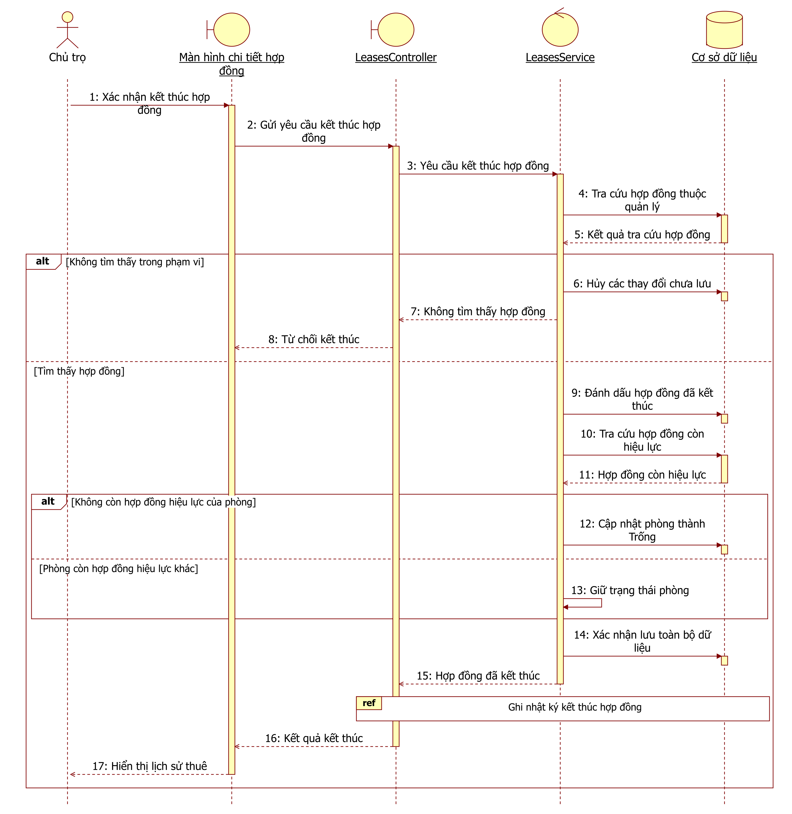

[SVG vector](docs/ba/sequence-diagrams/full/sd-05a-end-lease.svg) · [Nguồn draw.io](docs/ba/sequence-diagrams/full/sd-05a-end-lease.drawio)

| Bước | Bên gửi → Bên nhận | Điều kiện nhánh | Diễn giải nghiệp vụ |
| --- | --- | --- | --- |
| 1 | Chủ trọ → Màn hình chi tiết hợp đồng | Luồng chung | Xác nhận kết thúc hợp đồng |
| 2 | Màn hình chi tiết hợp đồng → LeasesController | Luồng chung | Gửi yêu cầu kết thúc hợp đồng |
| 3 | LeasesController → LeasesService | Luồng chung | Yêu cầu kết thúc hợp đồng |
| 4 | LeasesService → Cơ sở dữ liệu | Luồng chung | Tra cứu hợp đồng thuộc quản lý |
| 5 | Cơ sở dữ liệu → LeasesService | Luồng chung | Kết quả tra cứu hợp đồng |
| 6 | LeasesService → Cơ sở dữ liệu | alt Không tìm thấy trong phạm vi | Hủy các thay đổi chưa lưu |
| 7 | LeasesService → LeasesController | alt Không tìm thấy trong phạm vi | Không tìm thấy hợp đồng |
| 8 | LeasesController → Màn hình chi tiết hợp đồng | alt Không tìm thấy trong phạm vi | Từ chối kết thúc |
| 9 | LeasesService → Cơ sở dữ liệu | alt Tìm thấy hợp đồng | Đánh dấu hợp đồng đã kết thúc |
| 10 | LeasesService → Cơ sở dữ liệu | alt Tìm thấy hợp đồng | Tra cứu hợp đồng còn hiệu lực |
| 11 | Cơ sở dữ liệu → LeasesService | alt Tìm thấy hợp đồng | Hợp đồng còn hiệu lực |
| 12 | LeasesService → Cơ sở dữ liệu | alt Tìm thấy hợp đồng / alt Không còn hợp đồng hiệu lực của phòng | Cập nhật phòng thành Trống |
| 13 | LeasesService → LeasesService | alt Tìm thấy hợp đồng / alt Phòng còn hợp đồng hiệu lực khác | Giữ trạng thái phòng |
| 14 | LeasesService → Cơ sở dữ liệu | alt Tìm thấy hợp đồng | Xác nhận lưu toàn bộ dữ liệu |
| 15 | LeasesService → LeasesController | alt Tìm thấy hợp đồng | Hợp đồng đã kết thúc |
| 16 | LeasesController → Màn hình chi tiết hợp đồng | alt Tìm thấy hợp đồng | Kết quả kết thúc |
| 17 | Màn hình chi tiết hợp đồng → Chủ trọ | alt Tìm thấy hợp đồng | Hiển thị lịch sử thuê |

##### 2.4.4.8. Lập hóa đơn cho một hợp đồng

**Điều kiện trước:** Chủ trọ chọn hợp đồng có hiệu lực thuộc phạm vi quản lý.

**Dữ liệu đầu vào:** Hợp đồng, kỳ hóa đơn, hạn thanh toán, khoản thu khác, ghi chú; tối đa hai loại chỉ số điện nước.

**Điều kiện sau khi thành công:** Tạo hóa đơn Chưa thanh toán, gồm tiền thuê, điện, nước và phí. Chỉ số mới được lưu cùng hóa đơn.

**Khi bị từ chối:** Không đi tiếp nhánh thành công. Nếu kết quả đã được lưu nhưng mất phản hồi, cần kiểm tra trước khi thực hiện lại.

**Lưu ý nghiệp vụ**

- Không gửi chỉ số mới thì dùng số đã ghi của cùng phòng và kỳ. Thành phần chưa có dữ liệu được tính bằng 0 theo hiện trạng; PX-16 cần xác nhận.
- Không tạo thêm hóa đơn hoặc chỉ số trùng với dữ liệu đã ghi trong cùng kỳ. Chi tiết phát hiện trùng nằm ở bảng triển khai.
- Phí dịch vụ đang áp dụng được cộng vào khoản thu khác và tóm tắt trong ghi chú. Hóa đơn tổng tiền 0 vẫn được ghi là Chưa thanh toán theo hiện trạng PX-17.

**SD-06A Kiểm tra hợp đồng kỳ và chỉ số điện nước**

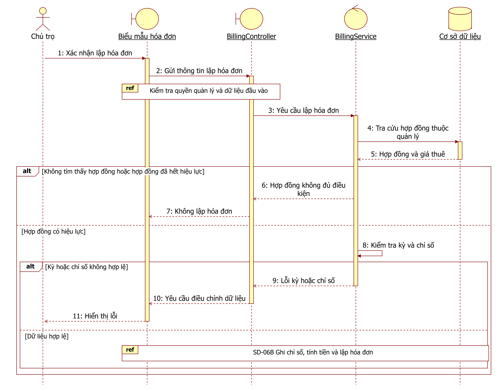

[SVG vector](docs/ba/sequence-diagrams/full/sd-06a-invoice-validation.svg) · [Nguồn draw.io](docs/ba/sequence-diagrams/full/sd-06a-invoice-validation.drawio)

| Bước | Bên gửi → Bên nhận | Điều kiện nhánh | Diễn giải nghiệp vụ |
| --- | --- | --- | --- |
| 1 | Chủ trọ → Biểu mẫu hóa đơn | Luồng chung | Xác nhận lập hóa đơn |
| 2 | Biểu mẫu hóa đơn → BillingController | Luồng chung | Gửi thông tin lập hóa đơn |
| 3 | BillingController → BillingService | Luồng chung | Yêu cầu lập hóa đơn |
| 4 | BillingService → Cơ sở dữ liệu | Luồng chung | Tra cứu hợp đồng thuộc quản lý |
| 5 | Cơ sở dữ liệu → BillingService | Luồng chung | Hợp đồng và giá thuê |
| 6 | BillingService → BillingController | alt Không tìm thấy hợp đồng hoặc hợp đồng đã hết hiệu lực | Hợp đồng không đủ điều kiện |
| 7 | BillingController → Biểu mẫu hóa đơn | alt Không tìm thấy hợp đồng hoặc hợp đồng đã hết hiệu lực | Không lập hóa đơn |
| 8 | BillingService → BillingService | alt Hợp đồng có hiệu lực | Kiểm tra kỳ và chỉ số |
| 9 | BillingService → BillingController | alt Hợp đồng có hiệu lực / alt Kỳ hoặc chỉ số không hợp lệ | Lỗi kỳ hoặc chỉ số |
| 10 | BillingController → Biểu mẫu hóa đơn | alt Hợp đồng có hiệu lực / alt Kỳ hoặc chỉ số không hợp lệ | Yêu cầu điều chỉnh dữ liệu |
| 11 | Biểu mẫu hóa đơn → Chủ trọ | alt Hợp đồng có hiệu lực / alt Kỳ hoặc chỉ số không hợp lệ | Hiển thị lỗi |

**SD-06B Tính tiền và lập hóa đơn**

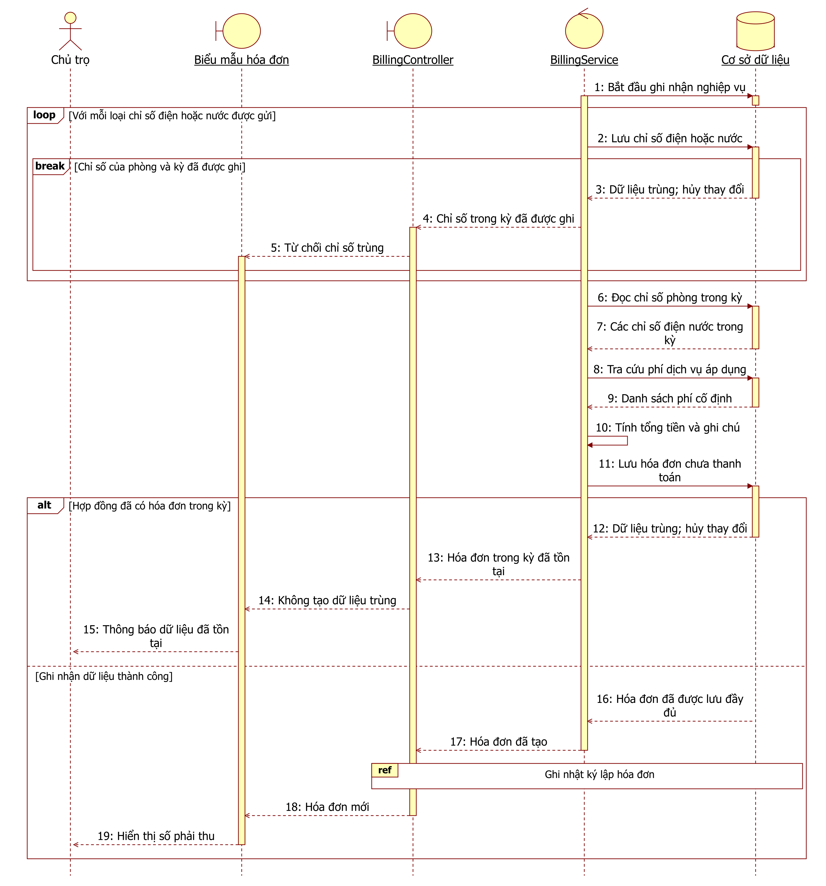

[SVG vector](docs/ba/sequence-diagrams/full/sd-06b-invoice-persistence.svg) · [Nguồn draw.io](docs/ba/sequence-diagrams/full/sd-06b-invoice-persistence.drawio)

| Bước | Bên gửi → Bên nhận | Điều kiện nhánh | Diễn giải nghiệp vụ |
| --- | --- | --- | --- |
| 1 | BillingService → Cơ sở dữ liệu | Luồng chung | Bắt đầu ghi nhận nghiệp vụ |
| 2 | BillingService → Cơ sở dữ liệu | loop Với mỗi loại chỉ số điện hoặc nước được gửi | Lưu chỉ số điện hoặc nước |
| 3 | Cơ sở dữ liệu → BillingService | loop Với mỗi loại chỉ số điện hoặc nước được gửi / break Chỉ số của phòng và kỳ đã được ghi | Dữ liệu trùng; hủy thay đổi |
| 4 | BillingService → BillingController | loop Với mỗi loại chỉ số điện hoặc nước được gửi / break Chỉ số của phòng và kỳ đã được ghi | Chỉ số trong kỳ đã được ghi |
| 5 | BillingController → Biểu mẫu hóa đơn | loop Với mỗi loại chỉ số điện hoặc nước được gửi / break Chỉ số của phòng và kỳ đã được ghi | Từ chối chỉ số trùng |
| 6 | BillingService → Cơ sở dữ liệu | Luồng chung | Đọc chỉ số phòng trong kỳ |
| 7 | Cơ sở dữ liệu → BillingService | Luồng chung | Các chỉ số điện nước trong kỳ |
| 8 | BillingService → Cơ sở dữ liệu | Luồng chung | Tra cứu phí dịch vụ áp dụng |
| 9 | Cơ sở dữ liệu → BillingService | Luồng chung | Danh sách phí cố định |
| 10 | BillingService → BillingService | Luồng chung | Tính tổng tiền và ghi chú |
| 11 | BillingService → Cơ sở dữ liệu | Luồng chung | Lưu hóa đơn chưa thanh toán |
| 12 | Cơ sở dữ liệu → BillingService | alt Hợp đồng đã có hóa đơn trong kỳ | Dữ liệu trùng; hủy thay đổi |
| 13 | BillingService → BillingController | alt Hợp đồng đã có hóa đơn trong kỳ | Hóa đơn trong kỳ đã tồn tại |
| 14 | BillingController → Biểu mẫu hóa đơn | alt Hợp đồng đã có hóa đơn trong kỳ | Không tạo dữ liệu trùng |
| 15 | Biểu mẫu hóa đơn → Chủ trọ | alt Hợp đồng đã có hóa đơn trong kỳ | Thông báo dữ liệu đã tồn tại |
| 16 | Cơ sở dữ liệu → BillingService | alt Ghi nhận dữ liệu thành công | Hóa đơn đã được lưu đầy đủ |
| 17 | BillingService → BillingController | alt Ghi nhận dữ liệu thành công | Hóa đơn đã tạo |
| 18 | BillingController → Biểu mẫu hóa đơn | alt Ghi nhận dữ liệu thành công | Hóa đơn mới |
| 19 | Biểu mẫu hóa đơn → Chủ trọ | alt Ghi nhận dữ liệu thành công | Hiển thị số phải thu |

##### 2.4.4.9. Ghi nhận thanh toán hóa đơn

**Điều kiện trước:** Chủ trọ chọn hóa đơn còn phải thu và xác nhận khoản thanh toán.

**Dữ liệu đầu vào:** Hóa đơn được chọn, số tiền thanh toán nguyên dương, phương thức, thời điểm thanh toán tùy chọn và ghi chú.

**Điều kiện sau khi thành công:** Ghi nhận khoản thanh toán, tăng số tiền đã thu và chuyển hóa đơn sang Thanh toán một phần hoặc Đã thanh toán.

**Khi bị từ chối:** Không đi tiếp nhánh thành công. Nếu kết quả đã được lưu nhưng mất phản hồi, cần kiểm tra trước khi thực hiện lại.

**Lưu ý nghiệp vụ**

- Kiểm tra số còn phải thu trước khi ghi nhận khoản thanh toán; cơ chế phối hợp khi thao tác đồng thời được giải thích ở bảng triển khai.
- Phương thức thanh toán chỉ mô tả khoản thu đã được ghi nhận; luồng này không thực hiện chuyển tiền qua cổng thanh toán.
- Khoản thu vượt số còn phải thu bị từ chối; không tự ghi số dư âm hoặc tiền thừa.

**SD-07A Kiểm tra hóa đơn và khoản thanh toán**

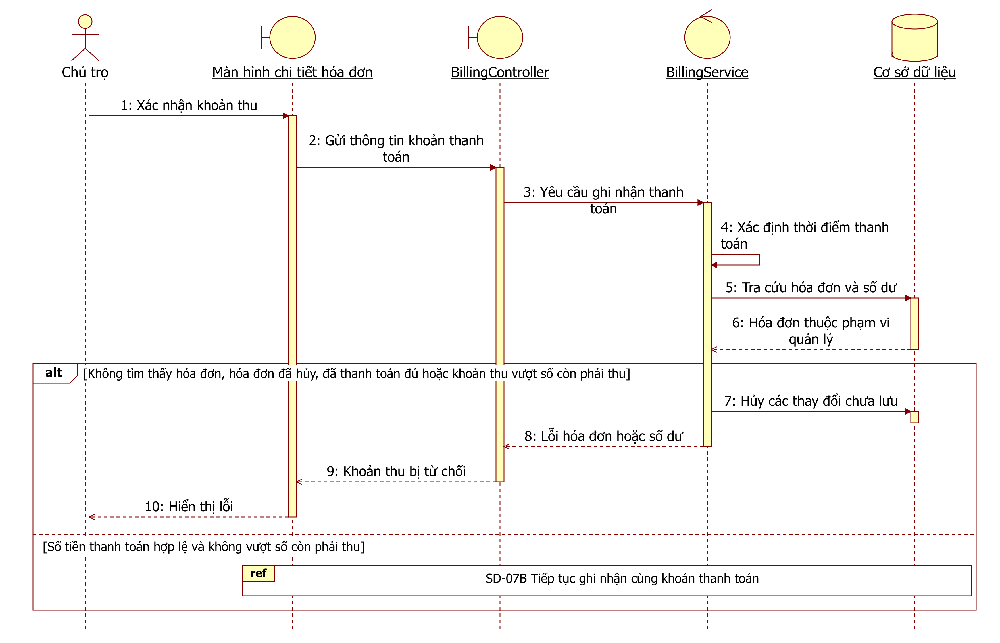

[SVG vector](docs/ba/sequence-diagrams/full/sd-07a-payment-checks.svg) · [Nguồn draw.io](docs/ba/sequence-diagrams/full/sd-07a-payment-checks.drawio)

| Bước | Bên gửi → Bên nhận | Điều kiện nhánh | Diễn giải nghiệp vụ |
| --- | --- | --- | --- |
| 1 | Chủ trọ → Màn hình chi tiết hóa đơn | Luồng chung | Xác nhận khoản thu |
| 2 | Màn hình chi tiết hóa đơn → BillingController | Luồng chung | Gửi thông tin khoản thanh toán |
| 3 | BillingController → BillingService | Luồng chung | Yêu cầu ghi nhận thanh toán |
| 4 | BillingService → BillingService | Luồng chung | Xác định thời điểm thanh toán |
| 5 | BillingService → Cơ sở dữ liệu | Luồng chung | Tra cứu hóa đơn và số dư |
| 6 | Cơ sở dữ liệu → BillingService | Luồng chung | Hóa đơn thuộc phạm vi quản lý |
| 7 | BillingService → Cơ sở dữ liệu | alt Không tìm thấy hóa đơn, hóa đơn đã hủy, đã thanh toán đủ hoặc khoản thu vượt số còn phải thu | Hủy các thay đổi chưa lưu |
| 8 | BillingService → BillingController | alt Không tìm thấy hóa đơn, hóa đơn đã hủy, đã thanh toán đủ hoặc khoản thu vượt số còn phải thu | Lỗi hóa đơn hoặc số dư |
| 9 | BillingController → Màn hình chi tiết hóa đơn | alt Không tìm thấy hóa đơn, hóa đơn đã hủy, đã thanh toán đủ hoặc khoản thu vượt số còn phải thu | Khoản thu bị từ chối |
| 10 | Màn hình chi tiết hóa đơn → Chủ trọ | alt Không tìm thấy hóa đơn, hóa đơn đã hủy, đã thanh toán đủ hoặc khoản thu vượt số còn phải thu | Hiển thị lỗi |

**SD-07B Ghi nhận thanh toán và cập nhật số phải thu**

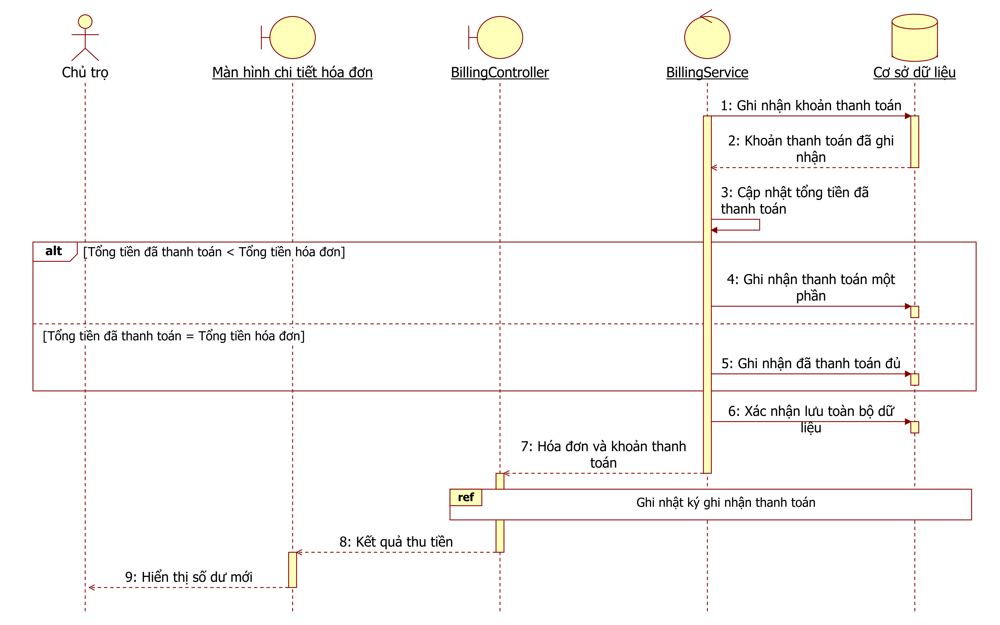

[SVG vector](docs/ba/sequence-diagrams/full/sd-07b-payment-status.svg) · [Nguồn draw.io](docs/ba/sequence-diagrams/full/sd-07b-payment-status.drawio)

| Bước | Bên gửi → Bên nhận | Điều kiện nhánh | Diễn giải nghiệp vụ |
| --- | --- | --- | --- |
| 1 | BillingService → Cơ sở dữ liệu | Luồng chung | Ghi nhận khoản thanh toán |
| 2 | Cơ sở dữ liệu → BillingService | Luồng chung | Khoản thanh toán đã ghi nhận |
| 3 | BillingService → BillingService | Luồng chung | Cập nhật tổng tiền đã thanh toán |
| 4 | BillingService → Cơ sở dữ liệu | alt Tổng tiền đã thanh toán < Tổng tiền hóa đơn | Ghi nhận thanh toán một phần |
| 5 | BillingService → Cơ sở dữ liệu | alt Tổng tiền đã thanh toán = Tổng tiền hóa đơn | Ghi nhận đã thanh toán đủ; số còn phải thu bằng 0. |
| 6 | BillingService → Cơ sở dữ liệu | Luồng chung | Xác nhận lưu toàn bộ dữ liệu |
| 7 | BillingService → BillingController | Luồng chung | Hóa đơn và khoản thanh toán |
| 8 | BillingController → Màn hình chi tiết hóa đơn | Luồng chung | Kết quả thu tiền |
| 9 | Màn hình chi tiết hóa đơn → Chủ trọ | Luồng chung | Hiển thị số dư mới |

##### 2.4.4.10. Gửi và xét duyệt minh chứng thanh toán

**Điều kiện trước:** Người thuê có hồ sơ đang sử dụng và hóa đơn của mình; Chủ trọ chỉ xét minh chứng Chờ duyệt thuộc phạm vi quản lý.

**Dữ liệu đầu vào:** Tệp minh chứng, số tiền, phương thức, ghi chú; minh chứng được chọn, quyết định chấp thuận hoặc từ chối và ghi chú xét duyệt.

**Điều kiện sau khi thành công:** Gửi minh chứng chỉ tạo trạng thái Chờ duyệt, chưa ghi nhận tiền đã thu. Chấp thuận tạo khoản thanh toán và cập nhật hóa đơn; từ chối không thay đổi khoản thu.

**Khi bị từ chối:** Không đi tiếp nhánh thành công. Nếu kết quả đã được lưu nhưng mất phản hồi, cần kiểm tra trước khi thực hiện lại.

**Lưu ý nghiệp vụ**

- Biểu mẫu yêu cầu ít nhất một tệp, nhưng xử lý tiếp nhận hiện chưa bắt buộc tương ứng; PX-25 cần chốt thống nhất.
- Tải tệp là thao tác riêng. Khi gửi minh chứng, hệ thống tiếp nhận thông tin và đường dẫn đến các tệp đã tải.
- Minh chứng chờ duyệt làm giảm hạn mức được phép gửi thêm, nhưng chưa được tính vào số tiền đã thanh toán.
- PX-21: việc kiểm tra trạng thái Chờ duyệt chưa đủ để khẳng định đã chống mọi trường hợp duyệt đồng thời cùng một minh chứng.

**SD-08A Tải tệp và chuẩn bị minh chứng**

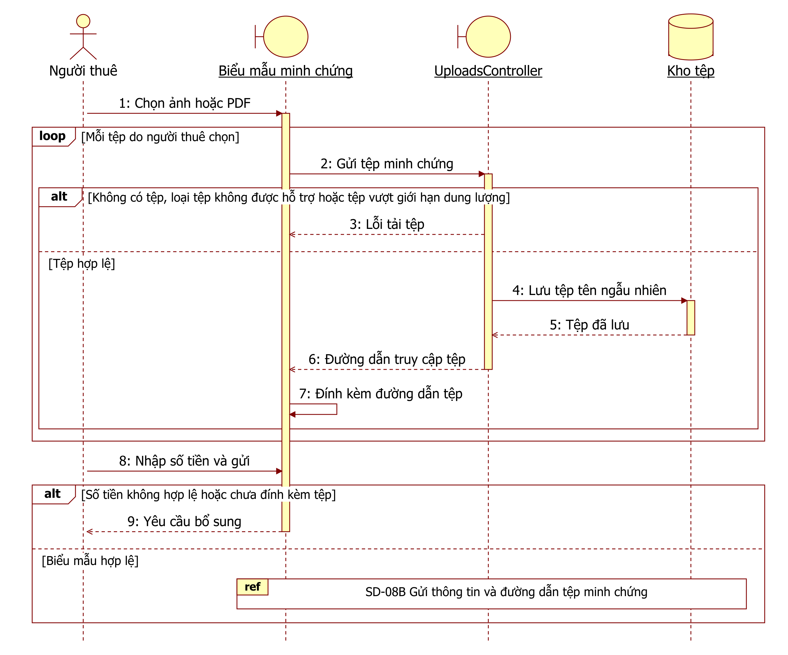

[SVG vector](docs/ba/sequence-diagrams/full/sd-08a-proof-upload.svg) · [Nguồn draw.io](docs/ba/sequence-diagrams/full/sd-08a-proof-upload.drawio)

| Bước | Bên gửi → Bên nhận | Điều kiện nhánh | Diễn giải nghiệp vụ |
| --- | --- | --- | --- |
| 1 | Người thuê → Biểu mẫu minh chứng | Luồng chung | Chọn ảnh hoặc PDF |
| 2 | Biểu mẫu minh chứng → UploadsController | loop Mỗi tệp do người thuê chọn | Gửi tệp minh chứng |
| 3 | UploadsController → Biểu mẫu minh chứng | loop Mỗi tệp do người thuê chọn / alt Không có tệp, loại tệp không được hỗ trợ hoặc tệp vượt giới hạn dung lượng | Lỗi tải tệp |
| 4 | UploadsController → Kho tệp | loop Mỗi tệp do người thuê chọn / alt Tệp hợp lệ | Lưu tệp tên ngẫu nhiên |
| 5 | Kho tệp → UploadsController | loop Mỗi tệp do người thuê chọn / alt Tệp hợp lệ | Tệp đã lưu |
| 6 | UploadsController → Biểu mẫu minh chứng | loop Mỗi tệp do người thuê chọn / alt Tệp hợp lệ | Đường dẫn truy cập tệp |
| 7 | Biểu mẫu minh chứng → Biểu mẫu minh chứng | loop Mỗi tệp do người thuê chọn / alt Tệp hợp lệ | Đính kèm đường dẫn tệp |
| 8 | Người thuê → Biểu mẫu minh chứng | Luồng chung | Nhập số tiền và gửi |
| 9 | Biểu mẫu minh chứng → Người thuê | alt Số tiền không hợp lệ hoặc chưa đính kèm tệp | Yêu cầu bổ sung |

**SD-08B Gửi minh chứng chờ xét duyệt**

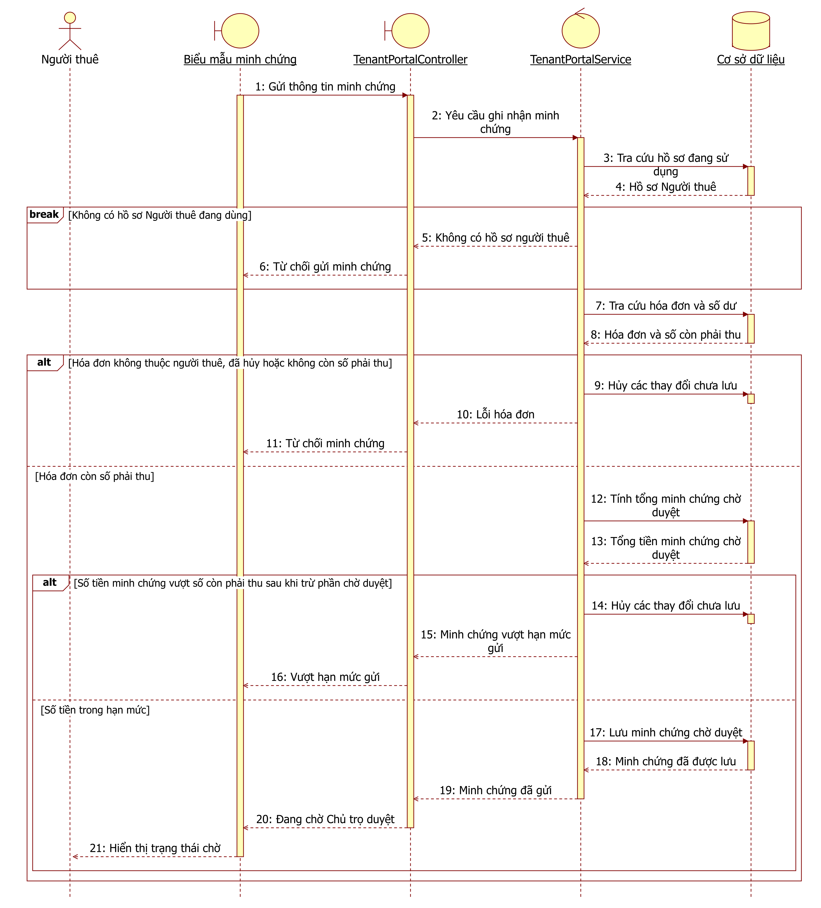

[SVG vector](docs/ba/sequence-diagrams/full/sd-08b-submit-proof.svg) · [Nguồn draw.io](docs/ba/sequence-diagrams/full/sd-08b-submit-proof.drawio)

| Bước | Bên gửi → Bên nhận | Điều kiện nhánh | Diễn giải nghiệp vụ |
| --- | --- | --- | --- |
| 1 | Biểu mẫu minh chứng → TenantPortalController | Luồng chung | Gửi thông tin minh chứng |
| 2 | TenantPortalController → TenantPortalService | Luồng chung | Yêu cầu ghi nhận minh chứng |
| 3 | TenantPortalService → Cơ sở dữ liệu | Luồng chung | Tra cứu hồ sơ đang sử dụng |
| 4 | Cơ sở dữ liệu → TenantPortalService | Luồng chung | Hồ sơ Người thuê |
| 5 | TenantPortalService → TenantPortalController | break Không có hồ sơ Người thuê đang dùng | Không có hồ sơ người thuê |
| 6 | TenantPortalController → Biểu mẫu minh chứng | break Không có hồ sơ Người thuê đang dùng | Từ chối gửi minh chứng |
| 7 | TenantPortalService → Cơ sở dữ liệu | Luồng chung | Tra cứu hóa đơn và số dư |
| 8 | Cơ sở dữ liệu → TenantPortalService | Luồng chung | Hóa đơn và số còn phải thu |
| 9 | TenantPortalService → Cơ sở dữ liệu | alt Hóa đơn không thuộc người thuê, đã hủy hoặc không còn số phải thu | Hủy các thay đổi chưa lưu |
| 10 | TenantPortalService → TenantPortalController | alt Hóa đơn không thuộc người thuê, đã hủy hoặc không còn số phải thu | Lỗi hóa đơn |
| 11 | TenantPortalController → Biểu mẫu minh chứng | alt Hóa đơn không thuộc người thuê, đã hủy hoặc không còn số phải thu | Từ chối minh chứng |
| 12 | TenantPortalService → Cơ sở dữ liệu | alt Hóa đơn còn số phải thu | Tính tổng minh chứng chờ duyệt |
| 13 | Cơ sở dữ liệu → TenantPortalService | alt Hóa đơn còn số phải thu | Tổng tiền minh chứng chờ duyệt |
| 14 | TenantPortalService → Cơ sở dữ liệu | alt Hóa đơn còn số phải thu / alt Số tiền minh chứng vượt số còn phải thu sau khi trừ phần chờ duyệt | Hủy các thay đổi chưa lưu |
| 15 | TenantPortalService → TenantPortalController | alt Hóa đơn còn số phải thu / alt Số tiền minh chứng vượt số còn phải thu sau khi trừ phần chờ duyệt | Minh chứng vượt hạn mức gửi |
| 16 | TenantPortalController → Biểu mẫu minh chứng | alt Hóa đơn còn số phải thu / alt Số tiền minh chứng vượt số còn phải thu sau khi trừ phần chờ duyệt | Vượt hạn mức gửi |
| 17 | TenantPortalService → Cơ sở dữ liệu | alt Hóa đơn còn số phải thu / alt Số tiền trong hạn mức | Lưu minh chứng chờ duyệt |
| 18 | Cơ sở dữ liệu → TenantPortalService | alt Hóa đơn còn số phải thu / alt Số tiền trong hạn mức | Minh chứng đã được lưu |
| 19 | TenantPortalService → TenantPortalController | alt Hóa đơn còn số phải thu / alt Số tiền trong hạn mức | Minh chứng đã gửi |
| 20 | TenantPortalController → Biểu mẫu minh chứng | alt Hóa đơn còn số phải thu / alt Số tiền trong hạn mức | Đang chờ Chủ trọ duyệt |
| 21 | Biểu mẫu minh chứng → Người thuê | alt Hóa đơn còn số phải thu / alt Số tiền trong hạn mức | Hiển thị trạng thái chờ |

**SD-08C Chấp thuận hoặc từ chối minh chứng**

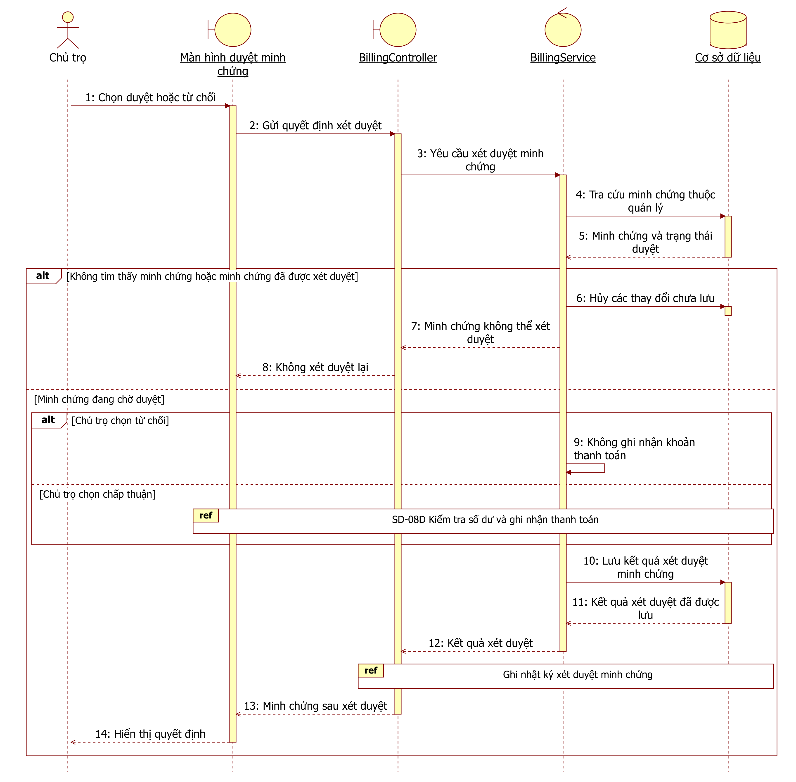

[SVG vector](docs/ba/sequence-diagrams/full/sd-08c-review-proof.svg) · [Nguồn draw.io](docs/ba/sequence-diagrams/full/sd-08c-review-proof.drawio)

| Bước | Bên gửi → Bên nhận | Điều kiện nhánh | Diễn giải nghiệp vụ |
| --- | --- | --- | --- |
| 1 | Chủ trọ → Màn hình duyệt minh chứng | Luồng chung | Chọn duyệt hoặc từ chối |
| 2 | Màn hình duyệt minh chứng → BillingController | Luồng chung | Gửi quyết định xét duyệt |
| 3 | BillingController → BillingService | Luồng chung | Yêu cầu xét duyệt minh chứng |
| 4 | BillingService → Cơ sở dữ liệu | Luồng chung | Tra cứu minh chứng thuộc quản lý |
| 5 | Cơ sở dữ liệu → BillingService | Luồng chung | Minh chứng và trạng thái duyệt |
| 6 | BillingService → Cơ sở dữ liệu | alt Không tìm thấy minh chứng hoặc minh chứng đã được xét duyệt | Hủy các thay đổi chưa lưu |
| 7 | BillingService → BillingController | alt Không tìm thấy minh chứng hoặc minh chứng đã được xét duyệt | Minh chứng không thể xét duyệt |
| 8 | BillingController → Màn hình duyệt minh chứng | alt Không tìm thấy minh chứng hoặc minh chứng đã được xét duyệt | Không xét duyệt lại |
| 9 | BillingService → BillingService | alt Minh chứng đang chờ duyệt / alt Chủ trọ chọn từ chối | Không ghi nhận khoản thanh toán |
| 10 | BillingService → Cơ sở dữ liệu | alt Minh chứng đang chờ duyệt | Lưu kết quả xét duyệt minh chứng |
| 11 | Cơ sở dữ liệu → BillingService | alt Minh chứng đang chờ duyệt | Kết quả xét duyệt đã được lưu |
| 12 | BillingService → BillingController | alt Minh chứng đang chờ duyệt | Kết quả xét duyệt |
| 13 | BillingController → Màn hình duyệt minh chứng | alt Minh chứng đang chờ duyệt | Minh chứng sau xét duyệt |
| 14 | Màn hình duyệt minh chứng → Chủ trọ | alt Minh chứng đang chờ duyệt | Hiển thị quyết định |

**SD-08D Kiểm tra số dư khi chấp thuận minh chứng**

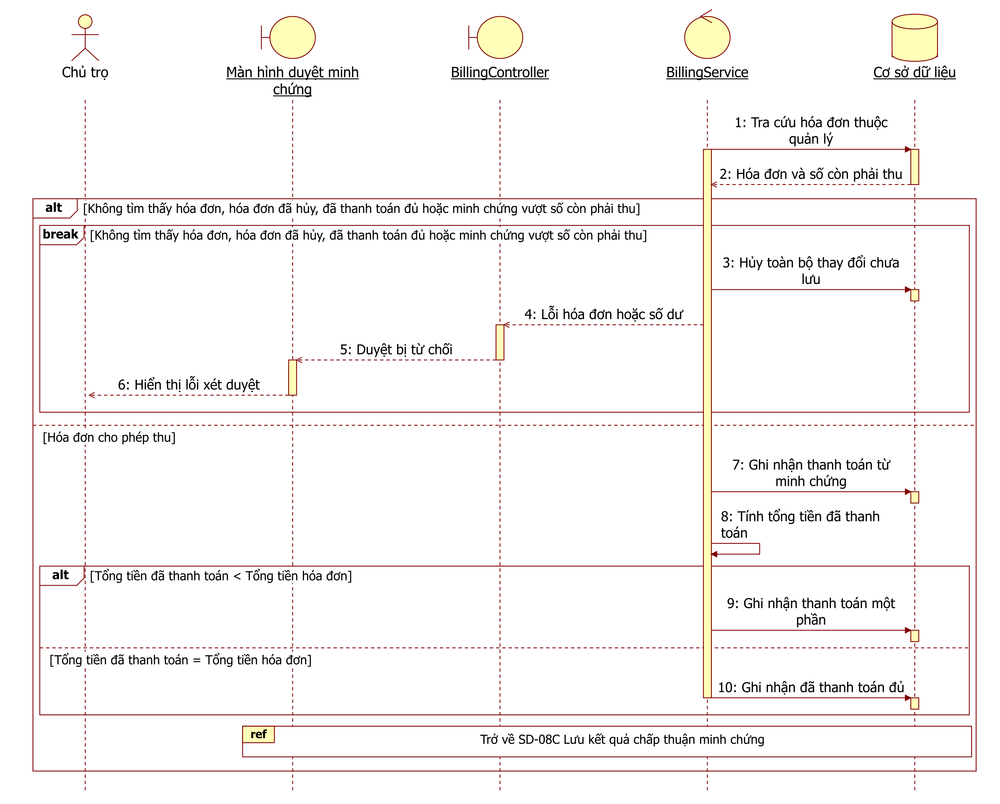

[SVG vector](docs/ba/sequence-diagrams/full/sd-08d-approve-proof.svg) · [Nguồn draw.io](docs/ba/sequence-diagrams/full/sd-08d-approve-proof.drawio)

| Bước | Bên gửi → Bên nhận | Điều kiện nhánh | Diễn giải nghiệp vụ |
| --- | --- | --- | --- |
| 1 | BillingService → Cơ sở dữ liệu | Luồng chung | Tra cứu hóa đơn thuộc quản lý |
| 2 | Cơ sở dữ liệu → BillingService | Luồng chung | Hóa đơn và số còn phải thu |
| 3 | BillingService → Cơ sở dữ liệu | alt Không tìm thấy hóa đơn, hóa đơn đã hủy, đã thanh toán đủ hoặc minh chứng vượt số còn phải thu / break Không tìm thấy hóa đơn, hóa đơn đã hủy, đã thanh toán đủ hoặc minh chứng vượt số còn phải thu | Hủy toàn bộ thay đổi chưa lưu |
| 4 | BillingService → BillingController | alt Không tìm thấy hóa đơn, hóa đơn đã hủy, đã thanh toán đủ hoặc minh chứng vượt số còn phải thu / break Không tìm thấy hóa đơn, hóa đơn đã hủy, đã thanh toán đủ hoặc minh chứng vượt số còn phải thu | Lỗi hóa đơn hoặc số dư |
| 5 | BillingController → Màn hình duyệt minh chứng | alt Không tìm thấy hóa đơn, hóa đơn đã hủy, đã thanh toán đủ hoặc minh chứng vượt số còn phải thu / break Không tìm thấy hóa đơn, hóa đơn đã hủy, đã thanh toán đủ hoặc minh chứng vượt số còn phải thu | Duyệt bị từ chối |
| 6 | Màn hình duyệt minh chứng → Chủ trọ | alt Không tìm thấy hóa đơn, hóa đơn đã hủy, đã thanh toán đủ hoặc minh chứng vượt số còn phải thu / break Không tìm thấy hóa đơn, hóa đơn đã hủy, đã thanh toán đủ hoặc minh chứng vượt số còn phải thu | Hiển thị lỗi xét duyệt |
| 7 | BillingService → Cơ sở dữ liệu | alt Hóa đơn cho phép thu | Ghi nhận thanh toán từ minh chứng |
| 8 | BillingService → BillingService | alt Hóa đơn cho phép thu | Tính tổng tiền đã thanh toán |
| 9 | BillingService → Cơ sở dữ liệu | alt Hóa đơn cho phép thu / alt Tổng tiền đã thanh toán < Tổng tiền hóa đơn | Ghi nhận thanh toán một phần |
| 10 | BillingService → Cơ sở dữ liệu | alt Hóa đơn cho phép thu / alt Tổng tiền đã thanh toán = Tổng tiền hóa đơn | Ghi nhận đã thanh toán đủ |

##### 2.4.4.11. Gửi xử lý và hoàn tất bảo trì

**Điều kiện trước:** Người thuê có hồ sơ đang sử dụng và hợp đồng có hiệu lực; Chủ trọ chỉ xử lý yêu cầu thuộc phạm vi quản lý.

**Dữ liệu đầu vào:** Tiêu đề, mô tả, ảnh và mức ưu tiên; yêu cầu bảo trì, trạng thái; chi phí thực tế, ngày hoàn tất, lựa chọn ghi khoản chi và ghi chú.

**Điều kiện sau khi thành công:** Tạo yêu cầu bảo trì Chờ xử lý; cập nhật tiến độ và các mốc phù hợp. Hoàn tất chuyển sang Hoàn tất và có thể liên kết khoản chi sửa chữa.

**Khi bị từ chối:** Không đi tiếp nhánh thành công. Nếu kết quả đã được lưu nhưng mất phản hồi, cần kiểm tra trước khi thực hiện lại.

**Lưu ý nghiệp vụ**

- Ảnh được tải theo luồng SD-08A, nhưng yêu cầu bảo trì có thể không kèm ảnh. Mức ưu tiên mặc định là Trung bình.
- Hiện trạng chọn hợp đồng có hiệu lực đầu tiên theo ngày bắt đầu giảm dần; chưa cho chọn phòng khi có nhiều hợp đồng. PX-27 cần xác nhận.
- PX-13: chưa có quy tắc hạn chế mọi chuyển trạng thái. Hủy không tự ghi ngày hoàn tất; chuyển sang Hoàn tất chỉ thêm mốc nếu chưa có.
- Chỉ tạo khoản chi khi đã chọn ghi khoản chi, chi phí lớn hơn 0 và chưa có khoản chi liên kết. Hoàn tất lại chưa tự bị từ chối; PX-14 cần chốt.

**SD-09A Người thuê gửi yêu cầu bảo trì**

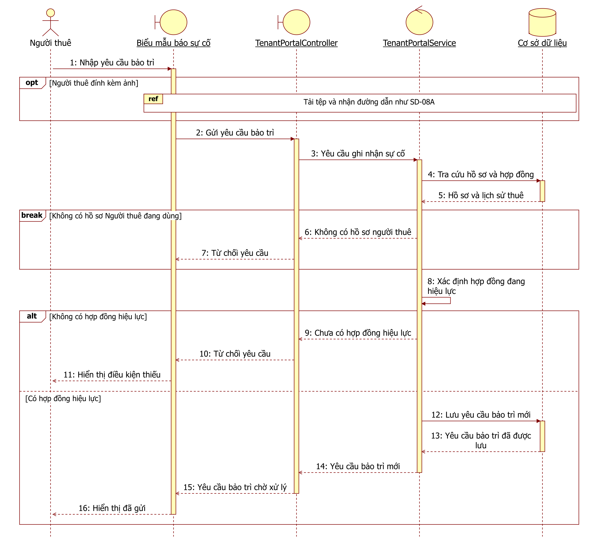

[SVG vector](docs/ba/sequence-diagrams/full/sd-09a-request-maintenance.svg) · [Nguồn draw.io](docs/ba/sequence-diagrams/full/sd-09a-request-maintenance.drawio)

| Bước | Bên gửi → Bên nhận | Điều kiện nhánh | Diễn giải nghiệp vụ |
| --- | --- | --- | --- |
| 1 | Người thuê → Biểu mẫu báo sự cố | Luồng chung | Nhập yêu cầu bảo trì |
| 2 | Biểu mẫu báo sự cố → TenantPortalController | Luồng chung | Gửi yêu cầu bảo trì |
| 3 | TenantPortalController → TenantPortalService | Luồng chung | Yêu cầu ghi nhận sự cố |
| 4 | TenantPortalService → Cơ sở dữ liệu | Luồng chung | Tra cứu hồ sơ và hợp đồng |
| 5 | Cơ sở dữ liệu → TenantPortalService | Luồng chung | Hồ sơ và lịch sử thuê |
| 6 | TenantPortalService → TenantPortalController | break Không có hồ sơ Người thuê đang dùng | Không có hồ sơ người thuê |
| 7 | TenantPortalController → Biểu mẫu báo sự cố | break Không có hồ sơ Người thuê đang dùng | Từ chối yêu cầu |
| 8 | TenantPortalService → TenantPortalService | Luồng chung | Xác định hợp đồng đang hiệu lực |
| 9 | TenantPortalService → TenantPortalController | alt Không có hợp đồng hiệu lực | Chưa có hợp đồng hiệu lực |
| 10 | TenantPortalController → Biểu mẫu báo sự cố | alt Không có hợp đồng hiệu lực | Từ chối yêu cầu |
| 11 | Biểu mẫu báo sự cố → Người thuê | alt Không có hợp đồng hiệu lực | Hiển thị điều kiện thiếu |
| 12 | TenantPortalService → Cơ sở dữ liệu | alt Có hợp đồng hiệu lực | Lưu yêu cầu bảo trì mới |
| 13 | Cơ sở dữ liệu → TenantPortalService | alt Có hợp đồng hiệu lực | Yêu cầu bảo trì đã được lưu |
| 14 | TenantPortalService → TenantPortalController | alt Có hợp đồng hiệu lực | Yêu cầu bảo trì mới |
| 15 | TenantPortalController → Biểu mẫu báo sự cố | alt Có hợp đồng hiệu lực | Yêu cầu bảo trì chờ xử lý |
| 16 | Biểu mẫu báo sự cố → Người thuê | alt Có hợp đồng hiệu lực | Hiển thị đã gửi |

**SD-09B Chủ trọ cập nhật tiến độ bảo trì**

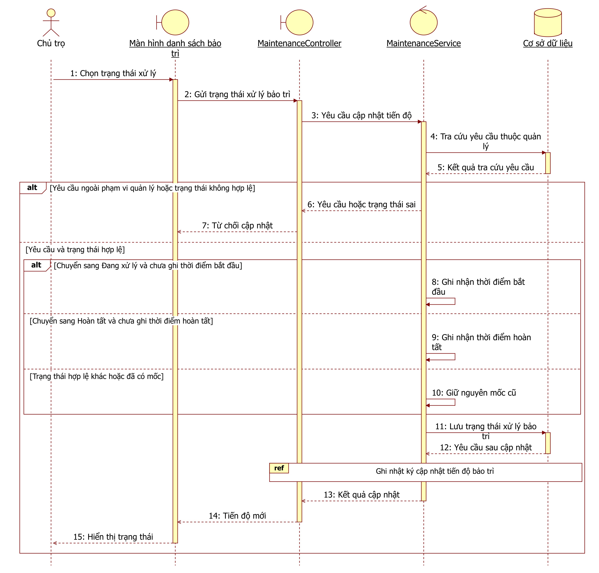

[SVG vector](docs/ba/sequence-diagrams/full/sd-09b-process-maintenance.svg) · [Nguồn draw.io](docs/ba/sequence-diagrams/full/sd-09b-process-maintenance.drawio)

| Bước | Bên gửi → Bên nhận | Điều kiện nhánh | Diễn giải nghiệp vụ |
| --- | --- | --- | --- |
| 1 | Chủ trọ → Màn hình danh sách bảo trì | Luồng chung | Chọn trạng thái xử lý |
| 2 | Màn hình danh sách bảo trì → MaintenanceController | Luồng chung | Gửi trạng thái xử lý bảo trì |
| 3 | MaintenanceController → MaintenanceService | Luồng chung | Yêu cầu cập nhật tiến độ |
| 4 | MaintenanceService → Cơ sở dữ liệu | Luồng chung | Tra cứu yêu cầu thuộc quản lý |
| 5 | Cơ sở dữ liệu → MaintenanceService | Luồng chung | Kết quả tra cứu yêu cầu |
| 6 | MaintenanceService → MaintenanceController | alt Yêu cầu ngoài phạm vi quản lý hoặc trạng thái không hợp lệ | Yêu cầu hoặc trạng thái sai |
| 7 | MaintenanceController → Màn hình danh sách bảo trì | alt Yêu cầu ngoài phạm vi quản lý hoặc trạng thái không hợp lệ | Từ chối cập nhật |
| 8 | MaintenanceService → MaintenanceService | alt Yêu cầu và trạng thái hợp lệ / alt Chuyển sang Đang xử lý và chưa ghi thời điểm bắt đầu | Ghi nhận thời điểm bắt đầu |
| 9 | MaintenanceService → MaintenanceService | alt Yêu cầu và trạng thái hợp lệ / alt Chuyển sang Hoàn tất và chưa ghi thời điểm hoàn tất | Ghi nhận thời điểm hoàn tất |
| 10 | MaintenanceService → MaintenanceService | alt Yêu cầu và trạng thái hợp lệ / alt Trạng thái hợp lệ khác hoặc đã có mốc | Giữ nguyên mốc cũ |
| 11 | MaintenanceService → Cơ sở dữ liệu | alt Yêu cầu và trạng thái hợp lệ | Lưu trạng thái xử lý bảo trì |
| 12 | Cơ sở dữ liệu → MaintenanceService | alt Yêu cầu và trạng thái hợp lệ | Yêu cầu sau cập nhật |
| 13 | MaintenanceService → MaintenanceController | alt Yêu cầu và trạng thái hợp lệ | Kết quả cập nhật |
| 14 | MaintenanceController → Màn hình danh sách bảo trì | alt Yêu cầu và trạng thái hợp lệ | Tiến độ mới |
| 15 | Màn hình danh sách bảo trì → Chủ trọ | alt Yêu cầu và trạng thái hợp lệ | Hiển thị trạng thái |

**SD-09C Hoàn tất bảo trì và ghi nhận chi phí**

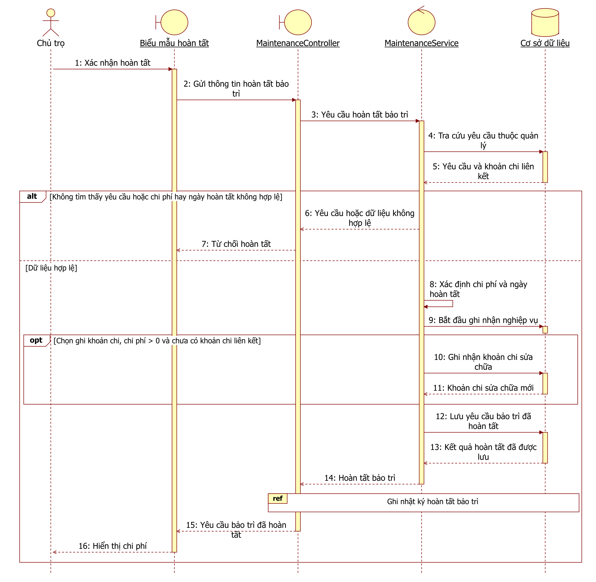

[SVG vector](docs/ba/sequence-diagrams/full/sd-09c-complete-maintenance.svg) · [Nguồn draw.io](docs/ba/sequence-diagrams/full/sd-09c-complete-maintenance.drawio)

| Bước | Bên gửi → Bên nhận | Điều kiện nhánh | Diễn giải nghiệp vụ |
| --- | --- | --- | --- |
| 1 | Chủ trọ → Biểu mẫu hoàn tất | Luồng chung | Xác nhận hoàn tất |
| 2 | Biểu mẫu hoàn tất → MaintenanceController | Luồng chung | Gửi thông tin hoàn tất bảo trì |
| 3 | MaintenanceController → MaintenanceService | Luồng chung | Yêu cầu hoàn tất bảo trì |
| 4 | MaintenanceService → Cơ sở dữ liệu | Luồng chung | Tra cứu yêu cầu thuộc quản lý |
| 5 | Cơ sở dữ liệu → MaintenanceService | Luồng chung | Yêu cầu và khoản chi liên kết |
| 6 | MaintenanceService → MaintenanceController | alt Không tìm thấy yêu cầu hoặc chi phí hay ngày hoàn tất không hợp lệ | Yêu cầu hoặc dữ liệu không hợp lệ |
| 7 | MaintenanceController → Biểu mẫu hoàn tất | alt Không tìm thấy yêu cầu hoặc chi phí hay ngày hoàn tất không hợp lệ | Từ chối hoàn tất |
| 8 | MaintenanceService → MaintenanceService | alt Dữ liệu hợp lệ | Xác định chi phí và ngày hoàn tất |
| 9 | MaintenanceService → Cơ sở dữ liệu | alt Dữ liệu hợp lệ | Bắt đầu ghi nhận nghiệp vụ |
| 10 | MaintenanceService → Cơ sở dữ liệu | alt Dữ liệu hợp lệ / opt Chọn ghi khoản chi, chi phí > 0 và chưa có khoản chi liên kết | Ghi nhận khoản chi sửa chữa |
| 11 | Cơ sở dữ liệu → MaintenanceService | alt Dữ liệu hợp lệ / opt Chọn ghi khoản chi, chi phí > 0 và chưa có khoản chi liên kết | Khoản chi sửa chữa mới |
| 12 | MaintenanceService → Cơ sở dữ liệu | alt Dữ liệu hợp lệ | Lưu yêu cầu bảo trì đã hoàn tất |
| 13 | Cơ sở dữ liệu → MaintenanceService | alt Dữ liệu hợp lệ | Kết quả hoàn tất đã được lưu |
| 14 | MaintenanceService → MaintenanceController | alt Dữ liệu hợp lệ | Hoàn tất bảo trì |
| 15 | MaintenanceController → Biểu mẫu hoàn tất | alt Dữ liệu hợp lệ | Yêu cầu bảo trì đã hoàn tất |
| 16 | Biểu mẫu hoàn tất → Chủ trọ | alt Dữ liệu hợp lệ | Hiển thị chi phí |

##### 2.4.4.12. Xem và xuất báo cáo tháng

**Điều kiện trước:** Chủ trọ đã đăng nhập; chọn tháng và tùy chọn khu trọ thuộc quyền chưa lưu trữ.

**Dữ liệu đầu vào:** Tháng báo cáo và khu trọ tùy chọn.

**Điều kiện sau khi thành công:** Hiển thị số liệu trong phạm vi đã chọn. Khi xuất, tạo nội dung báo cáo CSV và sao chép để người dùng sử dụng tiếp.

**Khi bị từ chối:** Không đi tiếp nhánh thành công. Nếu kết quả đã được lưu nhưng mất phản hồi, cần kiểm tra trước khi thực hiện lại.

**Lưu ý nghiệp vụ**

- Tiền phải thu theo kỳ hóa đơn; tiền đã thu theo thời điểm thanh toán, có tính các khoản hoàn tác; chi phí và giao dịch cọc theo thời điểm phát sinh.
- Số còn phải thu là số dư hiện tại của hóa đơn kỳ đã chọn. Số hợp đồng hiệu lực phản ánh hiện tại, không tái dựng thời điểm cuối tháng. PX-22 cần chốt ý nghĩa.
- Lợi nhuận ước tính bằng tiền đã thu trừ chi phí, không cộng cọc vào doanh thu. Chỉ số cọc trả hiện gồm cả hoàn cọc và khấu trừ.
- PX-23: xuất CSV hiện sao chép nội dung, không tải tệp và không xuất PDF. Dữ liệu được tổng hợp lại khi xuất, nên có thể khác thời điểm xem.
- Không có phát sinh vẫn là báo cáo hợp lệ; các tổng tiền bằng 0, số hợp đồng hiệu lực vẫn đếm tại thời điểm xem. Hiện trạng chưa có thông báo lỗi riêng cho thao tác xuất.

**SD-10A Xem báo cáo thu chi tháng**

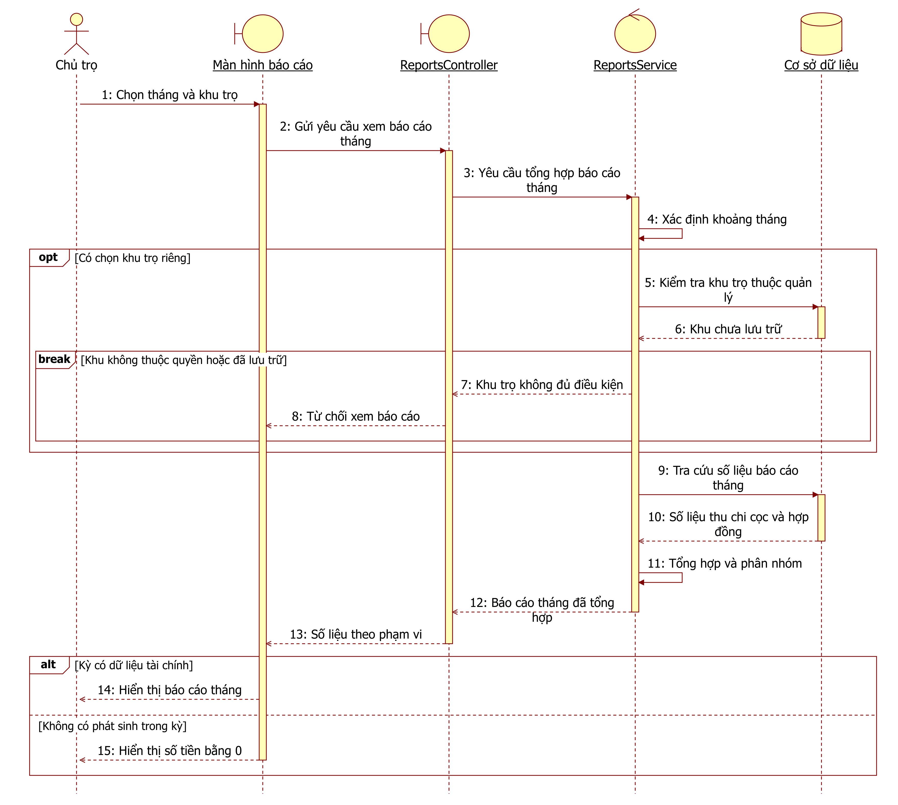

[SVG vector](docs/ba/sequence-diagrams/full/sd-10a-monthly-report.svg) · [Nguồn draw.io](docs/ba/sequence-diagrams/full/sd-10a-monthly-report.drawio)

| Bước | Bên gửi → Bên nhận | Điều kiện nhánh | Diễn giải nghiệp vụ |
| --- | --- | --- | --- |
| 1 | Chủ trọ → Màn hình báo cáo | Luồng chung | Chọn tháng và khu trọ |
| 2 | Màn hình báo cáo → ReportsController | Luồng chung | Gửi yêu cầu xem báo cáo tháng |
| 3 | ReportsController → ReportsService | Luồng chung | Yêu cầu tổng hợp báo cáo tháng |
| 4 | ReportsService → ReportsService | Luồng chung | Xác định khoảng tháng |
| 5 | ReportsService → Cơ sở dữ liệu | opt Có chọn khu trọ riêng | Kiểm tra khu trọ thuộc quản lý |
| 6 | Cơ sở dữ liệu → ReportsService | opt Có chọn khu trọ riêng | Khu chưa lưu trữ |
| 7 | ReportsService → ReportsController | opt Có chọn khu trọ riêng / break Khu không thuộc quyền hoặc đã lưu trữ | Khu trọ không đủ điều kiện |
| 8 | ReportsController → Màn hình báo cáo | opt Có chọn khu trọ riêng / break Khu không thuộc quyền hoặc đã lưu trữ | Từ chối xem báo cáo |
| 9 | ReportsService → Cơ sở dữ liệu | Luồng chung | Tra cứu số liệu báo cáo tháng |
| 10 | Cơ sở dữ liệu → ReportsService | Luồng chung | Số liệu thu chi cọc và hợp đồng |
| 11 | ReportsService → ReportsService | Luồng chung | Tổng hợp và phân nhóm |
| 12 | ReportsService → ReportsController | Luồng chung | Báo cáo tháng đã tổng hợp |
| 13 | ReportsController → Màn hình báo cáo | Luồng chung | Số liệu theo phạm vi |
| 14 | Màn hình báo cáo → Chủ trọ | alt Kỳ có dữ liệu tài chính | Hiển thị báo cáo tháng |
| 15 | Màn hình báo cáo → Chủ trọ | alt Không có phát sinh trong kỳ | Hiển thị số tiền bằng 0 |

**SD-10B Xuất báo cáo và sao chép nội dung CSV**

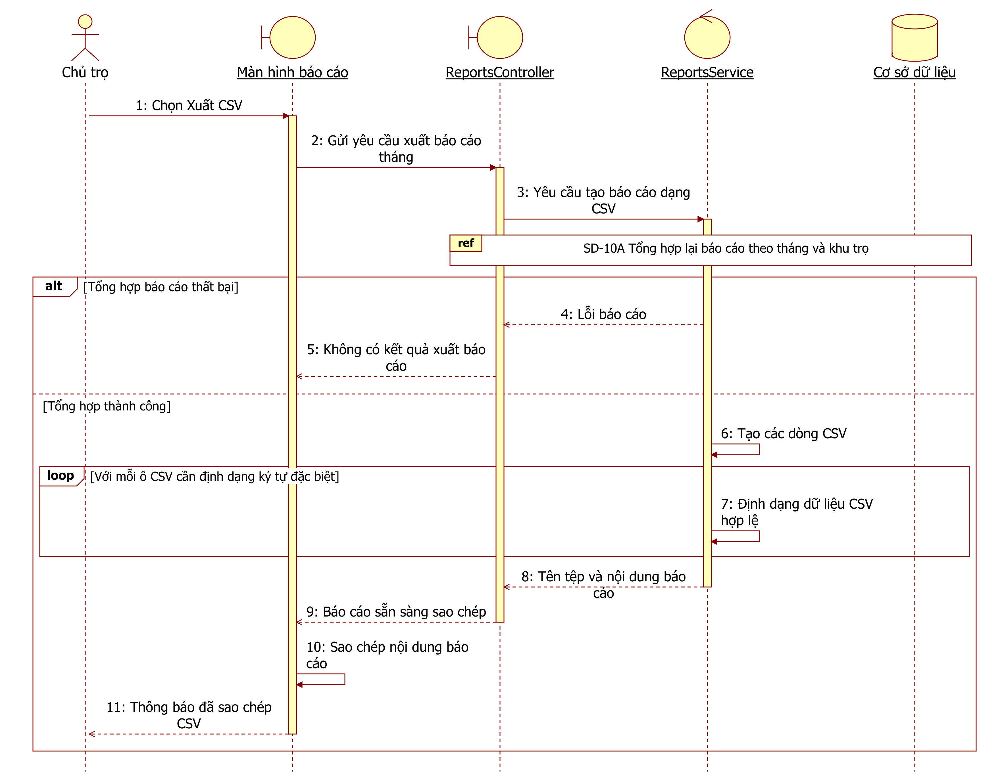

[SVG vector](docs/ba/sequence-diagrams/full/sd-10b-export-csv.svg) · [Nguồn draw.io](docs/ba/sequence-diagrams/full/sd-10b-export-csv.drawio)

| Bước | Bên gửi → Bên nhận | Điều kiện nhánh | Diễn giải nghiệp vụ |
| --- | --- | --- | --- |
| 1 | Chủ trọ → Màn hình báo cáo | Luồng chung | Chọn Xuất CSV |
| 2 | Màn hình báo cáo → ReportsController | Luồng chung | Gửi yêu cầu xuất báo cáo tháng |
| 3 | ReportsController → ReportsService | Luồng chung | Yêu cầu tạo báo cáo dạng CSV |
| 4 | ReportsService → ReportsController | alt Tổng hợp báo cáo thất bại | Lỗi báo cáo |
| 5 | ReportsController → Màn hình báo cáo | alt Tổng hợp báo cáo thất bại | Không có kết quả xuất báo cáo |
| 6 | ReportsService → ReportsService | alt Tổng hợp thành công | Tạo các dòng CSV |
| 7 | ReportsService → ReportsService | alt Tổng hợp thành công / loop Với mỗi ô CSV cần định dạng ký tự đặc biệt | Định dạng dữ liệu CSV hợp lệ |
| 8 | ReportsService → ReportsController | alt Tổng hợp thành công | Tên tệp và nội dung báo cáo |
| 9 | ReportsController → Màn hình báo cáo | alt Tổng hợp thành công | Báo cáo sẵn sàng sao chép |
| 10 | Màn hình báo cáo → Màn hình báo cáo | alt Tổng hợp thành công | Sao chép nội dung báo cáo |
| 11 | Màn hình báo cáo → Chủ trọ | alt Tổng hợp thành công | Thông báo đã sao chép CSV |

##### 2.4.4.13. Tài nguyên chỉnh sửa và giới hạn

- [Đặc tả Word chi tiết](docs/ba/SEQUENCE_DIAGRAM_SPECIFICATION.docx) và [đặc tả Markdown](docs/ba/SEQUENCE_DIAGRAM_SPECIFICATION.md) chứa các bảng liên hệ triển khai, căn cứ kiểm chứng và đối chiếu Use Case.
- [Bộ nguồn draw.io](docs/ba/sequence-diagrams/full/SEQUENCE_DIAGRAMS.drawio) gồm 22 trang chỉnh sửa được; [hướng dẫn](docs/ba/sequence-diagrams/full/README.md) nêu cách tái tạo và kiểm tra.
- Bộ hình ưu tiên nội dung nghiệp vụ. Các giới hạn và điểm PX chưa xác nhận vẫn được giữ nguyên, không đồng nghĩa đã khắc phục trong ứng dụng.
- SD-01 chính thức là đăng nhập, SD-04 là tạo hợp đồng. SD-01 tạo hợp đồng trong bộ demo cũ chỉ là lịch sử duyệt form.

#### 2.4.5. Các màn hình giao diện người dùng

Giao diện người dùng của hệ thống được thiết kế theo hướng mobile-first, ưu tiên thao tác nhanh trên điện thoại. Các màn hình được chia theo ba khu vực chính: khu vực Admin, khu vực Chủ trọ và tenant portal cho Người thuê phòng.

| Nhóm màn hình | Màn hình | Người dùng | Mục đích |
|---|---|---|---|
| Khởi động và xác thực | Splash, Onboarding, Login, Register | Admin, Chủ trọ, Người thuê phòng | Kiểm tra phiên, giới thiệu hệ thống, đăng nhập hoặc đăng ký. |
| Admin | Admin dashboard | Admin | Xem tổng quan nền tảng và các số liệu quản trị. |
| Admin | Quản lý chủ trọ | Admin | Xem, tạo, cập nhật, khóa hoặc mở khóa tài khoản chủ trọ. |
| Admin | Quản lý khu trọ toàn hệ thống | Admin | Theo dõi hoặc cập nhật thông tin khu trọ ở phạm vi hệ thống. |
| Chủ trọ | Dashboard | Chủ trọ | Xem số phòng, doanh thu, công nợ, hóa đơn gần đây và việc cần xử lý. |
| Chủ trọ | Danh sách khu trọ | Chủ trọ | Tạo, chọn, cập nhật, archive/restore khu trọ. |
| Chủ trọ | Danh sách phòng | Chủ trọ | Xem phòng theo khu trọ, trạng thái và thông tin vận hành. |
| Chủ trọ | Chi tiết phòng | Chủ trọ | Xem thông tin phòng, người thuê hiện tại, tài sản, phí dịch vụ và lịch sử liên quan. |
| Chủ trọ | Form phòng | Chủ trọ | Tạo hoặc cập nhật phòng. |
| Chủ trọ | Danh sách người thuê | Chủ trọ | Theo dõi hồ sơ người thuê đang hoạt động hoặc không hoạt động. |
| Chủ trọ | Chi tiết người thuê | Chủ trọ | Xem thông tin cá nhân, hợp đồng, hóa đơn và lời mời tenant portal. |
| Chủ trọ | Form hợp đồng | Chủ trọ | Tạo hợp đồng thuê phòng cho người thuê. |
| Chủ trọ | Billing | Chủ trọ | Xem danh sách hóa đơn, lọc hóa đơn, lập hóa đơn và ghi nhận thanh toán. |
| Chủ trọ | Chi tiết hóa đơn | Chủ trọ | Xem khoản tính tiền, timeline thanh toán, minh chứng và thao tác duyệt/từ chối. |
| Chủ trọ | Bảo trì | Chủ trọ | Xem, tạo, cập nhật trạng thái và xử lý yêu cầu bảo trì. |
| Chủ trọ | Chi phí | Chủ trọ | Tạo, cập nhật và phân loại chi phí vận hành. |
| Chủ trọ | Báo cáo | Chủ trọ | Xem báo cáo tháng, công nợ, chi phí, lợi nhuận và xuất CSV. |
| Chủ trọ | Thông báo/Audit/Action items | Chủ trọ | Theo dõi thông báo, lịch sử thao tác và danh sách việc cần xử lý. |
| Tenant portal | Tổng quan người thuê | Người thuê phòng | Xem hợp đồng, hóa đơn và trạng thái cần chú ý. |
| Tenant portal | Danh sách/chi tiết hóa đơn | Người thuê phòng | Xem hóa đơn, tải/chia sẻ PDF và gửi minh chứng thanh toán. |
| Tenant portal | Danh sách hợp đồng | Người thuê phòng | Xem hợp đồng hiện tại và lịch sử thuê. |
| Tenant portal | Bảo trì | Người thuê phòng | Tạo yêu cầu bảo trì, gửi phản hồi và theo dõi trạng thái xử lý. |
| Tenant portal | Thông báo/Zalo/Đổi mật khẩu | Người thuê phòng | Xem thông báo, tin nhắn liên quan và đổi mật khẩu tài khoản. |

## 3. Yêu cầu kỹ thuật

**Kiến trúc tổng quan**

- Ứng dụng client-server.
- Client mobile được xây dựng bằng Flutter.
- Backend được xây dựng bằng NestJS và cung cấp RESTful API dưới prefix `/api/v1`.
- Cơ sở dữ liệu PostgreSQL, truy cập qua Prisma ORM.
- Xác thực bằng JWT access token và rotating refresh token.
- Phân quyền theo role chính trong phạm vi báo cáo: `admin`, `landlord` và `tenant`.

**Công nghệ sử dụng**

- **Frontend:** Flutter, Dart, Riverpod, GoRouter, Dio, flutter_secure_storage.
- **Backend:** NestJS, TypeScript, Prisma ORM.
- **Database:** PostgreSQL.
- **Bảo mật:** Argon2id password hashing, JWT, refresh token hash, role guard, permission guard, CORS và Helmet.
- **Thông báo:** Zalo/ZNS hoặc kênh thông báo nội bộ.
- **Upload:** Hỗ trợ upload hình ảnh minh chứng thanh toán, ảnh phòng, ảnh bảo trì.

**Yêu cầu chất lượng**

- Giao diện tiếng Việt, dễ đọc trên màn hình điện thoại.
- Có trạng thái loading, error, empty và retry rõ ràng.
- API không tin dữ liệu nhạy cảm từ client; mọi truy vấn được scope theo tài khoản đăng nhập.
- Các thao tác thay đổi trạng thái quan trọng cần được thực hiện trong transaction khi liên quan nhiều bảng.
- Có unit test, API contract test và E2E test cho các luồng quan trọng.

## 4. Kiến trúc phần mềm

Hệ thống Rental Room Management sử dụng kiến trúc client-server. Flutter app đóng vai trò giao diện chính cho admin và người thuê. Backend NestJS xử lý nghiệp vụ, xác thực, phân quyền và truy cập PostgreSQL thông qua Prisma.

```text
Kiến trúc - Rental Room Management

┌──────────────────────────────────────────────────────────────┐
│                 Flutter Mobile App                           │
│  Admin Dashboard · Tenant Portal                              │
└─────────────────────────────┬────────────────────────────────┘
                              │ REST /api/v1 + Bearer JWT
┌─────────────────────────────▼────────────────────────────────┐
│                       NestJS API                              │
│ Auth · Dashboard · Properties · Rooms · Tenants · Leases      │
│ Billing · Expenses · Maintenance · Reports · Notifications    │
│ Admin · Tenant Portal · Audit · Uploads                       │
└─────────────────────────────┬────────────────────────────────┘
                              │ Prisma ORM
┌─────────────────────────────▼────────────────────────────────┐
│                       PostgreSQL                              │
│ User · Property · Room · Tenant · Lease · Invoice · Payment   │
│ MeterReading · Expense · MaintenanceTicket · AuditLog         │
└──────────────────────────────────────────────────────────────┘
```

### Các lớp chính

- **Presentation layer:** Các màn hình Flutter như admin dashboard, danh sách phòng, chi tiết người thuê, hóa đơn, bảo trì, báo cáo và tenant portal.
- **State/data layer:** Riverpod providers, repository và API client phụ trách lấy dữ liệu, cache nhẹ và quản lý trạng thái màn hình.
- **API layer:** NestJS controllers nhận request, validate input và gọi service.
- **Business layer:** NestJS services xử lý nghiệp vụ như tạo hợp đồng, lập hóa đơn, ghi nhận thanh toán, cập nhật trạng thái phòng.
- **Data layer:** Prisma schema, migration và PostgreSQL lưu trữ dữ liệu có quan hệ.

## 5. Tổ chức dữ liệu

### 5.1. Người dùng, vai trò và phiên đăng nhập

```text
TABLE: users
id              UUID PK
full_name       VARCHAR
email           VARCHAR UNIQUE
phone           VARCHAR NULL
password_hash   TEXT
role            ENUM(ADMIN, TENANT)
is_active       BOOLEAN
created_at      TIMESTAMP
updated_at      TIMESTAMP
```

```text
TABLE: refresh_tokens
id                    UUID PK
user_id               UUID FK -> users
token_hash            VARCHAR UNIQUE
expires_at            TIMESTAMP
revoked_at            TIMESTAMP NULL
replaced_by_token_id  UUID NULL
created_at            TIMESTAMP
```

**Ý nghĩa:** Bảng `users` quản lý tài khoản admin và người thuê. Vai trò được dùng để điều hướng trong Flutter và bảo vệ API trên backend. Refresh token được lưu dưới dạng hash để giảm rủi ro nếu dữ liệu bị rò rỉ.

### 5.2. Khu trọ, phòng và tài sản phòng

```text
TABLE: properties
id           UUID PK
admin_id     UUID FK -> users
name         VARCHAR
address      TEXT
is_archived  BOOLEAN
created_at   TIMESTAMP
updated_at   TIMESTAMP
```

```text
TABLE: rooms
id           UUID PK
property_id  UUID FK -> properties
name         VARCHAR
floor        INT NULL
area_sqm     FLOAT NULL
base_price   INT
status       ENUM(OCCUPIED, VACANT, MAINTENANCE)
is_active    BOOLEAN
capacity     INT NULL
amenities    TEXT[]
image_url    TEXT NULL
tenant_name  VARCHAR NULL
note         TEXT NULL
created_at   TIMESTAMP
updated_at   TIMESTAMP
```

```text
TABLE: room_assets
id            UUID PK
room_id       UUID FK -> rooms
name          VARCHAR
quantity      INT
condition     VARCHAR
value         INT NULL
purchased_at  TIMESTAMP NULL
note          TEXT NULL
image_url     TEXT NULL
created_at    TIMESTAMP
updated_at    TIMESTAMP
```

```text
TABLE: room_service_fees
id          UUID PK
room_id     UUID FK -> rooms
name        VARCHAR
amount      INT
is_active   BOOLEAN
note        TEXT NULL
created_at  TIMESTAMP
updated_at  TIMESTAMP
```

**Ý nghĩa:** Dữ liệu khu trọ và phòng là trung tâm của hệ thống. Mỗi phòng thuộc một khu trọ, mỗi khu trọ được quản lý bởi admin. Phòng có trạng thái riêng để phục vụ lọc nhanh trên dashboard và ngăn tạo hợp đồng sai.

### 5.3. Người thuê, hợp đồng và tiền cọc

```text
TABLE: tenants
id           UUID PK
admin_id     UUID FK -> users
user_id      UUID FK -> users NULL UNIQUE
full_name    VARCHAR
phone        VARCHAR NULL
id_number    VARCHAR NULL
note         TEXT NULL
is_active    BOOLEAN
created_at   TIMESTAMP
updated_at   TIMESTAMP
```

```text
TABLE: leases
id            UUID PK
room_id       UUID FK -> rooms
tenant_id     UUID FK -> tenants
start_date    DATE
end_date      DATE NULL
monthly_rent  INT
deposit       INT
status        ENUM(ACTIVE, ENDED)
created_at    TIMESTAMP
updated_at    TIMESTAMP
```

```text
TABLE: deposit_transactions
id           UUID PK
lease_id     UUID FK -> leases
admin_id     UUID FK -> users
type         ENUM(COLLECTED, REFUNDED, DEDUCTED, ADJUSTMENT)
amount       INT
occurred_at  TIMESTAMP
note         TEXT NULL
created_at   TIMESTAMP
```

**Ý nghĩa:** Bảng `leases` biểu diễn quan hệ thuê phòng theo thời gian. Một phòng chỉ nên có một hợp đồng active tại một thời điểm. Khi hợp đồng thay đổi, hệ thống cập nhật trạng thái phòng và ghi lại lịch sử liên quan.

### 5.4. Chỉ số điện nước, hóa đơn và thanh toán

```text
TABLE: meter_readings
id                UUID PK
room_id           UUID FK -> rooms
utility_type      ENUM(ELECTRICITY, WATER)
billing_month     DATE
previous_reading  INT
current_reading   INT
unit_price        INT
usage             INT
amount            INT
note              TEXT NULL
created_at        TIMESTAMP
updated_at        TIMESTAMP
```

```text
TABLE: invoices
id                  UUID PK
lease_id             UUID FK -> leases
room_id              UUID FK -> rooms
tenant_id            UUID FK -> tenants
billing_month        DATE
rent_amount          INT
electricity_amount   INT
water_amount         INT
other_amount         INT
total_amount         INT
paid_amount          INT
status               ENUM(UNPAID, PARTIAL, PAID, CANCELLED)
due_date             DATE NULL
issued_at            TIMESTAMP
note                 TEXT NULL
cancelled_at         TIMESTAMP NULL
cancelled_note       TEXT NULL
created_at           TIMESTAMP
updated_at           TIMESTAMP
```

```text
TABLE: payments
id                      UUID PK
invoice_id              UUID FK -> invoices
amount                  INT
method                  ENUM(CASH, BANK_TRANSFER, OTHER)
type                    ENUM(PAYMENT, REVERSAL)
reversal_of_payment_id  UUID NULL
paid_at                 TIMESTAMP
note                    TEXT NULL
created_at              TIMESTAMP
```

```text
TABLE: payment_proofs
id                UUID PK
invoice_id         UUID FK -> invoices
tenant_id          UUID FK -> tenants
amount             INT
method             ENUM(CASH, BANK_TRANSFER, OTHER)
note               TEXT NULL
proof_image_urls   TEXT[]
status             ENUM(PENDING, APPROVED, REJECTED)
submitted_at       TIMESTAMP
reviewed_at        TIMESTAMP NULL
reviewed_by_id     UUID FK -> users NULL
review_note        TEXT NULL
```

**Ý nghĩa:** Nhóm dữ liệu billing giúp tự động tính tiền phòng và tiền dịch vụ theo tháng. Hóa đơn có thể được thanh toán một phần, hủy hoặc đảo ngược giao dịch nếu cần điều chỉnh.

### 5.5. Bảo trì, chi phí và vận hành

```text
TABLE: maintenance_tickets
id              UUID PK
admin_id        UUID FK -> users
property_id     UUID FK -> properties
room_id         UUID FK -> rooms
status          ENUM(OPEN, IN_PROGRESS, DONE, CANCELLED)
priority        ENUM(LOW, MEDIUM, URGENT)
title           VARCHAR
description     TEXT NULL
reported_at     TIMESTAMP
started_at      TIMESTAMP NULL
completed_at    TIMESTAMP NULL
estimated_cost  INT NULL
actual_cost     INT NULL
note            TEXT NULL
image_urls      TEXT[]
expense_id      UUID FK -> expenses NULL
created_at      TIMESTAMP
updated_at      TIMESTAMP
```

```text
TABLE: expenses
id            UUID PK
admin_id      UUID FK -> users
property_id   UUID FK -> properties
room_id       UUID FK -> rooms NULL
category      ENUM(REPAIR, UTILITIES, INTERNET, CLEANING, FURNITURE, SALARY, TAX, OTHER)
amount        INT
expense_date  DATE
title         VARCHAR
note          TEXT NULL
receipt_url   TEXT NULL
created_at    TIMESTAMP
updated_at    TIMESTAMP
```

**Ý nghĩa:** Bảo trì và chi phí được gắn với khu trọ/phòng để admin tính được chi phí vận hành thật, từ đó lập báo cáo lợi nhuận chính xác hơn.

### 5.6. Thông báo, báo cáo và audit log

```text
TABLE: notification_deliveries
id                   UUID PK
admin_id              UUID FK -> users
tenant_id             UUID FK -> tenants NULL
invoice_id            UUID FK -> invoices NULL
channel               ENUM(ZALO)
purpose               VARCHAR
recipient             VARCHAR
template_id           VARCHAR NULL
status                ENUM(PENDING, SENT, FAILED, SKIPPED)
payload               JSON
provider_message_id   VARCHAR NULL
error_code            VARCHAR NULL
error_message         TEXT NULL
sent_at               TIMESTAMP NULL
created_at            TIMESTAMP
updated_at            TIMESTAMP
```

```text
TABLE: audit_logs
id             UUID PK
admin_id       UUID FK -> users NULL
actor_id       UUID FK -> users NULL
actor_role     ENUM(ADMIN, TENANT)
action         VARCHAR
resource_type  VARCHAR
resource_id    UUID NULL
summary        TEXT
metadata       JSON
created_at     TIMESTAMP
```

**Ý nghĩa:** Thông báo giúp theo dõi việc gửi nhắc nợ, hóa đơn và tin nhắn. Audit log giúp truy vết ai đã thực hiện thao tác nào, phù hợp với các hệ thống có liên quan đến tiền, hợp đồng và dữ liệu người thuê.

## 6. Tính năng nổi bật

### 6.1. Smart Billing & Late Payment Prediction

Hệ thống hỗ trợ tạo hóa đơn thông minh theo tháng dựa trên hợp đồng active, tiền thuê hằng tháng, chỉ số điện nước, phí dịch vụ và các khoản phụ thu. Trước khi tạo hóa đơn, backend kiểm tra trùng lặp theo hợp đồng và tháng tính tiền để tránh lập hóa đơn hai lần.

Ở hướng phát triển nâng cao, hệ thống có thể phân tích lịch sử thanh toán để dự đoán người thuê có nguy cơ trễ hạn, từ đó giúp admin chủ động nhắc thanh toán trước ngày đến hạn. Ngoài ra, hệ thống có thể phát hiện chỉ số điện/nước bất thường nếu mức sử dụng tăng quá cao so với các tháng trước.

| Input | Xử lý | Output |
|---|---|---|
| Hợp đồng active | Lấy tiền thuê hằng tháng | Tiền phòng |
| Chỉ số điện/nước | Tính usage = current - previous | Tiền điện, tiền nước |
| Phí dịch vụ/phụ thu | Cộng vào other amount | Tổng tiền hóa đơn |
| Thanh toán | Cập nhật paid amount | Trạng thái UNPAID/PARTIAL/PAID |
| Lịch sử thanh toán | Phân tích số lần trễ hạn và số ngày trễ | Cảnh báo nguy cơ trễ thanh toán |
| Lịch sử điện/nước | So sánh với mức dùng trung bình | Cảnh báo chỉ số bất thường |

### 6.2. Maintenance Issue Classification

Khi người thuê hoặc admin tạo yêu cầu bảo trì, hệ thống có thể phân loại vấn đề dựa trên tiêu đề, mô tả và hình ảnh đính kèm. Các nhóm thường gặp gồm điện, nước, nội thất, vệ sinh, thiết bị và hạ tầng phòng. Việc phân loại này giúp admin ưu tiên xử lý nhanh các lỗi nghiêm trọng và thống kê loại sự cố xuất hiện nhiều nhất.

| Input | Trọng số tham khảo | Output |
|---|---:|---|
| Tiêu đề và mô tả sự cố | 40% | Nhóm lỗi bảo trì |
| Mức độ khẩn cấp do người thuê chọn | 20% | Priority đề xuất |
| Lịch sử ticket cùng loại | 20% | Chi phí ước tính |
| Hình ảnh đính kèm | 20% | Gợi ý kiểm tra ban đầu |

Ví dụ: Khi người thuê gửi yêu cầu "phòng bị rò nước ở nhà vệ sinh", hệ thống có thể gợi ý nhóm lỗi `WATER`, mức ưu tiên `URGENT`, đồng thời hiển thị các ticket tương tự từng phát sinh trước đó.

### 6.3. Chatbot quản lý trọ tiếng Việt

Chatbot giúp admin truy vấn nhanh dữ liệu và thao tác bằng ngôn ngữ tự nhiên. Ban đầu chatbot có thể hoạt động theo rule-based command; ở giai đoạn nâng cao có thể kết hợp AI/RAG để đọc dữ liệu phòng, hóa đơn, hợp đồng và báo cáo.

**Ví dụ câu hỏi/tác vụ:**

- "Tháng này phòng nào chưa đóng tiền?"
- "Tạo hóa đơn tháng 9 cho khu A."
- "Có hợp đồng nào sắp hết hạn trong 30 ngày tới không?"
- "Tổng chi phí sửa chữa tháng này là bao nhiêu?"
- "Liệt kê các phòng đang bảo trì."
- "Người thuê phòng 203 còn nợ bao nhiêu?"

Chatbot không thay thế các màn hình quản lý chính, mà đóng vai trò trợ lý thao tác nhanh, đặc biệt hữu ích khi admin cần kiểm tra dữ liệu ngay trên điện thoại.

### 6.4. Tenant portal cho người thuê

Người thuê có cổng thông tin riêng để xem hóa đơn, lịch sử hợp đồng, thông báo và gửi minh chứng thanh toán. Tính năng này giúp giảm việc trao đổi rời rạc qua tin nhắn, đồng thời giúp admin lưu lại lịch sử thanh toán minh bạch.

Ở hướng mở rộng, tenant portal có thể tự nhắc người thuê trước hạn thanh toán, hiển thị QR/chuyển khoản, cho phép gửi phản hồi về chất lượng phòng và theo dõi tiến độ xử lý bảo trì.

### 6.5. Quản lý vòng đời phòng và hợp đồng

Khi tạo hợp đồng, phòng được chuyển sang trạng thái đang thuê. Khi kết thúc hợp đồng, phòng được cập nhật lại thành phòng trống. Các thao tác archive, deactivate và delete được kiểm tra điều kiện để tránh mất dữ liệu lịch sử.

Hướng phát triển nâng cao là cảnh báo hợp đồng sắp hết hạn, gợi ý gia hạn hợp đồng, hoặc nhắc admin kiểm tra phòng trước ngày người thuê rời đi.

### 6.6. Phân quyền theo vai trò

Hệ thống tách rõ `ADMIN` và `TENANT`. Admin có khu vực quản trị riêng để quản lý dữ liệu nhà trọ; tenant chỉ xem dữ liệu liên quan đến tài khoản và hợp đồng của mình.

### 6.7. Báo cáo vận hành thông minh

Báo cáo tổng hợp doanh thu, công nợ, chi phí, lợi nhuận, hóa đơn quá hạn và tỉ lệ lấp đầy. Đây là cơ sở để admin ra quyết định tăng/giảm giá phòng, tối ưu chi phí và xử lý các phòng có vấn đề.

Ở giai đoạn nâng cao, hệ thống có thể đưa ra nhận xét tự động như:

- Khu trọ nào có tỉ lệ lấp đầy thấp.
- Phòng nào thường xuyên phát sinh bảo trì.
- Tháng nào chi phí tăng bất thường.
- Người thuê nào thường xuyên thanh toán trễ.
- Doanh thu thực nhận so với doanh thu kỳ vọng.

Các phân tích này giúp dự án không chỉ dừng ở quản lý dữ liệu, mà tiến tới hỗ trợ quyết định vận hành cho admin.

## 7. Dữ liệu thực và dữ liệu mẫu

| Bảng/nhóm dữ liệu | Số lượng mục tiêu cho demo | Nguồn dữ liệu |
|---|---:|---|
| users | 20+ | Tạo tài khoản admin và tenant mẫu |
| properties | 5+ | Khu trọ mẫu theo địa chỉ thực tế hoặc giả lập |
| rooms | 100+ | Mỗi khu trọ 15-30 phòng |
| tenants | 80+ | Hồ sơ người thuê mẫu |
| leases | 80+ active, 30+ ended | Tạo theo lịch sử thuê phòng |
| meter_readings | 500+ | Điện/nước theo tháng cho từng phòng |
| invoices | 500+ | Hóa đơn 6-12 tháng |
| payments | 400+ | Thanh toán đủ, thanh toán một phần và nợ |
| expenses | 100+ | Chi phí sửa chữa, internet, vệ sinh, nội thất |
| maintenance_tickets | 80+ | Yêu cầu bảo trì với nhiều trạng thái |
| audit_logs | 300+ | Sinh từ các thao tác quan trọng |

Dữ liệu mẫu nên phân bố theo các trường hợp thực tế: phòng trống, phòng đang thuê, phòng bảo trì, hóa đơn quá hạn, người thuê đã rời đi, hợp đồng gần hết hạn, thanh toán một phần và yêu cầu bảo trì chưa xử lý.

## 8. Kế hoạch thực hiện

### Bước 1: Phân tích và thiết kế (1-2 tuần)

1. Xác định các vai trò người dùng và phạm vi thao tác của từng vai trò.
2. Lập user flow cho admin và người thuê.
3. Thiết kế ERD cho các bảng chính: User, Property, Room, Tenant, Lease, MeterReading, Invoice, Payment, Expense, MaintenanceTicket.
4. Thiết kế UI/UX mobile-first bằng Figma hoặc wireframe đơn giản.

### Bước 2: Chọn công nghệ và khởi tạo dự án (1 tuần)

1. Tạo Flutter app cho client mobile.
2. Tạo NestJS API cho backend.
3. Cấu hình PostgreSQL, Prisma migration và seed data.
4. Cấu hình môi trường local, biến môi trường và health check.

### Bước 3: Phát triển chức năng lõi (4-6 tuần)

1. Xây dựng auth, session restore, JWT refresh và role routing.
2. Xây dựng quản lý khu trọ và phòng.
3. Xây dựng quản lý người thuê và hợp đồng.
4. Xây dựng billing: ghi chỉ số, tạo hóa đơn, ghi nhận thanh toán.
5. Xây dựng dashboard tổng quan cho admin.
6. Xây dựng admin overview và quản lý khu trọ/phòng.

### Bước 4: Phát triển chức năng mở rộng (2-3 tuần)

1. Tenant portal cho người thuê.
2. Quản lý bảo trì, chi phí và báo cáo.
3. Thông báo/Zalo, minh chứng thanh toán và audit log.
4. Các vai trò mở rộng theo cấp quản lý, nếu còn thời gian phát triển.

### Bước 5: Kiểm thử và hoàn thiện (1-2 tuần)

1. Kiểm thử đơn vị cho model, provider và service.
2. Kiểm thử API contract giữa Flutter và NestJS.
3. Kiểm thử E2E các flow quan trọng: đăng nhập, tạo phòng, tạo hợp đồng, tạo hóa đơn, thu tiền, kết thúc hợp đồng.
4. Kiểm thử phân quyền: admin truy cập được màn hình quản lý, tenant chỉ xem dữ liệu liên quan đến tài khoản và hợp đồng của mình.
5. Sửa lỗi giao diện trên thiết bị thật và tối ưu trải nghiệm mobile.

### Bước 6: Báo cáo và demo (1 tuần)

1. Viết báo cáo đồ án, mô tả kiến trúc, cơ sở dữ liệu và luồng nghiệp vụ.
2. Chuẩn bị slide trình bày.
3. Chuẩn bị dữ liệu demo có đủ phòng, người thuê, hợp đồng, hóa đơn, thanh toán, bảo trì và báo cáo.
4. Demo luồng chính: admin đăng nhập -> xem dashboard -> tạo phòng -> tạo người thuê -> tạo hợp đồng -> tạo hóa đơn -> ghi thanh toán -> người thuê xem hóa đơn trên portal.

## Kết luận

Hệ thống Rental Room Management giải quyết bài toán quản lý nhà trọ theo hướng tập trung và có cấu trúc. Thay vì quản lý bằng ghi chép thủ công, admin có thể theo dõi phòng, người thuê, hợp đồng, hóa đơn, thanh toán, bảo trì và báo cáo trong một ứng dụng duy nhất; người thuê có cổng thông tin riêng để xem hóa đơn, hợp đồng và gửi yêu cầu hỗ trợ. Kiến trúc Flutter + NestJS + PostgreSQL phù hợp với mục tiêu xây dựng sản phẩm mobile-first, có khả năng mở rộng thêm vai trò và phân quyền chi tiết trong tương lai.
