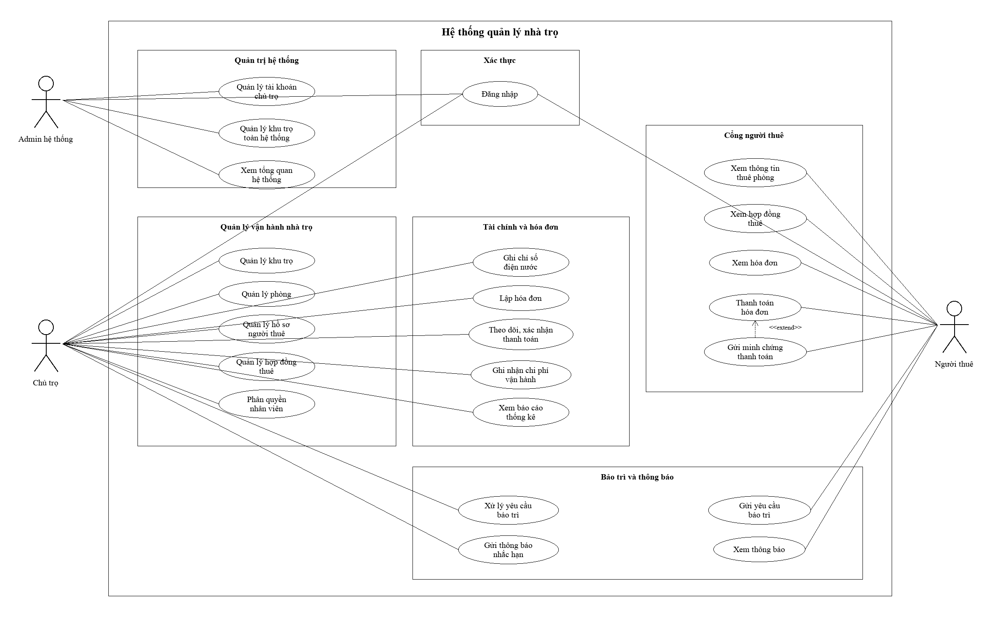

# PHẦN USE CASE - HỆ THỐNG QUẢN LÝ NHÀ TRỌ

## 1. Mục Đích Phần Use Case

Phần Use Case mô tả các tương tác chính giữa người dùng và hệ thống quản lý nhà trọ. Nội dung tập trung vào góc nhìn nghiệp vụ: người dùng cần thực hiện công việc gì, hệ thống phản hồi ra sao, điều kiện nào cần thỏa mãn và kết quả nghiệp vụ sau mỗi thao tác.

Tài liệu này không mô tả chi tiết kỹ thuật triển khai, cơ sở dữ liệu hoặc kiến trúc phần mềm. Các Use Case được trình bày nhằm hỗ trợ phân tích yêu cầu, thiết kế chức năng, kiểm thử nghiệm thu và đối chiếu phạm vi dự án.

## 2. Danh Sách Actor

| Mã actor | Actor | Mô tả nghiệp vụ | Mục tiêu sử dụng hệ thống |
|---|---|---|---|
| ACT-01 | Admin hệ thống | Người có quyền quản trị cao nhất trong hệ thống | Quản lý tài khoản, chủ trọ, dữ liệu tổng quan và các nghiệp vụ quản trị toàn hệ thống |
| ACT-02 | Chủ trọ / Landlord | Người quản lý trực tiếp khu trọ, phòng, người thuê và dòng tiền | Theo dõi vận hành nhà trọ, lập hóa đơn, thu tiền, xử lý công nợ, xem báo cáo |
| ACT-03 | Nhân viên / Staff | Người được phân công hỗ trợ một số nghiệp vụ vận hành | Thực hiện các chức năng được phân quyền như quản lý phòng, hóa đơn, bảo trì hoặc người thuê |
| ACT-04 | Người thuê / Tenant | Người đang thuê phòng và sử dụng cổng thông tin người thuê | Xem hợp đồng, hóa đơn, thông báo, gửi minh chứng thanh toán và yêu cầu bảo trì |
| ACT-05 | Hệ thống | Thành phần tự động kiểm tra, tính toán, cảnh báo và lưu vết thao tác | Đảm bảo dữ liệu hợp lệ, trạng thái chính xác và các quy tắc nghiệp vụ được áp dụng |

## 3. Phạm Vi Use Case

| Nhóm Use Case | Phạm vi nghiệp vụ | Actor liên quan |
|---|---|---|
| Xác thực và phân quyền | Đăng nhập, đăng xuất, điều hướng theo vai trò, kiểm soát quyền truy cập | Admin, Landlord, Staff, Tenant |
| Quản lý khu trọ | Tạo, xem, cập nhật, lưu trữ và chọn khu trọ đang quản lý | Admin, Landlord |
| Quản lý phòng | Tạo phòng, cập nhật thông tin, theo dõi trạng thái, xem chi tiết phòng | Landlord, Staff |
| Quản lý người thuê | Tạo hồ sơ người thuê, cập nhật thông tin, xem lịch sử thuê, mời kích hoạt tài khoản | Landlord, Staff, Tenant |
| Quản lý hợp đồng | Tạo hợp đồng, theo dõi hợp đồng, kết thúc hợp đồng, cập nhật trạng thái thuê | Landlord, Staff, Tenant |
| Hóa đơn và thanh toán | Ghi chỉ số, lập hóa đơn, ghi nhận thanh toán, theo dõi công nợ | Landlord, Staff, Tenant |
| Bảo trì | Tạo yêu cầu, tiếp nhận, xử lý và theo dõi trạng thái bảo trì | Landlord, Staff, Tenant |
| Chi phí | Ghi nhận, phân loại và theo dõi chi phí vận hành | Landlord, Staff |
| Thông báo | Gửi và xem thông báo liên quan đến tiền phòng, hợp đồng, bảo trì | Landlord, Staff, Tenant |
| Báo cáo | Xem báo cáo doanh thu, công nợ, chi phí, lợi nhuận và tỷ lệ lấp đầy | Admin, Landlord |
| Lịch sử hoạt động | Ghi nhận và tra cứu các thao tác quan trọng trong hệ thống | Admin, Landlord |

### 3.1. Sơ Đồ Use Case Tổng Quan

Sơ đồ Use Case tổng quan trình bày các nhóm nghiệp vụ chính và các actor tham gia trong hệ thống. Ở mức tổng quan, sơ đồ không thể hiện toàn bộ Use Case chi tiết để tránh rối bố cục; danh sách đầy đủ được trình bày tại phần 4 và phần đặc tả chi tiết được trình bày tại phần 6.

## 4. Danh Mục Use Case Tổng Quan

### 4.1. Nhóm Xác Thực Và Phân Quyền

| Mã UC | Tên Use Case | Actor chính | Mô tả nghiệp vụ | Mức ưu tiên |
|---|---|---|---|---|
| UC-01 | Đăng nhập hệ thống | Admin, Landlord, Staff, Tenant | Người dùng đăng nhập để sử dụng các chức năng theo vai trò được cấp | Cao |
| UC-02 | Đăng xuất hệ thống | Admin, Landlord, Staff, Tenant | Người dùng kết thúc phiên làm việc hiện tại | Cao |
| UC-03 | Khôi phục phiên đăng nhập | Admin, Landlord, Staff, Tenant | Hệ thống duy trì phiên làm việc hợp lệ khi người dùng mở lại ứng dụng | Trung bình |
| UC-04 | Kiểm soát quyền truy cập | Hệ thống | Hệ thống chỉ cho phép người dùng truy cập chức năng phù hợp với vai trò/quyền hạn | Cao |

### 4.2. Nhóm Quản Lý Khu Trọ

| Mã UC | Tên Use Case | Actor chính | Mô tả nghiệp vụ | Mức ưu tiên |
|---|---|---|---|---|
| UC-05 | Xem danh sách khu trọ | Landlord | Người dùng xem các khu trọ đang quản lý | Cao |
| UC-06 | Tạo khu trọ mới | Landlord | Người dùng khai báo thông tin khu trọ mới | Cao |
| UC-07 | Cập nhật thông tin khu trọ | Landlord | Người dùng chỉnh sửa tên, địa chỉ hoặc thông tin mô tả khu trọ | Trung bình |
| UC-08 | Lưu trữ / khôi phục khu trọ | Landlord | Người dùng tạm ngưng hoặc khôi phục khu trọ trong danh sách quản lý | Trung bình |
| UC-09 | Chọn khu trọ đang quản lý | Landlord | Người dùng chọn một khu trọ để lọc dữ liệu phòng, hóa đơn và báo cáo | Cao |

### 4.3. Nhóm Quản Lý Phòng

| Mã UC | Tên Use Case | Actor chính | Mô tả nghiệp vụ | Mức ưu tiên |
|---|---|---|---|---|
| UC-10 | Xem danh sách phòng | Landlord, Staff | Người dùng xem danh sách phòng theo khu trọ và trạng thái | Cao |
| UC-11 | Xem chi tiết phòng | Landlord, Staff | Người dùng xem thông tin chi tiết của một phòng | Cao |
| UC-12 | Tạo phòng mới | Landlord, Staff | Người dùng thêm phòng mới vào khu trọ | Cao |
| UC-13 | Cập nhật thông tin phòng | Landlord, Staff | Người dùng chỉnh sửa giá thuê, diện tích, tiện ích, ghi chú hoặc hình ảnh phòng | Cao |
| UC-14 | Cập nhật trạng thái phòng | Landlord, Staff | Người dùng chuyển trạng thái phòng giữa trống, đang thuê hoặc bảo trì | Cao |
| UC-15 | Vô hiệu hóa / khôi phục phòng | Landlord | Người dùng ngưng sử dụng hoặc khôi phục phòng trong vận hành | Trung bình |
| UC-16 | Xóa phòng | Landlord | Người dùng xóa phòng khi phòng chưa phát sinh dữ liệu nghiệp vụ liên quan | Thấp |

### 4.4. Nhóm Quản Lý Người Thuê

| Mã UC | Tên Use Case | Actor chính | Mô tả nghiệp vụ | Mức ưu tiên |
|---|---|---|---|---|
| UC-17 | Xem danh sách người thuê | Landlord, Staff | Người dùng xem danh sách người thuê đang hoạt động hoặc đã ngưng thuê | Cao |
| UC-18 | Tạo hồ sơ người thuê | Landlord, Staff | Người dùng tạo hồ sơ người thuê mới | Cao |
| UC-19 | Cập nhật thông tin người thuê | Landlord, Staff | Người dùng chỉnh sửa thông tin cá nhân và liên hệ của người thuê | Cao |
| UC-20 | Xem chi tiết người thuê | Landlord, Staff | Người dùng xem thông tin, hợp đồng và hóa đơn liên quan đến người thuê | Cao |
| UC-21 | Vô hiệu hóa / khôi phục người thuê | Landlord | Người dùng cập nhật trạng thái hoạt động của hồ sơ người thuê | Trung bình |
| UC-22 | Mời người thuê kích hoạt tài khoản | Landlord, Staff | Người dùng gửi lời mời để người thuê sử dụng cổng thông tin riêng | Trung bình |

### 4.5. Nhóm Quản Lý Hợp Đồng

| Mã UC | Tên Use Case | Actor chính | Mô tả nghiệp vụ | Mức ưu tiên |
|---|---|---|---|---|
| UC-23 | Tạo hợp đồng thuê phòng | Landlord, Staff | Người dùng lập hợp đồng giữa người thuê và phòng | Cao |
| UC-24 | Xem chi tiết hợp đồng | Landlord, Staff, Tenant | Người dùng xem thông tin hợp đồng thuê phòng | Cao |
| UC-25 | Xem lịch sử hợp đồng | Landlord, Staff, Tenant | Người dùng tra cứu các hợp đồng đã từng phát sinh | Trung bình |
| UC-26 | Kết thúc hợp đồng | Landlord, Staff | Người dùng chấm dứt hợp đồng khi người thuê trả phòng hoặc hết hạn thuê | Cao |
| UC-27 | Theo dõi trạng thái hợp đồng | Landlord, Staff, Tenant | Người dùng theo dõi hợp đồng còn hiệu lực hoặc đã kết thúc | Trung bình |

### 4.6. Nhóm Hóa Đơn Và Thanh Toán

| Mã UC | Tên Use Case | Actor chính | Mô tả nghiệp vụ | Mức ưu tiên |
|---|---|---|---|---|
| UC-28 | Ghi chỉ số điện nước | Landlord, Staff | Người dùng nhập chỉ số điện, nước phục vụ tính hóa đơn | Cao |
| UC-29 | Lập hóa đơn hàng tháng | Landlord, Staff | Người dùng tạo hóa đơn cho kỳ thanh toán của người thuê | Cao |
| UC-30 | Kiểm tra trùng hóa đơn | Hệ thống | Hệ thống ngăn tạo nhiều hóa đơn cho cùng hợp đồng trong cùng kỳ | Cao |
| UC-31 | Xem danh sách hóa đơn | Landlord, Staff, Tenant | Người dùng xem danh sách hóa đơn theo phạm vi được phép | Cao |
| UC-32 | Xem chi tiết hóa đơn | Landlord, Staff, Tenant | Người dùng xem chi tiết các khoản tiền trong một hóa đơn | Cao |
| UC-33 | Ghi nhận thanh toán | Landlord, Staff | Người dùng ghi nhận số tiền người thuê đã thanh toán | Cao |
| UC-34 | Theo dõi công nợ | Landlord, Staff | Người dùng xem hóa đơn chưa thanh toán hoặc thanh toán một phần | Cao |
| UC-35 | Theo dõi hóa đơn quá hạn | Landlord, Staff | Người dùng xem các hóa đơn đã quá hạn thanh toán | Cao |
| UC-36 | Hủy hóa đơn | Landlord | Người dùng hủy hóa đơn khi phát hiện sai sót hoặc không còn hiệu lực thu tiền | Trung bình |
| UC-37 | Xuất / chia sẻ hóa đơn | Landlord, Staff | Người dùng xuất hoặc chia sẻ hóa đơn cho người thuê | Trung bình |

### 4.7. Nhóm Bảo Trì

| Mã UC | Tên Use Case | Actor chính | Mô tả nghiệp vụ | Mức ưu tiên |
|---|---|---|---|---|
| UC-38 | Tạo yêu cầu bảo trì | Landlord, Staff | Người quản lý tạo yêu cầu sửa chữa hoặc bảo trì cho phòng | Trung bình |
| UC-39 | Người thuê gửi yêu cầu bảo trì | Tenant | Người thuê gửi yêu cầu xử lý sự cố trong phòng đang thuê | Trung bình |
| UC-40 | Xem danh sách yêu cầu bảo trì | Landlord, Staff, Tenant | Người dùng xem các yêu cầu bảo trì theo phạm vi liên quan | Trung bình |
| UC-41 | Cập nhật trạng thái bảo trì | Landlord, Staff | Người phụ trách cập nhật tiến độ xử lý yêu cầu bảo trì | Trung bình |
| UC-42 | Ghi nhận chi phí bảo trì | Landlord, Staff | Người dùng ghi nhận chi phí phát sinh cho yêu cầu bảo trì | Trung bình |

### 4.8. Nhóm Chi Phí

| Mã UC | Tên Use Case | Actor chính | Mô tả nghiệp vụ | Mức ưu tiên |
|---|---|---|---|---|
| UC-43 | Tạo khoản chi phí | Landlord, Staff | Người dùng ghi nhận một khoản chi phí vận hành nhà trọ | Trung bình |
| UC-44 | Xem danh sách chi phí | Landlord, Staff | Người dùng xem các khoản chi theo thời gian, khu trọ hoặc danh mục | Trung bình |
| UC-45 | Cập nhật chi phí | Landlord, Staff | Người dùng chỉnh sửa thông tin khoản chi khi có sai sót | Trung bình |
| UC-46 | Phân loại chi phí | Landlord, Staff | Người dùng gán chi phí vào nhóm phù hợp như sửa chữa, điện nước, internet hoặc khác | Trung bình |
| UC-47 | Thống kê chi phí theo danh mục | Landlord | Người dùng xem tổng chi phí theo nhóm phục vụ đánh giá lợi nhuận | Trung bình |

### 4.9. Nhóm Thông Báo Và Cổng Người Thuê

| Mã UC | Tên Use Case | Actor chính | Mô tả nghiệp vụ | Mức ưu tiên |
|---|---|---|---|---|
| UC-48 | Gửi thông báo cho người thuê | Landlord, Staff | Người dùng gửi thông báo liên quan đến hóa đơn, bảo trì hoặc vận hành nhà trọ | Trung bình |
| UC-49 | Xem danh sách thông báo | Landlord, Staff | Người quản lý xem các thông báo đã gửi hoặc cần theo dõi | Trung bình |
| UC-50 | Người thuê xem thông báo | Tenant | Người thuê xem thông báo được gửi đến tài khoản của mình | Trung bình |
| UC-51 | Người thuê xem thông tin cá nhân | Tenant | Người thuê xem thông tin hồ sơ cá nhân đang được lưu trong hệ thống | Trung bình |
| UC-52 | Người thuê xem hợp đồng hiện tại | Tenant | Người thuê xem thông tin hợp đồng thuê phòng còn hiệu lực | Cao |
| UC-53 | Người thuê xem hóa đơn | Tenant | Người thuê xem danh sách và trạng thái hóa đơn của mình | Cao |
| UC-54 | Người thuê gửi minh chứng thanh toán | Tenant | Người thuê gửi ảnh hoặc thông tin chứng minh đã thanh toán | Trung bình |
| UC-55 | Người thuê đổi mật khẩu | Tenant | Người thuê đổi mật khẩu tài khoản cổng thông tin | Trung bình |

### 4.10. Nhóm Báo Cáo Và Lịch Sử Hoạt Động

| Mã UC | Tên Use Case | Actor chính | Mô tả nghiệp vụ | Mức ưu tiên |
|---|---|---|---|---|
| UC-56 | Xem dashboard tổng quan | Landlord | Người dùng xem tình hình phòng, doanh thu, công nợ và việc cần xử lý | Cao |
| UC-57 | Xem báo cáo doanh thu | Landlord | Người dùng xem doanh thu theo tháng, khu trọ hoặc khoảng thời gian | Cao |
| UC-58 | Xem báo cáo công nợ | Landlord | Người dùng xem các khoản chưa thu hoặc thu một phần | Cao |
| UC-59 | Xem báo cáo tỷ lệ lấp đầy | Landlord | Người dùng xem tỷ lệ phòng đang thuê, phòng trống và phòng bảo trì | Trung bình |
| UC-60 | Xem báo cáo chi phí | Landlord | Người dùng xem chi phí vận hành theo thời gian hoặc danh mục | Trung bình |
| UC-61 | Xem báo cáo lợi nhuận | Landlord | Người dùng xem chênh lệch giữa doanh thu và chi phí | Trung bình |
| UC-62 | Ghi nhận lịch sử hoạt động | Hệ thống | Hệ thống lưu lại các thao tác quan trọng phục vụ kiểm tra và đối soát | Trung bình |
| UC-63 | Xem lịch sử hoạt động | Admin, Landlord | Người dùng tra cứu lịch sử thao tác theo người thực hiện, thời gian hoặc loại hành động | Trung bình |

## 5. Ma Trận Actor - Use Case

| Nhóm nghiệp vụ | Admin | Landlord | Staff | Tenant | Hệ thống |
|---|---:|---:|---:|---:|---:|
| Xác thực và phân quyền | X | X | X | X | X |
| Quản lý khu trọ | X | X |  |  |  |
| Quản lý phòng |  | X | X |  |  |
| Quản lý người thuê |  | X | X | Xem thông tin liên quan |  |
| Quản lý hợp đồng |  | X | X | Xem hợp đồng của mình |  |
| Hóa đơn và thanh toán |  | X | X | Xem/gửi minh chứng | X |
| Bảo trì |  | X | X | X |  |
| Chi phí |  | X | X |  |  |
| Thông báo |  | X | X | Xem thông báo |  |
| Báo cáo | X | X |  |  |  |
| Lịch sử hoạt động | X | X |  |  | X |

## 6. Đặc Tả Chi Tiết Use Case Chính

### 6.1. UC-01 - Đăng Nhập Hệ Thống

| Thuộc tính | Nội dung |
|---|---|
| Mã Use Case | UC-01 |
| Tên Use Case | Đăng nhập hệ thống |
| Nhóm nghiệp vụ | Xác thực và phân quyền |
| Primary Actor | Admin, Landlord, Staff, Tenant |
| Supporting Actor | Hệ thống |
| Mô tả | Người dùng đăng nhập bằng thông tin tài khoản hợp lệ để truy cập các chức năng tương ứng với vai trò được cấp. |
| Kích hoạt | Người dùng mở ứng dụng và chọn chức năng đăng nhập. |
| Điều kiện trước | PRE-1: Người dùng đã có tài khoản trong hệ thống. PRE-2: Tài khoản đang ở trạng thái hoạt động. PRE-3: Người dùng chưa có phiên đăng nhập hợp lệ trên thiết bị. |
| Kết quả sau | POST-1: Người dùng đăng nhập thành công và được chuyển đến màn hình phù hợp với vai trò. POST-2: Phiên làm việc được ghi nhận để người dùng tiếp tục sử dụng hệ thống. POST-3: Nếu đăng nhập thất bại, hệ thống không cho truy cập chức năng nội bộ. |
| Luồng chính | 1. Người dùng mở màn hình đăng nhập. 2. Người dùng nhập email và mật khẩu. 3. Người dùng chọn "Đăng nhập". 4. Hệ thống kiểm tra thông tin đăng nhập. 5. Hệ thống xác định vai trò của người dùng. 6. Hệ thống chuyển người dùng đến màn hình làm việc tương ứng. 7. Người dùng bắt đầu sử dụng các chức năng được phép. |
| Luồng thay thế | ALT-1: Người dùng đã có phiên hợp lệ khi mở ứng dụng, hệ thống tự chuyển đến màn hình phù hợp mà không yêu cầu đăng nhập lại. |
| Ngoại lệ | E1: Email hoặc mật khẩu không đúng, hệ thống hiển thị thông báo đăng nhập thất bại. E2: Tài khoản bị vô hiệu hóa, hệ thống từ chối đăng nhập. E3: Người dùng bỏ trống thông tin bắt buộc, hệ thống yêu cầu nhập đầy đủ. |
| Quy tắc nghiệp vụ | BR-1: Chỉ tài khoản đang hoạt động mới được đăng nhập. BR-2: Người dùng chỉ được truy cập chức năng phù hợp với vai trò/quyền hạn. BR-3: Thông tin đăng nhập sai không được tiết lộ chi tiết lý do bảo mật. |
| Mức ưu tiên | Cao |
| Tần suất sử dụng | Thường xuyên |
| Tiêu chí chấp nhận | AC-1: Người dùng đăng nhập thành công với tài khoản hợp lệ. AC-2: Người dùng được điều hướng đúng vai trò. AC-3: Người dùng không đăng nhập được khi thông tin sai hoặc tài khoản không hoạt động. |

### 6.2. UC-06 - Tạo Khu Trọ Mới

| Thuộc tính | Nội dung |
|---|---|
| Mã Use Case | UC-06 |
| Tên Use Case | Tạo khu trọ mới |
| Nhóm nghiệp vụ | Quản lý khu trọ |
| Primary Actor | Landlord |
| Supporting Actor | Hệ thống |
| Mô tả | Chủ trọ tạo một khu trọ mới để bắt đầu quản lý phòng, người thuê, hóa đơn và báo cáo theo từng địa điểm. |
| Kích hoạt | Người dùng chọn chức năng tạo khu trọ trong màn hình quản lý khu trọ. |
| Điều kiện trước | PRE-1: Người dùng đã đăng nhập. PRE-2: Người dùng có quyền quản lý khu trọ. PRE-3: Thông tin khu trọ mới chưa bị trùng trong phạm vi quản lý của người dùng. |
| Kết quả sau | POST-1: Khu trọ mới được tạo và hiển thị trong danh sách khu trọ. POST-2: Người dùng có thể chọn khu trọ để tiếp tục tạo phòng. POST-3: Hệ thống ghi nhận thời điểm tạo khu trọ. |
| Luồng chính | 1. Người dùng mở màn hình quản lý khu trọ. 2. Người dùng chọn "Thêm khu trọ". 3. Hệ thống hiển thị form tạo khu trọ. 4. Người dùng nhập tên khu trọ và địa chỉ. 5. Người dùng xác nhận lưu thông tin. 6. Hệ thống kiểm tra dữ liệu bắt buộc. 7. Hệ thống tạo khu trọ mới. 8. Hệ thống hiển thị thông báo tạo thành công. |
| Luồng thay thế | ALT-1: Người dùng hủy thao tác, hệ thống quay lại danh sách khu trọ và không lưu dữ liệu mới. |
| Ngoại lệ | E1: Tên khu trọ bỏ trống, hệ thống yêu cầu nhập tên. E2: Địa chỉ bỏ trống, hệ thống yêu cầu nhập địa chỉ. E3: Thông tin khu trọ không hợp lệ, hệ thống từ chối lưu. |
| Quy tắc nghiệp vụ | BR-1: Mỗi khu trọ phải có tên và địa chỉ. BR-2: Khu trọ mới mặc định ở trạng thái đang hoạt động. BR-3: Dữ liệu phòng và báo cáo có thể được lọc theo khu trọ. |
| Mức ưu tiên | Cao |
| Tần suất sử dụng | Không thường xuyên, khi chủ trọ có khu trọ mới |
| Tiêu chí chấp nhận | AC-1: Người dùng tạo được khu trọ khi nhập đủ thông tin hợp lệ. AC-2: Khu trọ mới xuất hiện trong danh sách. AC-3: Người dùng có thể chọn khu trọ mới để quản lý phòng. |

### 6.3. UC-12 - Tạo Phòng Mới

| Thuộc tính | Nội dung |
|---|---|
| Mã Use Case | UC-12 |
| Tên Use Case | Tạo phòng mới |
| Nhóm nghiệp vụ | Quản lý phòng |
| Primary Actor | Landlord, Staff |
| Supporting Actor | Hệ thống |
| Mô tả | Người dùng thêm một phòng mới vào khu trọ để quản lý thông tin thuê, trạng thái phòng, giá thuê và các nghiệp vụ phát sinh sau này. |
| Kích hoạt | Người dùng chọn chức năng thêm phòng trong màn hình danh sách phòng. |
| Điều kiện trước | PRE-1: Người dùng đã đăng nhập. PRE-2: Người dùng có quyền quản lý phòng. PRE-3: Khu trọ được chọn đang hoạt động. |
| Kết quả sau | POST-1: Phòng mới được tạo trong khu trọ đã chọn. POST-2: Phòng mới hiển thị trong danh sách phòng. POST-3: Trạng thái ban đầu của phòng được xác định theo thông tin người dùng nhập hoặc mặc định là phòng trống. |
| Luồng chính | 1. Người dùng mở danh sách phòng của khu trọ. 2. Người dùng chọn "Thêm phòng". 3. Hệ thống hiển thị form tạo phòng. 4. Người dùng nhập tên phòng, tầng, diện tích, giá thuê, sức chứa và ghi chú nếu có. 5. Người dùng xác nhận tạo phòng. 6. Hệ thống kiểm tra dữ liệu bắt buộc và định dạng thông tin. 7. Hệ thống tạo phòng mới. 8. Hệ thống hiển thị thông báo tạo thành công. |
| Luồng thay thế | ALT-1: Người dùng thêm hình ảnh hoặc tiện ích phòng trước khi lưu. ALT-2: Người dùng tạo phòng từ khu trọ đang được chọn sẵn, hệ thống tự gắn phòng vào khu trọ đó. |
| Ngoại lệ | E1: Tên phòng bỏ trống, hệ thống yêu cầu nhập tên phòng. E2: Giá thuê không hợp lệ, hệ thống yêu cầu nhập lại. E3: Người dùng không có quyền tạo phòng, hệ thống từ chối thao tác. E4: Khu trọ đã bị lưu trữ, hệ thống không cho tạo phòng mới. |
| Quy tắc nghiệp vụ | BR-1: Phòng phải thuộc một khu trọ cụ thể. BR-2: Giá thuê cơ bản phải lớn hơn hoặc bằng 0. BR-3: Phòng mới chưa có hợp đồng hoạt động thì được xem là phòng trống. BR-4: Phòng thuộc khu trọ bị lưu trữ không được tạo mới. |
| Mức ưu tiên | Cao |
| Tần suất sử dụng | Khi chủ trọ mở thêm phòng hoặc cập nhật danh sách phòng |
| Tiêu chí chấp nhận | AC-1: Tạo phòng thành công khi dữ liệu hợp lệ. AC-2: Phòng mới xuất hiện đúng khu trọ. AC-3: Hệ thống cảnh báo khi dữ liệu bắt buộc bị thiếu hoặc không hợp lệ. |

### 6.4. UC-18 - Tạo Hồ Sơ Người Thuê

| Thuộc tính | Nội dung |
|---|---|
| Mã Use Case | UC-18 |
| Tên Use Case | Tạo hồ sơ người thuê |
| Nhóm nghiệp vụ | Quản lý người thuê |
| Primary Actor | Landlord, Staff |
| Supporting Actor | Hệ thống |
| Mô tả | Người dùng tạo hồ sơ người thuê để lưu thông tin cá nhân, thông tin liên hệ và phục vụ việc lập hợp đồng thuê phòng. |
| Kích hoạt | Người dùng chọn chức năng thêm người thuê trong màn hình quản lý người thuê. |
| Điều kiện trước | PRE-1: Người dùng đã đăng nhập. PRE-2: Người dùng có quyền quản lý người thuê. PRE-3: Người thuê chưa có hồ sơ trùng lặp trong phạm vi quản lý. |
| Kết quả sau | POST-1: Hồ sơ người thuê được tạo trong hệ thống. POST-2: Người thuê có thể được chọn khi lập hợp đồng. POST-3: Trạng thái hồ sơ ban đầu là đang hoạt động. |
| Luồng chính | 1. Người dùng mở màn hình quản lý người thuê. 2. Người dùng chọn "Thêm người thuê". 3. Hệ thống hiển thị form tạo hồ sơ. 4. Người dùng nhập họ tên, số điện thoại, giấy tờ tùy thân và ghi chú nếu có. 5. Người dùng xác nhận lưu hồ sơ. 6. Hệ thống kiểm tra thông tin bắt buộc. 7. Hệ thống tạo hồ sơ người thuê. 8. Hệ thống hiển thị thông báo tạo thành công. |
| Luồng thay thế | ALT-1: Người dùng tạo hồ sơ người thuê trong quá trình lập hợp đồng, sau đó quay lại tiếp tục tạo hợp đồng. |
| Ngoại lệ | E1: Họ tên bỏ trống, hệ thống yêu cầu nhập họ tên. E2: Số điện thoại không hợp lệ, hệ thống yêu cầu nhập lại. E3: Hồ sơ có dấu hiệu trùng lặp, hệ thống cảnh báo cho người dùng kiểm tra. |
| Quy tắc nghiệp vụ | BR-1: Hồ sơ người thuê phải có họ tên và thông tin liên hệ cơ bản. BR-2: Người thuê chỉ được gắn với hợp đồng khi hồ sơ đang hoạt động. BR-3: Hồ sơ người thuê không được xóa nếu đã có lịch sử hợp đồng hoặc hóa đơn. |
| Mức ưu tiên | Cao |
| Tần suất sử dụng | Khi có người thuê mới |
| Tiêu chí chấp nhận | AC-1: Tạo hồ sơ thành công khi dữ liệu hợp lệ. AC-2: Hồ sơ người thuê xuất hiện trong danh sách. AC-3: Hồ sơ có thể được chọn khi tạo hợp đồng. |

### 6.5. UC-23 - Tạo Hợp Đồng Thuê Phòng

| Thuộc tính | Nội dung |
|---|---|
| Mã Use Case | UC-23 |
| Tên Use Case | Tạo hợp đồng thuê phòng |
| Nhóm nghiệp vụ | Quản lý hợp đồng |
| Primary Actor | Landlord, Staff |
| Supporting Actor | Hệ thống |
| Mô tả | Người dùng lập hợp đồng thuê phòng giữa người thuê và phòng, ghi nhận thời gian thuê, tiền thuê hàng tháng, tiền cọc và trạng thái hợp đồng. |
| Kích hoạt | Người dùng chọn chức năng tạo hợp đồng từ màn hình người thuê, phòng hoặc quản lý hợp đồng. |
| Điều kiện trước | PRE-1: Người dùng đã đăng nhập. PRE-2: Người dùng có quyền tạo hợp đồng. PRE-3: Phòng đang hoạt động và có thể cho thuê. PRE-4: Người thuê có hồ sơ đang hoạt động. PRE-5: Phòng chưa có hợp đồng đang hiệu lực trong cùng thời điểm. |
| Kết quả sau | POST-1: Hợp đồng mới được tạo ở trạng thái đang hiệu lực. POST-2: Phòng được cập nhật thành trạng thái đang thuê. POST-3: Người thuê có thể xem hợp đồng trong cổng thông tin nếu tài khoản đã được kích hoạt. |
| Luồng chính | 1. Người dùng chọn chức năng tạo hợp đồng. 2. Hệ thống hiển thị form hợp đồng. 3. Người dùng chọn phòng và người thuê. 4. Người dùng nhập ngày bắt đầu, ngày kết thúc, tiền thuê hàng tháng và tiền cọc. 5. Người dùng xác nhận tạo hợp đồng. 6. Hệ thống kiểm tra trạng thái phòng và người thuê. 7. Hệ thống kiểm tra thời gian hợp đồng hợp lệ. 8. Hệ thống tạo hợp đồng mới. 9. Hệ thống cập nhật trạng thái phòng thành đang thuê. 10. Hệ thống thông báo tạo hợp đồng thành công. |
| Luồng thay thế | ALT-1: Người dùng tạo hợp đồng từ chi tiết phòng, hệ thống tự điền thông tin phòng. ALT-2: Người dùng tạo hợp đồng từ chi tiết người thuê, hệ thống tự điền thông tin người thuê. |
| Ngoại lệ | E1: Phòng đã có hợp đồng đang hiệu lực, hệ thống từ chối tạo hợp đồng mới. E2: Người thuê không hoạt động, hệ thống từ chối tạo hợp đồng. E3: Ngày kết thúc nhỏ hơn ngày bắt đầu, hệ thống yêu cầu nhập lại. E4: Tiền thuê hoặc tiền cọc không hợp lệ, hệ thống yêu cầu điều chỉnh. |
| Quy tắc nghiệp vụ | BR-1: Một phòng không được có nhiều hợp đồng đang hiệu lực cùng thời điểm. BR-2: Chỉ người thuê đang hoạt động mới được lập hợp đồng. BR-3: Khi hợp đồng được tạo thành công, phòng chuyển sang trạng thái đang thuê. BR-4: Hợp đồng là căn cứ để lập hóa đơn hàng tháng. |
| Mức ưu tiên | Cao |
| Tần suất sử dụng | Khi có người thuê mới hoặc ký lại hợp đồng |
| Tiêu chí chấp nhận | AC-1: Tạo hợp đồng thành công khi phòng và người thuê hợp lệ. AC-2: Phòng chuyển sang trạng thái đang thuê sau khi tạo hợp đồng. AC-3: Hệ thống không cho tạo hợp đồng trùng thời gian cho cùng một phòng. |

### 6.6. UC-26 - Kết Thúc Hợp Đồng

| Thuộc tính | Nội dung |
|---|---|
| Mã Use Case | UC-26 |
| Tên Use Case | Kết thúc hợp đồng |
| Nhóm nghiệp vụ | Quản lý hợp đồng |
| Primary Actor | Landlord, Staff |
| Supporting Actor | Hệ thống |
| Mô tả | Người dùng kết thúc hợp đồng khi người thuê trả phòng, hết hạn thuê hoặc thỏa thuận chấm dứt hợp đồng trước thời hạn. |
| Kích hoạt | Người dùng chọn chức năng kết thúc hợp đồng trong màn hình chi tiết hợp đồng hoặc chi tiết người thuê. |
| Điều kiện trước | PRE-1: Người dùng đã đăng nhập. PRE-2: Người dùng có quyền cập nhật hợp đồng. PRE-3: Hợp đồng đang ở trạng thái hiệu lực. PRE-4: Ngày kết thúc hợp đồng hợp lệ. |
| Kết quả sau | POST-1: Hợp đồng được chuyển sang trạng thái đã kết thúc. POST-2: Nếu phòng không còn hợp đồng hiệu lực khác, phòng được chuyển sang trạng thái trống. POST-3: Lịch sử hợp đồng của người thuê được cập nhật. |
| Luồng chính | 1. Người dùng mở chi tiết hợp đồng. 2. Người dùng chọn "Kết thúc hợp đồng". 3. Hệ thống hiển thị thông tin xác nhận. 4. Người dùng nhập hoặc xác nhận ngày kết thúc. 5. Người dùng xác nhận thao tác. 6. Hệ thống kiểm tra trạng thái hợp đồng. 7. Hệ thống cập nhật hợp đồng thành đã kết thúc. 8. Hệ thống cập nhật trạng thái phòng nếu đủ điều kiện. 9. Hệ thống hiển thị thông báo thành công. |
| Luồng thay thế | ALT-1: Người dùng hủy thao tác tại màn hình xác nhận, hệ thống giữ nguyên trạng thái hợp đồng. |
| Ngoại lệ | E1: Hợp đồng đã kết thúc trước đó, hệ thống không cho kết thúc lại. E2: Ngày kết thúc không hợp lệ, hệ thống yêu cầu nhập lại. E3: Người dùng không có quyền cập nhật hợp đồng, hệ thống từ chối thao tác. |
| Quy tắc nghiệp vụ | BR-1: Chỉ hợp đồng đang hiệu lực mới được kết thúc. BR-2: Khi hợp đồng kết thúc, phòng chỉ chuyển về trống nếu không có hợp đồng hiệu lực khác. BR-3: Hợp đồng đã kết thúc vẫn được giữ trong lịch sử để đối chiếu. |
| Mức ưu tiên | Cao |
| Tần suất sử dụng | Khi người thuê trả phòng hoặc hết hạn hợp đồng |
| Tiêu chí chấp nhận | AC-1: Kết thúc được hợp đồng đang hiệu lực. AC-2: Trạng thái phòng được cập nhật đúng sau khi kết thúc hợp đồng. AC-3: Hợp đồng đã kết thúc vẫn xem được trong lịch sử. |

### 6.7. UC-29 - Lập Hóa Đơn Hàng Tháng

| Thuộc tính | Nội dung |
|---|---|
| Mã Use Case | UC-29 |
| Tên Use Case | Lập hóa đơn hàng tháng |
| Nhóm nghiệp vụ | Hóa đơn và thanh toán |
| Primary Actor | Landlord, Staff |
| Supporting Actor | Hệ thống |
| Mô tả | Người dùng tạo hóa đơn cho kỳ thanh toán của người thuê dựa trên hợp đồng đang hiệu lực, tiền phòng, chỉ số điện nước và các khoản phụ thu nếu có. |
| Kích hoạt | Người dùng chọn chức năng tạo hóa đơn trong màn hình hóa đơn, chi tiết phòng hoặc chi tiết hợp đồng. |
| Điều kiện trước | PRE-1: Người dùng đã đăng nhập. PRE-2: Người dùng có quyền lập hóa đơn. PRE-3: Hợp đồng thuê phòng đang hiệu lực. PRE-4: Kỳ hóa đơn chưa tồn tại cho hợp đồng được chọn. |
| Kết quả sau | POST-1: Hóa đơn mới được tạo trong hệ thống. POST-2: Hóa đơn có trạng thái ban đầu là chưa thanh toán. POST-3: Người thuê có thể xem hóa đơn trong cổng thông tin người thuê. |
| Luồng chính | 1. Người dùng mở màn hình hóa đơn. 2. Người dùng chọn "Tạo hóa đơn". 3. Hệ thống hiển thị form lập hóa đơn. 4. Người dùng chọn phòng hoặc hợp đồng thuê. 5. Hệ thống hiển thị thông tin người thuê và tiền thuê hàng tháng. 6. Người dùng nhập kỳ hóa đơn, chỉ số điện, chỉ số nước và phụ phí nếu có. 7. Hệ thống kiểm tra dữ liệu hóa đơn. 8. Hệ thống tính tổng tiền cần thanh toán. 9. Người dùng kiểm tra và xác nhận tạo hóa đơn. 10. Hệ thống lưu hóa đơn. 11. Hệ thống thông báo tạo hóa đơn thành công. |
| Luồng thay thế | ALT-1: Người dùng tạo hóa đơn từ chi tiết phòng, hệ thống tự điền phòng và hợp đồng đang hiệu lực. ALT-2: Hóa đơn có phụ phí, hệ thống cộng phụ phí vào tổng số tiền phải thanh toán. |
| Ngoại lệ | E1: Hợp đồng không còn hiệu lực, hệ thống từ chối tạo hóa đơn. E2: Hóa đơn của kỳ đã tồn tại, hệ thống cảnh báo không cho tạo trùng. E3: Chỉ số điện hoặc nước không hợp lệ, hệ thống yêu cầu nhập lại. E4: Tổng tiền không hợp lệ, hệ thống không cho xác nhận hóa đơn. |
| Quy tắc nghiệp vụ | BR-1: Không tạo hai hóa đơn cho cùng một hợp đồng trong cùng kỳ. BR-2: Tổng tiền hóa đơn bằng tiền phòng, tiền điện, tiền nước và các khoản phụ thu hợp lệ. BR-3: Hóa đơn mới tạo mặc định ở trạng thái chưa thanh toán. BR-4: Người thuê chỉ được xem hóa đơn thuộc hợp đồng của mình. |
| Mức ưu tiên | Cao |
| Tần suất sử dụng | Hàng tháng |
| Tiêu chí chấp nhận | AC-1: Hóa đơn được tạo thành công khi dữ liệu hợp lệ. AC-2: Hệ thống không cho tạo hóa đơn trùng kỳ. AC-3: Tổng tiền được tính đúng theo dữ liệu nhập. AC-4: Hóa đơn mới hiển thị trong danh sách hóa đơn và cổng người thuê. |

### 6.8. UC-33 - Ghi Nhận Thanh Toán

| Thuộc tính | Nội dung |
|---|---|
| Mã Use Case | UC-33 |
| Tên Use Case | Ghi nhận thanh toán |
| Nhóm nghiệp vụ | Hóa đơn và thanh toán |
| Primary Actor | Landlord, Staff |
| Supporting Actor | Hệ thống |
| Mô tả | Người dùng ghi nhận số tiền người thuê đã thanh toán cho một hóa đơn để cập nhật trạng thái công nợ và báo cáo doanh thu. |
| Kích hoạt | Người dùng chọn chức năng ghi nhận thanh toán trong chi tiết hóa đơn. |
| Điều kiện trước | PRE-1: Người dùng đã đăng nhập. PRE-2: Người dùng có quyền ghi nhận thanh toán. PRE-3: Hóa đơn tồn tại và chưa bị hủy. PRE-4: Số tiền thanh toán lớn hơn 0. |
| Kết quả sau | POST-1: Khoản thanh toán được ghi nhận cho hóa đơn. POST-2: Trạng thái hóa đơn được cập nhật theo số tiền đã thanh toán. POST-3: Công nợ và báo cáo doanh thu được cập nhật theo dữ liệu mới. |
| Luồng chính | 1. Người dùng mở chi tiết hóa đơn. 2. Người dùng chọn "Ghi nhận thanh toán". 3. Hệ thống hiển thị form thanh toán. 4. Người dùng nhập số tiền, ngày thanh toán và phương thức thanh toán. 5. Người dùng xác nhận lưu thanh toán. 6. Hệ thống kiểm tra số tiền thanh toán. 7. Hệ thống ghi nhận khoản thanh toán. 8. Hệ thống cập nhật trạng thái hóa đơn. 9. Hệ thống hiển thị thông báo ghi nhận thành công. |
| Luồng thay thế | ALT-1: Người thuê chỉ thanh toán một phần, hệ thống cập nhật hóa đơn sang trạng thái thanh toán một phần. ALT-2: Người thuê thanh toán đủ số tiền còn lại, hệ thống cập nhật hóa đơn sang trạng thái đã thanh toán. |
| Ngoại lệ | E1: Số tiền thanh toán bằng 0 hoặc âm, hệ thống yêu cầu nhập lại. E2: Số tiền thanh toán vượt quá số tiền còn phải thu, hệ thống cảnh báo hoặc từ chối theo quy định nghiệp vụ. E3: Hóa đơn đã bị hủy, hệ thống không cho ghi nhận thanh toán. E4: Người dùng không có quyền ghi nhận thanh toán, hệ thống từ chối thao tác. |
| Quy tắc nghiệp vụ | BR-1: Hóa đơn chưa thanh toán có thể được thanh toán một phần hoặc toàn bộ. BR-2: Hóa đơn đã thanh toán đủ phải chuyển sang trạng thái đã thanh toán. BR-3: Hóa đơn thanh toán chưa đủ phải chuyển sang trạng thái thanh toán một phần. BR-4: Mọi khoản thanh toán phải có số tiền, ngày thanh toán và phương thức thanh toán. |
| Mức ưu tiên | Cao |
| Tần suất sử dụng | Thường xuyên, theo chu kỳ thu tiền |
| Tiêu chí chấp nhận | AC-1: Ghi nhận thanh toán thành công với số tiền hợp lệ. AC-2: Trạng thái hóa đơn cập nhật đúng theo số tiền đã thu. AC-3: Công nợ giảm tương ứng sau khi ghi nhận thanh toán. |

### 6.9. UC-35 - Theo Dõi Hóa Đơn Quá Hạn

| Thuộc tính | Nội dung |
|---|---|
| Mã Use Case | UC-35 |
| Tên Use Case | Theo dõi hóa đơn quá hạn |
| Nhóm nghiệp vụ | Hóa đơn và thanh toán |
| Primary Actor | Landlord, Staff |
| Supporting Actor | Hệ thống |
| Mô tả | Người dùng xem danh sách hóa đơn đã quá hạn thanh toán để nhắc người thuê, ưu tiên xử lý công nợ và theo dõi rủi ro dòng tiền. |
| Kích hoạt | Người dùng mở dashboard, báo cáo công nợ hoặc danh sách hóa đơn quá hạn. |
| Điều kiện trước | PRE-1: Người dùng đã đăng nhập. PRE-2: Người dùng có quyền xem hóa đơn/công nợ. PRE-3: Hệ thống có dữ liệu hóa đơn và hạn thanh toán. |
| Kết quả sau | POST-1: Người dùng xem được danh sách hóa đơn quá hạn. POST-2: Người dùng xác định được phòng, người thuê, số tiền còn nợ và số ngày quá hạn. POST-3: Người dùng có thể chuyển sang hành động tiếp theo như xem chi tiết hóa đơn hoặc gửi nhắc thanh toán. |
| Luồng chính | 1. Người dùng mở màn hình theo dõi công nợ hoặc dashboard. 2. Người dùng chọn bộ lọc hóa đơn quá hạn. 3. Hệ thống xác định các hóa đơn chưa thanh toán đủ và đã vượt hạn thanh toán. 4. Hệ thống hiển thị danh sách hóa đơn quá hạn. 5. Người dùng chọn một hóa đơn để xem chi tiết. 6. Hệ thống hiển thị thông tin người thuê, phòng, kỳ hóa đơn, số tiền còn nợ và hạn thanh toán. |
| Luồng thay thế | ALT-1: Người dùng lọc theo khu trọ hoặc khoảng thời gian để thu hẹp danh sách hóa đơn quá hạn. ALT-2: Không có hóa đơn quá hạn, hệ thống hiển thị trạng thái không có dữ liệu cần xử lý. |
| Ngoại lệ | E1: Người dùng không có quyền xem công nợ, hệ thống từ chối truy cập. E2: Dữ liệu hóa đơn chưa có hạn thanh toán, hệ thống không đưa vào nhóm quá hạn hoặc hiển thị cảnh báo dữ liệu thiếu. |
| Quy tắc nghiệp vụ | BR-1: Hóa đơn quá hạn là hóa đơn chưa thanh toán đủ và ngày hiện tại lớn hơn hạn thanh toán. BR-2: Hóa đơn đã thanh toán đủ không được tính là quá hạn. BR-3: Hóa đơn đã hủy không được tính vào công nợ quá hạn. |
| Mức ưu tiên | Cao |
| Tần suất sử dụng | Thường xuyên, đặc biệt sau kỳ thu tiền |
| Tiêu chí chấp nhận | AC-1: Danh sách chỉ hiển thị hóa đơn thật sự quá hạn. AC-2: Người dùng xem được thông tin cần thiết để xử lý công nợ. AC-3: Bộ lọc khu trọ/thời gian hoạt động đúng theo phạm vi dữ liệu. |

### 6.10. UC-39 - Người Thuê Gửi Yêu Cầu Bảo Trì

| Thuộc tính | Nội dung |
|---|---|
| Mã Use Case | UC-39 |
| Tên Use Case | Người thuê gửi yêu cầu bảo trì |
| Nhóm nghiệp vụ | Bảo trì |
| Primary Actor | Tenant |
| Supporting Actor | Hệ thống, Landlord/Staff phụ trách xử lý |
| Mô tả | Người thuê gửi yêu cầu sửa chữa hoặc bảo trì khi phòng phát sinh sự cố, giúp chủ trọ tiếp nhận và theo dõi quá trình xử lý. |
| Kích hoạt | Người thuê chọn chức năng gửi yêu cầu bảo trì trong cổng thông tin người thuê. |
| Điều kiện trước | PRE-1: Người thuê đã đăng nhập. PRE-2: Người thuê có hợp đồng đang hiệu lực. PRE-3: Yêu cầu bảo trì có nội dung mô tả sự cố. |
| Kết quả sau | POST-1: Yêu cầu bảo trì được tạo và gắn với phòng/người thuê liên quan. POST-2: Chủ trọ hoặc nhân viên có thể xem yêu cầu để xử lý. POST-3: Trạng thái ban đầu của yêu cầu là mới tạo hoặc chờ xử lý. |
| Luồng chính | 1. Người thuê mở cổng thông tin người thuê. 2. Người thuê chọn chức năng bảo trì. 3. Hệ thống hiển thị form gửi yêu cầu. 4. Người thuê nhập tiêu đề, mô tả sự cố và hình ảnh nếu có. 5. Người thuê xác nhận gửi yêu cầu. 6. Hệ thống kiểm tra thông tin bắt buộc. 7. Hệ thống tạo yêu cầu bảo trì. 8. Hệ thống thông báo gửi yêu cầu thành công. 9. Chủ trọ hoặc nhân viên nhìn thấy yêu cầu trong danh sách xử lý. |
| Luồng thay thế | ALT-1: Người thuê đính kèm hình ảnh minh chứng sự cố, hệ thống lưu kèm yêu cầu. ALT-2: Người thuê xem lại trạng thái xử lý của yêu cầu đã gửi trước đó. |
| Ngoại lệ | E1: Người thuê không có hợp đồng đang hiệu lực, hệ thống không cho gửi yêu cầu bảo trì. E2: Mô tả sự cố bị bỏ trống, hệ thống yêu cầu nhập nội dung. E3: Hình ảnh không hợp lệ, hệ thống yêu cầu chọn lại hoặc gửi không kèm hình ảnh. |
| Quy tắc nghiệp vụ | BR-1: Yêu cầu bảo trì của người thuê phải gắn với phòng đang thuê. BR-2: Yêu cầu mới tạo phải có trạng thái ban đầu để người quản lý tiếp nhận. BR-3: Người thuê chỉ được xem các yêu cầu bảo trì của chính mình. |
| Mức ưu tiên | Trung bình |
| Tần suất sử dụng | Khi phát sinh sự cố phòng |
| Tiêu chí chấp nhận | AC-1: Người thuê gửi được yêu cầu khi có hợp đồng hợp lệ. AC-2: Người quản lý xem được yêu cầu mới. AC-3: Người thuê theo dõi được trạng thái xử lý yêu cầu. |

### 6.11. UC-54 - Người Thuê Gửi Minh Chứng Thanh Toán

| Thuộc tính | Nội dung |
|---|---|
| Mã Use Case | UC-54 |
| Tên Use Case | Người thuê gửi minh chứng thanh toán |
| Nhóm nghiệp vụ | Cổng thông tin người thuê |
| Primary Actor | Tenant |
| Supporting Actor | Hệ thống, Landlord/Staff phụ trách đối soát |
| Mô tả | Người thuê gửi thông tin hoặc hình ảnh chứng minh đã thanh toán hóa đơn để chủ trọ kiểm tra và ghi nhận thanh toán. |
| Kích hoạt | Người thuê mở chi tiết hóa đơn và chọn chức năng gửi minh chứng thanh toán. |
| Điều kiện trước | PRE-1: Người thuê đã đăng nhập. PRE-2: Hóa đơn thuộc về người thuê đang đăng nhập. PRE-3: Hóa đơn chưa được thanh toán đủ. PRE-4: Người thuê có thông tin minh chứng cần gửi. |
| Kết quả sau | POST-1: Minh chứng thanh toán được gửi thành công. POST-2: Chủ trọ hoặc nhân viên có thể xem minh chứng để đối soát. POST-3: Trạng thái hóa đơn chỉ thay đổi sau khi khoản thanh toán được ghi nhận hợp lệ. |
| Luồng chính | 1. Người thuê mở danh sách hóa đơn. 2. Người thuê chọn một hóa đơn chưa thanh toán đủ. 3. Người thuê chọn "Gửi minh chứng thanh toán". 4. Hệ thống hiển thị form gửi minh chứng. 5. Người thuê nhập số tiền, ghi chú và đính kèm hình ảnh nếu có. 6. Người thuê xác nhận gửi minh chứng. 7. Hệ thống kiểm tra dữ liệu bắt buộc. 8. Hệ thống lưu minh chứng thanh toán. 9. Hệ thống thông báo gửi thành công. |
| Luồng thay thế | ALT-1: Người thuê gửi ghi chú thanh toán không kèm hình ảnh nếu quy định cho phép. ALT-2: Người thuê gửi lại minh chứng khi phát hiện thông tin cũ chưa đầy đủ. |
| Ngoại lệ | E1: Hóa đơn không thuộc người thuê, hệ thống từ chối truy cập. E2: Hóa đơn đã thanh toán đủ, hệ thống không cần nhận minh chứng mới. E3: Số tiền minh chứng không hợp lệ, hệ thống yêu cầu nhập lại. E4: File minh chứng không hợp lệ, hệ thống yêu cầu chọn lại. |
| Quy tắc nghiệp vụ | BR-1: Người thuê chỉ được gửi minh chứng cho hóa đơn của chính mình. BR-2: Minh chứng không tự động làm hóa đơn thành đã thanh toán nếu chưa được người quản lý ghi nhận. BR-3: Hóa đơn đã thanh toán đủ không cần gửi minh chứng thanh toán mới. |
| Mức ưu tiên | Trung bình |
| Tần suất sử dụng | Theo kỳ thanh toán |
| Tiêu chí chấp nhận | AC-1: Người thuê gửi được minh chứng cho hóa đơn hợp lệ. AC-2: Người quản lý xem được minh chứng để đối soát. AC-3: Hệ thống không cho gửi minh chứng cho hóa đơn không thuộc người thuê. |

### 6.12. UC-56 - Xem Dashboard Tổng Quan

| Thuộc tính | Nội dung |
|---|---|
| Mã Use Case | UC-56 |
| Tên Use Case | Xem dashboard tổng quan |
| Nhóm nghiệp vụ | Báo cáo và dashboard |
| Primary Actor | Landlord |
| Supporting Actor | Hệ thống |
| Mô tả | Chủ trọ xem nhanh tình hình vận hành nhà trọ, bao gồm số phòng, trạng thái thuê, doanh thu, công nợ, hóa đơn gần đây và các việc cần xử lý. |
| Kích hoạt | Người dùng đăng nhập thành công hoặc chọn màn hình dashboard. |
| Điều kiện trước | PRE-1: Người dùng đã đăng nhập. PRE-2: Người dùng có quyền xem dashboard. PRE-3: Hệ thống có dữ liệu thuộc phạm vi quản lý của người dùng. |
| Kết quả sau | POST-1: Người dùng xem được các chỉ số vận hành chính. POST-2: Người dùng có thể chuyển sang các màn hình chi tiết để xử lý công việc. POST-3: Dữ liệu hiển thị đúng theo khu trọ hoặc phạm vi đã chọn. |
| Luồng chính | 1. Người dùng mở dashboard. 2. Hệ thống tổng hợp các chỉ số vận hành chính. 3. Hệ thống hiển thị tổng số phòng, phòng đang thuê, phòng trống và phòng cần chú ý. 4. Hệ thống hiển thị doanh thu, tiền đã thu và tiền còn nợ. 5. Hệ thống hiển thị xu hướng doanh thu theo thời gian. 6. Hệ thống hiển thị hóa đơn gần đây và các việc cần xử lý. 7. Người dùng chọn một chỉ số hoặc mục cần xử lý để xem chi tiết. |
| Luồng thay thế | ALT-1: Người dùng chọn một khu trọ cụ thể, hệ thống chỉ hiển thị dữ liệu của khu trọ đó. ALT-2: Không có dữ liệu vận hành, hệ thống hiển thị trạng thái trống phù hợp. |
| Ngoại lệ | E1: Người dùng không có quyền xem dashboard, hệ thống từ chối truy cập. E2: Dữ liệu tổng hợp không khả dụng, hệ thống hiển thị thông báo lỗi và cho phép thử lại. |
| Quy tắc nghiệp vụ | BR-1: Dashboard chỉ hiển thị dữ liệu thuộc phạm vi quản lý của người dùng. BR-2: Chỉ số công nợ không bao gồm hóa đơn đã hủy. BR-3: Chỉ số phòng phải phản ánh trạng thái vận hành hiện tại. |
| Mức ưu tiên | Cao |
| Tần suất sử dụng | Hằng ngày |
| Tiêu chí chấp nhận | AC-1: Dashboard hiển thị đúng các chỉ số tổng quan. AC-2: Người dùng lọc được dữ liệu theo khu trọ nếu có nhiều khu trọ. AC-3: Người dùng truy cập được chi tiết từ các mục cần xử lý. |

### 6.13. UC-57 - Xem Báo Cáo Doanh Thu

| Thuộc tính | Nội dung |
|---|---|
| Mã Use Case | UC-57 |
| Tên Use Case | Xem báo cáo doanh thu |
| Nhóm nghiệp vụ | Báo cáo và dashboard |
| Primary Actor | Landlord, Admin |
| Supporting Actor | Hệ thống |
| Mô tả | Người dùng xem báo cáo doanh thu theo thời gian và khu trọ để đánh giá tình hình thu tiền, xu hướng doanh thu và hiệu quả vận hành. |
| Kích hoạt | Người dùng chọn chức năng báo cáo doanh thu trong màn hình báo cáo. |
| Điều kiện trước | PRE-1: Người dùng đã đăng nhập. PRE-2: Người dùng có quyền xem báo cáo doanh thu. PRE-3: Hệ thống có dữ liệu hóa đơn và thanh toán trong phạm vi được xem. |
| Kết quả sau | POST-1: Báo cáo doanh thu được hiển thị theo bộ lọc đã chọn. POST-2: Người dùng xem được tổng doanh thu, số tiền đã thu và số tiền còn nợ. POST-3: Người dùng có thể dùng báo cáo để đánh giá hiệu quả vận hành. |
| Luồng chính | 1. Người dùng mở màn hình báo cáo. 2. Người dùng chọn báo cáo doanh thu. 3. Người dùng chọn khoảng thời gian và khu trọ nếu cần. 4. Hệ thống tổng hợp dữ liệu doanh thu theo phạm vi đã chọn. 5. Hệ thống hiển thị tổng doanh thu, tiền đã thu, tiền chưa thu và xu hướng theo thời gian. 6. Người dùng xem chi tiết hoặc điều chỉnh bộ lọc để phân tích thêm. |
| Luồng thay thế | ALT-1: Người dùng không chọn khu trọ cụ thể, hệ thống hiển thị dữ liệu tổng hợp theo toàn bộ phạm vi được phép. ALT-2: Không có dữ liệu trong khoảng thời gian đã chọn, hệ thống hiển thị trạng thái không có dữ liệu. |
| Ngoại lệ | E1: Người dùng không có quyền xem báo cáo, hệ thống từ chối truy cập. E2: Bộ lọc thời gian không hợp lệ, hệ thống yêu cầu chọn lại. E3: Dữ liệu báo cáo không thể tổng hợp, hệ thống hiển thị thông báo lỗi và cho phép thử lại. |
| Quy tắc nghiệp vụ | BR-1: Doanh thu được tính từ các hóa đơn hợp lệ trong phạm vi thời gian đã chọn. BR-2: Tiền đã thu được tính từ các khoản thanh toán đã ghi nhận. BR-3: Tiền còn nợ là phần hóa đơn chưa được thanh toán đủ. BR-4: Hóa đơn đã hủy không được tính vào doanh thu hợp lệ. |
| Mức ưu tiên | Cao |
| Tần suất sử dụng | Hàng tuần hoặc hàng tháng |
| Tiêu chí chấp nhận | AC-1: Báo cáo hiển thị đúng theo khoảng thời gian đã chọn. AC-2: Số liệu doanh thu, đã thu và còn nợ nhất quán với hóa đơn/thanh toán. AC-3: Người dùng lọc được báo cáo theo khu trọ khi cần. |

## 7. Mẫu Đặc Tả Use Case Dùng Cho Các Use Case Còn Lại

| Thuộc tính | Nội dung cần điền |
|---|---|
| Mã Use Case | Mã định danh duy nhất, ví dụ UC-XX |
| Tên Use Case | Tên ngắn gọn, bắt đầu bằng động từ nghiệp vụ |
| Nhóm nghiệp vụ | Nhóm chức năng chứa Use Case |
| Primary Actor | Người dùng chính thực hiện Use Case |
| Supporting Actor | Hệ thống hoặc bên liên quan hỗ trợ Use Case |
| Mô tả | Mô tả mục tiêu nghiệp vụ của Use Case |
| Kích hoạt | Sự kiện khiến Use Case bắt đầu |
| Điều kiện trước | Các điều kiện phải đúng trước khi thực hiện |
| Kết quả sau | Trạng thái/kết quả sau khi Use Case hoàn tất |
| Luồng chính | Các bước nghiệp vụ xảy ra khi thao tác thành công |
| Luồng thay thế | Các nhánh hợp lệ khác với luồng chính |
| Ngoại lệ | Các tình huống lỗi hoặc không thỏa điều kiện |
| Quy tắc nghiệp vụ | Quy định nghiệp vụ phải tuân thủ |
| Mức ưu tiên | Cao / Trung bình / Thấp |
| Tần suất sử dụng | Hằng ngày / Hàng tháng / Khi phát sinh |
| Tiêu chí chấp nhận | Điều kiện để xác nhận Use Case đáp ứng yêu cầu |

## 8. Ghi Chú Trình Bày Trong Báo Cáo

| Nội dung | Quy ước đề xuất |
|---|---|
| Cách đặt mã Use Case | Dùng định dạng UC-01, UC-02, UC-03 để dễ tham chiếu trong báo cáo |
| Cách viết tên Use Case | Dùng động từ nghiệp vụ như "Tạo", "Xem", "Cập nhật", "Ghi nhận", "Theo dõi" |
| Cách viết actor | Ưu tiên vai trò người dùng, không dùng tên màn hình hoặc tên bảng dữ liệu |
| Cách viết luồng chính | Viết theo trình tự người dùng - hệ thống - người dùng - hệ thống |
| Cách viết ngoại lệ | Mô tả tình huống không hợp lệ và phản hồi nghiệp vụ của hệ thống |
| Cách viết quy tắc nghiệp vụ | Viết rõ điều kiện, ràng buộc và kết quả cần đảm bảo |
| Cách viết tiêu chí chấp nhận | Viết thành các điều kiện kiểm chứng được khi nghiệm thu |
