# Audit Domain Entity Class Diagram hệ thống quản lý nhà trọ

Ngày đối chiếu: 7 tháng 10 năm 2026. Bản trước: bộ mô hình ngày 6 tháng 10 năm 2026. Phạm vi được giữ theo yêu cầu triển khai: 23 lớp, 39 association cấu trúc, 3 tham chiếu ID không phải association, 11 hình. Không thêm StaffProfile/StaffInvite, Controller, Service, Repository, method, inheritance, aggregation hoặc composition.

## Mô hình nghiệp vụ và nguồn có thẩm quyền

Backbone là User → Property → Room → Lease → Invoice → Payment; Tenant là hồ sơ Người thuê, không phải tài khoản User. Tài khoản quản lý hồ sơ khác tài khoản truy cập của Người thuê. Hợp đồng, khoản thu, tiền cọc và yêu cầu bảo trì có lịch sử; structural multiplicity không được rút gọn bằng số bản ghi đang ACTIVE. Lease.deposit là tiền cọc thỏa thuận; DepositTransaction là giao dịch cọc; PaymentProof là thông tin đối soát; Payment là khoản thu hoặc khoản đảo.

| Vấn đề | Source of truth | Cách xử lý khi không thống nhất |
| --- | --- | --- |
| Mục tiêu và chính sách nghiệp vụ | USE_CASE_SPECIFICATION.md v1.2 ngày 05/10/2026; bản Word hiện hành WITH_DIAGRAMS | PX là câu hỏi mở, không phải quy tắc đã duyệt. Không dùng bản nền Word hoặc BA_USE_CASES cũ để ghi đè. |
| Kiểu, nullable, enum, association, unique | backend/prisma/schema.prisma | Là cấu trúc khai báo, không chứng minh ý định nghiệp vụ hoặc schema đang triển khai trên DB thật. |
| Hành vi hiện tại và bảo đảm của luồng xử lý | Backend service, DTO, controller và luồng Flutter tương ứng | Code chứng minh hiện trạng; khác UC thì ghi cần xác nhận/thiếu sót, không tự chọn code làm nghiệp vụ đúng. |
| Trình tự và nhánh | SEQUENCE_DIAGRAM_SPECIFICATION.md v1.2 ngày 07/10/2026 | Bộ chính thức gồm 22 hình, 10 kịch bản, 15 UC; không phải 67 sequence. Demo SD-01 tạo hợp đồng là bản cũ, bộ chính thức dùng SD-04. |
| Nội dung báo cáo 2.4.3 | CLASS_DIAGRAM_REPORT_SECTION.docx; CLASS_DIAGRAM_SPECIFICATION.md/.docx | Là tài liệu được audit, không dùng chính diễn giải sơ đồ làm bằng chứng độc lập. |
| Bố cục bản trước | CLASS_DIAGRAMS.drawio và ảnh hiện tại | Manifest cũ bị lệch tọa độ User ở CD-02/CD-04B; lấy XML Draw.io hiện tại làm baseline rồi tái sinh manifest. |
| Nội dung và bố cục sau sửa | class-model.json: nội dung; diagram-manifest.json: tọa độ để dựng; build.py: xuất | Draw.io, SVG, PNG, PlantUML và Word phải đồng bộ; nếu sửa tọa độ trong Draw.io, cần đồng bộ manifest trước khi dựng lại. |
| Chính sách còn mở | Phụ lục A của Use Case; các câu hỏi bổ sung có căn cứ | Giữ nguyên cấu trúc hiện hành và ghi CẦN XÁC NHẬN NGHIỆP VỤ. |

Schema có 25 model, 14 enum; hai lớp Staff ngoài phạm vi 23 lớp báo cáo. Dấu vân tay schema vẫn là `a09a28988b7c6d9872328658cd1b37fd32548a1a0b11cfdc3ee58845f0ac0ec5`. Việc lựa chọn thuộc tính cho hình không làm thay đổi từ điển dữ liệu. Các lớp hỗ trợ phiên đăng nhập chỉ nằm ở hình chi tiết tài khoản, không được đưa thành backbone nghiệp vụ.

Phạm vi kiểm chứng là cấu trúc miền nghiệp vụ và các luồng có liên quan; không phải kiểm toán bảo mật mọi dòng mã hoặc nghiệm thu hệ thống vận hành. Dữ liệu DB thật, gửi Zalo thật và các yêu cầu đồng thời không được chạy trong đợt chỉnh tài liệu này. Không lấy kết quả kiểm thử cũ trong USE_CASE_AUDIT.md làm kết quả kiểm thử mới.

## PHẦN A — Audit

| Mã | Mức độ | Vấn đề ở bản trước | Kết quả xử lý |
| --- | --- | --- | --- |
| A-01 | MAJOR | CD-06 và PlantUML dùng nét đứt có mũi tên cho các mã NotificationDelivery, dễ được đọc như UML Dependency. | Bỏ cả ba connector; thể hiện ba trường và note <<IDRef>>, không association, không multiplicity. |
| A-02 | MAJOR | Nhiều connector trong Draw.io/ảnh không có tên vai trò; Payment tự liên kết chỉ ghi “đảo gốc”; nhãn giữa hai quan hệ cùng cặp lớp dễ đọc nhầm. | Nhãn vai trò gắn với đúng connector; Payment ghi reversalOfPayment và reversalPayment; Tenant và AuditLog giữ hai vai trò riêng. |
| A-03 | MAJOR | Manifest không khớp tọa độ User thực tế ở CD-02/CD-04B. Dựng lại từ manifest cũ có thể làm hộp lớp chồng nhau. | Đồng bộ từ XML Draw.io trước khi dựng; kiểm tra tọa độ và hộp lớp trên cả 11 trang. |
| A-04 | MAJOR | CD-05 có nhiều tuyến giao nhau, các đầu nối và bội số khó truy vết. | Expense đặt dưới MaintenanceTicket; Room ở trên, Property bên phải, User bên trái, Comment trong vùng giữa; giữ chín association, dùng tuyến không giao nhau. |
| A-05 | MAJOR | Việc schema cho phép nhiều ticket tham chiếu Expense có thể bị diễn giải thành nghiệp vụ chia sẻ chi phí đã được xác nhận. | CẦN XÁC NHẬN NGHIỆP VỤ; giữ bội số cấu trúc 0..* — 0..1, ghi rõ luồng complete tạo khoản chi mới. |
| A-06 | MAJOR | PX-01/02/03/14/32 còn mở; code và giao diện không bảo đảm một chính sách thống nhất. | Không thay multiplicity, enum hoặc áp đặt constraint mới; ghi rõ giới hạn và việc phải chốt trước bản nộp cuối. |
| A-07 | MINOR | Payment.reversalOfPaymentId và MaintenanceTicket.expenseId lặp với association tương ứng. | Bỏ khỏi thuộc tính trên hình; giữ nguyên schema/code và giải thích FK trong căn cứ kỹ thuật. |
| A-08 | MINOR | tokenHash là chi tiết xác thực quá kỹ thuật cho thuộc tính báo cáo. | Lược khỏi TenantInvite/RefreshToken trên hình; giữ lớp hỗ trợ, thời hạn và trạng thái chấp nhận/thu hồi. |
| A-09 | MINOR | Unique Invoice/MeterReading/NotificationRead được nói trong văn bản nhưng chưa có note trên hình. | Thêm note theo đúng @@unique đã khai báo; User.email có {unique}, id có {id}. |
| A-10 | MINOR | Hình chi tiết Invoice không thể hiện thành phần tiền; PaymentProof không thể hiện danh sách ảnh; OD-02 thiếu kỳ và usage ở view chỉ số. | Thêm thuộc tính có thật, không thêm entity/association; giữ nguyên số tiền snapshot. |
| A-11 | COSMETIC | Quy ước nét đứt cũ xuất hiện cả ở legend, README và bản Word; nhãn tự do khó theo connector khi dịch chuyển. | Đồng bộ diễn giải IDRef, gắn nhãn vào connector, giữ caption và tên hình hiện có; định hướng khổ giấy theo tỷ lệ hình. |

Không phát hiện bằng chứng CRITICAL về bội số cấu trúc trong 39 quan hệ đối chiếu. Điều này không chứng minh không có lỗi runtime, không xác nhận mọi chính sách PX, và không phải biên bản nghiệm thu.

### Kiểm tra 23 lớp

Kiểu ghi dưới đây giữ theo Prisma; trên hình `Type?` được biểu diễn `Type [0..1]`, `Type[]` là `Type [0..*]`. Tất cả id là String định danh theo @id, ký hiệu {id} trên hình. Các FK của association không đưa lại vào ngăn thuộc tính.

| Lớp | Thuộc tính hình chi tiết sau sửa | Phạm vi / kết luận | Căn cứ |
| --- | --- | --- | --- |
| User | id: String; fullName: String; email: String; phone: String?; role: UserRole; isActive: Boolean | GIỮ lớp; chỉ chọn thuộc tính có thật | schema.prisma:99; UC-SYS-01, UC-SYS-02, UC-ADM-02.01, UC-ADM-02.02, UC-ADM-02.03, UC-ADM-02.04 |
| AuditLog | id: String; actorRole: UserRole; action: String; resourceType: String; resourceId: String?; summary: String; createdAt: DateTime | GIỮ lớp; chỉ chọn thuộc tính có thật | schema.prisma:168; UC-ADM-02.04, UC-OPT-05.02, UC-BIL-03.01 |
| Property | id: String; name: String; address: String; isArchived: Boolean | GIỮ lớp; chỉ chọn thuộc tính có thật | schema.prisma:189; UC-OPT-02.01, UC-OPT-02.02, UC-OPT-02.03, UC-OPT-02.04, UC-OPT-02.05 |
| Room | id: String; name: String; basePrice: Int; status: RoomStatus; isActive: Boolean; capacity: Int? | GIỮ lớp; chỉ chọn thuộc tính có thật | schema.prisma:207; UC-OPT-03.01, UC-OPT-03.02, UC-OPT-03.03, UC-OPT-03.04, UC-OPT-03.05, UC-OPT-03.06 |
| RoomAsset | id: String; name: String; quantity: Int; condition: String; value: Int? | GIỮ lớp; chỉ chọn thuộc tính có thật | schema.prisma:237; UC-OPT-03.07 |
| RoomInspection | id: String; title: String; dueAt: DateTime; completedAt: DateTime? | GIỮ lớp; chỉ chọn thuộc tính có thật | schema.prisma:254; UC-OPT-03.09 |
| RoomServiceFee | id: String; name: String; amount: Int; isActive: Boolean; note: String? | GIỮ lớp; chỉ chọn thuộc tính có thật | schema.prisma:270; UC-OPT-03.08 |
| Tenant | id: String; fullName: String; phone: String?; idNumber: String?; isActive: Boolean | GIỮ lớp; chỉ chọn thuộc tính có thật | schema.prisma:285; UC-OPT-04.01, UC-OPT-04.02, UC-OPT-04.03, UC-OPT-04.04, UC-OPT-04.05, UC-OPT-04.06, UC-TEN-01 |
| TenantInvite | id: String; email: String; expiresAt: DateTime; acceptedAt: DateTime? | GIỮ lớp hỗ trợ tài khoản; lược tokenHash | schema.prisma:308; UC-OPT-04.06, UC-SYS-01.01 |
| Lease | id: String; startDate: DateTime; endDate: DateTime?; monthlyRent: Int; deposit: Int; status: LeaseStatus | GIỮ lớp; chỉ chọn thuộc tính có thật | schema.prisma:326; UC-OPT-05.01, UC-OPT-05.02, UC-OPT-05.03, UC-OPT-05.04, UC-OPT-05.05, UC-TEN-02 |
| DepositTransaction | id: String; type: DepositTransactionType; amount: Int; occurredAt: DateTime; note: String? | GIỮ lớp; chỉ chọn thuộc tính có thật | schema.prisma:348; UC-OPT-05.06 |
| LeaseChange | id: String; changeType: String; previousValues: Json; newValues: Json; note: String?; createdAt: DateTime | GIỮ lớp; chỉ chọn thuộc tính có thật | schema.prisma:366; UC-OPT-05.01, UC-OPT-05.03, UC-OPT-05.04 |
| NotificationRead | id: String; notificationId: String; readAt: DateTime | GIỮ lớp; chỉ chọn thuộc tính có thật | schema.prisma:383; UC-BIL-07.01, UC-TEN-06 |
| NotificationDelivery | id: String; landlordId: String; tenantId: String?; invoiceId: String?; channel: NotificationDeliveryChannel; purpose: String; recipient: String; status: NotificationDeliveryStatus; sentAt: DateTime?; errorCode: String? | GIỮ lớp; landlordId/tenantId/invoiceId là IDRef, không FK association | schema.prisma:394; UC-BIL-07.02 |
| MeterReading | id: String; utilityType: UtilityType; billingMonth: DateTime; previousReading: Int; currentReading: Int; unitPrice: Int; usage: Int; amount: Int | GIỮ lớp; chỉ chọn thuộc tính có thật | schema.prisma:421; UC-BIL-01, UC-BIL-02.01, UC-BIL-02.02 |
| Invoice | id: String; billingMonth: DateTime; rentAmount: Int; electricityAmount: Int; waterAmount: Int; otherAmount: Int; totalAmount: Int; paidAmount: Int; status: InvoiceStatus; dueDate: DateTime? | GIỮ lớp; chỉ chọn thuộc tính có thật | schema.prisma:441; UC-BIL-02.01, UC-BIL-02.02, UC-BIL-02.03, UC-BIL-02.04, UC-BIL-02.05, UC-BIL-02.06, UC-TEN-03 |
| PaymentProof | id: String; amount: Int; method: PaymentMethod; status: PaymentProofStatus; submittedAt: DateTime; reviewedAt: DateTime?; reviewNote: String?; proofImageUrls: String[] | GIỮ lớp; chỉ chọn thuộc tính có thật | schema.prisma:474; UC-TEN-04, UC-BIL-04 |
| Payment | id: String; amount: Int; method: PaymentMethod; type: PaymentType; paidAt: DateTime | GIỮ lớp; chỉ chọn thuộc tính có thật | schema.prisma:497; UC-BIL-03.01, UC-BIL-03.02, UC-BIL-04 |
| BillingAutomation | id: String; isEnabled: Boolean; invoiceDay: Int; dueDay: Int; lastRunMonth: DateTime?; lastRunAt: DateTime? | GIỮ lớp; chỉ chọn thuộc tính có thật | schema.prisma:516; UC-BIL-02.07 |
| Expense | id: String; category: ExpenseCategory; amount: Int; expenseDate: DateTime; title: String | GIỮ lớp; chỉ chọn thuộc tính có thật | schema.prisma:535; UC-BIL-05.01, UC-BIL-05.02, UC-BIL-05.03, UC-OPT-06.04 |
| MaintenanceTicket | id: String; title: String; status: MaintenanceStatus; priority: MaintenancePriority; reportedAt: DateTime; actualCost: Int? | GIỮ lớp; chỉ chọn thuộc tính có thật | schema.prisma:560; UC-OPT-06.01, UC-OPT-06.02, UC-OPT-06.03, UC-OPT-06.04, UC-TEN-05.01, UC-TEN-05.02 |
| MaintenanceComment | id: String; body: String; authorRole: UserRole; imageUrls: String[]; createdAt: DateTime | GIỮ lớp; chỉ chọn thuộc tính có thật | schema.prisma:593; UC-TEN-05.02, UC-OPT-06.01 |
| RefreshToken | id: String; expiresAt: DateTime; revokedAt: DateTime? | GIỮ lớp hỗ trợ tài khoản; lược tokenHash | schema.prisma:609; UC-SYS-01, UC-SYS-02 |

Các trường bị lược không bị xóa khỏi dữ liệu: passwordHash; tokenHash; updatedAt; phần lớn FK; metadata/payload khi không cần cho hình tổng quan. Những trường chuỗi như RoomAsset.condition, LeaseChange.changeType, NotificationDelivery.purpose không được tự chuyển thành enum. Proof.proofImageUrls giữ 0..*, không chuyển 1..* theo yêu cầu riêng của biểu mẫu vì PX-25 chưa chốt. Room.tenantName và RefreshToken.replacedByTokenId không tạo association mới. 14 enum được giữ trong Phụ lục B và các nguồn PlantUML liên quan; giữ STAFF trong UserRole không tạo actor Staff trong phạm vi này.

## PHẦN B — Ma trận relationship

Bội số ghi theo thứ tự đầu Class A — đầu Class B. Ví dụ `Lease 0..* — Room 1` nghĩa mỗi Lease có một Room; một Room có thể có nhiều Lease theo lịch sử. Kết luận GIỮ NGUYÊN áp dụng cho cấu trúc/ý nghĩa của quan hệ; việc bổ sung nhãn rõ hơn không làm phát sinh quan hệ mới. CẦN SỬA ở các vai trò đặc biệt là sửa cách thể hiện, không đổi schema.

| Class A | Class B | Role A→B | Multiplicity hiện tại | Multiplicity đề xuất | Kết luận | Căn cứ và phạm vi hình |
| --- | --- | --- | --- | --- | --- | --- |
| AuditLog | User | landlord | 0..* — 0..1 | 0..* — 0..1 | **CẦN SỬA** | schema.prisma:168; src/audit/audit.service.ts; UC-ADM-02.04,UC-OPT-05.02; CD-06 |
| AuditLog | User | actor | 0..* — 0..1 | 0..* — 0..1 | **CẦN SỬA** | schema.prisma:168; src/audit/audit.service.ts; UC-ADM-02.04,UC-OPT-05.02; CD-06 |
| Property | User | landlord | 0..* — 1 | 0..* — 1 | **GIỮ NGUYÊN** | schema.prisma:189; src/properties/properties.service.ts; UC-OPT-02.01,UC-OPT-02.02; CD-00,CD-02 |
| Room | Property | property | 0..* — 1 | 0..* — 1 | **GIỮ NGUYÊN** | schema.prisma:207; src/rooms/rooms.service.ts; UC-OPT-03.01,UC-OPT-03.02; CD-00,CD-02 |
| RoomAsset | Room | room | 0..* — 1 | 0..* — 1 | **GIỮ NGUYÊN** | schema.prisma:237; src/rooms/rooms.service.ts; UC-OPT-03.07; CD-02 |
| RoomInspection | Room | room | 0..* — 1 | 0..* — 1 | **GIỮ NGUYÊN** | schema.prisma:254; src/rooms/rooms.service.ts; UC-OPT-03.09; CD-02 |
| RoomServiceFee | Room | room | 0..* — 1 | 0..* — 1 | **GIỮ NGUYÊN** | schema.prisma:270; src/rooms/rooms.service.ts; UC-OPT-03.08; CD-02 |
| Tenant | User | landlord | 0..* — 1 | 0..* — 1 | **CẦN SỬA** | schema.prisma:285; src/tenants/tenants.service.ts; UC-OPT-04.01,UC-OPT-04.02; CD-00,CD-01 |
| Tenant | User | user | 0..1 — 0..1 | 0..1 — 0..1 | **CẦN SỬA** | schema.prisma:285; src/tenants/tenants.service.ts; UC-OPT-04.01,UC-OPT-04.02; CD-01 |
| TenantInvite | User | landlord | 0..* — 1 | 0..* — 1 | **GIỮ NGUYÊN** | schema.prisma:308; src/tenants/tenant-invites.service.ts; UC-OPT-04.06,UC-SYS-01.01; CD-01 |
| TenantInvite | Tenant | tenant | 0..* — 1 | 0..* — 1 | **GIỮ NGUYÊN** | schema.prisma:308; src/tenants/tenant-invites.service.ts; UC-OPT-04.06,UC-SYS-01.01; CD-01 |
| Lease | Room | room | 0..* — 1 | 0..* — 1 | **GIỮ NGUYÊN** | schema.prisma:326; src/leases/leases.service.ts; UC-OPT-05.01,UC-OPT-05.02; CD-00,CD-03; không đổi 0..* thành 0..1 vì kiểm tra ACTIVE trong create:85. |
| Lease | Tenant | tenant | 0..* — 1 | 0..* — 1 | **CẦN XÁC NHẬN NGHIỆP VỤ** | schema.prisma:326; src/leases/leases.service.ts; UC-OPT-05.01,UC-OPT-05.02; CD-00,CD-03; 0..* theo lịch sử đúng; số hợp đồng ACTIVE của một Tenant còn PX-02. |
| DepositTransaction | Lease | lease | 0..* — 1 | 0..* — 1 | **GIỮ NGUYÊN** | schema.prisma:348; src/leases/leases.service.ts; UC-OPT-05.06; CD-00,CD-03 |
| DepositTransaction | User | landlord | 0..* — 1 | 0..* — 1 | **GIỮ NGUYÊN** | schema.prisma:348; src/leases/leases.service.ts; UC-OPT-05.06; CD-03 |
| LeaseChange | Lease | lease | 0..* — 1 | 0..* — 1 | **GIỮ NGUYÊN** | schema.prisma:366; src/leases/leases.service.ts; UC-OPT-05.01,UC-OPT-05.03; CD-03 |
| LeaseChange | User | landlord | 0..* — 1 | 0..* — 1 | **GIỮ NGUYÊN** | schema.prisma:366; src/leases/leases.service.ts; UC-OPT-05.01,UC-OPT-05.03; CD-03 |
| NotificationRead | User | user | 0..* — 1 | 0..* — 1 | **GIỮ NGUYÊN** | schema.prisma:383; src/tenant-portal/tenant-portal.service.ts; UC-BIL-07.01,UC-TEN-06; CD-06 |
| MeterReading | Room | room | 0..* — 1 | 0..* — 1 | **GIỮ NGUYÊN** | schema.prisma:421; src/billing/billing.service.ts; UC-BIL-01,UC-BIL-02.01; CD-00,CD-04A |
| Invoice | Lease | lease | 0..* — 1 | 0..* — 1 | **GIỮ NGUYÊN** | schema.prisma:441; src/billing/billing.service.ts; UC-BIL-02.01,UC-BIL-02.02; CD-00,CD-04A |
| Invoice | Room | room | 0..* — 1 | 0..* — 1 | **GIỮ NGUYÊN** | schema.prisma:441; src/billing/billing.service.ts; UC-BIL-02.01,UC-BIL-02.02; CD-04A |
| Invoice | Tenant | tenant | 0..* — 1 | 0..* — 1 | **GIỮ NGUYÊN** | schema.prisma:441; src/billing/billing.service.ts; UC-BIL-02.01,UC-BIL-02.02; CD-04A |
| PaymentProof | Invoice | invoice | 0..* — 1 | 0..* — 1 | **GIỮ NGUYÊN** | schema.prisma:474; src/billing/billing.service.ts; UC-TEN-04,UC-BIL-04; CD-00,CD-04B |
| PaymentProof | Tenant | tenant | 0..* — 1 | 0..* — 1 | **GIỮ NGUYÊN** | schema.prisma:474; src/billing/billing.service.ts; UC-TEN-04,UC-BIL-04; CD-04B |
| PaymentProof | User | reviewedBy | 0..* — 0..1 | 0..* — 0..1 | **CẦN SỬA** | schema.prisma:474; src/billing/billing.service.ts; UC-TEN-04,UC-BIL-04; CD-04B |
| Payment | Invoice | invoice | 0..* — 1 | 0..* — 1 | **GIỮ NGUYÊN** | schema.prisma:497; src/billing/billing.service.ts; UC-BIL-03.01,UC-BIL-03.02; CD-00,CD-04B |
| Payment | Payment | reversalOfPayment | 0..1 — 0..1 | 0..1 — 0..1 | **CẦN SỬA** | schema.prisma:497; src/billing/billing.service.ts; UC-BIL-03.01,UC-BIL-03.02; CD-04B; reversalOfPaymentId? @unique; role ngược reversalPayment; reversePayment:1163. |
| BillingAutomation | User | landlord | 0..* — 1 | 0..* — 1 | **GIỮ NGUYÊN** | schema.prisma:516; src/billing/billing.service.ts; UC-BIL-02.07; CD-04C |
| BillingAutomation | Property | property | 0..1 — 1 | 0..1 — 1 | **GIỮ NGUYÊN** | schema.prisma:516; src/billing/billing.service.ts; UC-BIL-02.07; CD-00,CD-04C |
| Expense | User | landlord | 0..* — 1 | 0..* — 1 | **GIỮ NGUYÊN** | schema.prisma:535; src/expenses/expenses.service.ts; UC-BIL-05.01,UC-BIL-05.02; CD-05 |
| Expense | Property | property | 0..* — 1 | 0..* — 1 | **GIỮ NGUYÊN** | schema.prisma:535; src/expenses/expenses.service.ts; UC-BIL-05.01,UC-BIL-05.02; CD-00,CD-05 |
| Expense | Room | room | 0..* — 0..1 | 0..* — 0..1 | **CẦN XÁC NHẬN NGHIỆP VỤ** | schema.prisma:535; src/expenses/expenses.service.ts; UC-BIL-05.01,UC-BIL-05.02; CD-05; Room? đúng; tính nhất quán khi đổi Property và giữ Room cũ còn thiếu kiểm tra, PX-32. |
| MaintenanceTicket | User | landlord | 0..* — 1 | 0..* — 1 | **GIỮ NGUYÊN** | schema.prisma:560; src/maintenance/maintenance.service.ts; UC-OPT-06.01,UC-OPT-06.02; CD-05 |
| MaintenanceTicket | Property | property | 0..* — 1 | 0..* — 1 | **GIỮ NGUYÊN** | schema.prisma:560; src/maintenance/maintenance.service.ts; UC-OPT-06.01,UC-OPT-06.02; CD-05 |
| MaintenanceTicket | Room | room | 0..* — 1 | 0..* — 1 | **GIỮ NGUYÊN** | schema.prisma:560; src/maintenance/maintenance.service.ts; UC-OPT-06.01,UC-OPT-06.02; CD-00,CD-05 |
| MaintenanceTicket | Expense | expense | 0..* — 0..1 | 0..* — 0..1 | **CẦN XÁC NHẬN NGHIỆP VỤ** | schema.prisma:560; src/maintenance/maintenance.service.ts; UC-OPT-06.01,UC-OPT-06.02; CD-00,CD-05; Schema không @unique expenseId; complete tạo khoản chi mới, không có chọn Expense để chia sẻ; cần xác nhận chính sách. |
| MaintenanceComment | MaintenanceTicket | ticket | 0..* — 1 | 0..* — 1 | **GIỮ NGUYÊN** | schema.prisma:593; src/maintenance/maintenance.service.ts; UC-TEN-05.02,UC-OPT-06.01; CD-05 |
| MaintenanceComment | User | author | 0..* — 1 | 0..* — 1 | **GIỮ NGUYÊN** | schema.prisma:593; src/maintenance/maintenance.service.ts; UC-TEN-05.02,UC-OPT-06.01; CD-05 |
| RefreshToken | User | user | 0..* — 1 | 0..* — 1 | **GIỮ NGUYÊN** | schema.prisma:609; src/auth/auth.service.ts; UC-SYS-01,UC-SYS-02; CD-01 |

### Ba IDRef không được tính vào 39 association

| Class A | Loại dữ liệu liên quan | Trường / khả năng để trống | Hiện tại → Đề xuất | Kết luận | Căn cứ |
| --- | --- | --- | --- | --- | --- |
| NotificationDelivery | User | landlordId: String, bắt buộc | Mũi tên nét đứt → thuộc tính + note <<IDRef>>, không connector | CẦN SỬA | model NotificationDelivery không có @relation cho trường này; notifications service ghi mã ngữ cảnh. |
| NotificationDelivery | Tenant | tenantId: String? | Mũi tên nét đứt → thuộc tính + note <<IDRef>>, không connector | CẦN SỬA | Tương tự; optional của scalar không phải multiplicity association. |
| NotificationDelivery | Invoice | invoiceId: String? | Mũi tên nét đứt → thuộc tính + note <<IDRef>>, không connector | CẦN SỬA | Tương tự; không bổ sung FK chỉ để hình UML đầy đủ. |

Không thêm NotificationRead — NotificationDelivery dù markZaloMessageRead dùng deliveryId làm notificationId (tenant-portal.service.ts:322); mã nhận diện dùng trong thuật toán không phải association khai báo. Không thêm Invoice — MeterReading hoặc PaymentProof — Payment: code tìm chỉ số theo room/month/type và duyệt proof tạo Payment, nhưng không lưu các association tương ứng. Không có Tenant — MaintenanceTicket trực tiếp; yêu cầu được xác định qua hợp đồng/phòng và tác giả phản hồi là User.

### MaintenanceTicket — Expense cần bảo vệ như thế nào

1. Schema: mỗi MaintenanceTicket có tối đa một Expense; mỗi Expense được phép có 0..* ticket tham chiếu, vì expenseId nullable và không unique. Đây là structural multiplicity, không phải lời khẳng định chia sẻ khoản chi đã được duyệt.
2. complete tại maintenance.service.ts:201 đọc ticket, chỉ tạo Expense mới khi createExpense=true, actualCost>0 và chưa có expenseId; cập nhật liên kết cùng transaction. DTO không có trường để chọn Expense đã tồn tại.
3. Thao tác hoàn tất tuần tự không tạo Expense mới nếu đã liên kết. Không suy ra an toàn đồng thời từ kiểm tra trước transaction; PX-14 vẫn yêu cầu xác nhận/kiểm thử.
4. expenses.service.ts:97 cập nhật khoản chi không đồng bộ lại MaintenanceTicket.actualCost. Không ghi `{actualCost = expense.amount}` thành invariant được bảo đảm.
5. CẦN XÁC NHẬN: có cho chia sẻ Expense giữa nhiều ticket không; có cần phân bổ chi phí và đồng bộ hai chiều không? Nếu muốn 1–1, cần quyết định thiết kế riêng, không tự đổi UML/database trong đợt này.

## PHẦN C — Danh sách sửa chính xác và changelog

| Mã | Trước | Sau | Lý do |
| --- | --- | --- | --- |
| FIX-01 / CD-06 | Ba mũi tên nét đứt đến User/Tenant/Invoice | Không connector; ba IDRef nằm trong NotificationDelivery và note có câu “Tham chiếu bằng mã định danh trong dữ liệu; không phải structural association UML.” | Tránh giả Dependency/association; không có @relation. |
| FIX-02 / CD-01 | Nhãn quản lý/truy cập chưa dùng tên field nhất quán | Hai connector riêng landlord và user; giữ 0..*—1 và 0..1—0..1 | Hai vai trò không đồng nhất; userId? @unique. |
| FIX-03 / CD-04B | Nhãn tự liên kết “đảo gốc”; có reversalOfPaymentId trên hộp | Hai đầu ghi reversalPayment / reversalOfPayment; bỏ FK khỏi hộp | Đúng tên source, không lặp association; giữ 0..1 cả hai đầu. |
| FIX-04 / CD-04B | Người duyệt chỉ thể hiện bằng đường nối không rõ vai trò | Nhãn reviewedBy; đầu User 0..1 | reviewedById? và onDelete SetNull, không bắt buộc User luôn tồn tại sau duyệt. |
| FIX-05 / CD-06 | Hai vai trò User ghi phạm vi/thực hiện | Hai tuyến actor và landlord tách rõ; giữ 0..1 tại đầu User | Phân biệt người thực hiện với tài khoản xác định phạm vi quản lý. |
| FIX-06 / CD-05 | Expense bên trái Ticket; nhiều giao cắt; có expenseId trên hộp | Expense x=900,y=750 dưới Ticket x=900,y=350; Room x=900,y=120; User x=40,y=350; Comment x=480,y=500; Property x=1450,y=550; bỏ expenseId | Giữ chín quan hệ nhưng loại giao cắt và FK lặp; đọc riêng ý nghĩa khoản chi tùy chọn. |
| FIX-07 / CD-02, CD-04B | Manifest đặt User cùng vị trí Property ở CD-02, lệch bản PNG/Draw.io ở CD-04B | Manifest lấy lại tọa độ thực tế từ Draw.io; các bản xuất dùng cùng một bộ dữ liệu | Tránh tái dựng làm sai bố cục đã đúng. |
| FIX-08 / CD-01 | TenantInvite và RefreshToken hiển thị tokenHash | Bỏ tokenHash khỏi hình/bảng thuộc tính chọn lọc | Lược chi tiết xác thực, không xóa trường dữ liệu. |
| FIX-09 / CD-04A | Invoice thiếu thành phần tiền trên hình | Thêm rentAmount/electricityAmount/waterAmount/otherAmount, đều Int | Có thật trong schema và luồng tính tiền; giải thích được snapshot. |
| FIX-10 / CD-04B | PaymentProof không thể hiện ảnh | Thêm proofImageUrls: String [0..*] | Có thật; không đặt tối thiểu một ảnh khi PX-25 còn mở. |
| FIX-11 / CD-04A, CD-06 | Unique chỉ nằm trong diễn giải | Note Invoice {unique: lease,billingMonth}; MeterReading {unique: room,utilityType,billingMonth}; NotificationRead {unique: user,notificationId} | Theo đúng các @@unique, không đổi phạm vi duy nhất. |
| FIX-12 / toàn bộ | Nhãn là text tự do, id chưa có ký hiệu chọn lọc | Nhãn gắn connector; id {id}; User.email {unique}; enum khai báo trong PlantUML | Dễ chỉnh sửa, truy vết và đọc định danh/kiểu. |
| FIX-13 / OD-02 | View thiếu usage/kỳ và thành phần tiền | Bổ sung các slot có trong snapshot; chuyển Payment/Proof xuống y=750 | Không đổi giá trị; tránh hiểu nhầm rằng PENDING proof đã trả tiền. |
| FIX-14 / Word | 11 ảnh và diễn giải theo bản cũ | Thay 11 ảnh, cập nhật thuộc tính và quy ước; CD-06/OD-02 dùng trang dọc | Tính đọc A4 và đồng bộ; giữ caption/đánh số của phần hiện có. |
| FIX-15 / CD-04B, OD-02 | Role invoice của proof gần tuyến reviewedBy; tuyến proof–Tenant ở OD-02 đi xuyên hộp chỉ số nước | CD-04B: proof.invoice nối thẳng (900,520)–(790,520); reviewedBy đi (940,460)–(940,310)–(630,310)–(630,246). OD-02: proof.tenant đi ngoài bên phải (1220,800)–(1280,800)–(1280,170)–(1220,170); canvas rộng 1380 | Tránh đọc nhầm role và tránh connector bị hộp che; giữ nguyên association, multiplicity và snapshot. |

Không thay monthlyRent thành >0, không đặt Tenant chỉ có một ACTIVE Lease, không đổi Room–Lease thành 0..1, không đặt Expense–Ticket thành 1–1, không thêm tính duy nhất tên khu/phòng/giấy tờ, không đồng nhất basePrice với monthlyRent, không đặt Invoice–Room/Tenant là optional. Đây đều là những sửa đổi thiếu căn cứ hoặc đang chờ quyết định.

## PHẦN D — Cấu trúc sơ đồ sau hiệu chỉnh

Nguồn dưới đây là PlantUML hoàn chỉnh cho từng hình; nội dung classes, attributes, enum, association, vai trò, multiplicity và note đã đồng bộ với Draw.io. PlantUML có thể bố trí khác PNG/Draw.io; không coi nó là nguồn tọa độ. `<<reference>>` chỉ đánh dấu cùng classifier được nhắc lại, không phải subclass. `<<IDRef>>` là quy ước chú thích trong note, không khai báo UML profile mới và không tạo đường nối. Không thêm operation compartment có phương thức giả.

Các hình OD là partial view của cùng snapshot giả định ngày 06/10/2026, không phải dữ liệu seed; mã rút gọn không phải UUID gửi API. Các slot bị lược không có nghĩa giá trị null hoặc lớp không có thuộc tính đó. Snapshot có tổng 3.120.000, thu 2.000.000 và proof PENDING 1.120.000; số dư là 1.120.000, trạng thái PARTIAL đúng. Các link đều là instance của association đã có; không thêm PaymentProof–Payment và không mô tả thứ tự xử lý.

### CD-00 — Tổng quan các lớp nghiệp vụ

Nguồn editable: trang CD-00 trong `class-diagrams/CLASS_DIAGRAMS.drawio`; các bản xuất cùng mã PNG/SVG.

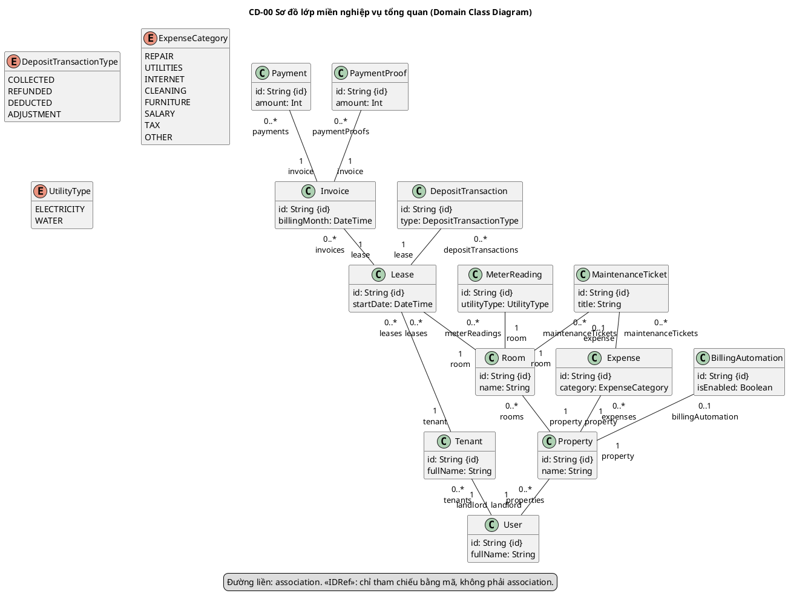

### CD-01 — Tài khoản và hồ sơ Người thuê

Nguồn editable: trang CD-01 trong `class-diagrams/CLASS_DIAGRAMS.drawio`; các bản xuất cùng mã PNG/SVG.

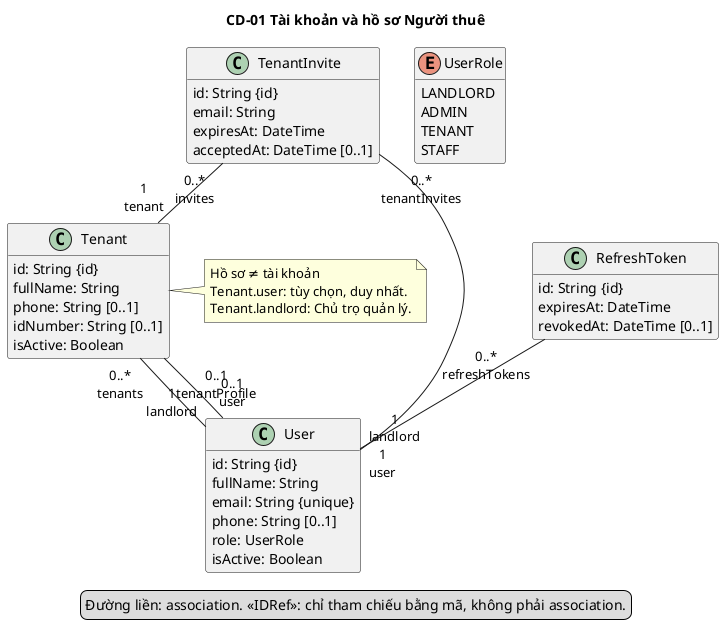

### CD-02 — Khu trọ và phòng

Nguồn editable: trang CD-02 trong `class-diagrams/CLASS_DIAGRAMS.drawio`; các bản xuất cùng mã PNG/SVG.

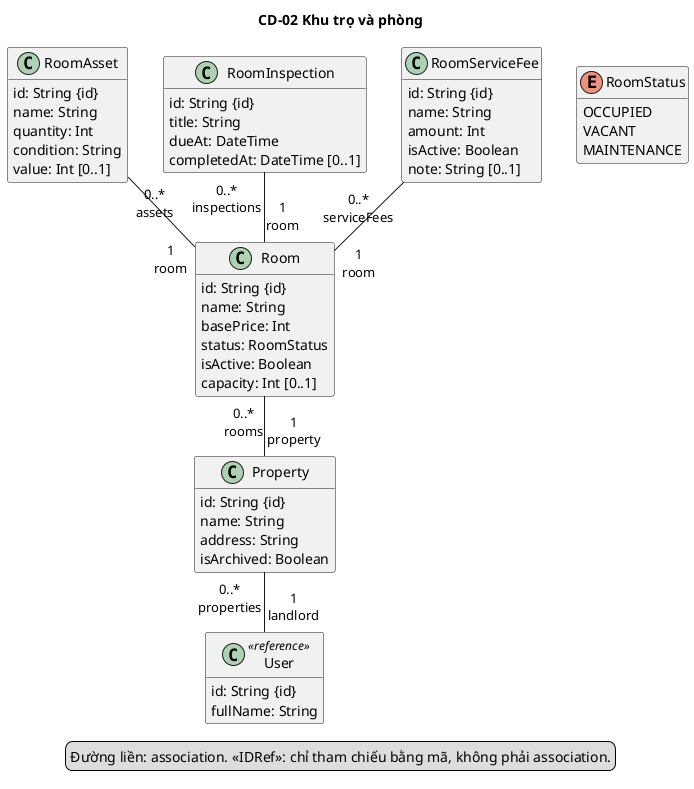

### CD-03 — Hợp đồng và tiền cọc

Nguồn editable: trang CD-03 trong `class-diagrams/CLASS_DIAGRAMS.drawio`; các bản xuất cùng mã PNG/SVG.

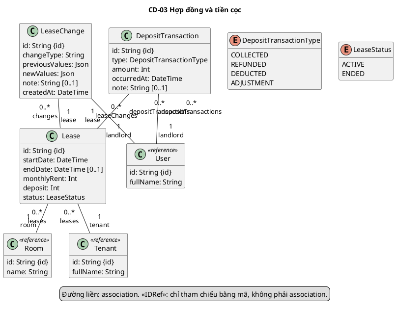

### CD-04A — Chỉ số và hóa đơn

Nguồn editable: trang CD-04A trong `class-diagrams/CLASS_DIAGRAMS.drawio`; các bản xuất cùng mã PNG/SVG.

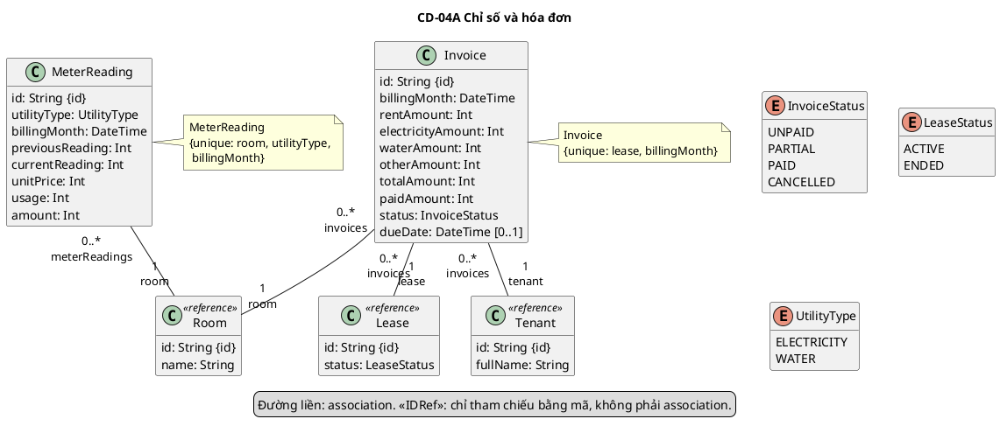

### CD-04B — Thanh toán và minh chứng

Nguồn editable: trang CD-04B trong `class-diagrams/CLASS_DIAGRAMS.drawio`; các bản xuất cùng mã PNG/SVG.

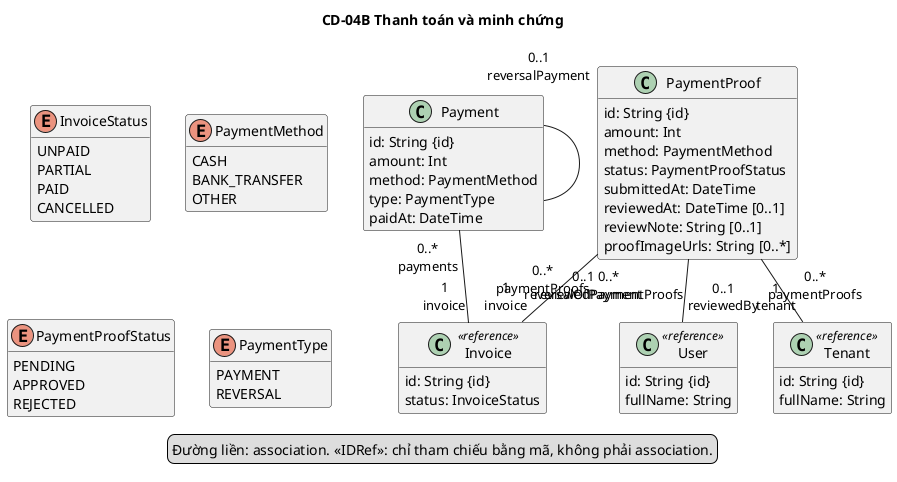

### CD-04C — Lập hóa đơn định kỳ

Nguồn editable: trang CD-04C trong `class-diagrams/CLASS_DIAGRAMS.drawio`; các bản xuất cùng mã PNG/SVG.

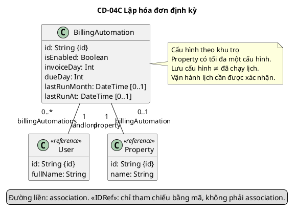

### CD-05 — Bảo trì và chi phí

Nguồn editable: trang CD-05 trong `class-diagrams/CLASS_DIAGRAMS.drawio`; các bản xuất cùng mã PNG/SVG.

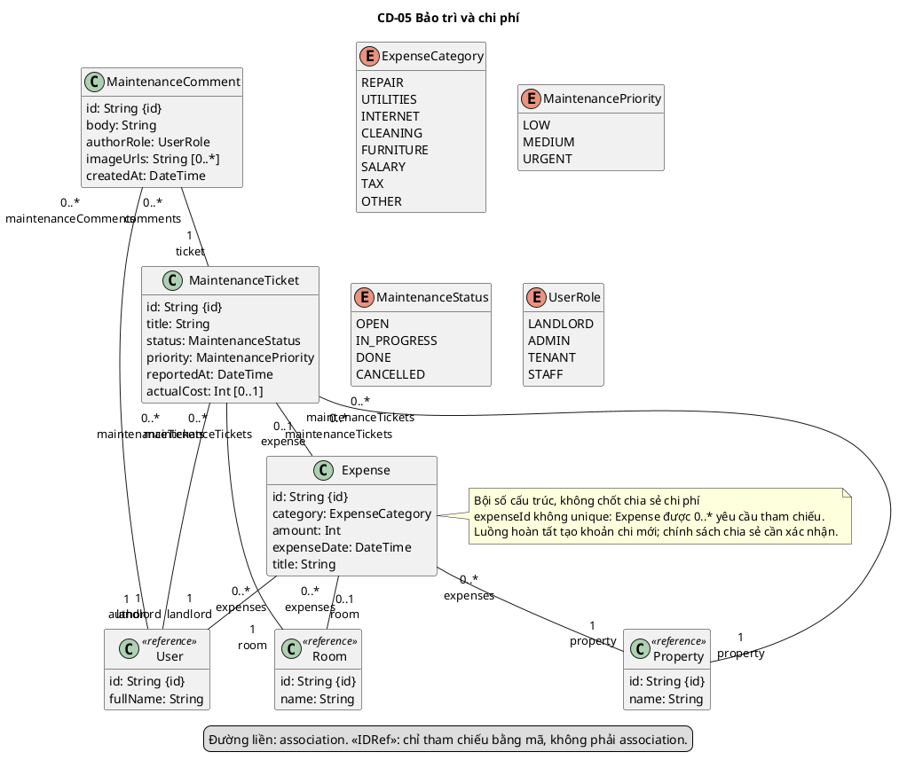

### CD-06 — Thông báo và nhật ký

Nguồn editable: trang CD-06 trong `class-diagrams/CLASS_DIAGRAMS.drawio`; các bản xuất cùng mã PNG/SVG.

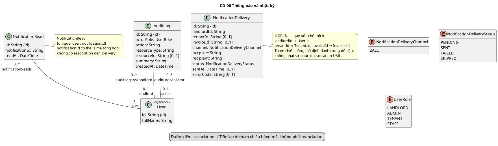

### OD-01 — Đối tượng tài khoản và hợp đồng

Nguồn editable: trang OD-01 trong `class-diagrams/CLASS_DIAGRAMS.drawio`; các bản xuất cùng mã PNG/SVG.

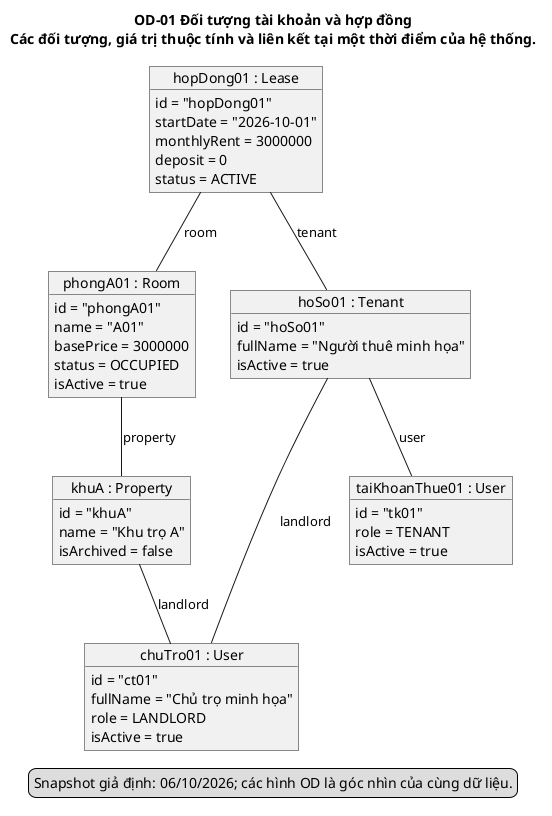

### OD-02 — Đối tượng hóa đơn và thanh toán

Nguồn editable: trang OD-02 trong `class-diagrams/CLASS_DIAGRAMS.drawio`; các bản xuất cùng mã PNG/SVG.

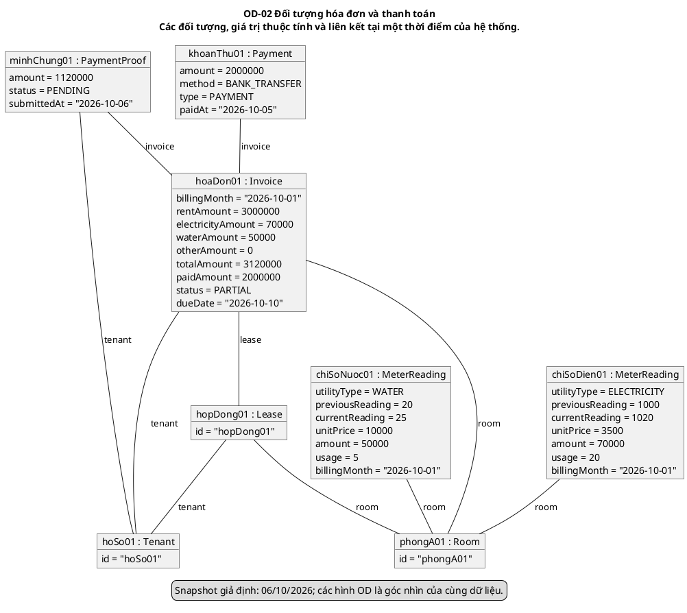

## PHẦN E — Final checklist trước khi nộp

| Hạng mục | Kết quả trong gói hiệu chỉnh | Việc còn lại |
| --- | --- | --- |
| UML / loại sơ đồ | Domain/Entity; không Controller/Service/Repository/method/inheritance/diamond; IDRef không có connector | Không dùng bộ này thay Design Class Diagram. |
| Class / attribute / kiểu | 23 lớp chọn lọc, các thuộc tính có trong schema; enum và optional đúng cấu trúc | Không tuyên bố từ điển đầy đủ bằng hình chọn lọc. |
| Association / multiplicity / role | 39 quan hệ kiểm tra độc lập theo schema; tám hình chi tiết bao phủ đủ; hai vai trò Tenant/User, Audit/User và Payment self rõ | Giữ structural multiplicity; chốt riêng chính sách ACTIVE/chia sẻ chi phí. |
| Constraint | Chỉ thêm {id}, email unique và ba note @@unique có thật; BillingAutomation–Property giữ 0..1 | Không bổ sung invariant về cost, state hoặc sở hữu khi code chưa bảo đảm. |
| Layout / A4 | CD-05 đổi tuyến để tránh giao nhau; role gắn connector; hình cao dùng trang dọc | Kiểm tra lại sau khi ghép vào template báo cáo tổng. |
| Caption / đánh số / thuật ngữ | Giữ caption Hình 2.4.3.1, 2.4.3.2, A1–A8, B1 trong Word phần lớp; dùng thống nhất User/Tenant/Lease | Khi ghép phụ lục toàn báo cáo, rà lại A1–A8/B1 để không trùng số phụ lục khác. |
| Use Case | Mã UC của 23 lớp đối chiếu với 67 UC hiện hành; không tạo entity mới cho dashboard/export/report tính toán | Các PX không được coi đã nghiệm thu hoặc chính sách đã chốt. |
| Sequence | Đối chiếu bộ chính thức SD-01..SD-10, gồm SD-04 tạo hợp đồng, SD-06 lập hóa đơn, SD-08 proof, SD-09 bảo trì | Bộ này không bao phủ mọi UC bằng sequence; demo SD-01 cũ không phải mã của bộ chính thức. |
| Schema / source | Fingerprint không đổi; chỉnh tài liệu không chỉnh Flutter/backend/migrations | Không xác nhận schema DB thật hoặc thử tải/đồng thời trên production. |
| Object Diagram | Hai góc nhìn cùng snapshot; link đúng lớp; số tiền và PENDING proof nhất quán | Dữ liệu giả định, không UUID hợp lệ hoặc dữ liệu vận hành. |
| Các định dạng | Draw.io, model, manifest, 11 SVG/PNG/PlantUML và hai Word phần lớp đã cập nhật | Báo cáo Word/PDF tổng PROPOSAL_QUAN_LY_TRO chưa được ghi đè; phải ghép phần mới và xuất lại bản tổng. |

### Các mục phải chốt trước bản nộp cuối

1. PX-01: giá thuê 0 đồng có được phép không; biểu mẫu và tiếp nhận chưa thống nhất.
2. PX-02: phòng MAINTENANCE có được lập hợp đồng không; một Tenant có được nhiều hợp đồng ACTIVE không. Không đổi cardinality lịch sử trong khi chờ.
3. PX-03: nhập deposit khi tạo hợp đồng là cọc thỏa thuận hay cọc đã nhận; code hiện tạo COLLECTED nếu deposit >0.
4. Quan hệ MaintenanceTicket–Expense và PX-14: có cho dùng chung Expense không; sửa Expense có phải cập nhật actualCost không; cần mức bảo đảm đồng thời nào.
5. PX-32: khi đổi Property của Expense mà giữ Room cũ, code chưa kiểm tra lại tính phù hợp. Nếu muốn mô tả quy tắc được bảo đảm, cần sửa và kiểm thử code trong yêu cầu riêng.
6. Những diễn giải phạm vi liên quan PX-19/24/25/26: scheduler đã vận hành thật, SENT có phải gửi Zalo thật, ảnh proof có bắt buộc và phạm vi quyền bảo trì của Tenant. Không thêm constraint/association để lấp các khoảng trống này.
7. Ghép bản Word phần 2.4.3 mới vào báo cáo tổng, xử lý đánh số phụ lục và xuất lại PDF cuối. Không lấy bản Word/PDF tổng cũ làm bản nộp đã đồng bộ.

**Kết luận: NOT READY TO SUBMIT.** Gói UML sau hiệu chỉnh mô tả được cấu trúc hiện hành, nhưng chưa được phép gọi các chính sách còn mở và báo cáo tổng chưa đồng bộ là bản cuối đã chốt. Không đánh đồng các việc con đã kiểm tra với nghiệm thu toàn bộ hệ thống.

### Cách kiểm chứng lại

Chạy build.py bằng Python runtime có Pillow và Node Sharp, rồi update_documents.py (chỉ khi đồng bộ bản Word phần lớp), sau cùng validate.py. Trình kiểm tra đối chiếu schema độc lập, không chỉ so các bản xuất với nhau. Render cả hai Word bằng render_docx.py và xem trang có hình. Các bản Word/PDF tổng không được tự động thay thế.

### Kết quả kiểm chứng ngày 7 tháng 10 năm 2026

- validate.py: 708 phép kiểm tra đạt, không có failure. Bao gồm 39 quan hệ đối chiếu độc lập với schema, ma trận audit đủ 39 dòng, 11 PlantUML nhúng khớp tệp nguồn, snapshot, các bản xuất và 11 ảnh trong từng Word.
- Tất cả connector trên 11 hình không xuyên phần trong của hộp lớp/đối tượng. Chín tuyến CD-05 không giao nhau; note không đè footer. Đây là kiểm tra hình học theo manifest, kết hợp xem các ảnh đã render, không phải kiểm thử tương tác chỉnh sửa trong ứng dụng Draw.io.
- Đã render và kiểm tra trực quan 19 trang Word phần báo cáo và 28 trang Word đặc tả; các hình, bảng và caption không bị cắt hoặc tách sang trang trắng. Khi ghép vào template báo cáo tổng vẫn cần kiểm tra lại phân trang và đánh số.
- So sánh SHA256 của 294 tệp Flutter/backend/Prisma với baseline trước chỉnh tài liệu: không có tệp thay đổi. Nội dung PROPOSAL_QUAN_LY_TRO.md ngoài mục 2.4.3 không thay đổi.
- Dựng lặp cho cùng model/manifest cho kết quả hình và nguồn giống nhau; đồng bộ Word lặp không thêm đoạn hiệu chỉnh hoặc đổi document.xml.
- PlantUML đã kiểm tra nội dung tĩnh, chưa biên dịch bằng engine PlantUML vì máy không có Java Runtime. PNG/SVG được dựng tại máy từ cùng model/manifest; không tải mô hình lên dịch vụ render công khai. Không chạy kiểm thử runtime Flutter/backend trong đợt chỉnh tài liệu.

Căn cứ UML bổ sung: OMG UML 2.5.1 (Association, Multiplicity, Dependency, InstanceSpecification); tài liệu chính thức PlantUML Class Diagram và Object Diagram. Chuẩn ký hiệu không được dùng để sáng tạo nghiệp vụ ngoài các nguồn dự án.
