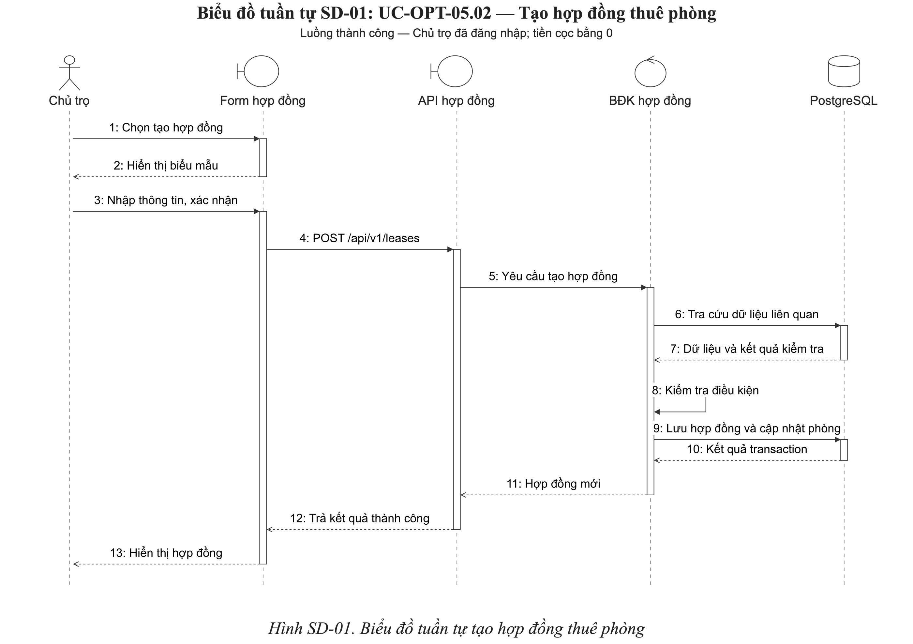

# Biểu đồ tuần tự tạo hợp đồng thuê phòng

## 2.4.4.1 Tạo hợp đồng thuê phòng

Biểu đồ SD-01 mô tả luồng thành công của **UC-OPT-05.02 — Tạo hợp đồng thuê phòng**. Chủ trọ lập hợp đồng tại hồ sơ người thuê; hệ thống kiểm tra dữ liệu và ghi nhận hợp đồng cùng trạng thái phòng trong một transaction. Đây là bản demo để thống nhất cách trình bày trước khi dựng các biểu đồ còn lại.

### Phạm vi và điều kiện trước

Chủ trọ đã đăng nhập, có quyền quản lý hợp đồng và đã chọn khu trọ. Hồ sơ người thuê đã tồn tại. Ví dụ sử dụng tiền cọc bằng 0; không mô tả khoản thu cọc ban đầu và không chốt các chính sách còn cần xác nhận trong đặc tả Use Case.

Hình chỉ trình bày luồng thành công. Kiểm tra biểu mẫu, xác thực, phân quyền, nhật ký hoạt động và các yêu cầu tải dữ liệu khi mở biểu mẫu được lược khỏi hình để tập trung vào nghiệp vụ chính. Các ngoại lệ được giải thích riêng, không ngầm coi chúng đã được thể hiện bằng khung alt.

### Biểu đồ

*Hình SD-01. Biểu đồ tuần tự tạo hợp đồng thuê phòng.*

### Thành phần tham gia

| Thành phần | Vai trò trong biểu đồ | Đối chiếu triển khai |
| --- | --- | --- |
| Chủ trọ | Actor khởi tạo nghiệp vụ | Người dùng có quyền quản lý hợp đồng |
| Form hợp đồng | Boundary tiếp nhận thao tác | Biểu mẫu tạo hợp đồng trong Flutter |
| API hợp đồng | Boundary tiếp nhận HTTP | LeasesController.create |
| BĐK hợp đồng | Control xử lý nghiệp vụ | LeasesService.create |
| PostgreSQL | Kho dữ liệu | Được truy cập thông qua Prisma |

BĐK trong hình là thành phần xử lý ở backend, không phải một lớp điều khiển Flutter được tự giả định. Hình không thêm một Entity trung gian: Lease là bản ghi được tạo trong xử lý dữ liệu, không được mô tả như một đối tượng tự gọi cơ sở dữ liệu.

### Diễn giải luồng

**Bước 1–3:** Chủ trọ chọn tạo hợp đồng tại hồ sơ người thuê. Ứng dụng hiển thị biểu mẫu; Chủ trọ chọn phòng, nhập hoặc kiểm tra giá thuê, ngày bắt đầu và xác nhận. Tiền cọc của ví dụ bằng 0.

**Bước 4–5:** Sau khi biểu mẫu hợp lệ, ứng dụng gửi POST /api/v1/leases. Sau khi yêu cầu vượt qua xác thực và phân quyền, API chuyển dữ liệu cùng phạm vi Chủ trọ đến thành phần xử lý nghiệp vụ.

**Bước 6–8:** Backend tra cứu phòng và khu trọ liên quan, người thuê và hợp đồng hiệu lực của phòng. Hệ thống kiểm tra phạm vi quản lý, khu trọ chưa lưu trữ, phòng và người thuê còn được sử dụng, phòng chưa có hợp đồng hiệu lực. Các bước 6–8 là biểu diễn rút gọn: trong mã nguồn, từng truy vấn và kiểm tra được thực hiện xen kẽ trong cùng transaction.

**Bước 9–10:** Hệ thống tạo hợp đồng ACTIVE; cập nhật phòng thành OCCUPIED và gắn tên người thuê. Việc đọc dữ liệu liên quan, tạo hợp đồng và cập nhật phòng nằm trong cùng transaction. Tiền cọc bằng 0 nên không phát sinh bản ghi thu cọc ban đầu.

**Bước 11–13:** Backend trả hợp đồng mới; ứng dụng cập nhật hồ sơ người thuê và hiển thị kết quả. Cơ chế ghi nhật ký sau khi tạo hợp đồng được lược khỏi hình, không phải bị loại khỏi triển khai.

### Ngoại lệ ngoài phạm vi hình

- Biểu mẫu không hợp lệ: chưa gửi yêu cầu; người dùng điều chỉnh dữ liệu.
- Phòng hoặc người thuê không tồn tại hay ngoài phạm vi; khu trọ đã lưu trữ; phòng hoặc người thuê đã ngừng sử dụng: từ chối tạo.
- Phòng đã có hợp đồng ACTIVE: từ chối; Chủ trọ chọn phòng khác.
- Lỗi trong transaction: không ghi nhận một phần hợp đồng hoặc trạng thái phòng.
- Không nhận được kết quả sau khi gửi: kiểm tra lịch sử hợp đồng trước khi tạo lại; không mặc định dữ liệu chưa được lưu.

### Căn cứ đối chiếu

- UC-OPT-05.02 trong USE_CASE_SPECIFICATION.md.
- `backend/src/leases/leases.controller.ts` và `backend/src/leases/leases.service.ts`.
- Các PX-01 đến PX-04 trong đặc tả vẫn cần được đọc riêng; tài liệu không thay thế kiểm thử hoặc sửa các thiếu sót triển khai.

### Tài nguyên

- sequence-diagrams/sd-01-create-lease.drawio: bản chỉnh sửa được, dùng hình UML gốc của draw.io.
- sequence-diagrams/sd-01-create-lease.svg: vector xuất trực tiếp từ draw.io, có nhúng bản nguồn.
- sequence-diagrams/sd-01-create-lease.png: ảnh 2800 px để chèn tài liệu.
- SEQUENCE_DIAGRAM_DEMO.docx: bản Word độc lập gồm trang sơ đồ và trang diễn giải.

Bản demo chưa thay thế mục 2.4.4 của báo cáo tổng và không ghi đè các sơ đồ lớp hoặc đặc tả Use Case.

