# Đặc tả Use Case hệ thống quản lý nhà trọ

> Phiên bản 1.2 ngày 05/10/2026. Tài liệu phục vụ rà soát nghiệp vụ và thống nhất yêu cầu trước khi phát triển tiếp.

## Mục lục

- [1 Mục đích và phạm vi](#pham-vi)
- [2 Actor thuật ngữ và cách đọc](#quy-uoc)
- [3 Danh mục phân rã Use Case](#danh-muc)
- [Nhóm SYS Xác thực và phiên làm việc](#nhom-sys)
- [Nhóm ADM Quản trị hệ thống](#nhom-adm)
- [Nhóm OPT Vận hành nhà trọ](#nhom-opt)
- [Nhóm BIL Tài chính báo cáo và thông báo](#nhom-bil)
- [Nhóm TEN Cổng thông tin Người thuê](#nhom-ten)
- [5 Nghiệp vụ liên nhóm](#lien-nhom)
- [Phụ lục A Điểm cần xác nhận](#diem-can-xac-nhan)
- [Phụ lục B Phạm vi và kiểm chứng](#gioi-han)
- [Phụ lục C Nhật ký hiệu chỉnh phiên bản 1 2](#nhat-ky-hieu-chinh)

## 1 Mục đích và phạm vi

Tài liệu mô tả mục tiêu, điều kiện thực hiện, tương tác và kết quả của 67 Use Case chi tiết hoặc bổ trợ, được tổ chức từ 24 Use Case tổng quan trong 5 nhóm nghiệp vụ. Mỗi Use Case được trình bày trong một bảng thống nhất để Chủ trọ, người rà soát và nhóm phát triển cùng kiểm tra yêu cầu.

Nội dung đặc tả chính chỉ ghi các hành vi và điều kiện đã xác định trong phạm vi chức năng. Những chênh lệch, cách hiểu chưa thống nhất hoặc chính sách chưa được quyết định nằm ở Phụ lục A và được tham chiếu bằng mã PX. Không coi một yêu cầu nhập riêng tại biểu mẫu là quy tắc nghiệp vụ chung, không tự bổ sung điều kiện hoặc cam kết chưa được xác nhận.

Tài liệu chưa phải biên bản nghiệm thu. Việc mô tả chức năng không xác nhận chức năng đã vận hành thành công trên môi trường triển khai. Các điểm chưa chốt phải được giải quyết trước khi dùng phần liên quan làm yêu cầu phát triển hoặc tiêu chí nghiệm thu cuối cùng.

## 2 Actor thuật ngữ và cách đọc

| Actor | Vai trò trong phạm vi tài liệu |
| --- | --- |
| Admin hệ thống | Theo dõi nền tảng và quản trị tài khoản Chủ trọ, khu trọ toàn hệ thống. |
| Chủ trọ | Quản lý khu trọ, phòng, Người thuê, hợp đồng, bảo trì, hóa đơn, khoản thu, khoản chi và báo cáo thuộc phạm vi quản lý. |
| Người thuê | Truy cập thông tin thuê và thực hiện nghiệp vụ được phép qua hồ sơ liên kết với tài khoản đăng nhập. |
| Dịch vụ Zalo ZNS | Actor phụ trong nhánh gửi nhắc thanh toán ra Zalo; tiếp nhận yêu cầu gửi và trả kết quả. |

Hệ thống là bên phản hồi trong luồng, không phải một actor bên ngoài. Người thuê là đối tượng của hợp đồng nhưng không tự động trở thành Actor phụ trong UC do Chủ trọ thực hiện nếu không có tương tác trực tiếp.

Hồ sơ Người thuê khác tài khoản đăng nhập. Tình trạng đang sử dụng hoặc ngừng sử dụng phòng khác trạng thái Trống, Đang thuê, Bảo trì. Phòng đủ điều kiện lập hợp đồng không mặc định đồng nghĩa phòng có trạng thái Trống. Tiền cọc thỏa thuận khác khoản cọc đã thu; cách ghi nhận khi tạo hợp đồng cần xác nhận tại PX-03. Minh chứng Chờ duyệt chưa phải khoản thanh toán đã được ghi nhận. Quá hạn là tình trạng xác định theo hạn và số còn phải thu, không phải trạng thái thanh toán riêng.

Các giá trị tiền trong tài liệu sử dụng đơn vị đồng. Điều kiện trước mô tả trạng thái tại thời điểm bắt đầu; hệ thống vẫn kiểm tra lại quyền và điều kiện có thể thay đổi trước khi ghi nhận kết quả.

- Mỗi UC có đúng 13 thuộc tính theo cùng một thứ tự. Actor phụ không có thì ghi Không có.
- Điều kiện trước là trạng thái cần tồn tại trước khi bắt đầu; việc mở màn hình, chọn chức năng thuộc Kích hoạt hoặc Luồng chính.
- Luồng chính đánh số từ 1; A là nhánh thay thế, E là ngoại lệ. Mỗi nhánh nêu bước phát sinh và kết quả hoặc điểm tiếp tục.
- Quy tắc nghiệp vụ chỉ ghi điều kiện đã xác định chắc chắn; trường hợp chưa thống nhất được chuyển sang Điểm cần xác nhận, không chọn ngầm một cách xử lý.
- Điều kiện sau phân biệt thành công và không thành công. Nếu mất kết quả sau khi gửi yêu cầu, cần kiểm tra lại trước khi thực hiện lại; không mặc định dữ liệu đã được hoàn tác.
- Mã UC có hậu tố phục vụ phân rã và tra cứu. Quan hệ nhóm trong tài liệu không tự xác lập quan hệ bao gồm, mở rộng hoặc kế thừa trên sơ đồ.

Sơ đồ chi tiết được đặt trước phần đặc tả của từng nhóm. Mỗi hình sử dụng mã và tên UC trùng với bảng đặc tả. Đường liền biểu thị actor tham gia UC; khung nét đứt chỉ nhóm chức năng theo mã UC tổng quan, không xác lập quan hệ bao gồm, mở rộng hoặc kế thừa. Actor có thể được lặp lại tại các khung để giảm giao cắt đường nối; các hình lặp lại cùng tên vẫn là một vai trò.

Nhóm SYS, ADM và TEN có một sơ đồ cho mỗi nhóm. Nhóm OPT có năm sơ đồ; nhóm BIL có ba sơ đồ để giữ kích thước chữ dễ đọc. Toàn bộ 11 hình bao phủ đúng 67 UC đã đặc tả, không bổ sung chức năng mới. Dịch vụ Zalo ZNS chỉ tham gia nhánh gửi ra Zalo của UC-BIL-07.02.

## 3 Danh mục phân rã Use Case

| Nhóm | UC tổng quan | Đặc tả chi tiết/bổ trợ |
| --- | --- | --- |
| SYS | 2 | 3 |
| ADM | 3 | 8 |
| OPT | 6 | 31 |
| BIL | 7 | 18 |
| TEN | 6 | 7 |

| Mã tổng quan | Tên trên sơ đồ | Đặc tả trong bản này |
| --- | --- | --- |
| UC-SYS-01 | Đăng nhập | [UC-SYS-01](#uc-sys-01), [UC-SYS-01.01](#uc-sys-01-01) |
| UC-SYS-02 | Đăng xuất | [UC-SYS-02](#uc-sys-02) |
| UC-ADM-01 | Xem tổng quan hệ thống | [UC-ADM-01](#uc-adm-01) |
| UC-ADM-02 | Quản lý tài khoản chủ trọ | [UC-ADM-02.01](#uc-adm-02-01), [UC-ADM-02.02](#uc-adm-02-02), [UC-ADM-02.03](#uc-adm-02-03), [UC-ADM-02.04](#uc-adm-02-04) |
| UC-ADM-03 | Quản lý khu trọ toàn hệ thống | [UC-ADM-03.01](#uc-adm-03-01), [UC-ADM-03.02](#uc-adm-03-02), [UC-ADM-03.03](#uc-adm-03-03) |
| UC-OPT-01 | Xem dashboard vận hành | [UC-OPT-01](#uc-opt-01) |
| UC-OPT-02 | Quản lý khu trọ | [UC-OPT-02.01](#uc-opt-02-01), [UC-OPT-02.02](#uc-opt-02-02), [UC-OPT-02.03](#uc-opt-02-03), [UC-OPT-02.04](#uc-opt-02-04), [UC-OPT-02.05](#uc-opt-02-05) |
| UC-OPT-03 | Quản lý phòng | [UC-OPT-03.01](#uc-opt-03-01), [UC-OPT-03.02](#uc-opt-03-02), [UC-OPT-03.03](#uc-opt-03-03), [UC-OPT-03.04](#uc-opt-03-04), [UC-OPT-03.05](#uc-opt-03-05), [UC-OPT-03.06](#uc-opt-03-06), [UC-OPT-03.07](#uc-opt-03-07), [UC-OPT-03.08](#uc-opt-03-08), [UC-OPT-03.09](#uc-opt-03-09) |
| UC-OPT-04 | Quản lý hồ sơ người thuê | [UC-OPT-04.01](#uc-opt-04-01), [UC-OPT-04.02](#uc-opt-04-02), [UC-OPT-04.03](#uc-opt-04-03), [UC-OPT-04.04](#uc-opt-04-04), [UC-OPT-04.05](#uc-opt-04-05), [UC-OPT-04.06](#uc-opt-04-06) |
| UC-OPT-05 | Quản lý hợp đồng thuê | [UC-OPT-05.01](#uc-opt-05-01), [UC-OPT-05.02](#uc-opt-05-02), [UC-OPT-05.03](#uc-opt-05-03), [UC-OPT-05.04](#uc-opt-05-04), [UC-OPT-05.05](#uc-opt-05-05), [UC-OPT-05.06](#uc-opt-05-06) |
| UC-OPT-06 | Quản lý bảo trì | [UC-OPT-06.01](#uc-opt-06-01), [UC-OPT-06.02](#uc-opt-06-02), [UC-OPT-06.03](#uc-opt-06-03), [UC-OPT-06.04](#uc-opt-06-04) |
| UC-BIL-01 | Ghi chỉ số điện nước | [UC-BIL-01](#uc-bil-01) |
| UC-BIL-02 | Lập hóa đơn | [UC-BIL-02.01](#uc-bil-02-01), [UC-BIL-02.02](#uc-bil-02-02), [UC-BIL-02.03](#uc-bil-02-03), [UC-BIL-02.04](#uc-bil-02-04), [UC-BIL-02.05](#uc-bil-02-05), [UC-BIL-02.06](#uc-bil-02-06), [UC-BIL-02.07](#uc-bil-02-07) |
| UC-BIL-03 | Ghi nhận thanh toán | [UC-BIL-03.01](#uc-bil-03-01), [UC-BIL-03.02](#uc-bil-03-02) |
| UC-BIL-04 | Duyệt minh chứng thanh toán | [UC-BIL-04](#uc-bil-04) |
| UC-BIL-05 | Quản lý chi phí vận hành | [UC-BIL-05.01](#uc-bil-05-01), [UC-BIL-05.02](#uc-bil-05-02), [UC-BIL-05.03](#uc-bil-05-03) |
| UC-BIL-06 | Xem báo cáo tháng | [UC-BIL-06.01](#uc-bil-06-01), [UC-BIL-06.02](#uc-bil-06-02) |
| UC-BIL-07 | Gửi thông báo / nhắc nợ | [UC-BIL-07.01](#uc-bil-07-01), [UC-BIL-07.02](#uc-bil-07-02) |
| UC-TEN-01 | Xem thông tin thuê phòng | [UC-TEN-01](#uc-ten-01) |
| UC-TEN-02 | Xem hợp đồng thuê | [UC-TEN-02](#uc-ten-02) |
| UC-TEN-03 | Xem hóa đơn | [UC-TEN-03](#uc-ten-03) |
| UC-TEN-04 | Gửi minh chứng thanh toán | [UC-TEN-04](#uc-ten-04) |
| UC-TEN-05 | Gửi yêu cầu bảo trì | [UC-TEN-05.01](#uc-ten-05-01), [UC-TEN-05.02](#uc-ten-05-02) |
| UC-TEN-06 | Xem thông báo | [UC-TEN-06](#uc-ten-06) |

## 4 Đặc tả Use Case

## 4.1 Nhóm SYS Xác thực và phiên làm việc

### Sơ đồ D-SYS-01 Xác thực và phiên làm việc

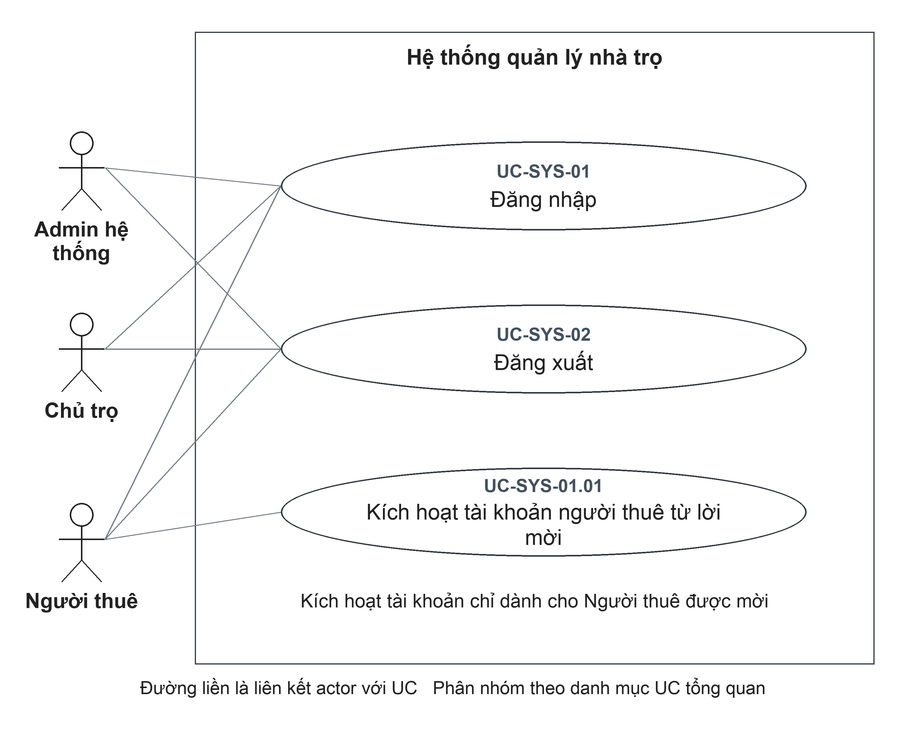

Đặc tả liên quan: [UC-SYS-01](#uc-sys-01), [UC-SYS-01.01](#uc-sys-01-01), [UC-SYS-02](#uc-sys-02).

### UC-SYS-01 Đăng nhập

| Thuộc tính | Đặc tả |
| --- | --- |
| **Mã UC** | UC-SYS-01 |
| **Tên UC** | Đăng nhập |
| **Mục tiêu** | Cho phép người dùng truy cập khu vực làm việc phù hợp với vai trò tài khoản. |
| **Actor chính** | Admin hệ thống, Chủ trọ, Người thuê |
| **Actor phụ** | Không có. |
| **Kích hoạt** | Mở chức năng đăng nhập. |
| **Điều kiện trước** | **1.** Người dùng có tài khoản đã đăng ký; hoặc thiết bị còn lưu thông tin phiên cần được xác minh. |
| **Điều kiện sau** | **Thành công:** Đăng nhập thành công tạo phiên được lưu trên thiết bị; khu vực làm việc phù hợp vai trò được mở.  **Hủy hoặc không thành công:** Thông tin đăng nhập bị từ chối thì không tạo phiên mới. Khôi phục phiên lỗi cần phân biệt phiên không hợp lệ với lỗi kết nối; không tự coi mọi lỗi là tài khoản bị khóa. |
| **Dữ liệu đầu vào** | Email và mật khẩu. Khi khôi phục đăng nhập, hệ thống sử dụng thông tin phiên đã lưu trên thiết bị. |
| **Luồng chính** | **1.** Người dùng: Mở chức năng đăng nhập.  **2.** Hệ thống: Hiển thị các trường email và mật khẩu.  **3.** Người dùng: Nhập email, mật khẩu và chọn đăng nhập.  **4.** Hệ thống: Kiểm tra thông tin đăng nhập, đối chiếu tài khoản và tình trạng hoạt động của tài khoản.  **5.** Hệ thống: Xác lập phiên đăng nhập và mở khu vực làm việc của Admin hệ thống, Chủ trọ hoặc Người thuê theo vai trò tài khoản. |
| **Luồng thay thế** | **A1 — Tại bước 1:** Thiết bị còn lưu thông tin đăng nhập. Hệ thống xác minh tài khoản; nếu còn hợp lệ thì mở khu vực làm việc theo vai trò mà không yêu cầu nhập lại. UC kết thúc thành công.  **A2 — Trong nhánh A1:** Thông tin phiên không còn hợp lệ. Hệ thống thử khôi phục trạng thái đăng nhập; nếu bị từ chối thì xóa thông tin phiên đã lưu và quay lại bước 2 để người dùng đăng nhập lại. |
| **Luồng ngoại lệ** | **E1 — Tại bước 3:** Thiếu email, mật khẩu hoặc email không hợp lệ. Yêu cầu điều chỉnh dữ liệu; chưa thực hiện đăng nhập và quay lại bước 3.  **E2 — Tại bước 4:** Tài khoản không tồn tại, bị khóa hoặc mật khẩu sai. Thông báo thông tin đăng nhập không hợp lệ; không tạo phiên mới. Người dùng kiểm tra lại thông tin và thực hiện lại từ bước 3.  **E3 — Trong nhánh A1:** Không xác minh được trạng thái đăng nhập do lỗi khác với thông tin phiên không hợp lệ. Hiển thị lỗi; chưa mở khu vực làm việc và không tự coi tài khoản bị khóa hoặc phiên đã bị xóa. |
| **Quy tắc nghiệp vụ** | **BR1.** Tài khoản bị khóa không được đăng nhập hoặc tiếp tục xác thực phiên.  **BR2.** Thông tin đăng nhập không hợp lệ không làm phát sinh phiên đăng nhập mới. |

### UC-SYS-01.01 Kích hoạt tài khoản người thuê từ lời mời

| Thuộc tính | Đặc tả |
| --- | --- |
| **Mã UC** | UC-SYS-01.01 |
| **Tên UC** | Kích hoạt tài khoản người thuê từ lời mời |
| **Mục tiêu** | Tạo tài khoản truy cập gắn với đúng hồ sơ Người thuê đã được Chủ trọ mời. |
| **Actor chính** | Người thuê |
| **Actor phụ** | Không có. |
| **Kích hoạt** | Mở chức năng kích hoạt tài khoản từ lời mời. |
| **Điều kiện trước** | **1.** Người thuê đã nhận được mã mời kích hoạt tài khoản do Chủ trọ cung cấp; không yêu cầu đăng nhập trước. |
| **Điều kiện sau** | **Thành công:** Tài khoản có vai trò Người thuê được liên kết với hồ sơ và lời mời được đánh dấu đã dùng; nếu cấp và lưu phiên thành công thì Người thuê được đăng nhập.  **Hủy hoặc không thành công:** Lời mời hoặc mật khẩu bị từ chối trước khi tạo tài khoản thì không tạo liên kết mới. Nếu tài khoản đã tạo nhưng đăng nhập chưa hoàn tất, cần kiểm tra trạng thái kích hoạt và đăng nhập lại; không mặc định mã mời còn dùng được. |
| **Dữ liệu đầu vào** | Mã mời và mật khẩu mới. |
| **Luồng chính** | **1.** Người thuê: Mở chức năng kích hoạt tài khoản từ lời mời.  **2.** Hệ thống: Hiển thị các trường mã mời và mật khẩu mới.  **3.** Người thuê: Nhập mã mời, đặt mật khẩu và xác nhận kích hoạt.  **4.** Hệ thống: Kiểm tra lời mời còn hiệu lực, chưa sử dụng và hồ sơ Người thuê chưa liên kết với tài khoản.  **5.** Hệ thống: Tạo tài khoản Người thuê, liên kết với hồ sơ được mời và đánh dấu lời mời đã sử dụng.  **6.** Hệ thống: Đăng nhập cho tài khoản mới và mở cổng thông tin Người thuê khi việc xác lập phiên thành công. |
| **Luồng thay thế** | Không có nhánh thay thế nghiệp vụ riêng trong phạm vi UC này. |
| **Luồng ngoại lệ** | **E1 — Tại bước 3:** Mã để trống hoặc mật khẩu dưới 12 ký tự trên biểu mẫu. Không gửi yêu cầu; yêu cầu bổ sung dữ liệu. Sau khi điều chỉnh, thực hiện lại từ bước 3.  **E2 — Tại bước 4:** Mã sai, hết hạn, đã dùng hoặc hồ sơ đã liên kết tài khoản. Từ chối kích hoạt; hiển thị lỗi lời mời không hợp lệ. UC kết thúc đối với yêu cầu bị từ chối.  **E3 — Tại bước 4:** Mật khẩu không đáp ứng chính sách mật khẩu. Từ chối yêu cầu; Người thuê điều chỉnh mật khẩu. Sau khi điều chỉnh, thực hiện lại từ bước 3.  **E4 — Tại bước 5:** Email đã được đăng ký. Từ chối tạo tài khoản trùng. UC kết thúc đối với yêu cầu bị từ chối. |
| **Quy tắc nghiệp vụ** | **BR1.** Mỗi mã mời chỉ được sử dụng để kích hoạt một lần và phải chưa hết hạn.  **BR2.** Mật khẩu mới dài 12 đến 128 ký tự, có chữ hoa, chữ thường, chữ số và ký tự đặc biệt.  **BR3.** Không tạo tài khoản mới bằng email đã được đăng ký. |

### UC-SYS-02 Đăng xuất

| Thuộc tính | Đặc tả |
| --- | --- |
| **Mã UC** | UC-SYS-02 |
| **Tên UC** | Đăng xuất |
| **Mục tiêu** | Kết thúc phiên làm việc trên thiết bị đang sử dụng và ngăn truy cập dữ liệu của phiên đã kết thúc. |
| **Actor chính** | Admin hệ thống, Chủ trọ, Người thuê |
| **Actor phụ** | Không có. |
| **Kích hoạt** | Chọn đăng xuất khỏi ứng dụng. |
| **Điều kiện trước** | **1.** Người dùng có phiên đăng nhập trên thiết bị đang sử dụng. |
| **Điều kiện sau** | **Thành công:** Thông tin đăng nhập trên thiết bị được xóa và ứng dụng chuyển về trạng thái chưa đăng nhập. Việc kết thúc phiên tại hệ thống chỉ được xác nhận khi yêu cầu tương ứng hoàn tất.  **Hủy hoặc không thành công:** Lỗi kết thúc phiên không ngăn việc xóa thông tin đăng nhập trên thiết bị; chưa xác nhận phiên được thu hồi ở mọi nơi. Phạm vi thu hồi xem [PX-29](#px-29). |
| **Dữ liệu đầu vào** | Thông tin phiên hiện tại; không yêu cầu nhập lại mật khẩu. |
| **Luồng chính** | **1.** Người dùng: Chọn đăng xuất khỏi ứng dụng.  **2.** Hệ thống: Yêu cầu kết thúc phiên đăng nhập hiện tại nếu thiết bị còn lưu thông tin phiên.  **3.** Hệ thống: Xóa thông tin đăng nhập trên thiết bị, kể cả khi yêu cầu kết thúc phiên không nhận được kết quả thành công.  **4.** Hệ thống: Chuyển ứng dụng về trạng thái chưa đăng nhập. |
| **Luồng thay thế** | **A1 — Tại bước 2:** Thiết bị không còn phiên lưu. Bỏ qua yêu cầu thu hồi; tiếp tục bước 3. |
| **Luồng ngoại lệ** | **E1 — Tại bước 2:** Không xác nhận được việc kết thúc phiên tại hệ thống. Vẫn tiếp tục bước 3 và 4 để đăng xuất trên thiết bị; phạm vi kết thúc phiên ở nơi khác chưa được xác nhận. |
| **Quy tắc nghiệp vụ** | **BR1.** Đăng xuất trong UC này áp dụng cho phiên trên thiết bị hiện tại, không phải thao tác đăng xuất đồng thời trên tất cả thiết bị. |

## 4.2 Nhóm ADM Quản trị hệ thống

### Sơ đồ D-ADM-01 Quản trị hệ thống

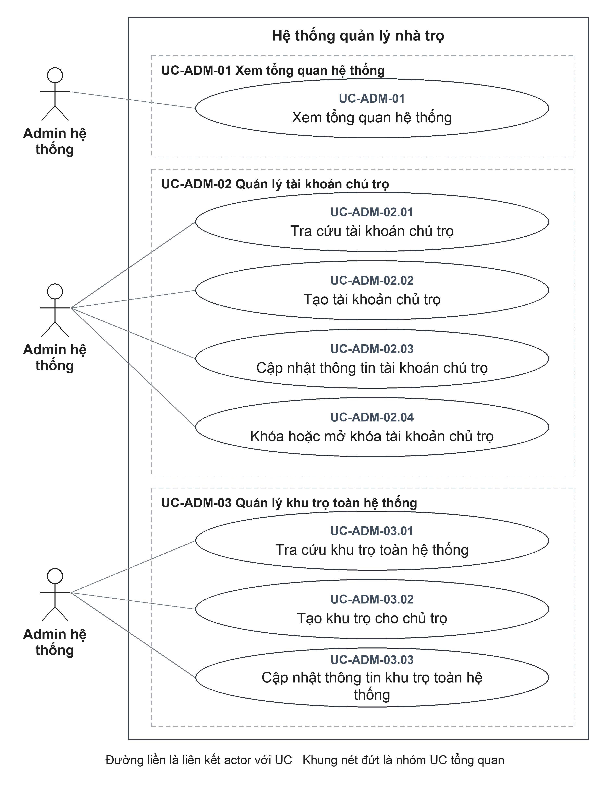

Đặc tả liên quan: [UC-ADM-01](#uc-adm-01), [UC-ADM-02.01](#uc-adm-02-01), [UC-ADM-02.02](#uc-adm-02-02), [UC-ADM-02.03](#uc-adm-02-03), [UC-ADM-02.04](#uc-adm-02-04), [UC-ADM-03.01](#uc-adm-03-01), [UC-ADM-03.02](#uc-adm-03-02), [UC-ADM-03.03](#uc-adm-03-03).

### UC-ADM-01 Xem tổng quan hệ thống

| Thuộc tính | Đặc tả |
| --- | --- |
| **Mã UC** | UC-ADM-01 |
| **Tên UC** | Xem tổng quan hệ thống |
| **Mục tiêu** | Nắm tình hình chủ trọ, khu trọ và các chỉ số quản trị trong toàn hệ thống. |
| **Actor chính** | Admin hệ thống |
| **Actor phụ** | Không có. |
| **Kích hoạt** | Mở trang tổng quan quản trị. |
| **Điều kiện trước** | **1.** Admin hệ thống đã đăng nhập và có quyền sử dụng chức năng quản trị tương ứng. |
| **Điều kiện sau** | **Thành công:** Admin hệ thống xem được tổng quan; UC không ghi thay đổi vào dữ liệu vận hành.  **Hủy hoặc không thành công:** Không cung cấp được kết quả tra cứu của lần yêu cầu không thành công; UC không ghi thay đổi vào dữ liệu nghiệp vụ. |
| **Dữ liệu đầu vào** | Không có dữ liệu nghiệp vụ cần nhập. |
| **Luồng chính** | **1.** Admin hệ thống: Mở trang tổng quan quản trị.  **2.** Hệ thống: Tổng hợp số Chủ trọ đang hoạt động và bị khóa; số khu trọ, số phòng và số Người thuê trên nền tảng.  **3.** Hệ thống: Hiển thị các chỉ số tổng quan và danh sách Chủ trọ được tạo gần đây.  **4.** Admin hệ thống: Xem các chỉ số hoặc chọn danh sách liên quan để tiếp tục tra cứu. |
| **Luồng thay thế** | **A1 — Tại bước 2:** Chưa có dữ liệu cho một chỉ số. Hiển thị số lượng bằng 0 và danh sách tương ứng rỗng. |
| **Luồng ngoại lệ** | **E1 — Tại bước 2:** Không có quyền truy cập hoặc không tải được dữ liệu. Không cung cấp kết quả tra cứu; hiển thị lỗi nếu nhận được phản hồi lỗi. UC kết thúc, dữ liệu nghiệp vụ không thay đổi. |
| **Quy tắc nghiệp vụ** | **BR1.** Chỉ Admin hệ thống được truy cập tổng quan quản trị toàn hệ thống. |

### UC-ADM-02.01 Tra cứu tài khoản chủ trọ

| Thuộc tính | Đặc tả |
| --- | --- |
| **Mã UC** | UC-ADM-02.01 |
| **Tên UC** | Tra cứu tài khoản chủ trọ |
| **Mục tiêu** | Tìm và kiểm tra thông tin tài khoản chủ trọ phục vụ quản trị. |
| **Actor chính** | Admin hệ thống |
| **Actor phụ** | Không có. |
| **Kích hoạt** | Mở danh sách tài khoản Chủ trọ và nhập từ khóa hoặc chọn bộ lọc trạng thái. |
| **Điều kiện trước** | **1.** Admin hệ thống đã đăng nhập và có quyền sử dụng chức năng quản trị tương ứng. |
| **Điều kiện sau** | **Thành công:** Danh sách/chi tiết Chủ trọ được hiển thị; dữ liệu không bị thay đổi.  **Hủy hoặc không thành công:** Không cung cấp được kết quả tra cứu của lần yêu cầu không thành công; UC không ghi thay đổi vào dữ liệu nghiệp vụ. |
| **Dữ liệu đầu vào** | Từ khóa, bộ lọc đang hoạt động/bị khóa/tất cả và tài khoản cần xem. |
| **Luồng chính** | **1.** Admin hệ thống: Mở danh sách tài khoản Chủ trọ và nhập từ khóa hoặc chọn bộ lọc trạng thái.  **2.** Hệ thống: Lọc tài khoản theo tên, email, số điện thoại và trạng thái đang hoạt động hoặc bị khóa.  **3.** Hệ thống: Hiển thị tài khoản phù hợp cùng thông tin số khu trọ và số phòng liên quan.  **4.** Admin hệ thống: Chọn tài khoản cần kiểm tra.  **5.** Hệ thống: Hiển thị thông tin tài khoản Chủ trọ và tổng hợp dữ liệu liên quan để Admin hệ thống xem. |
| **Luồng thay thế** | **A1 — Tại bước 2:** Không có tài khoản phù hợp. Trả danh sách rỗng; Admin hệ thống có thể thay đổi tiêu chí tại bước 1. UC kết thúc sau khi hiển thị kết quả. |
| **Luồng ngoại lệ** | **E1 — Tại bước 5:** Tài khoản không tồn tại hoặc không phải Chủ trọ. Không trả chi tiết; thông báo không tìm thấy. UC kết thúc đối với yêu cầu bị từ chối. |
| **Quy tắc nghiệp vụ** | **BR1.** Thông tin tra cứu không bao gồm mật khẩu của Chủ trọ. |

### UC-ADM-02.02 Tạo tài khoản chủ trọ

| Thuộc tính | Đặc tả |
| --- | --- |
| **Mã UC** | UC-ADM-02.02 |
| **Tên UC** | Tạo tài khoản chủ trọ |
| **Mục tiêu** | Khởi tạo tài khoản Chủ trọ khi Admin hệ thống hỗ trợ người dùng tham gia hệ thống. |
| **Actor chính** | Admin hệ thống |
| **Actor phụ** | Không có. |
| **Kích hoạt** | Chọn tạo tài khoản Chủ trọ. |
| **Điều kiện trước** | **1.** Admin hệ thống đã đăng nhập và có quyền sử dụng chức năng quản trị tương ứng. |
| **Điều kiện sau** | **Thành công:** Tài khoản mới có vai trò Chủ trọ và trạng thái đang hoạt động.  **Hủy hoặc không thành công:** Hủy trước xác nhận hoặc bị từ chối trước ghi nhận thì không tạo tài khoản Chủ trọ mới. Nếu đã gửi yêu cầu nhưng chưa xác định được kết quả, cần kiểm tra lại dữ liệu tài khoản Chủ trọ trước khi thực hiện lại. |
| **Dữ liệu đầu vào** | Họ tên, email, mật khẩu; số điện thoại tùy chọn. |
| **Luồng chính** | **1.** Admin hệ thống: Chọn tạo tài khoản Chủ trọ.  **2.** Hệ thống: Hiển thị các trường họ tên, email, mật khẩu và số điện thoại.  **3.** Admin hệ thống: Nhập họ tên, email, mật khẩu; bổ sung số điện thoại nếu có và xác nhận tạo.  **4.** Hệ thống: Kiểm tra dữ liệu bắt buộc, định dạng email, chính sách mật khẩu và việc email đã được đăng ký.  **5.** Hệ thống: Tạo tài khoản có vai trò Chủ trọ, trạng thái đang hoạt động và hiển thị tài khoản mới. |
| **Luồng thay thế** | Không có nhánh thay thế nghiệp vụ riêng trong phạm vi UC này. |
| **Luồng ngoại lệ** | **E1 — Tại bước 4:** Email không hợp lệ hoặc mật khẩu không đạt chính sách. Từ chối yêu cầu; Admin hệ thống điều chỉnh biểu mẫu. Sau khi điều chỉnh, thực hiện lại từ bước 3.  **E2 — Tại bước 5:** Email đã được dùng. Không tạo tài khoản; thông báo email đã đăng ký. UC kết thúc đối với yêu cầu bị từ chối. |
| **Quy tắc nghiệp vụ** | **BR1.** Email đăng ký không được trùng với email đã có tài khoản.  **BR2.** Mật khẩu dài 12 đến 128 ký tự, có chữ hoa, chữ thường, chữ số và ký tự đặc biệt.  **BR3.** Số điện thoại là thông tin tùy chọn. |

### UC-ADM-02.03 Cập nhật thông tin tài khoản chủ trọ

| Thuộc tính | Đặc tả |
| --- | --- |
| **Mã UC** | UC-ADM-02.03 |
| **Tên UC** | Cập nhật thông tin tài khoản chủ trọ |
| **Mục tiêu** | Điều chỉnh thông tin liên hệ của Chủ trọ mà không thay đổi vai trò hoặc quyền sở hữu nghiệp vụ. |
| **Actor chính** | Admin hệ thống |
| **Actor phụ** | Không có. |
| **Kích hoạt** | Chọn chỉnh sửa tài khoản Chủ trọ. |
| **Điều kiện trước** | **1.** Admin hệ thống đã đăng nhập và có quyền sử dụng chức năng quản trị tương ứng.  **2.** Tài khoản Chủ trọ cần cập nhật đã tồn tại. |
| **Điều kiện sau** | **Thành công:** Họ tên/số điện thoại được cập nhật; vai trò, email đăng nhập và quyền sở hữu khu trọ không được thay đổi bởi UC này.  **Hủy hoặc không thành công:** Yêu cầu bị từ chối trước ghi nhận không thay đổi họ tên và số điện thoại tài khoản. Nếu chưa nhận được kết quả sau khi xác nhận, cần kiểm tra lại họ tên và số điện thoại tài khoản, không mặc định thao tác đã được hoàn tác. |
| **Dữ liệu đầu vào** | Chủ trọ được chọn; họ tên và số điện thoại cần cập nhật. |
| **Luồng chính** | **1.** Admin hệ thống: Chọn chỉnh sửa tài khoản Chủ trọ.  **2.** Hệ thống: Hiển thị họ tên và số điện thoại hiện tại của tài khoản.  **3.** Admin hệ thống: Điều chỉnh họ tên hoặc số điện thoại và xác nhận lưu.  **4.** Hệ thống: Kiểm tra tài khoản đích là tài khoản Chủ trọ và dữ liệu thay đổi hợp lệ.  **5.** Hệ thống: Lưu thông tin mới và hiển thị tài khoản sau cập nhật. |
| **Luồng thay thế** | Không có nhánh thay thế nghiệp vụ riêng trong phạm vi UC này. |
| **Luồng ngoại lệ** | **E1 — Tại bước 4:** Tài khoản không tồn tại/không thuộc vai trò Chủ trọ hoặc dữ liệu sai định dạng. Từ chối cập nhật; thông báo để kiểm tra lại. UC kết thúc đối với yêu cầu bị từ chối. |
| **Quy tắc nghiệp vụ** | **BR1.** UC này chỉ cập nhật họ tên và số điện thoại; không thay đổi email, mật khẩu hoặc vai trò tài khoản. |

### UC-ADM-02.04 Khóa hoặc mở khóa tài khoản chủ trọ

| Thuộc tính | Đặc tả |
| --- | --- |
| **Mã UC** | UC-ADM-02.04 |
| **Tên UC** | Khóa hoặc mở khóa tài khoản chủ trọ |
| **Mục tiêu** | Kiểm soát quyền đăng nhập của một tài khoản Chủ trọ, không xóa dữ liệu lịch sử. |
| **Actor chính** | Admin hệ thống |
| **Actor phụ** | Không có. |
| **Kích hoạt** | Chọn tài khoản Chủ trọ cần khóa hoặc mở khóa. |
| **Điều kiện trước** | **1.** Admin hệ thống đã đăng nhập và có quyền sử dụng chức năng quản trị tương ứng.  **2.** Tài khoản Chủ trọ cần thay đổi trạng thái đã tồn tại. |
| **Điều kiện sau** | **Thành công:** Trạng thái hoạt động được thay đổi; không xóa tài khoản hoặc dữ liệu thuê.  **Hủy hoặc không thành công:** Yêu cầu bị từ chối trước ghi nhận không thay đổi tình trạng tài khoản. Nếu chưa nhận được kết quả sau khi xác nhận, cần kiểm tra lại tình trạng tài khoản, không mặc định thao tác đã được hoàn tác. |
| **Dữ liệu đầu vào** | Tài khoản Chủ trọ và trạng thái hoạt động mong muốn. |
| **Luồng chính** | **1.** Admin hệ thống: Chọn tài khoản Chủ trọ cần khóa hoặc mở khóa.  **2.** Hệ thống: Hiển thị trạng thái hiện tại và yêu cầu xác nhận thay đổi.  **3.** Admin hệ thống: Xác nhận thao tác khóa hoặc mở khóa đã chọn.  **4.** Hệ thống: Kiểm tra tài khoản đích và cập nhật trạng thái khóa hoặc mở khóa theo lựa chọn đã xác nhận.  **5.** Hệ thống: Hiển thị trạng thái mới của tài khoản. |
| **Luồng thay thế** | **A1 — Tại bước 1:** Tài khoản đang bị khóa và Admin hệ thống chọn mở khóa. Tại bước 2, hệ thống yêu cầu xác nhận mở khóa; tại bước 3, Admin hệ thống xác nhận. Tiếp tục bước 4 để kiểm tra tài khoản và cập nhật về đang hoạt động, sau đó hiển thị kết quả tại bước 5. |
| **Luồng ngoại lệ** | **E1 — Tại bước 4:** Không tìm thấy Chủ trọ hoặc Admin hệ thống yêu cầu thay đổi trạng thái chính mình. Từ chối thao tác. UC kết thúc đối với yêu cầu bị từ chối. |
| **Quy tắc nghiệp vụ** | **BR1.** Khóa tài khoản không xóa tài khoản hoặc dữ liệu khu trọ của Chủ trọ.  **BR2.** Tài khoản bị khóa không được đăng nhập; mở khóa không tự đăng nhập cho Chủ trọ. |

### UC-ADM-03.01 Tra cứu khu trọ toàn hệ thống

| Thuộc tính | Đặc tả |
| --- | --- |
| **Mã UC** | UC-ADM-03.01 |
| **Tên UC** | Tra cứu khu trọ toàn hệ thống |
| **Mục tiêu** | Kiểm tra thông tin khu trọ và Chủ trọ phụ trách trong phạm vi quản trị hệ thống. |
| **Actor chính** | Admin hệ thống |
| **Actor phụ** | Không có. |
| **Kích hoạt** | Mở danh sách khu trọ toàn hệ thống; nhập từ khóa hoặc chọn Chủ trọ cần lọc. |
| **Điều kiện trước** | **1.** Admin hệ thống đã đăng nhập và có quyền sử dụng chức năng quản trị tương ứng. |
| **Điều kiện sau** | **Thành công:** Admin hệ thống xem được thông tin khu trọ trong phạm vi quản trị toàn hệ thống.  **Hủy hoặc không thành công:** Không cung cấp được kết quả tra cứu của lần yêu cầu không thành công; UC không ghi thay đổi vào dữ liệu nghiệp vụ. |
| **Dữ liệu đầu vào** | Từ khóa tra cứu, Chủ trọ cần lọc và khu trọ cần xem. |
| **Luồng chính** | **1.** Admin hệ thống: Mở danh sách khu trọ toàn hệ thống; nhập từ khóa hoặc chọn Chủ trọ cần lọc.  **2.** Hệ thống: Tìm khu trọ phù hợp và tổng hợp số phòng của từng khu trọ.  **3.** Hệ thống: Hiển thị tên khu trọ, thông tin Chủ trọ sở hữu và số phòng.  **4.** Admin hệ thống: Chọn khu trọ cần xem.  **5.** Hệ thống: Hiển thị thông tin khu trọ và các phòng liên quan. |
| **Luồng thay thế** | **A1 — Tại bước 2:** Không có kết quả. Hiển thị danh sách rỗng; cho phép đổi tiêu chí tại bước 1. UC kết thúc sau khi hiển thị kết quả. |
| **Luồng ngoại lệ** | **E1 — Tại bước 5:** Khu trọ không tồn tại. Thông báo không tìm thấy; không trả chi tiết. UC kết thúc đối với yêu cầu bị từ chối. |
| **Quy tắc nghiệp vụ** | **BR1.** Phạm vi tra cứu của UC này là toàn hệ thống, không bị giới hạn vào một Chủ trọ. |

### UC-ADM-03.02 Tạo khu trọ cho chủ trọ

| Thuộc tính | Đặc tả |
| --- | --- |
| **Mã UC** | UC-ADM-03.02 |
| **Tên UC** | Tạo khu trọ cho chủ trọ |
| **Mục tiêu** | Hỗ trợ khởi tạo khu trọ và gắn khu trọ với đúng Chủ trọ. |
| **Actor chính** | Admin hệ thống |
| **Actor phụ** | Không có. |
| **Kích hoạt** | Chọn tạo khu trọ cho Chủ trọ. |
| **Điều kiện trước** | **1.** Admin hệ thống đã đăng nhập và có quyền sử dụng chức năng quản trị tương ứng.  **2.** Có tài khoản Chủ trọ để liên kết khu trọ mới. |
| **Điều kiện sau** | **Thành công:** Khu trọ mới được gắn với Chủ trọ được chọn.  **Hủy hoặc không thành công:** Hủy trước xác nhận hoặc bị từ chối trước ghi nhận thì không tạo khu trọ mới. Nếu đã gửi yêu cầu nhưng chưa xác định được kết quả, cần kiểm tra lại dữ liệu khu trọ trước khi thực hiện lại. |
| **Dữ liệu đầu vào** | Chủ trọ, tên khu trọ; địa chỉ tùy chọn. |
| **Luồng chính** | **1.** Admin hệ thống: Chọn tạo khu trọ cho Chủ trọ.  **2.** Hệ thống: Hiển thị danh sách Chủ trọ và các trường tên khu trọ, địa chỉ.  **3.** Admin hệ thống: Chọn Chủ trọ sở hữu, nhập tên khu trọ và địa chỉ nếu có; xác nhận tạo.  **4.** Hệ thống: Kiểm tra Chủ trọ được chọn tồn tại, đang hoạt động và thông tin khu trọ hợp lệ.  **5.** Hệ thống: Tạo khu trọ gắn với Chủ trọ đã chọn và hiển thị kết quả. |
| **Luồng thay thế** | Không có nhánh thay thế nghiệp vụ riêng trong phạm vi UC này. |
| **Luồng ngoại lệ** | **E1 — Tại bước 4:** Chủ trọ không tồn tại, sai vai trò hoặc bị khóa. Không tạo khu trọ; yêu cầu chọn đối tượng hợp lệ. UC kết thúc đối với yêu cầu bị từ chối.  **E2 — Tại bước 4:** Thiếu tên hoặc dữ liệu không hợp lệ. Từ chối yêu cầu; điều chỉnh biểu mẫu. Sau khi điều chỉnh, thực hiện lại từ bước 3. |
| **Quy tắc nghiệp vụ** | **BR1.** Khu trọ mới phải liên kết với một tài khoản Chủ trọ đang hoạt động.  **BR2.** Tên khu trọ bắt buộc, dài tối đa 120 ký tự; địa chỉ tùy chọn, tối đa 255 ký tự. |

### UC-ADM-03.03 Cập nhật thông tin khu trọ toàn hệ thống

| Thuộc tính | Đặc tả |
| --- | --- |
| **Mã UC** | UC-ADM-03.03 |
| **Tên UC** | Cập nhật thông tin khu trọ toàn hệ thống |
| **Mục tiêu** | Hiệu chỉnh thông tin khu trọ phục vụ hỗ trợ quản trị, không chuyển quyền sở hữu. |
| **Actor chính** | Admin hệ thống |
| **Actor phụ** | Không có. |
| **Kích hoạt** | Chọn chỉnh sửa khu trọ trong danh sách toàn hệ thống. |
| **Điều kiện trước** | **1.** Admin hệ thống đã đăng nhập và có quyền sử dụng chức năng quản trị tương ứng.  **2.** Khu trọ cần cập nhật đã tồn tại. |
| **Điều kiện sau** | **Thành công:** Tên/địa chỉ được cập nhật; quan hệ Chủ trọ–khu trọ giữ nguyên.  **Hủy hoặc không thành công:** Yêu cầu bị từ chối trước ghi nhận không thay đổi thông tin khu trọ. Nếu chưa nhận được kết quả sau khi xác nhận, cần kiểm tra lại thông tin khu trọ, không mặc định thao tác đã được hoàn tác. |
| **Dữ liệu đầu vào** | Khu trọ được chọn; tên, địa chỉ cần chỉnh sửa. |
| **Luồng chính** | **1.** Admin hệ thống: Chọn chỉnh sửa khu trọ trong danh sách toàn hệ thống.  **2.** Hệ thống: Hiển thị tên và địa chỉ hiện tại của khu trọ.  **3.** Admin hệ thống: Thay đổi tên hoặc địa chỉ và xác nhận lưu.  **4.** Hệ thống: Kiểm tra khu trọ tồn tại và dữ liệu cập nhật hợp lệ.  **5.** Hệ thống: Lưu tên, địa chỉ mới và giữ nguyên Chủ trọ sở hữu. |
| **Luồng thay thế** | Không có nhánh thay thế nghiệp vụ riêng trong phạm vi UC này. |
| **Luồng ngoại lệ** | **E1 — Tại bước 4:** Khu trọ không tồn tại hoặc dữ liệu không hợp lệ. Từ chối cập nhật; yêu cầu kiểm tra dữ liệu. UC kết thúc đối với yêu cầu bị từ chối. |
| **Quy tắc nghiệp vụ** | **BR1.** Chỉnh sửa thông tin trong UC này không chuyển quyền sở hữu khu trọ. |

## 4.3 Nhóm OPT Vận hành nhà trọ

### Sơ đồ D-OPT-01 Tổng quan vận hành và quản lý khu trọ

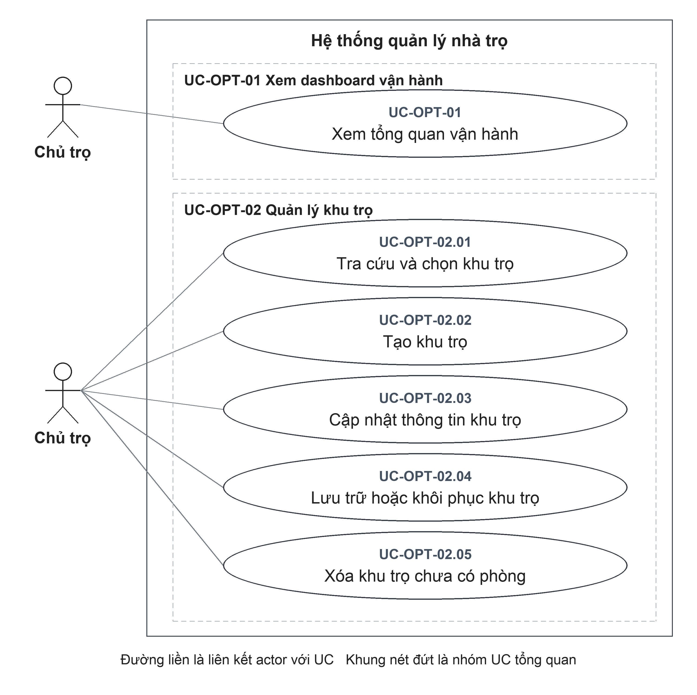

Đặc tả liên quan: [UC-OPT-01](#uc-opt-01), [UC-OPT-02.01](#uc-opt-02-01), [UC-OPT-02.02](#uc-opt-02-02), [UC-OPT-02.03](#uc-opt-02-03), [UC-OPT-02.04](#uc-opt-02-04), [UC-OPT-02.05](#uc-opt-02-05).

### Sơ đồ D-OPT-02 Quản lý phòng

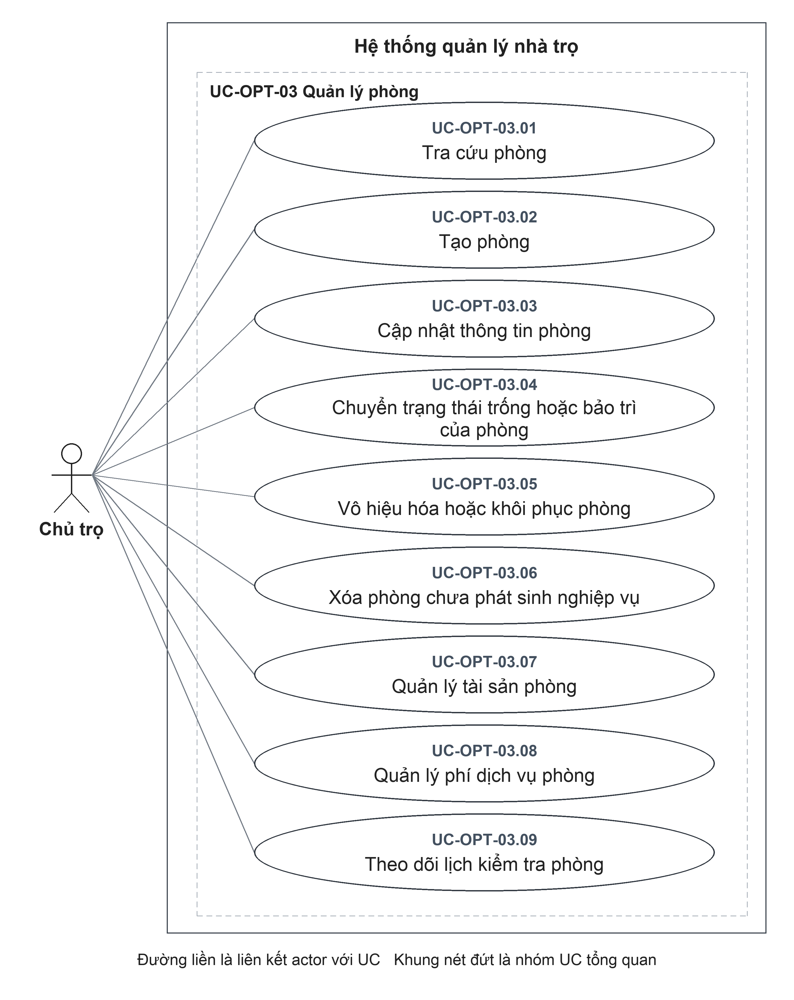

Đặc tả liên quan: [UC-OPT-03.01](#uc-opt-03-01), [UC-OPT-03.02](#uc-opt-03-02), [UC-OPT-03.03](#uc-opt-03-03), [UC-OPT-03.04](#uc-opt-03-04), [UC-OPT-03.05](#uc-opt-03-05), [UC-OPT-03.06](#uc-opt-03-06), [UC-OPT-03.07](#uc-opt-03-07), [UC-OPT-03.08](#uc-opt-03-08), [UC-OPT-03.09](#uc-opt-03-09).

### Sơ đồ D-OPT-03 Quản lý hồ sơ người thuê

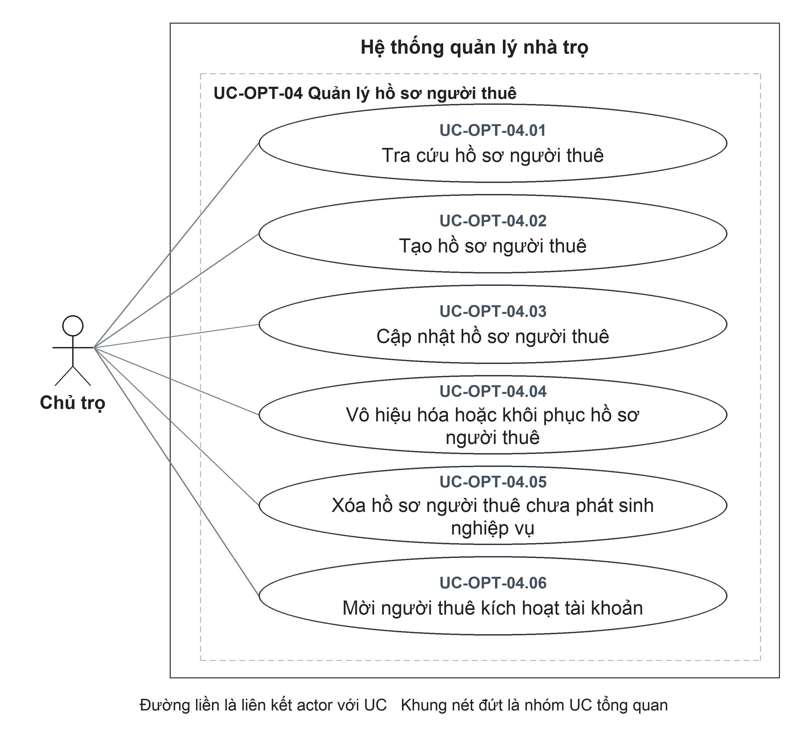

Đặc tả liên quan: [UC-OPT-04.01](#uc-opt-04-01), [UC-OPT-04.02](#uc-opt-04-02), [UC-OPT-04.03](#uc-opt-04-03), [UC-OPT-04.04](#uc-opt-04-04), [UC-OPT-04.05](#uc-opt-04-05), [UC-OPT-04.06](#uc-opt-04-06).

### Sơ đồ D-OPT-04 Quản lý hợp đồng thuê

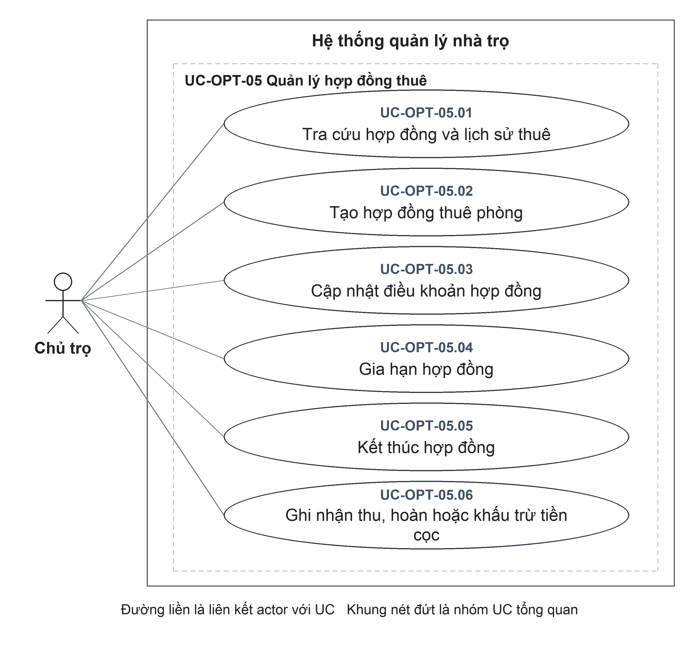

Đặc tả liên quan: [UC-OPT-05.01](#uc-opt-05-01), [UC-OPT-05.02](#uc-opt-05-02), [UC-OPT-05.03](#uc-opt-05-03), [UC-OPT-05.04](#uc-opt-05-04), [UC-OPT-05.05](#uc-opt-05-05), [UC-OPT-05.06](#uc-opt-05-06).

### Sơ đồ D-OPT-05 Quản lý bảo trì

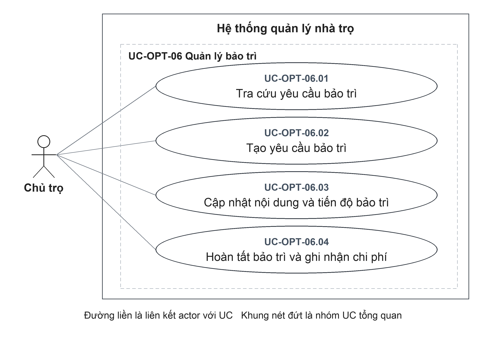

Đặc tả liên quan: [UC-OPT-06.01](#uc-opt-06-01), [UC-OPT-06.02](#uc-opt-06-02), [UC-OPT-06.03](#uc-opt-06-03), [UC-OPT-06.04](#uc-opt-06-04).

### UC-OPT-01 Xem tổng quan vận hành

| Thuộc tính | Đặc tả |
| --- | --- |
| **Mã UC** | UC-OPT-01 |
| **Tên UC** | Xem tổng quan vận hành |
| **Mục tiêu** | Nắm tình trạng phòng, thu tiền và các việc cần xử lý trong phạm vi quản lý. |
| **Actor chính** | Chủ trọ |
| **Actor phụ** | Không có. |
| **Kích hoạt** | Mở tổng quan vận hành. |
| **Điều kiện trước** | **1.** Chủ trọ đã đăng nhập và có quyền sử dụng chức năng tương ứng trong phạm vi quản lý của mình. |
| **Điều kiện sau** | **Thành công:** Tổng quan vận hành hiển thị số liệu theo phạm vi được chọn; không làm thay đổi dữ liệu nguồn.  **Hủy hoặc không thành công:** Không cung cấp được kết quả tra cứu của lần yêu cầu không thành công; UC không ghi thay đổi vào dữ liệu nghiệp vụ. |
| **Dữ liệu đầu vào** | Khu trọ cần xem và phạm vi số tháng thống kê; nếu không chỉ định số tháng thì sử dụng 12 tháng. |
| **Luồng chính** | **1.** Chủ trọ: Mở tổng quan vận hành.  **2.** Hệ thống: Xác định phạm vi khu trọ và khoảng thời gian thống kê được yêu cầu.  **3.** Hệ thống: Tổng hợp phòng, hợp đồng hiệu lực, hóa đơn, tiền thực thu và công nợ trong phạm vi quản lý.  **4.** Hệ thống: Hiển thị tỷ lệ lấp đầy, tiền thu, hóa đơn cần chú ý và việc cần xử lý.  **5.** Chủ trọ: Xem số liệu hoặc mở danh sách nghiệp vụ liên quan để xử lý. |
| **Luồng thay thế** | **A1 — Tại bước 2:** Không chọn một khu trọ cụ thể. Tổng hợp dữ liệu các khu trọ chưa lưu trữ và phòng đang sử dụng của Chủ trọ. |
| **Luồng ngoại lệ** | **E1 — Tại bước 2:** Khu trọ không thuộc Chủ trọ hoặc đã lưu trữ. Không trả số liệu của khu trọ đó; thông báo không tìm thấy. UC kết thúc đối với yêu cầu bị từ chối. |
| **Quy tắc nghiệp vụ** | **BR1.** Tỷ lệ lấp đầy bằng số phòng đang thuê chia tổng số phòng trong phạm vi; tổng số phòng bằng 0 thì tỷ lệ bằng 0.  **BR2.** Tiền thực thu được tổng hợp theo ngày giao dịch, không đồng nhất với tổng tiền lập hóa đơn. |

### UC-OPT-02.01 Tra cứu và chọn khu trọ

| Thuộc tính | Đặc tả |
| --- | --- |
| **Mã UC** | UC-OPT-02.01 |
| **Tên UC** | Tra cứu và chọn khu trọ |
| **Mục tiêu** | Xem thông tin khu trọ và chọn phạm vi cho các nghiệp vụ vận hành. |
| **Actor chính** | Chủ trọ |
| **Actor phụ** | Không có. |
| **Kích hoạt** | Mở danh sách khu trọ và chọn bộ lọc đang sử dụng, đã lưu trữ hoặc tất cả. |
| **Điều kiện trước** | **1.** Chủ trọ đã đăng nhập và có quyền sử dụng chức năng tương ứng trong phạm vi quản lý của mình. |
| **Điều kiện sau** | **Thành công:** Danh sách khu trọ được hiển thị; lựa chọn khu trọ được dùng cho các màn hình vận hành.  **Hủy hoặc không thành công:** Không cung cấp được kết quả tra cứu của lần yêu cầu không thành công; UC không ghi thay đổi vào dữ liệu nghiệp vụ. |
| **Dữ liệu đầu vào** | Bộ lọc khu trọ đang sử dụng/đã lưu trữ/tất cả; khu trọ cần chọn. |
| **Luồng chính** | **1.** Chủ trọ: Mở danh sách khu trọ và chọn bộ lọc đang sử dụng, đã lưu trữ hoặc tất cả.  **2.** Hệ thống: Lấy các khu trọ thuộc Chủ trọ theo bộ lọc cùng tổng số phòng của từng khu trọ, bao gồm cả phòng đã ngừng sử dụng.  **3.** Hệ thống: Hiển thị danh sách khu trọ và thông tin tóm tắt của từng khu.  **4.** Chủ trọ: Chọn khu trọ làm phạm vi vận hành cho các chức năng tiếp theo. |
| **Luồng thay thế** | **A1 — Tại bước 2:** Không có khu trọ phù hợp bộ lọc. Hiển thị danh sách rỗng; đổi bộ lọc hoặc chuyển sang tạo khu trọ. UC kết thúc sau khi hiển thị kết quả. |
| **Luồng ngoại lệ** | **E1 — Tại bước 2:** Đối tượng chi tiết không thuộc Chủ trọ hoặc không tồn tại. Không trả thông tin khu trọ. UC kết thúc đối với yêu cầu bị từ chối. |
| **Quy tắc nghiệp vụ** | **BR1.** Chỉ hiển thị khu trọ thuộc phạm vi quản lý của Chủ trọ. |

### UC-OPT-02.02 Tạo khu trọ

| Thuộc tính | Đặc tả |
| --- | --- |
| **Mã UC** | UC-OPT-02.02 |
| **Tên UC** | Tạo khu trọ |
| **Mục tiêu** | Khai báo một khu trọ mới thuộc quyền quản lý của Chủ trọ. |
| **Actor chính** | Chủ trọ |
| **Actor phụ** | Không có. |
| **Kích hoạt** | Chọn thêm khu trọ. |
| **Điều kiện trước** | **1.** Chủ trọ đã đăng nhập và có quyền sử dụng chức năng tương ứng trong phạm vi quản lý của mình. |
| **Điều kiện sau** | **Thành công:** Khu trọ mới thuộc Chủ trọ và được trả về danh sách.  **Hủy hoặc không thành công:** Hủy trước xác nhận hoặc bị từ chối trước ghi nhận thì không tạo khu trọ mới. Nếu đã gửi yêu cầu nhưng chưa xác định được kết quả, cần kiểm tra lại dữ liệu khu trọ trước khi thực hiện lại. |
| **Dữ liệu đầu vào** | Tên khu trọ; địa chỉ tùy chọn. |
| **Luồng chính** | **1.** Chủ trọ: Chọn thêm khu trọ.  **2.** Hệ thống: Hiển thị các trường tên khu trọ và địa chỉ.  **3.** Chủ trọ: Nhập tên, bổ sung địa chỉ nếu có và xác nhận tạo.  **4.** Hệ thống: Kiểm tra tên bắt buộc và độ dài các thông tin được nhập.  **5.** Hệ thống: Tạo khu trọ thuộc Chủ trọ đang đăng nhập.  **6.** Hệ thống: Cập nhật danh sách để hiển thị khu trọ mới. |
| **Luồng thay thế** | Không có nhánh thay thế nghiệp vụ riêng trong phạm vi UC này. |
| **Luồng ngoại lệ** | **E1 — Tại bước 4:** Tên để trống hoặc quá 120 ký tự; địa chỉ nếu nhập quá 255 ký tự. Không tạo khu trọ; Chủ trọ điều chỉnh dữ liệu rồi thực hiện lại từ bước 3. |
| **Quy tắc nghiệp vụ** | **BR1.** Khu trọ mới thuộc Chủ trọ thực hiện tạo.  **BR2.** Tên khu trọ dài từ 1 đến 120 ký tự; địa chỉ không bắt buộc, tối đa 255 ký tự. |

### UC-OPT-02.03 Cập nhật thông tin khu trọ

| Thuộc tính | Đặc tả |
| --- | --- |
| **Mã UC** | UC-OPT-02.03 |
| **Tên UC** | Cập nhật thông tin khu trọ |
| **Mục tiêu** | Hiệu chỉnh tên và địa chỉ của khu trọ. |
| **Actor chính** | Chủ trọ |
| **Actor phụ** | Không có. |
| **Kích hoạt** | Chọn chỉnh sửa thông tin khu trọ. |
| **Điều kiện trước** | **1.** Chủ trọ đã đăng nhập và có quyền sử dụng chức năng tương ứng trong phạm vi quản lý của mình.  **2.** Khu trọ cần sửa đã tồn tại và thuộc phạm vi quản lý. |
| **Điều kiện sau** | **Thành công:** Thông tin khu trọ được cập nhật; quan hệ sở hữu giữ nguyên.  **Hủy hoặc không thành công:** Yêu cầu bị từ chối trước ghi nhận không thay đổi thông tin khu trọ. Nếu chưa nhận được kết quả sau khi xác nhận, cần kiểm tra lại thông tin khu trọ, không mặc định thao tác đã được hoàn tác. |
| **Dữ liệu đầu vào** | Khu trọ, tên/địa chỉ cần cập nhật. |
| **Luồng chính** | **1.** Chủ trọ: Chọn chỉnh sửa thông tin khu trọ.  **2.** Hệ thống: Hiển thị tên và địa chỉ hiện tại của khu trọ.  **3.** Chủ trọ: Điều chỉnh tên hoặc địa chỉ và xác nhận lưu.  **4.** Hệ thống: Kiểm tra quyền quản lý khu trọ và dữ liệu cập nhật.  **5.** Hệ thống: Lưu thông tin thay đổi, giữ nguyên quan hệ sở hữu.  **6.** Hệ thống: Hiển thị thông tin khu trọ sau cập nhật. |
| **Luồng thay thế** | Không có nhánh thay thế nghiệp vụ riêng trong phạm vi UC này. |
| **Luồng ngoại lệ** | **E1 — Tại bước 4:** Khu trọ không tồn tại/không thuộc Chủ trọ hoặc dữ liệu không hợp lệ. Từ chối cập nhật. UC kết thúc đối với yêu cầu bị từ chối. |
| **Quy tắc nghiệp vụ** | **BR1.** Tên khu trọ không được để trống.  **BR2.** UC này không thay đổi Chủ trọ sở hữu khu trọ. |

### UC-OPT-02.04 Lưu trữ hoặc khôi phục khu trọ

| Thuộc tính | Đặc tả |
| --- | --- |
| **Mã UC** | UC-OPT-02.04 |
| **Tên UC** | Lưu trữ hoặc khôi phục khu trọ |
| **Mục tiêu** | Tạm ngưng khu trọ khỏi phạm vi vận hành hoặc đưa khu trọ đã lưu trữ trở lại. |
| **Actor chính** | Chủ trọ |
| **Actor phụ** | Không có. |
| **Kích hoạt** | Chọn lưu trữ khu trọ đang sử dụng hoặc khôi phục khu trọ đã lưu trữ. |
| **Điều kiện trước** | **1.** Chủ trọ đã đăng nhập và có quyền sử dụng chức năng tương ứng trong phạm vi quản lý của mình.  **2.** Khu trọ cần thay đổi tình trạng đã tồn tại và thuộc phạm vi quản lý. |
| **Điều kiện sau** | **Thành công:** Tình trạng lưu trữ được cập nhật; phòng và lịch sử thuê không bị xóa.  **Hủy hoặc không thành công:** Yêu cầu bị từ chối trước ghi nhận không thay đổi tình trạng lưu trữ khu trọ. Nếu chưa nhận được kết quả sau khi xác nhận, cần kiểm tra lại tình trạng lưu trữ khu trọ, không mặc định thao tác đã được hoàn tác. |
| **Dữ liệu đầu vào** | Khu trọ và lựa chọn lưu trữ/khôi phục. |
| **Luồng chính** | **1.** Chủ trọ: Chọn lưu trữ khu trọ đang sử dụng.  **2.** Hệ thống: Hiển thị yêu cầu xác nhận lưu trữ khu trọ.  **3.** Chủ trọ: Xác nhận lưu trữ.  **4.** Hệ thống: Kiểm tra khu trọ thuộc Chủ trọ; khi lưu trữ, kiểm tra không còn hợp đồng hiệu lực trong khu trọ.  **5.** Hệ thống: Cập nhật tình trạng lưu trữ theo lựa chọn được xác nhận, giữ nguyên dữ liệu hiện có.  **6.** Hệ thống: Cập nhật tình trạng khu trọ trong danh sách. |
| **Luồng thay thế** | **A1 — Tại bước 1:** Chủ trọ chọn khôi phục khu trọ đã lưu trữ thay cho lưu trữ. Tại bước 2, hệ thống yêu cầu xác nhận khôi phục; tại bước 3, Chủ trọ xác nhận. Tiếp tục bước 4 để kiểm tra quyền quản lý, không áp dụng điều kiện không còn hợp đồng của nhánh lưu trữ; tại bước 5 đặt khu trọ về đang sử dụng, không tự khôi phục từng phòng; hiển thị kết quả tại bước 6. |
| **Luồng ngoại lệ** | **E1 — Tại bước 4:** Khu trọ còn hợp đồng hiệu lực khi yêu cầu lưu trữ. Từ chối; cần xử lý hợp đồng trước. UC kết thúc đối với yêu cầu bị từ chối.  **E2 — Tại bước 4:** Không tìm thấy khu trọ trong phạm vi Chủ trọ. Từ chối thao tác. UC kết thúc đối với yêu cầu bị từ chối. |
| **Quy tắc nghiệp vụ** | **BR1.** Không lưu trữ khu trọ còn hợp đồng hiệu lực.  **BR2.** Khôi phục khu trọ không tự khôi phục các phòng đã ngừng sử dụng. |

### UC-OPT-02.05 Xóa khu trọ chưa có phòng

| Thuộc tính | Đặc tả |
| --- | --- |
| **Mã UC** | UC-OPT-02.05 |
| **Tên UC** | Xóa khu trọ chưa có phòng |
| **Mục tiêu** | Loại bỏ khu trọ khai báo nhầm nhưng chưa có dữ liệu phòng. |
| **Actor chính** | Chủ trọ |
| **Actor phụ** | Không có. |
| **Kích hoạt** | Chọn xóa khu trọ. |
| **Điều kiện trước** | **1.** Chủ trọ đã đăng nhập và có quyền sử dụng chức năng tương ứng trong phạm vi quản lý của mình.  **2.** Khu trọ cần xóa đã tồn tại và thuộc phạm vi quản lý. |
| **Điều kiện sau** | **Thành công:** Khu trọ bị xóa khỏi dữ liệu hiện tại.  **Hủy hoặc không thành công:** Hủy trước xác nhận hoặc bị từ chối khi kiểm tra điều kiện thì khu trọ vẫn được giữ lại. Nếu mất phản hồi sau yêu cầu xóa, cần tra cứu lại để xác định khu trọ còn tồn tại hay không. |
| **Dữ liệu đầu vào** | Khu trọ cần xóa và xác nhận thao tác. |
| **Luồng chính** | **1.** Chủ trọ: Chọn xóa khu trọ.  **2.** Hệ thống: Hiển thị yêu cầu xác nhận xóa khu trọ đã chọn.  **3.** Chủ trọ: Xác nhận xóa.  **4.** Hệ thống: Kiểm tra quyền quản lý, hợp đồng hiệu lực và các phòng thuộc khu trọ.  **5.** Hệ thống: Xóa khu trọ khi không có phòng liên quan và không còn hợp đồng hiệu lực.  **6.** Hệ thống: Loại khu trọ đã xóa khỏi danh sách. |
| **Luồng thay thế** | Không có nhánh thay thế nghiệp vụ riêng trong phạm vi UC này. |
| **Luồng ngoại lệ** | **E1 — Tại bước 4:** Có hợp đồng hiệu lực hoặc có phòng. Từ chối xóa; giữ khu trọ. UC kết thúc đối với yêu cầu bị từ chối.  **E2 — Tại bước 4:** Khu trọ không tồn tại/không thuộc Chủ trọ. Từ chối thao tác. UC kết thúc đối với yêu cầu bị từ chối. |
| **Quy tắc nghiệp vụ** | **BR1.** Không xóa khu trọ đang có phòng liên quan hoặc hợp đồng hiệu lực. |

### UC-OPT-03.01 Tra cứu phòng

| Thuộc tính | Đặc tả |
| --- | --- |
| **Mã UC** | UC-OPT-03.01 |
| **Tên UC** | Tra cứu phòng |
| **Mục tiêu** | Xem danh sách, hiện trạng và thông tin chi tiết phòng trong khu trọ. |
| **Actor chính** | Chủ trọ |
| **Actor phụ** | Không có. |
| **Kích hoạt** | Chọn khu trọ và bộ lọc phòng đang sử dụng, ngừng sử dụng hoặc tất cả. |
| **Điều kiện trước** | **1.** Chủ trọ đã đăng nhập và có quyền sử dụng chức năng tương ứng trong phạm vi quản lý của mình.  **2.** Khu trọ cần tra cứu đã tồn tại và thuộc phạm vi quản lý. |
| **Điều kiện sau** | **Thành công:** Danh sách/chi tiết phòng được hiển thị.  **Hủy hoặc không thành công:** Không cung cấp được kết quả tra cứu của lần yêu cầu không thành công; UC không ghi thay đổi vào dữ liệu nghiệp vụ. |
| **Dữ liệu đầu vào** | Khu trọ, bộ lọc tình trạng sử dụng và phòng cần xem. |
| **Luồng chính** | **1.** Chủ trọ: Chọn khu trọ và bộ lọc phòng đang sử dụng, ngừng sử dụng hoặc tất cả.  **2.** Hệ thống: Lấy các phòng của khu trọ theo phạm vi và bộ lọc được chọn.  **3.** Hệ thống: Hiển thị danh sách phòng với tình trạng sử dụng và thông tin hợp đồng liên quan.  **4.** Chủ trọ: Mở một phòng để xem thông tin chi tiết hoặc chọn thao tác tiếp theo. |
| **Luồng thay thế** | **A1 — Tại bước 2:** Không có phòng phù hợp. Hiển thị danh sách rỗng. UC kết thúc sau khi hiển thị kết quả. |
| **Luồng ngoại lệ** | **E1 — Tại bước 2:** Khu trọ/phòng không tồn tại hoặc ngoài phạm vi Chủ trọ. Không trả dữ liệu. UC kết thúc đối với yêu cầu bị từ chối. |
| **Quy tắc nghiệp vụ** | **BR1.** Không hiển thị phòng ngoài phạm vi quản lý của Chủ trọ. |

### UC-OPT-03.02 Tạo phòng

| Thuộc tính | Đặc tả |
| --- | --- |
| **Mã UC** | UC-OPT-03.02 |
| **Tên UC** | Tạo phòng |
| **Mục tiêu** | Khai báo phòng mới để quản lý và sử dụng trong nghiệp vụ cho thuê. |
| **Actor chính** | Chủ trọ |
| **Actor phụ** | Không có. |
| **Kích hoạt** | Chọn thêm phòng vào khu trọ. |
| **Điều kiện trước** | **1.** Chủ trọ đã đăng nhập và có quyền sử dụng chức năng tương ứng trong phạm vi quản lý của mình.  **2.** Khu trọ nhận phòng mới đã tồn tại, thuộc phạm vi quản lý và chưa được lưu trữ. |
| **Điều kiện sau** | **Thành công:** Phòng mới được tạo trong khu trọ.  **Hủy hoặc không thành công:** Hủy trước xác nhận hoặc bị từ chối trước ghi nhận thì không tạo phòng mới. Nếu đã gửi yêu cầu nhưng chưa xác định được kết quả, cần kiểm tra lại dữ liệu phòng trước khi thực hiện lại. |
| **Dữ liệu đầu vào** | Khu trọ, tên, trạng thái và giá phòng; tầng, diện tích, sức chứa, tiện ích, ảnh, ghi chú tùy chọn. |
| **Luồng chính** | **1.** Chủ trọ: Chọn thêm phòng vào khu trọ.  **2.** Hệ thống: Hiển thị các trường tên phòng, giá phòng, trạng thái và thông tin mô tả phòng.  **3.** Chủ trọ: Nhập tên, giá, trạng thái; bổ sung tầng, diện tích, sức chứa, tiện ích, ảnh hoặc ghi chú và xác nhận tạo.  **4.** Hệ thống: Kiểm tra khu trọ, dữ liệu phòng và sự phù hợp của trạng thái với việc chưa có hợp đồng.  **5.** Hệ thống: Tạo phòng gắn với khu trọ đã chọn.  **6.** Hệ thống: Hiển thị phòng mới trong danh sách phòng của khu trọ. |
| **Luồng thay thế** | Không có nhánh thay thế nghiệp vụ riêng trong phạm vi UC này. |
| **Luồng ngoại lệ** | **E1 — Tại bước 4:** Khu trọ đã lưu trữ, không tồn tại hoặc ngoài phạm vi. Từ chối tạo phòng. UC kết thúc đối với yêu cầu bị từ chối.  **E2 — Tại bước 4:** Yêu cầu tạo phòng Đang thuê. Từ chối vì chưa có hợp đồng hiệu lực. UC kết thúc đối với yêu cầu bị từ chối. |
| **Quy tắc nghiệp vụ** | **BR1.** Không tạo phòng ở khu trọ đã lưu trữ.  **BR2.** Phòng mới chưa có hợp đồng không được tạo với trạng thái Đang thuê.  **BR3.** Giá phòng là số nguyên không âm; tầng, diện tích, sức chứa khi được nhập phải không âm. |

### UC-OPT-03.03 Cập nhật thông tin phòng

| Thuộc tính | Đặc tả |
| --- | --- |
| **Mã UC** | UC-OPT-03.03 |
| **Tên UC** | Cập nhật thông tin phòng |
| **Mục tiêu** | Điều chỉnh thông tin mô tả hoặc giá thuê tham khảo của phòng. |
| **Actor chính** | Chủ trọ |
| **Actor phụ** | Không có. |
| **Kích hoạt** | Chọn chỉnh sửa phòng. |
| **Điều kiện trước** | **1.** Chủ trọ đã đăng nhập và có quyền sử dụng chức năng tương ứng trong phạm vi quản lý của mình.  **2.** Phòng cần cập nhật đã tồn tại và thuộc phạm vi quản lý. |
| **Điều kiện sau** | **Thành công:** Thông tin phòng được cập nhật; UC không cập nhật tiền thuê trên hợp đồng.  **Hủy hoặc không thành công:** Yêu cầu bị từ chối trước ghi nhận không thay đổi thông tin phòng. Nếu chưa nhận được kết quả sau khi xác nhận, cần kiểm tra lại thông tin phòng, không mặc định thao tác đã được hoàn tác. |
| **Dữ liệu đầu vào** | Tên, giá phòng, tầng, diện tích, sức chứa, tiện ích, ảnh, ghi chú và trạng thái được gửi. |
| **Luồng chính** | **1.** Chủ trọ: Chọn chỉnh sửa phòng.  **2.** Hệ thống: Hiển thị tên, giá phòng và các thông tin mô tả hiện tại.  **3.** Chủ trọ: Điều chỉnh thông tin phòng và xác nhận lưu.  **4.** Hệ thống: Kiểm tra phòng đang được sử dụng, dữ liệu hợp lệ và trạng thái phù hợp với hợp đồng hiệu lực nếu có.  **5.** Hệ thống: Lưu thông tin phòng; giữ nguyên tiền thuê của hợp đồng đã lập.  **6.** Hệ thống: Hiển thị thông tin phòng sau cập nhật. |
| **Luồng thay thế** | Không có nhánh thay thế nghiệp vụ riêng trong phạm vi UC này. |
| **Luồng ngoại lệ** | **E1 — Tại bước 4:** Phòng ngừng sử dụng hoặc không tìm thấy. Từ chối cập nhật. UC kết thúc đối với yêu cầu bị từ chối.  **E2 — Tại bước 4:** Trạng thái mới mâu thuẫn với hợp đồng hiệu lực. Từ chối cập nhật trạng thái. UC kết thúc đối với yêu cầu bị từ chối. |
| **Quy tắc nghiệp vụ** | **BR1.** Giá phòng và tiền thuê trên hợp đồng là hai giá trị riêng; đổi giá phòng không tự đổi tiền thuê của hợp đồng.  **BR2.** Trạng thái Đang thuê phải phù hợp với sự tồn tại của hợp đồng hiệu lực. |

### UC-OPT-03.04 Chuyển trạng thái trống hoặc bảo trì của phòng

| Thuộc tính | Đặc tả |
| --- | --- |
| **Mã UC** | UC-OPT-03.04 |
| **Tên UC** | Chuyển trạng thái trống hoặc bảo trì của phòng |
| **Mục tiêu** | Đánh dấu phòng chưa có hợp đồng hiệu lực là trống hoặc đang bảo trì. |
| **Actor chính** | Chủ trọ |
| **Actor phụ** | Không có. |
| **Kích hoạt** | Chọn thay đổi trạng thái vận hành của phòng. |
| **Điều kiện trước** | **1.** Chủ trọ đã đăng nhập và có quyền sử dụng chức năng tương ứng trong phạm vi quản lý của mình.  **2.** Phòng cần thay đổi trạng thái đã tồn tại, thuộc phạm vi quản lý và đang được sử dụng. |
| **Điều kiện sau** | **Thành công:** Phòng không có hợp đồng hiệu lực được chuyển Trống/Bảo trì nếu yêu cầu hợp lệ.  **Hủy hoặc không thành công:** Yêu cầu bị từ chối trước ghi nhận không thay đổi trạng thái phòng. Nếu chưa nhận được kết quả sau khi xác nhận, cần kiểm tra lại trạng thái phòng, không mặc định thao tác đã được hoàn tác. |
| **Dữ liệu đầu vào** | Phòng và trạng thái Trống/Bảo trì. |
| **Luồng chính** | **1.** Chủ trọ: Chọn thay đổi trạng thái vận hành của phòng.  **2.** Hệ thống: Hiển thị trạng thái hiện tại và lựa chọn Trống hoặc Bảo trì.  **3.** Chủ trọ: Chọn trạng thái cần áp dụng và xác nhận.  **4.** Hệ thống: Kiểm tra sự phù hợp giữa trạng thái được chọn và hợp đồng hiệu lực của phòng.  **5.** Hệ thống: Cập nhật trạng thái khi không có mâu thuẫn với hợp đồng.  **6.** Hệ thống: Hiển thị trạng thái mới của phòng. |
| **Luồng thay thế** | Không có nhánh thay thế nghiệp vụ riêng trong phạm vi UC này. |
| **Luồng ngoại lệ** | **E1 — Tại bước 4:** Có hợp đồng hiệu lực nhưng yêu cầu trạng thái khác Đang thuê. Từ chối thay đổi. UC kết thúc đối với yêu cầu bị từ chối.  **E2 — Tại bước 4:** Không có hợp đồng hiệu lực nhưng yêu cầu Đang thuê. Từ chối thay đổi. UC kết thúc đối với yêu cầu bị từ chối. |
| **Quy tắc nghiệp vụ** | **BR1.** Phòng còn hợp đồng hiệu lực không được chuyển sang Trống hoặc Bảo trì bằng thao tác này. |

### UC-OPT-03.05 Vô hiệu hóa hoặc khôi phục phòng

| Thuộc tính | Đặc tả |
| --- | --- |
| **Mã UC** | UC-OPT-03.05 |
| **Tên UC** | Vô hiệu hóa hoặc khôi phục phòng |
| **Mục tiêu** | Ngừng dùng phòng trong phát sinh mới hoặc khôi phục khả năng vận hành, giữ lịch sử. |
| **Actor chính** | Chủ trọ |
| **Actor phụ** | Không có. |
| **Kích hoạt** | Chọn ngừng sử dụng phòng đang sử dụng hoặc khôi phục phòng đã ngừng sử dụng. |
| **Điều kiện trước** | **1.** Chủ trọ đã đăng nhập và có quyền sử dụng chức năng tương ứng trong phạm vi quản lý của mình.  **2.** Phòng cần thay đổi tình trạng sử dụng đã tồn tại và thuộc phạm vi quản lý. |
| **Điều kiện sau** | **Thành công:** Phòng được ngừng sử dụng/khôi phục; lịch sử được giữ.  **Hủy hoặc không thành công:** Yêu cầu bị từ chối trước ghi nhận không thay đổi tình trạng sử dụng phòng. Nếu chưa nhận được kết quả sau khi xác nhận, cần kiểm tra lại tình trạng sử dụng phòng, không mặc định thao tác đã được hoàn tác. |
| **Dữ liệu đầu vào** | Phòng và tình trạng sử dụng mong muốn. |
| **Luồng chính** | **1.** Chủ trọ: Chọn ngừng sử dụng phòng.  **2.** Hệ thống: Hiển thị yêu cầu xác nhận ngừng sử dụng.  **3.** Chủ trọ: Xác nhận thao tác.  **4.** Hệ thống: Kiểm tra quyền quản lý phòng; khi ngừng sử dụng, kiểm tra phòng không còn hợp đồng hiệu lực.  **5.** Hệ thống: Cập nhật tình trạng sử dụng theo lựa chọn được xác nhận, giữ lịch sử phòng.  **6.** Hệ thống: Cập nhật tình trạng sử dụng của phòng trong danh sách. |
| **Luồng thay thế** | **A1 — Tại bước 1:** Chủ trọ chọn khôi phục phòng đã ngừng sử dụng. Tại bước 2, hệ thống yêu cầu xác nhận khôi phục; tại bước 3, Chủ trọ xác nhận. Tiếp tục bước 4 để kiểm tra quyền quản lý, không áp dụng điều kiện không còn hợp đồng của nhánh ngừng sử dụng; tại bước 5 đặt phòng về đang sử dụng và hiển thị kết quả tại bước 6. Điều kiện khi khu trọ đã lưu trữ xem [PX-10](#px-10). |
| **Luồng ngoại lệ** | **E1 — Tại bước 4:** Phòng có hợp đồng hiệu lực khi yêu cầu ngừng sử dụng. Từ chối thao tác. UC kết thúc đối với yêu cầu bị từ chối.  **E2 — Tại bước 4:** Phòng không thuộc Chủ trọ hoặc không tồn tại. Không cập nhật. |
| **Quy tắc nghiệp vụ** | **BR1.** Không ngừng sử dụng phòng còn hợp đồng hiệu lực.  **BR2.** Ngừng sử dụng phòng không xóa lịch sử hợp đồng, hóa đơn hoặc chỉ số điện nước. |

### UC-OPT-03.06 Xóa phòng chưa phát sinh nghiệp vụ

| Thuộc tính | Đặc tả |
| --- | --- |
| **Mã UC** | UC-OPT-03.06 |
| **Tên UC** | Xóa phòng chưa phát sinh nghiệp vụ |
| **Mục tiêu** | Loại bỏ phòng tạo nhầm khi chưa có dữ liệu cần bảo toàn. |
| **Actor chính** | Chủ trọ |
| **Actor phụ** | Không có. |
| **Kích hoạt** | Chọn xóa phòng. |
| **Điều kiện trước** | **1.** Chủ trọ đã đăng nhập và có quyền sử dụng chức năng tương ứng trong phạm vi quản lý của mình.  **2.** Phòng cần xóa đã tồn tại và thuộc phạm vi quản lý. |
| **Điều kiện sau** | **Thành công:** Phòng bị xóa khỏi dữ liệu hiện tại nếu thao tác hoàn tất.  **Hủy hoặc không thành công:** Hủy trước xác nhận hoặc bị từ chối khi kiểm tra điều kiện thì phòng vẫn được giữ lại. Nếu mất phản hồi sau yêu cầu xóa, cần tra cứu lại để xác định phòng còn tồn tại hay không. |
| **Dữ liệu đầu vào** | Phòng cần xóa và xác nhận thao tác. |
| **Luồng chính** | **1.** Chủ trọ: Chọn xóa phòng.  **2.** Hệ thống: Hiển thị yêu cầu xác nhận xóa phòng đã chọn.  **3.** Chủ trọ: Xác nhận xóa.  **4.** Hệ thống: Kiểm tra quyền quản lý và các hợp đồng, chỉ số điện nước, hóa đơn liên quan đến phòng.  **5.** Hệ thống: Xóa phòng khi không còn hợp đồng hiệu lực và không có lịch sử hợp đồng, chỉ số hoặc hóa đơn.  **6.** Hệ thống: Loại phòng đã xóa khỏi danh sách. |
| **Luồng thay thế** | Không có nhánh thay thế nghiệp vụ riêng trong phạm vi UC này. |
| **Luồng ngoại lệ** | **E1 — Tại bước 4:** Có hợp đồng hiệu lực hoặc có hợp đồng, chỉ số hay hóa đơn lịch sử. Từ chối xóa; giữ phòng. UC kết thúc đối với yêu cầu bị từ chối. |
| **Quy tắc nghiệp vụ** | **BR1.** Không xóa phòng đã có hợp đồng, chỉ số điện nước hoặc hóa đơn; cần giữ lại dữ liệu để đối chiếu. |

### UC-OPT-03.07 Quản lý tài sản phòng

| Thuộc tính | Đặc tả |
| --- | --- |
| **Mã UC** | UC-OPT-03.07 |
| **Tên UC** | Quản lý tài sản phòng |
| **Mục tiêu** | Theo dõi tài sản, số lượng và tình trạng trang bị của một phòng. |
| **Actor chính** | Chủ trọ |
| **Actor phụ** | Không có. |
| **Kích hoạt** | Mở danh sách tài sản của phòng. |
| **Điều kiện trước** | **1.** Chủ trọ đã đăng nhập và có quyền sử dụng chức năng tương ứng trong phạm vi quản lý của mình.  **2.** Phòng quản lý tài sản đã tồn tại và thuộc phạm vi quản lý. |
| **Điều kiện sau** | **Thành công:** Tài sản được thêm/xóa theo thao tác hoàn tất; không tự tạo khoản chi.  **Hủy hoặc không thành công:** Yêu cầu bị từ chối trước ghi nhận không thay đổi danh sách tài sản. Nếu chưa nhận được kết quả sau khi xác nhận, cần kiểm tra lại danh sách tài sản, không mặc định thao tác đã được hoàn tác. |
| **Dữ liệu đầu vào** | Phòng đã chọn; tên tài sản, số lượng, tình trạng và giá trị nếu có. Khi xóa, xác định tài sản cần xóa. Các thông tin mở rộng xem [PX-09](#px-09). |
| **Luồng chính** | **1.** Chủ trọ: Mở danh sách tài sản của phòng.  **2.** Hệ thống: Hiển thị các tài sản đã ghi nhận cùng số lượng, tình trạng và giá trị.  **3.** Chủ trọ: Chọn thêm tài sản, nhập tên, số lượng, tình trạng và giá trị nếu có; xác nhận lưu.  **4.** Hệ thống: Kiểm tra phòng, tên tài sản, số lượng và giá trị rồi ghi nhận tài sản thuộc phòng.  **5.** Hệ thống: Hiển thị tài sản mới trong danh sách. |
| **Luồng thay thế** | **A1 — Tại bước 3:** Chủ trọ chọn xóa tài sản hiện có thay cho thêm tài sản. Tại bước 4, hệ thống kiểm tra quyền quản lý phòng và xác nhận tài sản thuộc phòng rồi xóa tài sản đã chọn. Tại bước 5, hiển thị danh sách sau khi xóa; không tạo tài sản mới. |
| **Luồng ngoại lệ** | **E1 — Tại bước 4:** Phòng hoặc tài sản được chọn không tồn tại trong phạm vi. Từ chối thao tác. UC kết thúc đối với yêu cầu bị từ chối.  **E2 — Tại bước 4:** Dữ liệu không đáp ứng các trường bắt buộc hoặc giới hạn giá trị. Từ chối lưu; điều chỉnh thông tin. Sau khi điều chỉnh, thực hiện lại từ bước 3. |
| **Quy tắc nghiệp vụ** | **BR1.** Tài sản phải gắn với một phòng thuộc phạm vi quản lý.  **BR2.** Số lượng tối thiểu là 1, mặc định 1; giá trị khi nhập là số nguyên không âm. |

### UC-OPT-03.08 Quản lý phí dịch vụ phòng

| Thuộc tính | Đặc tả |
| --- | --- |
| **Mã UC** | UC-OPT-03.08 |
| **Tên UC** | Quản lý phí dịch vụ phòng |
| **Mục tiêu** | Khai báo khoản phí định kỳ được đưa vào các hóa đơn lập sau đó. |
| **Actor chính** | Chủ trọ |
| **Actor phụ** | Không có. |
| **Kích hoạt** | Mở danh sách phí dịch vụ của phòng. |
| **Điều kiện trước** | **1.** Chủ trọ đã đăng nhập và có quyền sử dụng chức năng tương ứng trong phạm vi quản lý của mình.  **2.** Phòng áp dụng phí dịch vụ đã tồn tại và thuộc phạm vi quản lý. |
| **Điều kiện sau** | **Thành công:** Danh mục và trạng thái phí được cập nhật; hóa đơn đã lập không được tính lại bởi UC này.  **Hủy hoặc không thành công:** Yêu cầu bị từ chối trước ghi nhận không thay đổi danh sách phí dịch vụ. Nếu chưa nhận được kết quả sau khi xác nhận, cần kiểm tra lại danh sách phí dịch vụ, không mặc định thao tác đã được hoàn tác. |
| **Dữ liệu đầu vào** | Phòng, tên phí, số tiền, ghi chú; phí cần bật/tắt hoặc xóa. |
| **Luồng chính** | **1.** Chủ trọ: Mở danh sách phí dịch vụ của phòng.  **2.** Hệ thống: Hiển thị tên phí, số tiền và tình trạng đang áp dụng của từng phí.  **3.** Chủ trọ: Chọn thêm phí, nhập tên, số tiền và ghi chú nếu có; xác nhận lưu.  **4.** Hệ thống: Kiểm tra phòng và dữ liệu; ghi nhận phí dịch vụ mới của phòng.  **5.** Hệ thống: Cập nhật danh sách phí để Chủ trọ kiểm tra. |
| **Luồng thay thế** | **A1 — Tại bước 3:** Chủ trọ chọn bật hoặc tắt phí hiện có. Tại bước 4, hệ thống kiểm tra quyền quản lý phòng và phí thuộc phòng rồi cập nhật tình trạng áp dụng. Tại bước 5, hiển thị danh sách sau cập nhật; không tạo phí mới.  **A2 — Tại bước 3:** Chủ trọ chọn xóa phí hiện có. Tại bước 4, hệ thống kiểm tra quyền quản lý phòng và phí thuộc phòng rồi xóa phí đã chọn. Tại bước 5, hiển thị danh sách sau khi xóa; không tạo phí mới. |
| **Luồng ngoại lệ** | **E1 — Tại bước 4:** Phòng/phí không thuộc phạm vi hoặc không tồn tại. Từ chối thao tác. UC kết thúc đối với yêu cầu bị từ chối.  **E2 — Tại bước 4:** Số tiền âm hoặc dữ liệu không hợp lệ. Từ chối lưu. UC kết thúc đối với yêu cầu bị từ chối. |
| **Quy tắc nghiệp vụ** | **BR1.** Số tiền phí dịch vụ là số nguyên không âm.  **BR2.** Chỉ các phí đang áp dụng của phòng được đưa vào hóa đơn lập mới. |

### UC-OPT-03.09 Theo dõi lịch kiểm tra phòng

| Thuộc tính | Đặc tả |
| --- | --- |
| **Mã UC** | UC-OPT-03.09 |
| **Tên UC** | Theo dõi lịch kiểm tra phòng |
| **Mục tiêu** | Ghi nhận lịch và kết quả kiểm tra tình trạng phòng để phục vụ vận hành. |
| **Actor chính** | Chủ trọ |
| **Actor phụ** | Không có. |
| **Kích hoạt** | Mở lịch kiểm tra của phòng. |
| **Điều kiện trước** | **1.** Chủ trọ đã đăng nhập và có quyền sử dụng chức năng tương ứng trong phạm vi quản lý của mình.  **2.** Phòng cần kiểm tra đã tồn tại và thuộc phạm vi quản lý. |
| **Điều kiện sau** | **Thành công:** Lịch kiểm tra được thêm hoặc được ghi nhận hoàn tất; không tự lập yêu cầu bảo trì.  **Hủy hoặc không thành công:** Yêu cầu bị từ chối trước ghi nhận không thay đổi lịch kiểm tra phòng. Nếu chưa nhận được kết quả sau khi xác nhận, cần kiểm tra lại lịch kiểm tra phòng, không mặc định thao tác đã được hoàn tác. |
| **Dữ liệu đầu vào** | Phòng, tiêu đề, ngày kiểm tra; ghi chú tùy chọn. |
| **Luồng chính** | **1.** Chủ trọ: Mở lịch kiểm tra của phòng.  **2.** Hệ thống: Hiển thị nội dung kiểm tra, ngày dự kiến và tình trạng hoàn tất.  **3.** Chủ trọ: Thêm nội dung kiểm tra, nhập tiêu đề, ngày dự kiến và ghi chú nếu có; xác nhận lưu.  **4.** Hệ thống: Kiểm tra phòng và dữ liệu rồi tạo mục kiểm tra chưa hoàn tất.  **5.** Hệ thống: Hiển thị mục mới trong lịch kiểm tra phòng. |
| **Luồng thay thế** | **A1 — Tại bước 3:** Chủ trọ chọn đánh dấu mục kiểm tra hiện có đã hoàn tất. Tại bước 4, hệ thống kiểm tra quyền quản lý phòng và mục kiểm tra thuộc phòng rồi ghi thời điểm hoàn tất hiện tại. Tại bước 5, hiển thị lịch kiểm tra sau cập nhật; không tạo mục mới. |
| **Luồng ngoại lệ** | **E1 — Tại bước 4:** Phòng hoặc mục kiểm tra không tồn tại/ngoài phạm vi. Từ chối thao tác. UC kết thúc đối với yêu cầu bị từ chối.  **E2 — Tại bước 4:** Ngày hoặc tiêu đề không hợp lệ. Từ chối lưu. UC kết thúc đối với yêu cầu bị từ chối. |
| **Quy tắc nghiệp vụ** | **BR1.** Mỗi mục kiểm tra thuộc một phòng.  **BR2.** Đánh dấu hoàn tất ghi nhận thời điểm hoàn tất của mục kiểm tra. |

### UC-OPT-04.01 Tra cứu hồ sơ người thuê

| Thuộc tính | Đặc tả |
| --- | --- |
| **Mã UC** | UC-OPT-04.01 |
| **Tên UC** | Tra cứu hồ sơ người thuê |
| **Mục tiêu** | Xem thông tin người thuê và lịch sử thuê, hóa đơn liên quan. |
| **Actor chính** | Chủ trọ |
| **Actor phụ** | Không có. |
| **Kích hoạt** | Mở danh sách Người thuê, chọn tình trạng sử dụng và nhập từ khóa cần tìm. |
| **Điều kiện trước** | **1.** Chủ trọ đã đăng nhập và có quyền sử dụng chức năng tương ứng trong phạm vi quản lý của mình. |
| **Điều kiện sau** | **Thành công:** Chủ trọ xem được danh sách và tổng quan hồ sơ Người thuê.  **Hủy hoặc không thành công:** Không cung cấp được kết quả tra cứu của lần yêu cầu không thành công; UC không ghi thay đổi vào dữ liệu nghiệp vụ. |
| **Dữ liệu đầu vào** | Bộ lọc đang sử dụng/ngừng sử dụng/tất cả, từ khóa trên biểu mẫu và hồ sơ cần xem. |
| **Luồng chính** | **1.** Chủ trọ: Mở danh sách Người thuê, chọn tình trạng sử dụng và nhập từ khóa cần tìm.  **2.** Hệ thống: Lấy hồ sơ Người thuê thuộc Chủ trọ cùng thông tin hợp đồng và số liệu liên quan.  **3.** Hệ thống: Hiển thị các hồ sơ theo tiêu chí tra cứu.  **4.** Chủ trọ: Chọn hồ sơ để xem thông tin cá nhân, tình hình thuê phòng và lịch sử hợp đồng. |
| **Luồng thay thế** | **A1 — Tại bước 2:** Không có hồ sơ phù hợp. Trả danh sách rỗng; điều chỉnh tiêu chí. Sau khi điều chỉnh, thực hiện lại từ bước 1. |
| **Luồng ngoại lệ** | **E1 — Tại bước 2:** Hồ sơ ngoài phạm vi hoặc không tồn tại. Không trả chi tiết. UC kết thúc đối với yêu cầu bị từ chối. |
| **Quy tắc nghiệp vụ** | **BR1.** Hồ sơ Người thuê và tài khoản đăng nhập là hai đối tượng riêng.  **BR2.** Chỉ tra cứu hồ sơ thuộc phạm vi quản lý của Chủ trọ. |

### UC-OPT-04.02 Tạo hồ sơ người thuê

| Thuộc tính | Đặc tả |
| --- | --- |
| **Mã UC** | UC-OPT-04.02 |
| **Tên UC** | Tạo hồ sơ người thuê |
| **Mục tiêu** | Khai báo người thuê để sử dụng trong nghiệp vụ hợp đồng. |
| **Actor chính** | Chủ trọ |
| **Actor phụ** | Không có. |
| **Kích hoạt** | Chọn thêm Người thuê. |
| **Điều kiện trước** | **1.** Chủ trọ đã đăng nhập và có quyền sử dụng chức năng tương ứng trong phạm vi quản lý của mình. |
| **Điều kiện sau** | **Thành công:** Hồ sơ Người thuê mới được tạo.  **Hủy hoặc không thành công:** Hủy trước xác nhận hoặc bị từ chối trước ghi nhận thì không tạo hồ sơ Người thuê mới. Nếu đã gửi yêu cầu nhưng chưa xác định được kết quả, cần kiểm tra lại dữ liệu hồ sơ Người thuê trước khi thực hiện lại. |
| **Dữ liệu đầu vào** | Họ tên; số điện thoại, số giấy tờ định danh và ghi chú tùy chọn. |
| **Luồng chính** | **1.** Chủ trọ: Chọn thêm Người thuê.  **2.** Hệ thống: Hiển thị các trường họ tên, số điện thoại, giấy tờ định danh và ghi chú.  **3.** Chủ trọ: Nhập họ tên, bổ sung thông tin liên hệ, giấy tờ hoặc ghi chú nếu có và xác nhận tạo.  **4.** Hệ thống: Kiểm tra dữ liệu bắt buộc và tính hợp lệ của thông tin hồ sơ.  **5.** Hệ thống: Tạo hồ sơ Người thuê thuộc Chủ trọ thực hiện thao tác.  **6.** Hệ thống: Hiển thị hồ sơ mới để Chủ trọ tiếp tục lập hợp đồng hoặc cấp lời mời tài khoản. |
| **Luồng thay thế** | Không có nhánh thay thế nghiệp vụ riêng trong phạm vi UC này. |
| **Luồng ngoại lệ** | **E1 — Tại bước 4:** Thiếu họ tên hoặc thông tin hồ sơ không đáp ứng định dạng, độ dài được phép. Không tạo hồ sơ; Chủ trọ điều chỉnh dữ liệu và thực hiện lại từ bước 3. |
| **Quy tắc nghiệp vụ** | **BR1.** Tạo hồ sơ Người thuê không tự tạo tài khoản đăng nhập.  **BR2.** Tạo hồ sơ chưa làm phát sinh hợp đồng thuê phòng. |

### UC-OPT-04.03 Cập nhật hồ sơ người thuê

| Thuộc tính | Đặc tả |
| --- | --- |
| **Mã UC** | UC-OPT-04.03 |
| **Tên UC** | Cập nhật hồ sơ người thuê |
| **Mục tiêu** | Hiệu chỉnh thông tin cá nhân hoặc liên hệ mà không thay đổi lịch sử thuê. |
| **Actor chính** | Chủ trọ |
| **Actor phụ** | Không có. |
| **Kích hoạt** | Chọn chỉnh sửa hồ sơ Người thuê. |
| **Điều kiện trước** | **1.** Chủ trọ đã đăng nhập và có quyền sử dụng chức năng tương ứng trong phạm vi quản lý của mình.  **2.** Hồ sơ Người thuê cần sửa đã tồn tại và thuộc phạm vi quản lý. |
| **Điều kiện sau** | **Thành công:** Hồ sơ được cập nhật; không tự sửa tài khoản đăng nhập hoặc điều khoản hợp đồng.  **Hủy hoặc không thành công:** Yêu cầu bị từ chối trước ghi nhận không thay đổi thông tin hồ sơ Người thuê. Nếu chưa nhận được kết quả sau khi xác nhận, cần kiểm tra lại thông tin hồ sơ Người thuê, không mặc định thao tác đã được hoàn tác. |
| **Dữ liệu đầu vào** | Họ tên, số điện thoại, số giấy tờ và ghi chú cần sửa. |
| **Luồng chính** | **1.** Chủ trọ: Chọn chỉnh sửa hồ sơ Người thuê.  **2.** Hệ thống: Hiển thị họ tên, số điện thoại, giấy tờ định danh và ghi chú hiện tại.  **3.** Chủ trọ: Thay đổi thông tin hồ sơ và xác nhận lưu.  **4.** Hệ thống: Kiểm tra hồ sơ tồn tại, thuộc Chủ trọ, đang được sử dụng và dữ liệu cập nhật hợp lệ.  **5.** Hệ thống: Lưu thông tin hồ sơ mà không thay đổi tài khoản đăng nhập hoặc hợp đồng.  **6.** Hệ thống: Hiển thị hồ sơ sau cập nhật. |
| **Luồng thay thế** | Không có nhánh thay thế nghiệp vụ riêng trong phạm vi UC này. |
| **Luồng ngoại lệ** | **E1 — Tại bước 4:** Hồ sơ ngừng sử dụng, ngoài phạm vi hoặc không tồn tại. Từ chối cập nhật. UC kết thúc đối với yêu cầu bị từ chối. |
| **Quy tắc nghiệp vụ** | **BR1.** Cập nhật hồ sơ không thay đổi thông tin đăng nhập của tài khoản đã liên kết. |

### UC-OPT-04.04 Vô hiệu hóa hoặc khôi phục hồ sơ người thuê

| Thuộc tính | Đặc tả |
| --- | --- |
| **Mã UC** | UC-OPT-04.04 |
| **Tên UC** | Vô hiệu hóa hoặc khôi phục hồ sơ người thuê |
| **Mục tiêu** | Ngừng dùng hồ sơ trong hợp đồng mới hoặc khôi phục khả năng sử dụng hồ sơ. |
| **Actor chính** | Chủ trọ |
| **Actor phụ** | Không có. |
| **Kích hoạt** | Chọn ngừng sử dụng hồ sơ Người thuê hoặc khôi phục hồ sơ đã ngừng sử dụng. |
| **Điều kiện trước** | **1.** Chủ trọ đã đăng nhập và có quyền sử dụng chức năng tương ứng trong phạm vi quản lý của mình.  **2.** Hồ sơ Người thuê cần thay đổi tình trạng đã tồn tại và thuộc phạm vi quản lý. |
| **Điều kiện sau** | **Thành công:** Hồ sơ được ngừng sử dụng/khôi phục; không xóa lịch sử.  **Hủy hoặc không thành công:** Yêu cầu bị từ chối trước ghi nhận không thay đổi tình trạng sử dụng hồ sơ. Nếu chưa nhận được kết quả sau khi xác nhận, cần kiểm tra lại tình trạng sử dụng hồ sơ, không mặc định thao tác đã được hoàn tác. |
| **Dữ liệu đầu vào** | Hồ sơ và tình trạng sử dụng mới. |
| **Luồng chính** | **1.** Chủ trọ: Chọn ngừng sử dụng hồ sơ Người thuê.  **2.** Hệ thống: Hiển thị yêu cầu xác nhận ngừng sử dụng hồ sơ.  **3.** Chủ trọ: Xác nhận thao tác.  **4.** Hệ thống: Kiểm tra hồ sơ thuộc Chủ trọ; khi ngừng sử dụng, kiểm tra không còn hợp đồng hiệu lực.  **5.** Hệ thống: Cập nhật tình trạng sử dụng theo lựa chọn được xác nhận và giữ nguyên lịch sử thuê.  **6.** Hệ thống: Cập nhật tình trạng hồ sơ trong danh sách Người thuê. |
| **Luồng thay thế** | **A1 — Tại bước 1:** Chủ trọ chọn khôi phục hồ sơ đã ngừng sử dụng. Tại bước 2, hệ thống yêu cầu xác nhận khôi phục hồ sơ; tại bước 3, Chủ trọ xác nhận. Tiếp tục bước 4 để kiểm tra quyền quản lý, không áp dụng điều kiện không còn hợp đồng của nhánh ngừng sử dụng; tại bước 5 đặt hồ sơ về đang sử dụng, không tự thay đổi tài khoản đăng nhập; hiển thị kết quả tại bước 6. |
| **Luồng ngoại lệ** | **E1 — Tại bước 4:** Hồ sơ còn hợp đồng hiệu lực khi yêu cầu ngừng sử dụng. Từ chối thao tác. UC kết thúc đối với yêu cầu bị từ chối. |
| **Quy tắc nghiệp vụ** | **BR1.** Không ngừng sử dụng hồ sơ còn hợp đồng hiệu lực.  **BR2.** Thay đổi tình trạng hồ sơ không đồng thời khóa hoặc mở khóa tài khoản đăng nhập.  **BR3.** Truy cập cổng thông tin Người thuê yêu cầu hồ sơ liên kết đang được sử dụng. |

### UC-OPT-04.05 Xóa hồ sơ người thuê chưa phát sinh nghiệp vụ

| Thuộc tính | Đặc tả |
| --- | --- |
| **Mã UC** | UC-OPT-04.05 |
| **Tên UC** | Xóa hồ sơ người thuê chưa phát sinh nghiệp vụ |
| **Mục tiêu** | Xóa hồ sơ nhập nhầm khi các kiểm tra hợp đồng và hóa đơn cho phép. |
| **Actor chính** | Chủ trọ |
| **Actor phụ** | Không có. |
| **Kích hoạt** | Chọn xóa hồ sơ Người thuê. |
| **Điều kiện trước** | **1.** Chủ trọ đã đăng nhập và có quyền sử dụng chức năng tương ứng trong phạm vi quản lý của mình.  **2.** Hồ sơ Người thuê cần xóa đã tồn tại và thuộc phạm vi quản lý. |
| **Điều kiện sau** | **Thành công:** Hồ sơ bị xóa nếu thao tác hoàn tất.  **Hủy hoặc không thành công:** Hủy trước xác nhận hoặc bị từ chối khi kiểm tra điều kiện thì hồ sơ Người thuê vẫn được giữ lại. Nếu mất phản hồi sau yêu cầu xóa, cần tra cứu lại để xác định hồ sơ Người thuê còn tồn tại hay không. |
| **Dữ liệu đầu vào** | Hồ sơ cần xóa và xác nhận. |
| **Luồng chính** | **1.** Chủ trọ: Chọn xóa hồ sơ Người thuê.  **2.** Hệ thống: Hiển thị yêu cầu xác nhận xóa hồ sơ đã chọn.  **3.** Chủ trọ: Xác nhận xóa.  **4.** Hệ thống: Kiểm tra quyền quản lý và các hợp đồng, hóa đơn liên quan đến hồ sơ.  **5.** Hệ thống: Xóa hồ sơ khi không có hợp đồng hoặc hóa đơn cần bảo toàn.  **6.** Hệ thống: Loại hồ sơ đã xóa khỏi danh sách Người thuê. |
| **Luồng thay thế** | Không có nhánh thay thế nghiệp vụ riêng trong phạm vi UC này. |
| **Luồng ngoại lệ** | **E1 — Tại bước 4:** Hồ sơ có hợp đồng hiệu lực hoặc có hợp đồng/hóa đơn lịch sử. Từ chối xóa. UC kết thúc đối với yêu cầu bị từ chối. |
| **Quy tắc nghiệp vụ** | **BR1.** Không xóa hồ sơ có hợp đồng hoặc hóa đơn lịch sử.  **BR2.** Xóa hồ sơ không phải chức năng xóa tài khoản đăng nhập. |

### UC-OPT-04.06 Mời người thuê kích hoạt tài khoản

| Thuộc tính | Đặc tả |
| --- | --- |
| **Mã UC** | UC-OPT-04.06 |
| **Tên UC** | Mời người thuê kích hoạt tài khoản |
| **Mục tiêu** | Cấp lời mời để người thuê có thể kích hoạt tài khoản gắn với đúng hồ sơ. |
| **Actor chính** | Chủ trọ |
| **Actor phụ** | Không có. |
| **Kích hoạt** | Chọn tạo lời mời kích hoạt tài khoản cho Người thuê. |
| **Điều kiện trước** | **1.** Chủ trọ đã đăng nhập và có quyền sử dụng chức năng tương ứng trong phạm vi quản lý của mình.  **2.** Hồ sơ Người thuê đã tồn tại, thuộc phạm vi quản lý và đang được sử dụng. |
| **Điều kiện sau** | **Thành công:** Lời mời được tạo; Người thuê chưa được tạo tài khoản chỉ bởi UC này.  **Hủy hoặc không thành công:** Hủy trước xác nhận hoặc bị từ chối trước ghi nhận thì không tạo lời mời mới. Nếu đã gửi yêu cầu nhưng chưa xác định được kết quả, cần kiểm tra lại dữ liệu lời mời trước khi thực hiện lại. |
| **Dữ liệu đầu vào** | Hồ sơ Người thuê và email được mời. |
| **Luồng chính** | **1.** Chủ trọ: Chọn tạo lời mời kích hoạt tài khoản cho Người thuê.  **2.** Hệ thống: Hiển thị trường email của Người thuê được mời.  **3.** Chủ trọ: Nhập email và xác nhận tạo lời mời.  **4.** Hệ thống: Kiểm tra hồ sơ chưa có tài khoản và email chưa được đăng ký.  **5.** Hệ thống: Tạo mã mời có thời hạn 7 ngày và đường dẫn kích hoạt gắn với hồ sơ.  **6.** Chủ trọ: Sao chép mã hoặc đường dẫn để chuyển cho Người thuê. |
| **Luồng thay thế** | Không có nhánh thay thế nghiệp vụ riêng trong phạm vi UC này. |
| **Luồng ngoại lệ** | **E1 — Tại bước 4:** Hồ sơ không tồn tại/không hoạt động, đã có tài khoản hoặc email đã đăng ký. Từ chối tạo lời mời. UC kết thúc đối với yêu cầu bị từ chối. |
| **Quy tắc nghiệp vụ** | **BR1.** Lời mời gắn với hồ sơ Người thuê được chọn và có thời hạn 7 ngày.  **BR2.** Tạo lời mời chưa tạo tài khoản đăng nhập; tài khoản chỉ được tạo khi kích hoạt thành công. |

### UC-OPT-05.01 Tra cứu hợp đồng và lịch sử thuê

| Thuộc tính | Đặc tả |
| --- | --- |
| **Mã UC** | UC-OPT-05.01 |
| **Tên UC** | Tra cứu hợp đồng và lịch sử thuê |
| **Mục tiêu** | Kiểm tra điều khoản, trạng thái, tiền cọc và lịch sử hợp đồng theo phòng hoặc người thuê. |
| **Actor chính** | Chủ trọ |
| **Actor phụ** | Không có. |
| **Kích hoạt** | Chọn tra cứu hợp đồng của phòng, của Người thuê hoặc các hợp đồng sắp hết hạn. |
| **Điều kiện trước** | **1.** Chủ trọ đã đăng nhập và có quyền sử dụng chức năng tương ứng trong phạm vi quản lý của mình. |
| **Điều kiện sau** | **Thành công:** Hợp đồng và lịch sử liên quan được hiển thị.  **Hủy hoặc không thành công:** Không cung cấp được kết quả tra cứu của lần yêu cầu không thành công; UC không ghi thay đổi vào dữ liệu nghiệp vụ. |
| **Dữ liệu đầu vào** | Phòng/hồ sơ Người thuê hoặc phạm vi ngày hợp đồng sắp hết hạn. |
| **Luồng chính** | **1.** Chủ trọ: Chọn tra cứu hợp đồng của phòng, của Người thuê hoặc các hợp đồng sắp hết hạn.  **2.** Hệ thống: Kiểm tra phạm vi quản lý và lấy hợp đồng cùng lịch sử thay đổi, giao dịch cọc tương ứng.  **3.** Hệ thống: Hiển thị hợp đồng, tình trạng hiệu lực, ngày thuê, tiền thuê và thông tin cọc.  **4.** Chủ trọ: Xem chi tiết hoặc chọn nghiệp vụ xử lý hợp đồng tiếp theo. |
| **Luồng thay thế** | **A1 — Tại bước 2:** Đối tượng chưa có hợp đồng. Hiển thị danh sách rỗng. UC kết thúc sau khi hiển thị kết quả. |
| **Luồng ngoại lệ** | **E1 — Tại bước 2:** Phòng/hồ sơ không thuộc Chủ trọ hoặc không tồn tại. Từ chối truy vấn. UC kết thúc đối với yêu cầu bị từ chối. |
| **Quy tắc nghiệp vụ** | **BR1.** Danh sách sắp hết hạn chỉ gồm hợp đồng hiệu lực có ngày kết thúc trong khoảng tra cứu.  **BR2.** Khoảng tra cứu sắp hết hạn mặc định 30 ngày, được lựa chọn trong khoảng 1 đến 180 ngày. |

### UC-OPT-05.02 Tạo hợp đồng thuê phòng

| Thuộc tính | Đặc tả |
| --- | --- |
| **Mã UC** | UC-OPT-05.02 |
| **Tên UC** | Tạo hợp đồng thuê phòng |
| **Mục tiêu** | Ghi nhận quan hệ thuê phòng, giá thuê và ngày bắt đầu của Người thuê; cập nhật tình trạng sử dụng của phòng. |
| **Actor chính** | Chủ trọ |
| **Actor phụ** | Không có. |
| **Kích hoạt** | Tại hồ sơ Người thuê, chọn Tạo hợp đồng thuê. |
| **Điều kiện trước** | **1.** Chủ trọ đã đăng nhập và có quyền sử dụng chức năng tương ứng trong phạm vi quản lý của mình.  **2.** Hồ sơ Người thuê đã tồn tại, đang được sử dụng và thuộc phạm vi quản lý; khu trọ nhận hợp đồng đã tồn tại. |
| **Điều kiện sau** | **Thành công:** Hợp đồng Hiệu lực được lưu và liên kết đúng phòng, Người thuê; phòng chuyển thành Đang thuê. Kết quả ghi nhận tiền cọc cần được đọc cùng [PX-03](#px-03), chưa coi đây là chính sách thu cọc đã được chốt.  **Hủy hoặc không thành công:** Hủy trước xác nhận hoặc bị từ chối trước ghi nhận thì không tạo hợp đồng mới. Nếu đã gửi yêu cầu nhưng chưa xác định được kết quả, cần kiểm tra lại dữ liệu hợp đồng trước khi thực hiện lại. |
| **Dữ liệu đầu vào** | Người thuê được xác định từ hồ sơ đang lập hợp đồng; phòng thuê; giá thuê tháng; tiền cọc tùy chọn, mặc định 0; ngày bắt đầu mặc định ngày hiện tại. Chính sách giá thuê 0, trạng thái phòng và thu cọc xem [PX-01](#px-01) đến [PX-03](#px-03); ngày kết thúc xem [PX-04](#px-04). Khi chọn phòng, giá thuê được điền theo giá phòng nếu trường này chưa có giá trị; Chủ trọ có thể điều chỉnh. |
| **Luồng chính** | **1.** Chủ trọ: Tại hồ sơ Người thuê, chọn Tạo hợp đồng thuê.  **2.** Hệ thống: Hiển thị danh sách phòng có thể chọn trên biểu mẫu và các trường giá thuê tháng, tiền cọc, ngày bắt đầu; điều kiện lựa chọn phòng cần đối chiếu [PX-02](#px-02).  **3.** Chủ trọ: Chọn phòng dự kiến cho thuê.  **4.** Hệ thống: Điền giá thuê theo giá phòng nếu trường giá thuê chưa có giá trị; hiển thị ngày bắt đầu mặc định là ngày hiện tại.  **5.** Chủ trọ: Kiểm tra hoặc điều chỉnh giá thuê, nhập tiền cọc nếu có, chọn ngày bắt đầu và xác nhận tạo hợp đồng.  **6.** Hệ thống: Kiểm tra phòng và Người thuê thuộc phạm vi quản lý, đang được sử dụng, khu trọ chưa lưu trữ và phòng chưa có hợp đồng hiệu lực; kiểm tra dữ liệu nhập theo chức năng hiện tại.  **7.** Hệ thống: Tạo hợp đồng Hiệu lực, lưu điều khoản và cập nhật phòng thành Đang thuê, gắn tên Người thuê; cách ghi nhận thu cọc khi nhập cọc dương được tách tại [PX-03](#px-03).  **8.** Hệ thống: Trở về hồ sơ Người thuê và cập nhật thông tin hợp đồng liên quan. |
| **Luồng thay thế** | **A1 — Tại bước 5:** Không nhập tiền cọc hoặc nhập 0. Ghi nhận tiền cọc hợp đồng bằng 0; tiếp tục bước 6 và tại bước 7 không tạo khoản thu cọc ban đầu.  **A2 — Trước khi xác nhận tại bước 5:** Chủ trọ quay lại hồ sơ Người thuê. Không thực hiện tạo hợp đồng; UC kết thúc. |
| **Luồng ngoại lệ** | **E1 — Tại bước 2:** Chưa chọn khu trọ. Thông báo cần chọn khu trọ; chưa hiển thị biểu mẫu lập hợp đồng. Chủ trọ chọn khu trọ rồi khởi tạo lại UC.  **E2 — Tại bước 2:** Không có phòng trong danh sách được phép chọn. Thông báo không có phòng để lập hợp đồng; UC kết thúc.  **E3 — Tại bước 5:** Chưa chọn phòng hoặc giá thuê không đạt điều kiện của biểu mẫu. Chưa thực hiện tạo hợp đồng. Nếu chưa chọn phòng, quay lại bước 3 rồi tiếp tục bước 4 và bước 5. Nếu giá thuê không đạt điều kiện của biểu mẫu, điều chỉnh giá thuê tại bước 5 rồi xác nhận lại. Chênh lệch giá thuê xem [PX-01](#px-01).  **E4 — Tại bước 6:** Phòng, Người thuê không tồn tại, ngoài phạm vi, đã ngừng sử dụng hoặc khu trọ đã lưu trữ. Từ chối tạo; UC kết thúc không có hợp đồng mới từ yêu cầu bị từ chối.  **E5 — Tại bước 6:** Phòng đã có hợp đồng hiệu lực. Từ chối tạo thêm; Chủ trọ quay lại bước 3 để chọn phòng khác, tiếp tục bước 4 và kiểm tra lại giá thuê trước khi xác nhận tại bước 5. Giá thuê chỉ được điền theo giá phòng khi trường này chưa có giá trị.  **E6 — Tại bước 7–8:** Không hoàn tất hoặc không nhận được kết quả. Hiển thị lỗi nếu có; kiểm tra lịch sử hợp đồng trước khi tạo lại vì chưa xác định được kết quả ghi nhận. |
| **Quy tắc nghiệp vụ** | **BR1.** Không lập thêm hợp đồng hiệu lực cho phòng đã có hợp đồng hiệu lực.  **BR2.** Phòng và Người thuê phải thuộc phạm vi quản lý, đang được sử dụng; khu trọ chưa được lưu trữ.  **BR3.** Giá thuê và tiền cọc trên hợp đồng được ghi nhận riêng với giá phòng và lịch sử giao dịch cọc. |

### UC-OPT-05.03 Cập nhật điều khoản hợp đồng

| Thuộc tính | Đặc tả |
| --- | --- |
| **Mã UC** | UC-OPT-05.03 |
| **Tên UC** | Cập nhật điều khoản hợp đồng |
| **Mục tiêu** | Hiệu chỉnh điều khoản hợp đồng và lưu nội dung thay đổi. |
| **Actor chính** | Chủ trọ |
| **Actor phụ** | Không có. |
| **Kích hoạt** | Khởi tạo yêu cầu sửa ngày thuê, tiền thuê hoặc tiền cọc của hợp đồng; cách mở thao tác riêng cần xác nhận tại [PX-06](#px-06). |
| **Điều kiện trước** | **1.** Chủ trọ đã đăng nhập và có quyền sử dụng chức năng tương ứng trong phạm vi quản lý của mình.  **2.** Hợp đồng cần điều chỉnh đã tồn tại và thuộc phạm vi quản lý. |
| **Điều kiện sau** | **Thành công:** Điều khoản và lịch sử thay đổi được lưu; hóa đơn/giao dịch cọc đã có không được tính lại.  **Hủy hoặc không thành công:** Yêu cầu bị từ chối trước ghi nhận không thay đổi điều khoản và lịch sử hợp đồng. Nếu chưa nhận được kết quả sau khi xác nhận, cần kiểm tra lại điều khoản và lịch sử hợp đồng, không mặc định thao tác đã được hoàn tác. |
| **Dữ liệu đầu vào** | Hợp đồng; ngày bắt đầu, ngày kết thúc, tiền thuê, cọc và ghi chú được gửi. |
| **Luồng chính** | **1.** Chủ trọ: Khởi tạo yêu cầu sửa ngày thuê, tiền thuê hoặc tiền cọc của hợp đồng; cách mở thao tác riêng cần xác nhận tại [PX-06](#px-06).  **2.** Hệ thống: Xác định hợp đồng cần sửa và kiểm tra quyền quản lý.  **3.** Hệ thống: Xác định điều khoản thay đổi, giữ nguyên thông tin không được yêu cầu sửa và kiểm tra ngày kết thúc không trước ngày bắt đầu.  **4.** Hệ thống: Lưu điều khoản mới cùng lịch sử thay đổi của hợp đồng.  **5.** Hệ thống: Cung cấp thông tin hợp đồng sau cập nhật. |
| **Luồng thay thế** | **A1 — Tại bước 3:** Không gửi một trường điều khoản. Giữ giá trị hiện tại của trường đó; tiếp tục bước 4. |
| **Luồng ngoại lệ** | **E1 — Tại bước 2:** Hợp đồng không tồn tại hoặc ngoài phạm vi. Từ chối cập nhật. UC kết thúc đối với yêu cầu bị từ chối.  **E2 — Tại bước 3:** Ngày không hợp lệ hoặc ngày kết thúc trước ngày bắt đầu. Từ chối dữ liệu. |
| **Quy tắc nghiệp vụ** | **BR1.** Ngày kết thúc, nếu có, không được trước ngày bắt đầu.  **BR2.** Thay đổi tiền cọc thỏa thuận không tự tạo giao dịch thu hoặc hoàn cọc.  **BR3.** Hóa đơn và giao dịch cọc đã có không được tính lại bằng thao tác sửa điều khoản. |

### UC-OPT-05.04 Gia hạn hợp đồng

| Thuộc tính | Đặc tả |
| --- | --- |
| **Mã UC** | UC-OPT-05.04 |
| **Tên UC** | Gia hạn hợp đồng |
| **Mục tiêu** | Kéo dài thời gian thuê theo thỏa thuận mới mà vẫn bảo toàn lịch sử hợp đồng. |
| **Actor chính** | Chủ trọ |
| **Actor phụ** | Không có. |
| **Kích hoạt** | Chọn gia hạn hợp đồng. |
| **Điều kiện trước** | **1.** Chủ trọ đã đăng nhập và có quyền sử dụng chức năng tương ứng trong phạm vi quản lý của mình.  **2.** Hợp đồng cần gia hạn đã tồn tại, thuộc phạm vi quản lý và còn hiệu lực. |
| **Điều kiện sau** | **Thành công:** Hợp đồng hiện tại được cập nhật; không tạo hợp đồng mới.  **Hủy hoặc không thành công:** Yêu cầu bị từ chối trước ghi nhận không thay đổi thời hạn và lịch sử gia hạn. Nếu chưa nhận được kết quả sau khi xác nhận, cần kiểm tra lại thời hạn và lịch sử gia hạn, không mặc định thao tác đã được hoàn tác. |
| **Dữ liệu đầu vào** | Ngày kết thúc mới; tiền thuê, cọc và ghi chú tùy chọn. |
| **Luồng chính** | **1.** Chủ trọ: Chọn gia hạn hợp đồng.  **2.** Hệ thống: Hiển thị ngày kết thúc và các điều khoản tiền thuê, tiền cọc có thể cập nhật.  **3.** Chủ trọ: Nhập ngày kết thúc mới, điều chỉnh tiền thuê hoặc tiền cọc nếu có; bổ sung ghi chú và xác nhận.  **4.** Hệ thống: Kiểm tra hợp đồng còn hiệu lực và ngày kết thúc không trước ngày bắt đầu.  **5.** Hệ thống: Cập nhật thời hạn, các điều khoản được thay đổi và ghi lịch sử gia hạn.  **6.** Hệ thống: Hiển thị hợp đồng sau gia hạn. |
| **Luồng thay thế** | Không có nhánh thay thế nghiệp vụ riêng trong phạm vi UC này. |
| **Luồng ngoại lệ** | **E1 — Tại bước 4:** Hợp đồng đã kết thúc hoặc dữ liệu ngày không hợp lệ. Từ chối gia hạn. |
| **Quy tắc nghiệp vụ** | **BR1.** Gia hạn chỉ áp dụng cho hợp đồng còn hiệu lực.  **BR2.** Ngày kết thúc không được trước ngày bắt đầu. Việc phải kéo dài hơn thời hạn cũ cần xác nhận tại [PX-07](#px-07). |

### UC-OPT-05.05 Kết thúc hợp đồng

| Thuộc tính | Đặc tả |
| --- | --- |
| **Mã UC** | UC-OPT-05.05 |
| **Tên UC** | Kết thúc hợp đồng |
| **Mục tiêu** | Chấm dứt quan hệ thuê hiện tại và cập nhật khả năng sử dụng phòng, giữ công nợ và lịch sử. |
| **Actor chính** | Chủ trọ |
| **Actor phụ** | Không có. |
| **Kích hoạt** | Chọn kết thúc hợp đồng. |
| **Điều kiện trước** | **1.** Chủ trọ đã đăng nhập và có quyền sử dụng chức năng tương ứng trong phạm vi quản lý của mình.  **2.** Hợp đồng cần kết thúc đã tồn tại và thuộc phạm vi quản lý. |
| **Điều kiện sau** | **Thành công:** Hợp đồng kết thúc; phòng được giải phóng khi không còn hợp đồng hiệu lực; công nợ và các giao dịch cọc giữ nguyên.  **Hủy hoặc không thành công:** Yêu cầu bị từ chối trước ghi nhận không thay đổi tình trạng hợp đồng và phòng. Nếu chưa nhận được kết quả sau khi xác nhận, cần kiểm tra lại tình trạng hợp đồng và phòng, không mặc định thao tác đã được hoàn tác. |
| **Dữ liệu đầu vào** | Hợp đồng cần kết thúc và xác nhận thao tác. |
| **Luồng chính** | **1.** Chủ trọ: Chọn kết thúc hợp đồng.  **2.** Hệ thống: Hiển thị yêu cầu xác nhận kết thúc hợp đồng đã chọn.  **3.** Chủ trọ: Xác nhận kết thúc.  **4.** Hệ thống: Kiểm tra hợp đồng thuộc phạm vi quản lý của Chủ trọ.  **5.** Hệ thống: Đánh dấu hợp đồng Đã kết thúc, ghi ngày kết thúc hiện tại; nếu phòng không còn hợp đồng hiệu lực thì chuyển phòng thành Trống và bỏ tên Người thuê đang gắn.  **6.** Hệ thống: Cập nhật hợp đồng và tình trạng phòng để Chủ trọ kiểm tra. |
| **Luồng thay thế** | Không có nhánh thay thế nghiệp vụ riêng trong phạm vi UC này. |
| **Luồng ngoại lệ** | **E1 — Tại bước 4:** Hợp đồng không thuộc Chủ trọ hoặc không tồn tại. Từ chối thao tác. UC kết thúc đối với yêu cầu bị từ chối. |
| **Quy tắc nghiệp vụ** | **BR1.** Chỉ giải phóng phòng khi phòng không còn hợp đồng hiệu lực.  **BR2.** Kết thúc hợp đồng không tự hoàn cọc, xóa công nợ hoặc lập hóa đơn cuối kỳ. |

### UC-OPT-05.06 Ghi nhận thu, hoàn hoặc khấu trừ tiền cọc

| Thuộc tính | Đặc tả |
| --- | --- |
| **Mã UC** | UC-OPT-05.06 |
| **Tên UC** | Ghi nhận thu, hoàn hoặc khấu trừ tiền cọc |
| **Mục tiêu** | Theo dõi giao dịch tiền cọc thực tế và số dư phải đối soát của hợp đồng. |
| **Actor chính** | Chủ trọ |
| **Actor phụ** | Không có. |
| **Kích hoạt** | Mở lịch sử cọc của hợp đồng và chọn ghi nhận giao dịch. |
| **Điều kiện trước** | **1.** Chủ trọ đã đăng nhập và có quyền sử dụng chức năng tương ứng trong phạm vi quản lý của mình.  **2.** Hợp đồng ghi nhận giao dịch cọc đã tồn tại và thuộc phạm vi quản lý. |
| **Điều kiện sau** | **Thành công:** Giao dịch cọc được lưu; lịch sử và số dư được cập nhật theo cách tính hiện tại. Chính sách giới hạn hoàn, khấu trừ và điều chỉnh xem [PX-08](#px-08).  **Hủy hoặc không thành công:** Yêu cầu bị từ chối trước ghi nhận không thay đổi lịch sử giao dịch cọc. Nếu chưa nhận được kết quả sau khi xác nhận, cần kiểm tra lại lịch sử giao dịch cọc, không mặc định thao tác đã được hoàn tác. |
| **Dữ liệu đầu vào** | Loại Thu cọc/Hoàn cọc/Khấu trừ/Điều chỉnh; số tiền; ngày giao dịch và ghi chú tùy chọn. |
| **Luồng chính** | **1.** Chủ trọ: Mở lịch sử cọc của hợp đồng và chọn ghi nhận giao dịch.  **2.** Hệ thống: Hiển thị lựa chọn Thu cọc, Hoàn cọc, Khấu trừ hoặc Điều chỉnh cùng số tiền, ngày và ghi chú.  **3.** Chủ trọ: Chọn loại giao dịch, nhập số tiền, ngày phát sinh và ghi chú nếu có; xác nhận ghi nhận.  **4.** Hệ thống: Kiểm tra hợp đồng, loại giao dịch và số tiền là số nguyên dương.  **5.** Hệ thống: Lưu giao dịch cọc theo loại, số tiền và ngày đã xác nhận.  **6.** Hệ thống: Hiển thị lịch sử giao dịch và số dư cọc được tính lại. |
| **Luồng thay thế** | Không có nhánh thay thế nghiệp vụ riêng trong phạm vi UC này. |
| **Luồng ngoại lệ** | **E1 — Tại bước 4:** Không tìm thấy hợp đồng, loại không hợp lệ hoặc số tiền dưới 1. Từ chối ghi giao dịch. UC kết thúc đối với yêu cầu bị từ chối. |
| **Quy tắc nghiệp vụ** | **BR1.** Giao dịch cọc phải gắn với hợp đồng thuộc phạm vi quản lý.  **BR2.** Số tiền giao dịch là số nguyên dương; không tự thay đổi tiền cọc thỏa thuận trên hợp đồng. |

### UC-OPT-06.01 Tra cứu yêu cầu bảo trì

| Thuộc tính | Đặc tả |
| --- | --- |
| **Mã UC** | UC-OPT-06.01 |
| **Tên UC** | Tra cứu yêu cầu bảo trì |
| **Mục tiêu** | Theo dõi yêu cầu, tiến độ, phản hồi và chi phí bảo trì trong phạm vi quản lý. |
| **Actor chính** | Chủ trọ |
| **Actor phụ** | Không có. |
| **Kích hoạt** | Mở danh sách bảo trì, chọn khu trọ, phòng, trạng thái, mức ưu tiên hoặc từ khóa. |
| **Điều kiện trước** | **1.** Chủ trọ đã đăng nhập và có quyền sử dụng chức năng tương ứng trong phạm vi quản lý của mình. |
| **Điều kiện sau** | **Thành công:** Danh sách/chi tiết yêu cầu được hiển thị.  **Hủy hoặc không thành công:** Không cung cấp được kết quả tra cứu của lần yêu cầu không thành công; UC không ghi thay đổi vào dữ liệu nghiệp vụ. |
| **Dữ liệu đầu vào** | Khu trọ, phòng, trạng thái, mức ưu tiên và từ khóa. |
| **Luồng chính** | **1.** Chủ trọ: Mở danh sách bảo trì, chọn khu trọ, phòng, trạng thái, mức ưu tiên hoặc từ khóa.  **2.** Hệ thống: Kiểm tra phạm vi dữ liệu và lấy các yêu cầu phù hợp cùng số liệu tổng hợp.  **3.** Hệ thống: Hiển thị yêu cầu, phòng hoặc khu trọ liên quan, tình trạng và thông tin cần chú ý.  **4.** Chủ trọ: Mở yêu cầu để xem nội dung, phản hồi, tiến độ và chi phí. |
| **Luồng thay thế** | **A1 — Tại bước 2:** Không có yêu cầu phù hợp. Trả danh sách rỗng và số liệu tổng hợp tương ứng. UC kết thúc sau khi hiển thị kết quả. |
| **Luồng ngoại lệ** | **E1 — Tại bước 2:** Khu trọ/phòng/yêu cầu ngoài phạm vi hoặc không tồn tại. Từ chối truy vấn. UC kết thúc đối với yêu cầu bị từ chối. |
| **Quy tắc nghiệp vụ** | **BR1.** Chỉ tra cứu các yêu cầu thuộc phạm vi quản lý của Chủ trọ. |

### UC-OPT-06.02 Tạo yêu cầu bảo trì

| Thuộc tính | Đặc tả |
| --- | --- |
| **Mã UC** | UC-OPT-06.02 |
| **Tên UC** | Tạo yêu cầu bảo trì |
| **Mục tiêu** | Ghi nhận một sự cố hoặc công việc bảo trì cần xử lý. |
| **Actor chính** | Chủ trọ |
| **Actor phụ** | Không có. |
| **Kích hoạt** | Chọn tạo yêu cầu bảo trì. |
| **Điều kiện trước** | **1.** Chủ trọ đã đăng nhập và có quyền sử dụng chức năng tương ứng trong phạm vi quản lý của mình.  **2.** Khu trọ chưa được lưu trữ; phòng nhận yêu cầu đã tồn tại, thuộc khu trọ và phạm vi quản lý. |
| **Điều kiện sau** | **Thành công:** Yêu cầu mới được tạo; không tự tạo khoản chi hoặc chuyển trạng thái thuê phòng.  **Hủy hoặc không thành công:** Hủy trước xác nhận hoặc bị từ chối trước ghi nhận thì không tạo yêu cầu bảo trì mới. Nếu đã gửi yêu cầu nhưng chưa xác định được kết quả, cần kiểm tra lại dữ liệu yêu cầu bảo trì trước khi thực hiện lại. |
| **Dữ liệu đầu vào** | Khu trọ và phòng; tiêu đề; mức ưu tiên, mô tả, ngày báo, chi phí dự kiến và ghi chú theo biểu mẫu. Phạm vi ảnh và thông tin mở rộng xem [PX-31](#px-31). |
| **Luồng chính** | **1.** Chủ trọ: Chọn tạo yêu cầu bảo trì.  **2.** Hệ thống: Hiển thị thông tin khu trọ, phòng, tiêu đề sự cố, mô tả, mức ưu tiên, ngày báo và chi phí dự kiến.  **3.** Chủ trọ: Nhập tiêu đề, chọn khu trọ và phòng; bổ sung mô tả, mức ưu tiên, ngày báo, chi phí dự kiến hoặc ghi chú và xác nhận tạo.  **4.** Hệ thống: Kiểm tra khu trọ, phòng thuộc phạm vi quản lý và phòng thuộc khu trọ đã chọn; kiểm tra thông tin yêu cầu.  **5.** Hệ thống: Ghi nhận yêu cầu bảo trì và liên kết với phòng, khu trọ tương ứng.  **6.** Hệ thống: Hiển thị yêu cầu mới trong danh sách bảo trì. |
| **Luồng thay thế** | Không có nhánh thay thế nghiệp vụ riêng trong phạm vi UC này. |
| **Luồng ngoại lệ** | **E1 — Tại bước 4:** Phòng không thuộc khu trọ/Chủ trọ hoặc dữ liệu không hợp lệ. Từ chối tạo yêu cầu. UC kết thúc đối với yêu cầu bị từ chối. |
| **Quy tắc nghiệp vụ** | **BR1.** Phòng được chọn phải thuộc khu trọ của yêu cầu.  **BR2.** Tạo yêu cầu bảo trì không tự chuyển phòng sang trạng thái Bảo trì. |

### UC-OPT-06.03 Cập nhật nội dung và tiến độ bảo trì

| Thuộc tính | Đặc tả |
| --- | --- |
| **Mã UC** | UC-OPT-06.03 |
| **Tên UC** | Cập nhật nội dung và tiến độ bảo trì |
| **Mục tiêu** | Điều chỉnh nội dung và trạng thái xử lý của yêu cầu bảo trì. |
| **Actor chính** | Chủ trọ |
| **Actor phụ** | Không có. |
| **Kích hoạt** | Chọn sửa nội dung hoặc cập nhật tiến độ của yêu cầu bảo trì. |
| **Điều kiện trước** | **1.** Chủ trọ đã đăng nhập và có quyền sử dụng chức năng tương ứng trong phạm vi quản lý của mình.  **2.** Yêu cầu bảo trì cần cập nhật đã tồn tại và thuộc phạm vi quản lý. |
| **Điều kiện sau** | **Thành công:** Yêu cầu được cập nhật; các thay đổi được hiển thị; cập nhật trạng thái không tự tạo khoản chi.  **Hủy hoặc không thành công:** Yêu cầu bị từ chối trước ghi nhận không thay đổi nội dung và tiến độ bảo trì. Nếu chưa nhận được kết quả sau khi xác nhận, cần kiểm tra lại nội dung và tiến độ bảo trì, không mặc định thao tác đã được hoàn tác. |
| **Dữ liệu đầu vào** | Nội dung, phòng/khu trọ, ưu tiên, trạng thái, ngày báo, chi phí dự kiến, chi phí thực tế và ghi chú theo biểu mẫu sửa. Nhánh thao tác nhanh sử dụng yêu cầu đã chọn và trạng thái cần chuyển; cách ghi ngày bắt đầu, hoàn tất xem [PX-13](#px-13). |
| **Luồng chính** | **1.** Chủ trọ: Chọn chỉnh sửa yêu cầu bảo trì.  **2.** Hệ thống: Hiển thị phòng/khu trọ, tiêu đề, mô tả, mức ưu tiên, trạng thái, ngày báo, chi phí dự kiến, chi phí thực tế và ghi chú hiện tại.  **3.** Chủ trọ: Thay đổi các thông tin cần sửa trên biểu mẫu và xác nhận lưu.  **4.** Hệ thống: Kiểm tra quyền quản lý yêu cầu, khu trọ, phòng và tính hợp lệ của dữ liệu.  **5.** Hệ thống: Lưu các thông tin được thay đổi. Không tự ghi ngày bắt đầu hoặc hoàn tất chỉ vì đổi trạng thái trong biểu mẫu sửa; khác biệt với thao tác nhanh xem [PX-13](#px-13).  **6.** Hệ thống: Hiển thị nội dung và tiến độ mới của yêu cầu. |
| **Luồng thay thế** | **A1 — Tại bước 1:** Chủ trọ chọn bắt đầu xử lý hoặc hủy yêu cầu ngay trên danh sách thay cho mở biểu mẫu sửa. Hệ thống tiếp nhận lựa chọn và tiếp tục bước 4 để kiểm tra yêu cầu thuộc phạm vi quản lý. Tại bước 5, hệ thống chuyển sang Đang xử lý hoặc Đã hủy; khi bắt đầu xử lý và chưa có ngày bắt đầu thì ghi thời điểm hiện tại. Nhánh hủy không tự ghi ngày hoàn tất. Hiển thị kết quả tại bước 6. |
| **Luồng ngoại lệ** | **E1 — Tại bước 4:** Yêu cầu/phòng/khu trọ không hợp lệ hoặc trạng thái/ngày sai. Từ chối cập nhật. UC kết thúc đối với yêu cầu bị từ chối. |
| **Quy tắc nghiệp vụ** | **BR1.** Chuyển trạng thái Hoàn tất bằng cập nhật tiến độ không tự ghi nhận khoản chi.  **BR2.** Ghi nhận khoản chi bảo trì được thực hiện trong UC Hoàn tất bảo trì và ghi nhận chi phí. |

### UC-OPT-06.04 Hoàn tất bảo trì và ghi nhận chi phí

| Thuộc tính | Đặc tả |
| --- | --- |
| **Mã UC** | UC-OPT-06.04 |
| **Tên UC** | Hoàn tất bảo trì và ghi nhận chi phí |
| **Mục tiêu** | Xác nhận công việc đã hoàn tất, lưu kết quả và khoản chi thực tế nếu có. |
| **Actor chính** | Chủ trọ |
| **Actor phụ** | Không có. |
| **Kích hoạt** | Chọn hoàn tất yêu cầu bảo trì. |
| **Điều kiện trước** | **1.** Chủ trọ đã đăng nhập và có quyền sử dụng chức năng tương ứng trong phạm vi quản lý của mình.  **2.** Yêu cầu bảo trì cần hoàn tất đã tồn tại và thuộc phạm vi quản lý. |
| **Điều kiện sau** | **Thành công:** Yêu cầu Hoàn tất với ngày/chi phí thực tế; khoản chi liên kết được tạo khi đủ điều kiện.  **Hủy hoặc không thành công:** Yêu cầu bị từ chối trước ghi nhận không thay đổi kết quả hoàn tất bảo trì và khoản chi liên quan. Nếu chưa nhận được kết quả sau khi xác nhận, cần kiểm tra lại kết quả hoàn tất bảo trì và khoản chi liên quan, không mặc định thao tác đã được hoàn tác. |
| **Dữ liệu đầu vào** | Chi phí thực tế, ghi chú, lựa chọn tạo khoản chi và ngày hoàn tất tùy chọn. |
| **Luồng chính** | **1.** Chủ trọ: Chọn hoàn tất yêu cầu bảo trì.  **2.** Hệ thống: Hiển thị chi phí thực tế, ghi chú và lựa chọn ghi nhận khoản chi.  **3.** Chủ trọ: Nhập chi phí thực tế, ghi chú nếu có, chọn có ghi khoản chi hay không và xác nhận hoàn tất.  **4.** Hệ thống: Kiểm tra yêu cầu, chi phí và thời điểm hoàn tất.  **5.** Hệ thống: Đánh dấu yêu cầu Hoàn tất; nếu chọn ghi khoản chi, chi phí dương và chưa có khoản chi liên kết thì tạo khoản chi sửa chữa, liên kết với yêu cầu.  **6.** Hệ thống: Hiển thị kết quả hoàn tất và khoản chi liên quan nếu được tạo. |
| **Luồng thay thế** | **A1 — Tại bước 3:** Chủ trọ không chọn ghi khoản chi. Tiếp tục bước 4 để kiểm tra yêu cầu, chi phí và thời điểm hoàn tất. Nếu hợp lệ, tại bước 5 hệ thống đánh dấu yêu cầu Hoàn tất mà không tạo khoản chi mới; hiển thị kết quả tại bước 6. |
| **Luồng ngoại lệ** | **E1 — Tại bước 4:** Yêu cầu không tồn tại/ngoài phạm vi hoặc dữ liệu không hợp lệ. Từ chối hoàn tất. UC kết thúc đối với yêu cầu bị từ chối. |
| **Quy tắc nghiệp vụ** | **BR1.** Không tạo khoản chi nếu không chọn ghi khoản chi hoặc chi phí bằng 0.  **BR2.** Nếu yêu cầu đã có khoản chi liên kết, thao tác hoàn tất tuần tự không tạo thêm khoản chi.  **BR3.** Khi có khoản chi mới, việc hoàn tất và liên kết khoản chi được ghi nhận đồng bộ. |

## 4.4 Nhóm BIL Tài chính báo cáo và thông báo

### Sơ đồ D-BIL-01 Chỉ số điện nước và hóa đơn

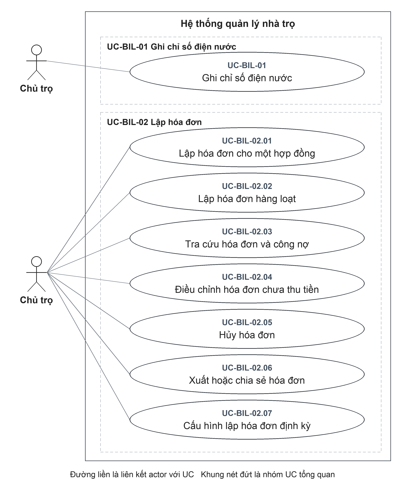

Đặc tả liên quan: [UC-BIL-01](#uc-bil-01), [UC-BIL-02.01](#uc-bil-02-01), [UC-BIL-02.02](#uc-bil-02-02), [UC-BIL-02.03](#uc-bil-02-03), [UC-BIL-02.04](#uc-bil-02-04), [UC-BIL-02.05](#uc-bil-02-05), [UC-BIL-02.06](#uc-bil-02-06), [UC-BIL-02.07](#uc-bil-02-07).

### Sơ đồ D-BIL-02 Thanh toán minh chứng và chi phí

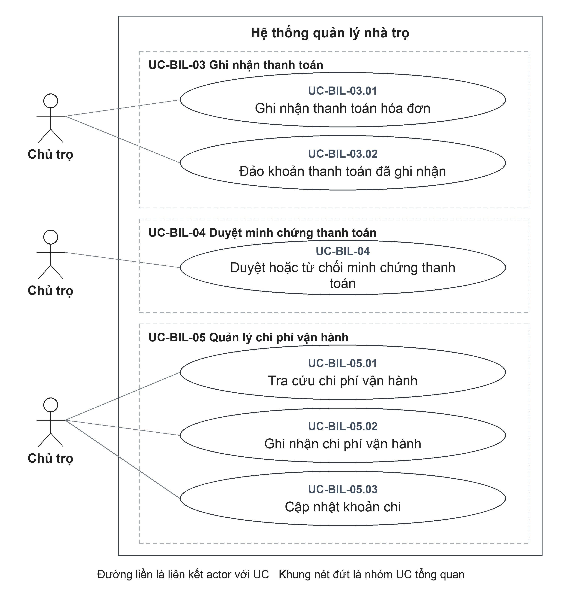

Đặc tả liên quan: [UC-BIL-03.01](#uc-bil-03-01), [UC-BIL-03.02](#uc-bil-03-02), [UC-BIL-04](#uc-bil-04), [UC-BIL-05.01](#uc-bil-05-01), [UC-BIL-05.02](#uc-bil-05-02), [UC-BIL-05.03](#uc-bil-05-03).

### Sơ đồ D-BIL-03 Báo cáo và thông báo

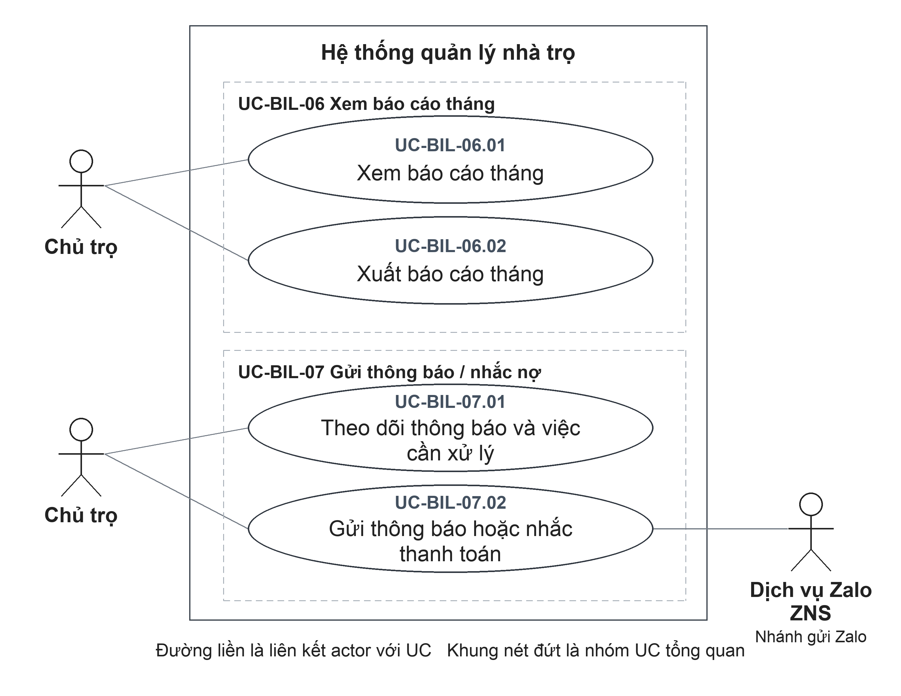

Đặc tả liên quan: [UC-BIL-06.01](#uc-bil-06-01), [UC-BIL-06.02](#uc-bil-06-02), [UC-BIL-07.01](#uc-bil-07-01), [UC-BIL-07.02](#uc-bil-07-02).

### UC-BIL-01 Ghi chỉ số điện nước

| Thuộc tính | Đặc tả |
| --- | --- |
| **Mã UC** | UC-BIL-01 |
| **Tên UC** | Ghi chỉ số điện nước |
| **Mục tiêu** | Ghi nhận mức sử dụng điện/nước theo phòng và kỳ làm căn cứ tính hóa đơn. |
| **Actor chính** | Chủ trọ |
| **Actor phụ** | Không có. |
| **Kích hoạt** | Cung cấp phòng, loại điện hoặc nước, kỳ tính, chỉ số trước, chỉ số sau và đơn giá trong nghiệp vụ ghi chỉ số; đường thao tác độc lập xem [PX-15](#px-15). |
| **Điều kiện trước** | **1.** Chủ trọ đã đăng nhập và có quyền sử dụng chức năng tương ứng trong phạm vi quản lý của mình.  **2.** Phòng ghi chỉ số đã tồn tại và thuộc phạm vi quản lý. |
| **Điều kiện sau** | **Thành công:** Chỉ số, lượng tiêu thụ và tiền sử dụng được lưu; ghi chỉ số riêng không tự lập hóa đơn.  **Hủy hoặc không thành công:** Hủy trước xác nhận hoặc bị từ chối trước ghi nhận thì không tạo chỉ số điện nước mới. Nếu đã gửi yêu cầu nhưng chưa xác định được kết quả, cần kiểm tra lại dữ liệu chỉ số điện nước trước khi thực hiện lại. |
| **Dữ liệu đầu vào** | Phòng, loại điện/nước, kỳ tính, chỉ số trước/sau, đơn giá; ghi chú tùy chọn. |
| **Luồng chính** | **1.** Chủ trọ: Cung cấp phòng, loại điện hoặc nước, kỳ tính, chỉ số trước, chỉ số sau và đơn giá trong nghiệp vụ ghi chỉ số; đường thao tác độc lập xem [PX-15](#px-15).  **2.** Hệ thống: Kiểm tra phòng thuộc phạm vi quản lý và xác định tháng của kỳ tính.  **3.** Hệ thống: Kiểm tra các chỉ số không âm, chỉ số sau không nhỏ hơn chỉ số trước và đơn giá dương.  **4.** Hệ thống: Tính lượng sử dụng bằng chỉ số sau trừ chỉ số trước; tính tiền sử dụng bằng lượng sử dụng nhân đơn giá.  **5.** Hệ thống: Lưu chỉ số theo phòng, loại dịch vụ, kỳ tính và cung cấp kết quả ghi nhận. |
| **Luồng thay thế** | **A1 — Tại bước 1:** Chỉ yêu cầu tra cứu chỉ số. Lấy chỉ số theo phòng/kỳ trong phạm vi Chủ trọ; không ghi dữ liệu mới. UC kết thúc sau khi hiển thị kết quả. |
| **Luồng ngoại lệ** | **E1 — Tại bước 2:** Phòng không tồn tại/không thuộc Chủ trọ. Từ chối ghi chỉ số. UC kết thúc đối với yêu cầu bị từ chối.  **E2 — Tại bước 3:** Chỉ số sau nhỏ hơn chỉ số trước hoặc đơn giá không dương. Từ chối; yêu cầu điều chỉnh. Sau khi điều chỉnh, thực hiện lại từ bước 1.  **E3 — Tại bước 5:** Đã có chỉ số cùng phòng, loại dịch vụ và kỳ. Từ chối tạo trùng. UC kết thúc đối với yêu cầu bị từ chối. |
| **Quy tắc nghiệp vụ** | **BR1.** Một phòng không có hai bản ghi chỉ số cùng loại dịch vụ trong cùng kỳ.  **BR2.** Chỉ số là số nguyên không âm; chỉ số sau không nhỏ hơn chỉ số trước; đơn giá là số nguyên dương.  **BR3.** Tiền điện hoặc nước bằng lượng sử dụng nhân đơn giá. |

### UC-BIL-02.01 Lập hóa đơn cho một hợp đồng

| Thuộc tính | Đặc tả |
| --- | --- |
| **Mã UC** | UC-BIL-02.01 |
| **Tên UC** | Lập hóa đơn cho một hợp đồng |
| **Mục tiêu** | Xác lập số tiền cần thu của một hợp đồng trong kỳ tính tiền. |
| **Actor chính** | Chủ trọ |
| **Actor phụ** | Không có. |
| **Kích hoạt** | Chọn lập hóa đơn cho một hợp đồng và xác định kỳ tính. |
| **Điều kiện trước** | **1.** Chủ trọ đã đăng nhập và có quyền sử dụng chức năng tương ứng trong phạm vi quản lý của mình.  **2.** Hợp đồng cần lập hóa đơn đã tồn tại và thuộc phạm vi quản lý.  **3.** Hợp đồng còn hiệu lực. |
| **Điều kiện sau** | **Thành công:** Hóa đơn mới được tạo với tổng tiền đã tính và trạng thái Chưa thanh toán; chưa ghi nhận khoản thanh toán.  **Hủy hoặc không thành công:** Hủy trước xác nhận hoặc bị từ chối trước ghi nhận thì không tạo hóa đơn mới. Nếu đã gửi yêu cầu nhưng chưa xác định được kết quả, cần kiểm tra lại dữ liệu hóa đơn trước khi thực hiện lại. |
| **Dữ liệu đầu vào** | Hợp đồng, kỳ tính; hạn thanh toán, chỉ số điện/nước, khoản khác và ghi chú tùy chọn. |
| **Luồng chính** | **1.** Chủ trọ: Chọn lập hóa đơn cho một hợp đồng và xác định kỳ tính.  **2.** Hệ thống: Hiển thị hợp đồng, tiền thuê, kỳ tính và các trường chỉ số điện, nước, đơn giá, khoản khác, hạn thanh toán, ghi chú.  **3.** Chủ trọ: Kiểm tra thông tin; nhập các chỉ số và khoản bổ sung nếu có, xác định hạn thanh toán và xác nhận lập hóa đơn.  **4.** Hệ thống: Kiểm tra hợp đồng còn hiệu lực, kỳ tính thuộc thời gian thuê, chưa có hóa đơn cùng hợp đồng và kỳ, dữ liệu được nhập hợp lệ.  **5.** Hệ thống: Ghi các chỉ số được bổ sung; lấy chỉ số đã có trong kỳ và các phí dịch vụ đang áp dụng của phòng.  **6.** Hệ thống: Tính tiền thuê, điện, nước, phí dịch vụ và khoản khác; tạo hóa đơn và cung cấp kết quả. Trường hợp thiếu chỉ số hoặc tổng tiền bằng 0 xem [PX-16](#px-16), [PX-17](#px-17). |
| **Luồng thay thế** | **A1 — Tại bước 3:** Không gửi chỉ số mới. Dùng chỉ số đã có cùng phòng/kỳ; thành phần chưa có dữ liệu được tính theo xử lý hiện tại, không bắt buộc đủ cả hai loại. |
| **Luồng ngoại lệ** | **E1 — Tại bước 4:** Hợp đồng không hiệu lực, kỳ ngoài thời gian thuê hoặc dữ liệu sai. Từ chối lập. UC kết thúc đối với yêu cầu bị từ chối.  **E2 — Tại bước 5:** Chỉ số gửi mới trùng dữ liệu đã có. Từ chối do chỉ số trùng; không tạo hóa đơn từ giao dịch này. UC kết thúc đối với yêu cầu bị từ chối.  **E3 — Tại bước 6:** Đã có hóa đơn cùng hợp đồng/kỳ. Từ chối tạo trùng. UC kết thúc đối với yêu cầu bị từ chối. |
| **Quy tắc nghiệp vụ** | **BR1.** Không lập trùng hóa đơn cùng hợp đồng và kỳ tính.  **BR2.** Tiền thuê của hóa đơn lấy từ hợp đồng; phí dịch vụ lấy từ các phí đang áp dụng của phòng.  **BR3.** Tổng tiền hóa đơn gồm tiền thuê, tiền điện, tiền nước, phí dịch vụ và khoản khác do Chủ trọ bổ sung. |

### UC-BIL-02.02 Lập hóa đơn hàng loạt

| Thuộc tính | Đặc tả |
| --- | --- |
| **Mã UC** | UC-BIL-02.02 |
| **Tên UC** | Lập hóa đơn hàng loạt |
| **Mục tiêu** | Lập hóa đơn cho các hợp đồng đủ điều kiện trong cùng khu trọ và kỳ. |
| **Actor chính** | Chủ trọ |
| **Actor phụ** | Không có. |
| **Kích hoạt** | Chọn khu trọ, kỳ tính và chức năng lập hóa đơn hàng loạt. |
| **Điều kiện trước** | **1.** Chủ trọ đã đăng nhập và có quyền sử dụng chức năng tương ứng trong phạm vi quản lý của mình.  **2.** Khu trọ lập hóa đơn đã tồn tại, thuộc phạm vi quản lý và chưa được lưu trữ. |
| **Điều kiện sau** | **Thành công:** Các hóa đơn mới được tạo đồng bộ; hóa đơn đã có không bị tạo trùng.  **Hủy hoặc không thành công:** Hủy trước xác nhận hoặc bị từ chối trước ghi nhận thì không tạo đợt hóa đơn mới. Nếu đã gửi yêu cầu nhưng chưa xác định được kết quả, cần kiểm tra lại dữ liệu đợt hóa đơn trước khi thực hiện lại. |
| **Dữ liệu đầu vào** | Khu trọ, kỳ tính; hạn thanh toán và các nhóm chỉ số theo hợp đồng tùy chọn. |
| **Luồng chính** | **1.** Chủ trọ: Chọn khu trọ, kỳ tính và chức năng lập hóa đơn hàng loạt.  **2.** Hệ thống: Hiển thị hợp đồng phù hợp, hóa đơn đã có, chỉ số trong kỳ, chỉ số kỳ trước và phí dịch vụ để Chủ trọ kiểm tra.  **3.** Chủ trọ: Rà soát danh sách, bổ sung chỉ số hoặc hạn thanh toán và xác nhận lập hóa đơn.  **4.** Hệ thống: Kiểm tra nhóm chỉ số không trùng nhau và chỉ thuộc các hợp đồng trong đợt lập.  **5.** Hệ thống: Bỏ qua hợp đồng đã có hóa đơn cùng kỳ, ghi chỉ số chưa có và tạo hóa đơn cho các hợp đồng còn lại trong một đợt ghi nhận đồng bộ.  **6.** Hệ thống: Hiển thị số hóa đơn mới và danh sách hóa đơn đã tồn tại, phân biệt rõ hai nhóm kết quả. |
| **Luồng thay thế** | **A1 — Tại bước 5:** Một hợp đồng đã có hóa đơn cùng kỳ. Trả hóa đơn hiện có với nhãn đã tồn tại, không tạo lại. Tiếp tục xử lý các hợp đồng còn lại tại bước 5, sau đó đưa hóa đơn hiện có vào kết quả tổng hợp tại bước 6.  **A2 — Tại bước 5:** Chỉ số loại dịch vụ đã có trong kỳ. Bỏ qua chỉ số gửi bổ sung cho loại đó; dùng giá trị đã lưu. Tiếp tục tính và lập hóa đơn tại bước 5, xử lý các hợp đồng còn lại rồi hiển thị kết quả tổng hợp tại bước 6; không yêu cầu nhập lại chỉ vì đã có chỉ số. |
| **Luồng ngoại lệ** | **E1 — Tại bước 2:** Khu trọ không thuộc Chủ trọ hoặc đã lưu trữ. Từ chối xử lý. UC kết thúc đối với yêu cầu bị từ chối.  **E2 — Tại bước 4:** Nhóm chỉ số trùng hợp đồng, trùng loại điện/nước hoặc hợp đồng ngoài danh sách. Từ chối yêu cầu. UC kết thúc đối với yêu cầu bị từ chối.  **E3 — Tại bước 5:** Giao dịch lưu phát sinh lỗi/ràng buộc trùng. Giao dịch không hoàn tất; không mô tả là đã tạo từng phần thành công. |
| **Quy tắc nghiệp vụ** | **BR1.** Hợp đồng đã có hóa đơn cùng kỳ không được tạo lại.  **BR2.** Chỉ số đã tồn tại của cùng phòng, loại dịch vụ và kỳ được giữ lại.  **BR3.** Lỗi trong đợt ghi nhận không được mô tả là thành công riêng từng phòng; kết quả cả đợt phải được xác định. |

### UC-BIL-02.03 Tra cứu hóa đơn và công nợ

| Thuộc tính | Đặc tả |
| --- | --- |
| **Mã UC** | UC-BIL-02.03 |
| **Tên UC** | Tra cứu hóa đơn và công nợ |
| **Mục tiêu** | Xem các khoản phải thu, tình trạng thanh toán và lịch sử của hóa đơn. |
| **Actor chính** | Chủ trọ |
| **Actor phụ** | Không có. |
| **Kích hoạt** | Mở danh sách hóa đơn và chọn kỳ, trạng thái, khu trọ hoặc nhóm công nợ. |
| **Điều kiện trước** | **1.** Chủ trọ đã đăng nhập và có quyền sử dụng chức năng tương ứng trong phạm vi quản lý của mình. |
| **Điều kiện sau** | **Thành công:** Danh sách, chi tiết và tổng hợp công nợ được hiển thị; không ghi giao dịch mới.  **Hủy hoặc không thành công:** Không cung cấp được kết quả tra cứu của lần yêu cầu không thành công; UC không ghi thay đổi vào dữ liệu nghiệp vụ. |
| **Dữ liệu đầu vào** | Kỳ, trạng thái, khu trọ, nhóm công nợ mở/quá hạn/sắp đến hạn và khoảng ngày sắp đến hạn. |
| **Luồng chính** | **1.** Chủ trọ: Mở danh sách hóa đơn và chọn kỳ, trạng thái, khu trọ hoặc nhóm công nợ.  **2.** Hệ thống: Kiểm tra phạm vi khu trọ và các tiêu chí lọc được yêu cầu.  **3.** Hệ thống: Hiển thị hóa đơn phù hợp cùng tổng tiền phải thu, đã thu và còn phải thu.  **4.** Chủ trọ: Chọn hóa đơn cần kiểm tra.  **5.** Hệ thống: Hiển thị thành phần tiền, khoản thanh toán, giao dịch đảo và minh chứng thanh toán của hóa đơn. |
| **Luồng thay thế** | **A1 — Tại bước 3:** Không có hóa đơn phù hợp. Hiển thị danh sách rỗng; cho phép đổi tiêu chí tại bước 1. UC kết thúc sau khi hiển thị kết quả. |
| **Luồng ngoại lệ** | **E1 — Tại bước 2:** Nhóm công nợ không hợp lệ hoặc khoảng sắp đến hạn ngoài 0–60 ngày. Từ chối truy vấn. UC kết thúc đối với yêu cầu bị từ chối.  **E2 — Tại bước 5:** Hóa đơn không thuộc Chủ trọ hoặc không tồn tại. Không trả chi tiết. UC kết thúc đối với yêu cầu bị từ chối. |
| **Quy tắc nghiệp vụ** | **BR1.** Quá hạn được xác định từ hạn thanh toán và số tiền còn phải thu, không phải một trạng thái thanh toán riêng.  **BR2.** Khoảng sắp đến hạn mặc định 7 ngày. |

### UC-BIL-02.04 Điều chỉnh hóa đơn chưa thu tiền

| Thuộc tính | Đặc tả |
| --- | --- |
| **Mã UC** | UC-BIL-02.04 |
| **Tên UC** | Điều chỉnh hóa đơn chưa thu tiền |
| **Mục tiêu** | Điều chỉnh hạn thanh toán và ghi chú của hóa đơn đủ điều kiện cập nhật. |
| **Actor chính** | Chủ trọ |
| **Actor phụ** | Không có. |
| **Kích hoạt** | Chọn sửa hạn thanh toán hoặc ghi chú của hóa đơn. |
| **Điều kiện trước** | **1.** Chủ trọ đã đăng nhập và có quyền sử dụng chức năng tương ứng trong phạm vi quản lý của mình.  **2.** Hóa đơn cần điều chỉnh đã tồn tại và thuộc phạm vi quản lý. |
| **Điều kiện sau** | **Thành công:** Hạn thanh toán/ghi chú được cập nhật; tổng tiền và các thành phần tiền không đổi.  **Hủy hoặc không thành công:** Yêu cầu bị từ chối trước ghi nhận không thay đổi hạn thanh toán hoặc ghi chú hóa đơn. Nếu chưa nhận được kết quả sau khi xác nhận, cần kiểm tra lại hạn thanh toán hoặc ghi chú hóa đơn, không mặc định thao tác đã được hoàn tác. |
| **Dữ liệu đầu vào** | Hóa đơn; hạn thanh toán và ghi chú cần sửa. |
| **Luồng chính** | **1.** Chủ trọ: Chọn sửa hạn thanh toán hoặc ghi chú của hóa đơn.  **2.** Hệ thống: Hiển thị hạn thanh toán và ghi chú hiện tại.  **3.** Chủ trọ: Thay đổi các thông tin được phép sửa và xác nhận lưu.  **4.** Hệ thống: Kiểm tra hóa đơn chưa hủy, đang Chưa thanh toán và tiền đã thu ròng không lớn hơn 0.  **5.** Hệ thống: Lưu hạn thanh toán hoặc ghi chú được thay đổi và hiển thị hóa đơn sau cập nhật. |
| **Luồng thay thế** | **A1 — Tại bước 3:** Chủ trọ xóa giá trị hạn thanh toán trên biểu mẫu. Kết quả xóa hạn chưa thống nhất, xem [PX-18](#px-18); không cam kết hạn đã được xóa. Sau khi lưu phải kiểm tra hóa đơn trả về. |
| **Luồng ngoại lệ** | **E1 — Tại bước 3:** Ngày nhập không hợp lệ. Biểu mẫu yêu cầu điều chỉnh. Sau khi điều chỉnh, thực hiện lại từ bước 3.  **E2 — Tại bước 4:** Hóa đơn đã hủy, đã thanh toán một phần/đủ hoặc đã có tiền thu dương. Từ chối cập nhật. UC kết thúc đối với yêu cầu bị từ chối. |
| **Quy tắc nghiệp vụ** | **BR1.** UC này không sửa các thành phần tiền thuê, điện, nước hoặc khoản khác.  **BR2.** Chỉ điều chỉnh khi hóa đơn chưa hủy, có trạng thái Chưa thanh toán và tiền thu ròng không lớn hơn 0. |

### UC-BIL-02.05 Hủy hóa đơn

| Thuộc tính | Đặc tả |
| --- | --- |
| **Mã UC** | UC-BIL-02.05 |
| **Tên UC** | Hủy hóa đơn |
| **Mục tiêu** | Ngừng nghĩa vụ thu của một hóa đơn lập sai, có lưu lý do và lịch sử. |
| **Actor chính** | Chủ trọ |
| **Actor phụ** | Không có. |
| **Kích hoạt** | Chọn hủy hóa đơn. |
| **Điều kiện trước** | **1.** Chủ trọ đã đăng nhập và có quyền sử dụng chức năng tương ứng trong phạm vi quản lý của mình.  **2.** Hóa đơn cần hủy đã tồn tại và thuộc phạm vi quản lý. |
| **Điều kiện sau** | **Thành công:** Hóa đơn được giữ trong dữ liệu với trạng thái Đã hủy và thông tin hủy; không bị xóa.  **Hủy hoặc không thành công:** Yêu cầu bị từ chối trước ghi nhận không thay đổi tình trạng hủy hóa đơn. Nếu chưa nhận được kết quả sau khi xác nhận, cần kiểm tra lại tình trạng hủy hóa đơn, không mặc định thao tác đã được hoàn tác. |
| **Dữ liệu đầu vào** | Hóa đơn và lý do hủy. |
| **Luồng chính** | **1.** Chủ trọ: Chọn hủy hóa đơn.  **2.** Hệ thống: Hiển thị trường lý do và yêu cầu xác nhận hủy.  **3.** Chủ trọ: Nhập lý do rồi xác nhận hủy hóa đơn.  **4.** Hệ thống: Kiểm tra hóa đơn chưa bị hủy và chưa có bất kỳ giao dịch thanh toán nào liên quan.  **5.** Hệ thống: Ghi nhận trạng thái Đã hủy, thời điểm và lý do hủy; hiển thị kết quả. |
| **Luồng thay thế** | **A1 — Tại bước 3:** Đóng/hủy hộp thoại trước xác nhận. Không gửi yêu cầu hủy; kết thúc thao tác. |
| **Luồng ngoại lệ** | **E1 — Tại bước 4:** Hóa đơn đã hủy. Từ chối hủy lại. UC kết thúc đối với yêu cầu bị từ chối.  **E2 — Tại bước 4:** Có giao dịch thanh toán, kể cả giao dịch đã được đảo. Từ chối hủy; tiền thu ròng bằng 0 không đủ điều kiện. UC kết thúc đối với yêu cầu bị từ chối. |
| **Quy tắc nghiệp vụ** | **BR1.** Lý do hủy bắt buộc, dài tối đa 500 ký tự.  **BR2.** Không hủy hóa đơn đã có giao dịch thanh toán, kể cả khi giao dịch đã được đảo.  **BR3.** Hóa đơn đã hủy vẫn được giữ lại và được tính khi kiểm tra hóa đơn trùng hợp đồng, kỳ. |

### UC-BIL-02.06 Xuất hoặc chia sẻ hóa đơn

| Thuộc tính | Đặc tả |
| --- | --- |
| **Mã UC** | UC-BIL-02.06 |
| **Tên UC** | Xuất hoặc chia sẻ hóa đơn |
| **Mục tiêu** | Cung cấp bản hóa đơn để lưu trữ, đối soát hoặc gửi người thuê. |
| **Actor chính** | Chủ trọ |
| **Actor phụ** | Không có. |
| **Kích hoạt** | Mở hóa đơn và chọn xuất PDF. |
| **Điều kiện trước** | **1.** Chủ trọ đã đăng nhập và có quyền sử dụng chức năng tương ứng trong phạm vi quản lý của mình.  **2.** Hóa đơn cần xuất đã tồn tại và Chủ trọ có quyền xem hóa đơn. |
| **Điều kiện sau** | **Thành công:** PDF được tạo và mở chức năng xuất/chia sẻ hoặc nội dung được sao chép; dữ liệu hóa đơn và thanh toán không đổi.  **Hủy hoặc không thành công:** Hủy chức năng in hoặc chia sẻ không thay đổi hóa đơn. Nếu tạo tài liệu hoặc chia sẻ lỗi, chưa xác nhận tài liệu được lưu hoặc gửi tới đích bên ngoài. |
| **Dữ liệu đầu vào** | Hóa đơn đang xem; lựa chọn sao chép hoặc xuất PDF. |
| **Luồng chính** | **1.** Chủ trọ: Mở hóa đơn và chọn xuất PDF.  **2.** Hệ thống: Tạo tài liệu PDF từ thông tin hóa đơn được phép xem.  **3.** Hệ thống: Mở chức năng in hoặc chia sẻ tài liệu của thiết bị.  **4.** Chủ trọ: Chọn nơi lưu, in, chia sẻ hoặc đóng hộp thoại để kết thúc. |
| **Luồng thay thế** | **A1 — Tại bước 1:** Chọn sao chép nội dung. Ứng dụng ghi nội dung hóa đơn vào bộ nhớ sao chép; không tạo PDF. UC kết thúc thành công sau khi sao chép; dữ liệu hóa đơn không thay đổi. |
| **Luồng ngoại lệ** | **E1 — Tại bước 2:** Không lấy được hóa đơn hoặc không tạo/xuất được PDF. Hiển thị lỗi; không kết luận tài liệu đã được gửi. UC kết thúc đối với yêu cầu bị từ chối. |
| **Quy tắc nghiệp vụ** | **BR1.** Xuất hoặc chia sẻ hóa đơn không làm thay đổi số tiền đã thu hay trạng thái thanh toán.  **BR2.** Mở chức năng chia sẻ không phải bằng chứng người nhận đã nhận hoặc đọc hóa đơn. |

### UC-BIL-02.07 Cấu hình lập hóa đơn định kỳ

| Thuộc tính | Đặc tả |
| --- | --- |
| **Mã UC** | UC-BIL-02.07 |
| **Tên UC** | Cấu hình lập hóa đơn định kỳ |
| **Mục tiêu** | Cho phép Chủ trọ bật hoặc tắt việc lập hóa đơn theo lịch của từng khu trọ. |
| **Actor chính** | Chủ trọ |
| **Actor phụ** | Không có. |
| **Kích hoạt** | Mở cấu hình lập hóa đơn định kỳ của khu trọ. |
| **Điều kiện trước** | **1.** Chủ trọ đã đăng nhập và có quyền sử dụng chức năng tương ứng trong phạm vi quản lý của mình.  **2.** Khu trọ được cấu hình đã tồn tại, thuộc phạm vi quản lý và chưa được lưu trữ. |
| **Điều kiện sau** | **Thành công:** Cấu hình được lưu; lưu cấu hình không tự tạo hóa đơn ngay. Hóa đơn chỉ phát sinh khi lượt chạy tương ứng hoàn tất.  **Hủy hoặc không thành công:** Yêu cầu bị từ chối trước ghi nhận không thay đổi cấu hình lập hóa đơn định kỳ. Nếu chưa nhận được kết quả sau khi xác nhận, cần kiểm tra lại cấu hình lập hóa đơn định kỳ, không mặc định thao tác đã được hoàn tác. |
| **Dữ liệu đầu vào** | Khu trọ, bật/tắt, ngày lập và ngày đến hạn; kỳ/chỉ số khi chạy thủ công. |
| **Luồng chính** | **1.** Chủ trọ: Mở cấu hình lập hóa đơn định kỳ của khu trọ.  **2.** Hệ thống: Hiển thị cấu hình hiện tại; nếu chưa có thì hiển thị mặc định tắt, ngày lập 1 và ngày đến hạn 10.  **3.** Chủ trọ: Chọn bật hoặc tắt, đặt ngày lập và ngày đến hạn rồi xác nhận lưu.  **4.** Hệ thống: Kiểm tra khu trọ và kiểm tra từng ngày nằm trong khoảng 1 đến 28.  **5.** Hệ thống: Lưu cấu hình và hiển thị trạng thái đã lưu; việc vận hành lịch tự động cần xác nhận tại [PX-19](#px-19). |
| **Luồng thay thế** | **A1 — Tại bước 3:** Chủ trọ chọn xem trước thay cho lưu cấu hình. Hệ thống kiểm tra khu trọ, sử dụng cấu hình đã lưu hoặc cấu hình mặc định nếu chưa có để hiển thị danh sách hợp đồng, chỉ số và hạn thanh toán dự kiến. Cho phép xem trước khi cấu hình đang tắt; không lưu các thay đổi chưa xác nhận và không tạo hóa đơn. UC kết thúc nhánh xem trước sau khi hiển thị kết quả.  **A2 — Tại bước 3:** Chủ trọ chọn chạy ngay thay cho lưu cấu hình. Hệ thống kiểm tra khu trọ và cấu hình đã lưu đang bật, sau đó thực hiện lập hóa đơn hàng loạt theo [UC-BIL-02.02](#uc-bil-02-02) bằng cấu hình đã lưu. Khi xử lý thành công, cập nhật kỳ và thời điểm lần chạy rồi hiển thị kết quả; không tự lưu các giá trị đang sửa chưa xác nhận. Việc chạy khi đến lịch là sự kiện độc lập, được mô tả tại [PX-19](#px-19), không diễn ra trong bước 5 của luồng lưu cấu hình. |
| **Luồng ngoại lệ** | **E1 — Tại bước 4:** Khu trọ lưu trữ/ngoài phạm vi hoặc ngày ngoài 1–28. Từ chối lưu. UC kết thúc đối với yêu cầu bị từ chối.  **E2 — Tại bước 3:** Chạy thủ công khi cấu hình tắt. Từ chối chạy. UC kết thúc đối với yêu cầu bị từ chối. |
| **Quy tắc nghiệp vụ** | **BR1.** Ngày lập và ngày đến hạn được chọn từ 1 đến 28.  **BR2.** Chạy ngay theo cấu hình yêu cầu cấu hình đang bật.  **BR3.** Lưu cấu hình không đồng nghĩa đã phát sinh hóa đơn hoặc đã xác nhận lịch tự động đang vận hành. |

### UC-BIL-03.01 Ghi nhận thanh toán hóa đơn

| Thuộc tính | Đặc tả |
| --- | --- |
| **Mã UC** | UC-BIL-03.01 |
| **Tên UC** | Ghi nhận thanh toán hóa đơn |
| **Mục tiêu** | Ghi nhận khoản tiền thực tế đã thu và cập nhật số dư của hóa đơn. |
| **Actor chính** | Chủ trọ |
| **Actor phụ** | Không có. |
| **Kích hoạt** | Chọn ghi nhận khoản thanh toán trên hóa đơn. |
| **Điều kiện trước** | **1.** Chủ trọ đã đăng nhập và có quyền sử dụng chức năng tương ứng trong phạm vi quản lý của mình.  **2.** Hóa đơn cần ghi nhận thanh toán đã tồn tại và thuộc phạm vi quản lý.  **3.** Hóa đơn chưa hủy và còn số tiền phải thu. |
| **Điều kiện sau** | **Thành công:** Khoản thu được lưu; hóa đơn phản ánh số tiền đã thu, số dư và trạng thái tương ứng.  **Hủy hoặc không thành công:** Hủy trước xác nhận hoặc bị từ chối trước ghi nhận thì không tạo khoản thanh toán mới. Nếu đã gửi yêu cầu nhưng chưa xác định được kết quả, cần kiểm tra lại dữ liệu khoản thanh toán trước khi thực hiện lại. |
| **Dữ liệu đầu vào** | Hóa đơn, số tiền; phương thức, thời điểm thanh toán và ghi chú tùy chọn. |
| **Luồng chính** | **1.** Chủ trọ: Chọn ghi nhận khoản thanh toán trên hóa đơn.  **2.** Hệ thống: Hiển thị tổng tiền, tiền đã thu, số còn phải thu và các trường số tiền, phương thức, ngày thanh toán, ghi chú.  **3.** Chủ trọ: Nhập khoản tiền đã nhận, phương thức và ngày nhận; bổ sung ghi chú nếu có và xác nhận.  **4.** Hệ thống: Kiểm tra hóa đơn chưa hủy, còn phải thu; số tiền là số nguyên dương và không vượt số còn phải thu.  **5.** Hệ thống: Ghi khoản thanh toán, tăng tiền đã thu và tính lại trạng thái hóa đơn đồng bộ.  **6.** Hệ thống: Hiển thị khoản thanh toán mới cùng số dư và trạng thái hóa đơn. |
| **Luồng thay thế** | **A1 — Tại bước 3:** Chủ trọ nhập số tiền nhỏ hơn số còn phải thu. Tiếp tục bước 4 để kiểm tra hóa đơn và số tiền. Nếu hợp lệ, tại bước 5 hệ thống ghi khoản thanh toán và chuyển hóa đơn sang Thanh toán một phần; hiển thị khoản thu và số dư mới tại bước 6. |
| **Luồng ngoại lệ** | **E1 — Tại bước 4:** Hóa đơn đã hủy/đã thu đủ hoặc số tiền vượt số dư. Từ chối ghi thu. UC kết thúc đối với yêu cầu bị từ chối.  **E2 — Tại bước 4:** Số tiền không phải số nguyên dương. Từ chối dữ liệu. UC kết thúc đối với yêu cầu bị từ chối. |
| **Quy tắc nghiệp vụ** | **BR1.** Không ghi khoản thu vượt số tiền còn phải thu hoặc trên hóa đơn đã hủy, đã thu đủ.  **BR2.** Phương thức gồm Tiền mặt, Chuyển khoản hoặc Khác; đây là ghi nhận tiền đã nhận, không thực hiện chuyển tiền qua ngân hàng.  **BR3.** Thanh toán một phần làm hóa đơn chuyển sang Thanh toán một phần; thu đủ làm hóa đơn chuyển sang Đã thanh toán. |

### UC-BIL-03.02 Đảo khoản thanh toán đã ghi nhận

| Thuộc tính | Đặc tả |
| --- | --- |
| **Mã UC** | UC-BIL-03.02 |
| **Tên UC** | Đảo khoản thanh toán đã ghi nhận |
| **Mục tiêu** | Điều chỉnh khoản thu ghi sai bằng giao dịch đảo, giữ lịch sử giao dịch gốc. |
| **Actor chính** | Chủ trọ |
| **Actor phụ** | Không có. |
| **Kích hoạt** | Chọn đảo khoản thanh toán đã ghi nhận sai trên hóa đơn. |
| **Điều kiện trước** | **1.** Chủ trọ đã đăng nhập và có quyền sử dụng chức năng tương ứng trong phạm vi quản lý của mình.  **2.** Khoản thanh toán cần đảo đã tồn tại trên hóa đơn thuộc phạm vi quản lý. |
| **Điều kiện sau** | **Thành công:** Khoản gốc được giữ; khoản đảo được liên kết và hóa đơn được cập nhật số dư.  **Hủy hoặc không thành công:** Yêu cầu bị từ chối trước ghi nhận không thay đổi giao dịch đảo và số dư hóa đơn. Nếu chưa nhận được kết quả sau khi xác nhận, cần kiểm tra lại giao dịch đảo và số dư hóa đơn, không mặc định thao tác đã được hoàn tác. |
| **Dữ liệu đầu vào** | Khoản thanh toán gốc và lý do đảo. |
| **Luồng chính** | **1.** Chủ trọ: Chọn đảo khoản thanh toán đã ghi nhận sai trên hóa đơn.  **2.** Hệ thống: Hiển thị khoản thanh toán gốc và yêu cầu nhập lý do, xác nhận đảo.  **3.** Chủ trọ: Nhập lý do và xác nhận đảo khoản thanh toán.  **4.** Hệ thống: Kiểm tra khoản gốc thuộc hóa đơn, chưa được đảo và không phải khoản đảo.  **5.** Hệ thống: Ghi khoản đảo bằng số tiền âm của toàn bộ khoản gốc; giảm tiền đã thu và tính lại trạng thái hóa đơn đồng bộ.  **6.** Hệ thống: Hiển thị khoản gốc, khoản đảo và số còn phải thu sau điều chỉnh. |
| **Luồng thay thế** | **A1 — Tại bước 3:** Hủy hộp thoại. Không gửi yêu cầu đảo. |
| **Luồng ngoại lệ** | **E1 — Tại bước 4:** Khoản không thuộc hóa đơn/không tồn tại, đã đảo hoặc là khoản đảo. Từ chối thao tác. UC kết thúc đối với yêu cầu bị từ chối. |
| **Quy tắc nghiệp vụ** | **BR1.** Đảo toàn bộ khoản thanh toán; UC này không đảo một phần.  **BR2.** Một khoản thanh toán gốc chỉ được đảo một lần và không đảo tiếp một khoản đảo.  **BR3.** Đảo khoản thanh toán không tự chuyển minh chứng đã duyệt về Chờ duyệt. |

### UC-BIL-04 Duyệt hoặc từ chối minh chứng thanh toán

| Thuộc tính | Đặc tả |
| --- | --- |
| **Mã UC** | UC-BIL-04 |
| **Tên UC** | Duyệt hoặc từ chối minh chứng thanh toán |
| **Mục tiêu** | Đối soát chứng từ người thuê và chỉ ghi nhận khoản thu khi được chấp thuận. |
| **Actor chính** | Chủ trọ |
| **Actor phụ** | Không có. |
| **Kích hoạt** | Mở minh chứng thanh toán đang Chờ duyệt. |
| **Điều kiện trước** | **1.** Chủ trọ đã đăng nhập và có quyền sử dụng chức năng tương ứng trong phạm vi quản lý của mình.  **2.** Minh chứng cần xử lý đã tồn tại trên hóa đơn thuộc phạm vi quản lý.  **3.** Minh chứng đang Chờ duyệt. |
| **Điều kiện sau** | **Thành công:** Minh chứng có kết quả duyệt/từ chối; duyệt thành công mới tạo khoản thu và thay đổi số dư hóa đơn.  **Hủy hoặc không thành công:** Yêu cầu bị từ chối trước ghi nhận không thay đổi quyết định duyệt minh chứng và khoản thanh toán. Nếu chưa nhận được kết quả sau khi xác nhận, cần kiểm tra lại quyết định duyệt minh chứng và khoản thanh toán, không mặc định thao tác đã được hoàn tác. |
| **Dữ liệu đầu vào** | Minh chứng, quyết định duyệt/từ chối; ghi chú tùy chọn. |
| **Luồng chính** | **1.** Chủ trọ: Mở minh chứng thanh toán đang Chờ duyệt.  **2.** Hệ thống: Hiển thị số tiền, phương thức, tệp minh chứng và ghi chú của Người thuê.  **3.** Chủ trọ: Đối soát thông tin đã nhận, chọn duyệt và xác nhận quyết định.  **4.** Hệ thống: Kiểm tra minh chứng tồn tại trong phạm vi quản lý và còn Chờ duyệt. Với quyết định duyệt, kiểm tra thêm hóa đơn chưa hủy, còn phải thu và số tiền minh chứng không vượt số còn phải thu.  **5.** Hệ thống: Ghi khoản thanh toán từ minh chứng, cập nhật hóa đơn và đánh dấu minh chứng Đã duyệt đồng bộ.  **6.** Hệ thống: Hiển thị quyết định duyệt, khoản thanh toán và số còn phải thu mới. |
| **Luồng thay thế** | **A1 — Tại bước 3:** Chủ trọ chọn từ chối minh chứng, bổ sung ghi chú nếu có và xác nhận. Tại bước 4, hệ thống kiểm tra minh chứng thuộc phạm vi quản lý và còn Chờ duyệt; không áp dụng điều kiện số dư hóa đơn dành riêng cho nhánh duyệt. Nếu hợp lệ, tại bước 5 ghi kết quả Đã từ chối, người duyệt, thời điểm và ghi chú; không tạo khoản thanh toán và không thay đổi số tiền đã thu. Tại bước 6, hiển thị quyết định từ chối; UC kết thúc thành công ở nhánh từ chối. |
| **Luồng ngoại lệ** | **E1 — Tại bước 4:** Minh chứng không tồn tại hoặc đã có kết quả. Từ chối xử lý lại. UC kết thúc đối với yêu cầu bị từ chối.  **E2 — Tại bước 4:** Duyệt cho hóa đơn đã hủy/đã thu đủ hoặc số tiền vượt số dư. Từ chối duyệt; chưa tạo khoản thu từ yêu cầu này. UC kết thúc đối với yêu cầu bị từ chối. |
| **Quy tắc nghiệp vụ** | **BR1.** Minh chứng chỉ được xử lý khi còn Chờ duyệt; quyết định gồm duyệt hoặc từ chối.  **BR2.** Duyệt tạo khoản thanh toán; từ chối không tạo khoản thanh toán.  **BR3.** Ghi chú khi duyệt hoặc từ chối là tùy chọn. |

### UC-BIL-05.01 Tra cứu chi phí vận hành

| Thuộc tính | Đặc tả |
| --- | --- |
| **Mã UC** | UC-BIL-05.01 |
| **Tên UC** | Tra cứu chi phí vận hành |
| **Mục tiêu** | Xem các khoản chi và tổng hợp theo khu trọ, phòng, thời gian hoặc danh mục. |
| **Actor chính** | Chủ trọ |
| **Actor phụ** | Không có. |
| **Kích hoạt** | Mở danh sách khoản chi và chọn tháng, khu trọ, phòng hoặc nhóm chi phí. |
| **Điều kiện trước** | **1.** Chủ trọ đã đăng nhập và có quyền sử dụng chức năng tương ứng trong phạm vi quản lý của mình. |
| **Điều kiện sau** | **Thành công:** Khoản chi và tổng hợp được hiển thị; không thay đổi dữ liệu.  **Hủy hoặc không thành công:** Không cung cấp được kết quả tra cứu của lần yêu cầu không thành công; UC không ghi thay đổi vào dữ liệu nghiệp vụ. |
| **Dữ liệu đầu vào** | Khu trọ, phòng, nhóm chi phí và tháng. |
| **Luồng chính** | **1.** Chủ trọ: Mở danh sách khoản chi và chọn tháng, khu trọ, phòng hoặc nhóm chi phí.  **2.** Hệ thống: Kiểm tra khu trọ và phòng được chọn thuộc phạm vi quản lý.  **3.** Hệ thống: Lấy khoản chi phù hợp, tính tổng số khoản và tổng tiền.  **4.** Hệ thống: Hiển thị danh sách, số liệu tổng hợp và thông tin chi tiết của khoản chi. |
| **Luồng thay thế** | **A1 — Tại bước 3:** Không có khoản phù hợp. Trả danh sách rỗng và tổng bằng 0. UC kết thúc sau khi hiển thị kết quả. |
| **Luồng ngoại lệ** | **E1 — Tại bước 2:** Khu trọ/phòng không thuộc phạm vi. Từ chối truy vấn. UC kết thúc đối với yêu cầu bị từ chối. |
| **Quy tắc nghiệp vụ** | **BR1.** Tháng tra cứu khoản chi được xác định theo ngày phát sinh khoản chi. |

### UC-BIL-05.02 Ghi nhận chi phí vận hành

| Thuộc tính | Đặc tả |
| --- | --- |
| **Mã UC** | UC-BIL-05.02 |
| **Tên UC** | Ghi nhận chi phí vận hành |
| **Mục tiêu** | Ghi một khoản tiền đã chi để theo dõi vận hành và báo cáo. |
| **Actor chính** | Chủ trọ |
| **Actor phụ** | Không có. |
| **Kích hoạt** | Chọn ghi nhận khoản chi vận hành. |
| **Điều kiện trước** | **1.** Chủ trọ đã đăng nhập và có quyền sử dụng chức năng tương ứng trong phạm vi quản lý của mình.  **2.** Khu trọ nhận khoản chi đã tồn tại và thuộc phạm vi quản lý; phòng đã tồn tại nếu khoản chi gắn với phòng.  **3.** Khu trọ chưa được lưu trữ. |
| **Điều kiện sau** | **Thành công:** Khoản chi được lưu với ngày, nhóm và số tiền; không tự ghi thanh toán hóa đơn.  **Hủy hoặc không thành công:** Hủy trước xác nhận hoặc bị từ chối trước ghi nhận thì không tạo khoản chi mới. Nếu đã gửi yêu cầu nhưng chưa xác định được kết quả, cần kiểm tra lại dữ liệu khoản chi trước khi thực hiện lại. |
| **Dữ liệu đầu vào** | Khu trọ, nhóm chi, số tiền, ngày chi, tiêu đề; phòng, ghi chú và đường dẫn chứng từ tùy chọn. |
| **Luồng chính** | **1.** Chủ trọ: Chọn ghi nhận khoản chi vận hành.  **2.** Hệ thống: Hiển thị các trường khu trọ, phòng tùy chọn, nhóm chi phí, số tiền, ngày, tiêu đề, ghi chú và chứng từ.  **3.** Chủ trọ: Xác định nơi phát sinh khoản chi, nhập nhóm, số tiền, ngày và tiêu đề; bổ sung ghi chú, chứng từ nếu có rồi xác nhận.  **4.** Hệ thống: Kiểm tra khu trọ chưa lưu trữ, phòng thuộc khu trọ nếu có, số tiền dương, nhóm chi phí và ngày hợp lệ.  **5.** Hệ thống: Ghi nhận khoản chi và hiển thị kết quả trong danh sách chi phí. |
| **Luồng thay thế** | **A1 — Tại bước 3:** Chủ trọ không chọn phòng, xác định khoản chi ở cấp khu trọ. Tiếp tục bước 4 để kiểm tra khu trọ và dữ liệu khoản chi. Nếu hợp lệ, tại bước 5 hệ thống ghi khoản chi không gắn phòng và hiển thị kết quả. |
| **Luồng ngoại lệ** | **E1 — Tại bước 4:** Khu trọ/phòng không phù hợp, số tiền dưới 1, nhóm hoặc ngày không hợp lệ. Từ chối ghi khoản chi. UC kết thúc đối với yêu cầu bị từ chối. |
| **Quy tắc nghiệp vụ** | **BR1.** Số tiền khoản chi là số nguyên dương.  **BR2.** Khoản chi có thể ghi ở cấp khu trọ hoặc gắn với phòng thuộc khu trọ.  **BR3.** Minh chứng là thông tin tùy chọn. |

### UC-BIL-05.03 Cập nhật khoản chi

| Thuộc tính | Đặc tả |
| --- | --- |
| **Mã UC** | UC-BIL-05.03 |
| **Tên UC** | Cập nhật khoản chi |
| **Mục tiêu** | Hiệu chỉnh thông tin một khoản chi thuộc phạm vi Chủ trọ. |
| **Actor chính** | Chủ trọ |
| **Actor phụ** | Không có. |
| **Kích hoạt** | Chọn chỉnh sửa khoản chi. |
| **Điều kiện trước** | **1.** Chủ trọ đã đăng nhập và có quyền sử dụng chức năng tương ứng trong phạm vi quản lý của mình.  **2.** Khoản chi cần sửa đã tồn tại và thuộc phạm vi quản lý. |
| **Điều kiện sau** | **Thành công:** Khoản chi được cập nhật trực tiếp theo dữ liệu gửi; các lần tổng hợp sau sử dụng giá trị mới.  **Hủy hoặc không thành công:** Yêu cầu bị từ chối trước ghi nhận không thay đổi thông tin khoản chi. Nếu chưa nhận được kết quả sau khi xác nhận, cần kiểm tra lại thông tin khoản chi, không mặc định thao tác đã được hoàn tác. |
| **Dữ liệu đầu vào** | Khoản chi; các trường khu trọ, phòng, nhóm, số tiền, ngày, tiêu đề, ghi chú và chứng từ cần sửa. |
| **Luồng chính** | **1.** Chủ trọ: Chọn chỉnh sửa khoản chi.  **2.** Hệ thống: Hiển thị khu trọ, phòng, nhóm, số tiền, ngày, tiêu đề, ghi chú và chứng từ hiện tại.  **3.** Chủ trọ: Thay đổi thông tin cần sửa và xác nhận lưu.  **4.** Hệ thống: Kiểm tra khoản chi và khu trọ thuộc phạm vi quản lý, dữ liệu hợp lệ; khi có lựa chọn phòng mới, kiểm tra phòng thuộc khu trọ áp dụng. Trường hợp đổi khu trọ mà không chọn lại phòng cần xác nhận tại [PX-32](#px-32).  **5.** Hệ thống: Lưu các thông tin thay đổi và hiển thị khoản chi sau cập nhật. |
| **Luồng thay thế** | Không có nhánh thay thế nghiệp vụ riêng trong phạm vi UC này. |
| **Luồng ngoại lệ** | **E1 — Tại bước 4:** Khoản chi/khu trọ/phòng không hợp lệ hoặc dữ liệu sai. Từ chối cập nhật. UC kết thúc đối với yêu cầu bị từ chối. |
| **Quy tắc nghiệp vụ** | **BR1.** Số tiền sau sửa vẫn phải là số nguyên dương.  **BR2.** Khi chọn phòng trong lần cập nhật, phòng được chọn phải thuộc khu trọ của khoản chi. Việc giữ phòng cũ khi đổi khu trọ chưa được bảo đảm, xem [PX-32](#px-32). |

### UC-BIL-06.01 Xem báo cáo tháng

| Thuộc tính | Đặc tả |
| --- | --- |
| **Mã UC** | UC-BIL-06.01 |
| **Tên UC** | Xem báo cáo tháng |
| **Mục tiêu** | Đối soát hóa đơn, tiền đã thu, công nợ và chi phí theo tháng và phạm vi khu trọ. |
| **Actor chính** | Chủ trọ |
| **Actor phụ** | Không có. |
| **Kích hoạt** | Mở báo cáo và chọn tháng, khu trọ cần xem. |
| **Điều kiện trước** | **1.** Chủ trọ đã đăng nhập và có quyền sử dụng chức năng tương ứng trong phạm vi quản lý của mình. |
| **Điều kiện sau** | **Thành công:** Báo cáo được hiển thị; không ghi thay đổi vào giao dịch nguồn.  **Hủy hoặc không thành công:** Không cung cấp được kết quả tra cứu của lần yêu cầu không thành công; UC không ghi thay đổi vào dữ liệu nghiệp vụ. |
| **Dữ liệu đầu vào** | Tháng và khu trọ tùy chọn. |
| **Luồng chính** | **1.** Chủ trọ: Mở báo cáo và chọn tháng, khu trọ cần xem.  **2.** Hệ thống: Kiểm tra khu trọ được chọn thuộc phạm vi quản lý và chưa lưu trữ.  **3.** Hệ thống: Tổng hợp hóa đơn theo kỳ; khoản thu, khoản đảo, khoản chi và giao dịch cọc theo ngày phát sinh.  **4.** Hệ thống: Tính tiền lập hóa đơn, thực thu, công nợ hiện tại, chi phí và chênh lệch thu–chi; tổng hợp riêng thông tin cọc, xem [PX-22](#px-22).  **5.** Hệ thống: Hiển thị chỉ số tổng hợp, cơ cấu khoản chi, phương thức thu và danh sách hóa đơn để Chủ trọ đối chiếu. |
| **Luồng thay thế** | **A1 — Tại bước 1:** Không chọn tháng hoặc khu trọ riêng. Dùng tháng hiện tại và phạm vi Chủ trọ theo xử lý báo cáo. |
| **Luồng ngoại lệ** | **E1 — Tại bước 2:** Khu trọ ngoài phạm vi hoặc đã lưu trữ. Từ chối báo cáo theo khu trọ đó. UC kết thúc đối với yêu cầu bị từ chối. |
| **Quy tắc nghiệp vụ** | **BR1.** Hóa đơn Đã hủy được loại khỏi báo cáo hóa đơn và khoản thu liên quan.  **BR2.** Thực thu có tính các khoản đảo mang số tiền âm; không đồng nhất với giá trị hóa đơn lập trong tháng.  **BR3.** Chênh lệch thu–chi không tự cộng giao dịch cọc. |

### UC-BIL-06.02 Xuất báo cáo tháng

| Thuộc tính | Đặc tả |
| --- | --- |
| **Mã UC** | UC-BIL-06.02 |
| **Tên UC** | Xuất báo cáo tháng |
| **Mục tiêu** | Lấy nội dung CSV báo cáo tháng để phục vụ đối soát. |
| **Actor chính** | Chủ trọ |
| **Actor phụ** | Không có. |
| **Kích hoạt** | Chọn xuất CSV cho báo cáo tháng đang xem. |
| **Điều kiện trước** | **1.** Chủ trọ đã đăng nhập và có quyền sử dụng chức năng tương ứng trong phạm vi quản lý của mình.  **2.** Có phạm vi tháng và khu trọ của báo cáo cần xuất. |
| **Điều kiện sau** | **Thành công:** Nội dung CSV được sao chép khi thao tác hoàn tất; dữ liệu tài chính không thay đổi.  **Hủy hoặc không thành công:** Nếu tổng hợp hoặc sao chép lỗi thì chưa xác nhận có nội dung CSV mới trong bộ nhớ sao chép; dữ liệu tài chính không thay đổi. |
| **Dữ liệu đầu vào** | Tháng và khu trọ của báo cáo đang xem. |
| **Luồng chính** | **1.** Chủ trọ: Chọn xuất CSV cho báo cáo tháng đang xem.  **2.** Hệ thống: Tổng hợp báo cáo theo tháng và phạm vi khu trọ đã chọn.  **3.** Hệ thống: Tạo nội dung CSV gồm các chỉ số tổng hợp và danh sách hóa đơn, kèm tên tệp tương ứng.  **4.** Hệ thống: Sao chép nội dung CSV vào bộ nhớ sao chép của thiết bị và hiển thị tên tệp; kết quả lưu thành tệp xem [PX-23](#px-23). |
| **Luồng thay thế** | Không có nhánh thay thế nghiệp vụ riêng trong phạm vi UC này. |
| **Luồng ngoại lệ** | **E1 — Tại bước 2:** Không lấy được báo cáo hoặc dữ liệu ngoài phạm vi. Không có CSV mới; hiển thị lỗi. |
| **Quy tắc nghiệp vụ** | **BR1.** Phạm vi dữ liệu xuất phải phù hợp với tháng và khu trọ của báo cáo.  **BR2.** Xuất báo cáo không làm thay đổi hóa đơn, khoản thu hoặc khoản chi. |

### UC-BIL-07.01 Theo dõi thông báo và việc cần xử lý

| Thuộc tính | Đặc tả |
| --- | --- |
| **Mã UC** | UC-BIL-07.01 |
| **Tên UC** | Theo dõi thông báo và việc cần xử lý |
| **Mục tiêu** | Theo dõi thông báo vận hành và các mục cần xử lý. |
| **Actor chính** | Chủ trọ |
| **Actor phụ** | Không có. |
| **Kích hoạt** | Mở thông báo hoặc danh sách việc cần xử lý. |
| **Điều kiện trước** | **1.** Chủ trọ đã đăng nhập và có quyền sử dụng chức năng tương ứng trong phạm vi quản lý của mình. |
| **Điều kiện sau** | **Thành công:** Chủ trọ xem được mục cần xử lý; đánh dấu đọc chỉ thay đổi trạng thái đọc, không thu tiền/duyệt chứng từ/hoàn tất bảo trì.  **Hủy hoặc không thành công:** Yêu cầu bị từ chối trước ghi nhận không thay đổi tình trạng đọc thông báo. Nếu chưa nhận được kết quả sau khi xác nhận, cần kiểm tra lại tình trạng đọc thông báo, không mặc định thao tác đã được hoàn tác. |
| **Dữ liệu đầu vào** | Danh sách thông báo/việc cần xử lý và thông báo cần đánh dấu đọc. |
| **Luồng chính** | **1.** Chủ trọ: Mở thông báo hoặc danh sách việc cần xử lý.  **2.** Hệ thống: Tổng hợp hóa đơn quá hạn, sắp đến hạn, minh chứng Chờ duyệt, bảo trì cần chú ý, hợp đồng sắp hết hạn và lịch kiểm tra.  **3.** Hệ thống: Hiển thị các mục cùng tình trạng đã đọc của tài khoản hiện tại.  **4.** Chủ trọ: Chọn mục để mở nghiệp vụ liên quan hoặc chọn đánh dấu đã đọc.  **5.** Hệ thống: Lưu tình trạng đã đọc và cập nhật danh sách khi Chủ trọ thực hiện đánh dấu. |
| **Luồng thay thế** | **A1 — Tại bước 3:** Không có mục cần xử lý. Hiển thị danh sách rỗng. UC kết thúc sau khi hiển thị kết quả. |
| **Luồng ngoại lệ** | **E1 — Tại bước 2:** Không có quyền truy cập hoặc không tải được dữ liệu. Không cung cấp kết quả tra cứu; hiển thị lỗi nếu nhận được phản hồi lỗi. UC kết thúc, dữ liệu nghiệp vụ không thay đổi. |
| **Quy tắc nghiệp vụ** | **BR1.** Tình trạng đã đọc được ghi nhận riêng cho tài khoản.  **BR2.** Thông báo vận hành được tổng hợp từ dữ liệu nghiệp vụ, không đồng nghĩa đã gửi thông điệp cho Người thuê. |

### UC-BIL-07.02 Gửi thông báo hoặc nhắc thanh toán

| Thuộc tính | Đặc tả |
| --- | --- |
| **Mã UC** | UC-BIL-07.02 |
| **Tên UC** | Gửi thông báo hoặc nhắc thanh toán |
| **Mục tiêu** | Thông báo cho đúng người thuê về hóa đơn hoặc nội dung vận hành cần theo dõi. |
| **Actor chính** | Chủ trọ |
| **Actor phụ** | Dịch vụ Zalo ZNS — tiếp nhận yêu cầu gửi và trả kết quả; chỉ tham gia nhánh gửi ra Zalo. |
| **Kích hoạt** | Chọn gửi nhắc thanh toán qua Zalo cho phạm vi khu trọ và khoảng sắp đến hạn. |
| **Điều kiện trước** | **1.** Chủ trọ đã đăng nhập và có quyền sử dụng chức năng tương ứng trong phạm vi quản lý của mình.  **2.** Có dữ liệu hóa đơn thuộc phạm vi quản lý để xác định đối tượng nhắc thanh toán. |
| **Điều kiện sau** | **Thành công:** Lượt nhắc ghi nhận kết quả theo từng hóa đơn; thông điệp thủ công/thử chỉ có bằng chứng bản ghi trong ứng dụng.  **Hủy hoặc không thành công:** Yêu cầu bị từ chối trước ghi nhận không thay đổi lượt gửi thông báo. Nếu chưa nhận được kết quả sau khi xác nhận, cần kiểm tra lại lượt gửi thông báo, không mặc định thao tác đã được hoàn tác. |
| **Dữ liệu đầu vào** | Khu trọ và khoảng sắp đến hạn khi nhắc tiền; Người thuê/nội dung khi tạo thông điệp thủ công. |
| **Luồng chính** | **1.** Chủ trọ: Chọn gửi nhắc thanh toán qua Zalo cho phạm vi khu trọ và khoảng sắp đến hạn.  **2.** Hệ thống: Xác định hóa đơn chưa thu đủ, quá hạn hoặc sắp đến hạn và số điện thoại Người thuê liên quan.  **3.** Hệ thống: Lập nội dung nhắc gồm phòng, kỳ, số tiền còn phải thu, hạn thanh toán và đường dẫn; ghi nhận lượt gửi để theo dõi.  **4.** Hệ thống và dịch vụ Zalo ZNS: Kiểm tra thông tin nhận và mẫu tin; thực hiện gửi khi đủ điều kiện và tiếp nhận kết quả từ dịch vụ.  **5.** Hệ thống: Lưu kết quả Đã gửi, Thất bại hoặc Bỏ qua theo từng lượt; hiển thị tổng hợp kết quả cho Chủ trọ. |
| **Luồng thay thế** | **A1 — Tại bước 1:** Chủ trọ tạo thông điệp thủ công hoặc tin thử trong ứng dụng. Hệ thống ghi nhận thông điệp nội bộ; không thực hiện gửi qua Zalo ZNS trong nhánh này. UC kết thúc sau ghi nhận; cách thể hiện trạng thái xem [PX-24](#px-24). |
| **Luồng ngoại lệ** | **E1 — Tại bước 4:** Thiếu số điện thoại hoặc mẫu tin. Ghi kết quả Bỏ qua với lý do.  **E2 — Tại bước 4:** Kênh ZNS tắt, thiếu khóa truy cập, hết thời gian hoặc nhà cung cấp báo lỗi. Ghi kết quả Thất bại; không báo đã gửi thật. |
| **Quy tắc nghiệp vụ** | **BR1.** Kết quả gửi nhắc không làm thay đổi số tiền đã thu hoặc trạng thái thanh toán.  **BR2.** Kết quả ghi nhận thông điệp trong ứng dụng không được coi là bằng chứng đã gửi thành công ra Zalo. |

## 4.5 Nhóm TEN Cổng thông tin Người thuê

### Sơ đồ D-TEN-01 Cổng thông tin Người thuê

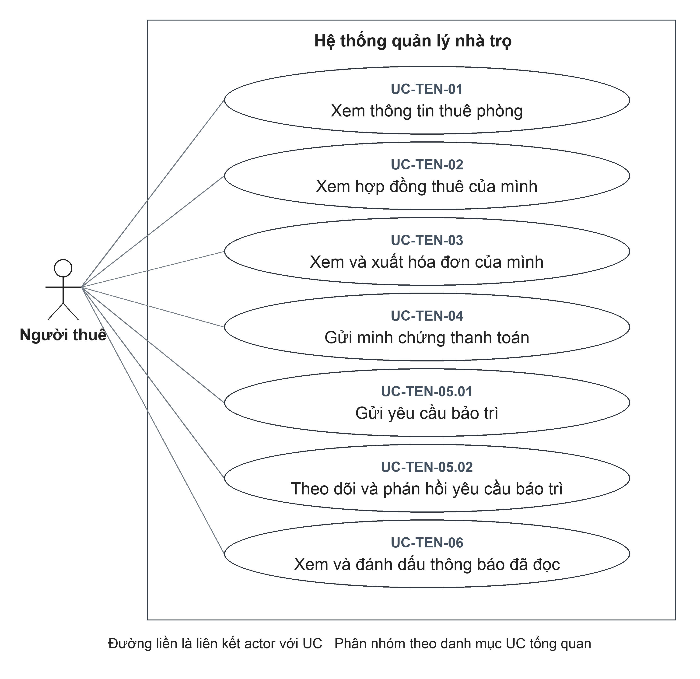

Đặc tả liên quan: [UC-TEN-01](#uc-ten-01), [UC-TEN-02](#uc-ten-02), [UC-TEN-03](#uc-ten-03), [UC-TEN-04](#uc-ten-04), [UC-TEN-05.01](#uc-ten-05-01), [UC-TEN-05.02](#uc-ten-05-02), [UC-TEN-06](#uc-ten-06).

### UC-TEN-01 Xem thông tin thuê phòng

| Thuộc tính | Đặc tả |
| --- | --- |
| **Mã UC** | UC-TEN-01 |
| **Tên UC** | Xem thông tin thuê phòng |
| **Mục tiêu** | Nắm thông tin cá nhân, phòng đang thuê, Chủ trọ phụ trách và các mục cần chú ý của mình. |
| **Actor chính** | Người thuê |
| **Actor phụ** | Không có. |
| **Kích hoạt** | Mở cổng thông tin thuê phòng. |
| **Điều kiện trước** | **1.** Người thuê đã đăng nhập; tài khoản được liên kết với hồ sơ Người thuê đang được sử dụng. |
| **Điều kiện sau** | **Thành công:** Người thuê xem được thông tin thuộc hồ sơ liên kết; UC không sửa hồ sơ hoặc điều khoản thuê.  **Hủy hoặc không thành công:** Không cung cấp được kết quả tra cứu của lần yêu cầu không thành công; UC không ghi thay đổi vào dữ liệu nghiệp vụ. |
| **Dữ liệu đầu vào** | Không yêu cầu nhập thông tin của Người thuê khác; hồ sơ được xác định từ tài khoản đăng nhập. |
| **Luồng chính** | **1.** Người thuê: Mở cổng thông tin thuê phòng.  **2.** Hệ thống: Xác định hồ sơ Người thuê đang được sử dụng và liên kết với tài khoản đăng nhập.  **3.** Hệ thống: Tổng hợp thông tin hồ sơ, Chủ trọ, phòng, hợp đồng và hóa đơn liên quan.  **4.** Hệ thống: Hiển thị thông tin thuê phòng và tổng quan thanh toán, bảo trì.  **5.** Người thuê: Chọn hợp đồng, hóa đơn, bảo trì hoặc thông báo để xem chi tiết. |
| **Luồng thay thế** | **A1 — Tại bước 3:** Hồ sơ chưa có hợp đồng. Hệ thống vẫn tổng hợp thông tin hồ sơ và dữ liệu liên quan hiện có; không hiển thị một phòng đang thuê khi chưa có căn cứ. Tiếp tục bước 4 để hiển thị thông tin tổng quan với phần hợp đồng/phòng thuê rỗng. Người thuê vẫn có thể xem các mục được phép tại bước 5; đây không phải yêu cầu bị từ chối. |
| **Luồng ngoại lệ** | **E1 — Tại bước 2:** Tài khoản chưa có hồ sơ liên kết đang sử dụng. Từ chối truy cập dữ liệu cổng thông tin Người thuê với lỗi không tìm thấy hồ sơ. UC kết thúc đối với yêu cầu bị từ chối. |
| **Quy tắc nghiệp vụ** | **BR1.** Thông tin truy cập được xác định từ hồ sơ liên kết với tài khoản đăng nhập; Người thuê không tự chọn mã hồ sơ khác. |

### UC-TEN-02 Xem hợp đồng thuê của mình

| Thuộc tính | Đặc tả |
| --- | --- |
| **Mã UC** | UC-TEN-02 |
| **Tên UC** | Xem hợp đồng thuê của mình |
| **Mục tiêu** | Tra cứu điều khoản hợp đồng hiện tại và lịch sử hợp đồng của người thuê. |
| **Actor chính** | Người thuê |
| **Actor phụ** | Không có. |
| **Kích hoạt** | Mở danh sách hợp đồng thuê. |
| **Điều kiện trước** | **1.** Người thuê đã đăng nhập; tài khoản được liên kết với hồ sơ Người thuê đang được sử dụng. |
| **Điều kiện sau** | **Thành công:** Thông tin hợp đồng được hiển thị ở chế độ xem; Người thuê không sửa/gia hạn/kết thúc hợp đồng từ UC này.  **Hủy hoặc không thành công:** Không cung cấp được kết quả tra cứu của lần yêu cầu không thành công; UC không ghi thay đổi vào dữ liệu nghiệp vụ. |
| **Dữ liệu đầu vào** | Lựa chọn xem hợp đồng trong danh sách của hồ sơ. |
| **Luồng chính** | **1.** Người thuê: Mở danh sách hợp đồng thuê.  **2.** Hệ thống: Xác định hồ sơ liên kết đang được sử dụng của tài khoản.  **3.** Hệ thống: Lấy hợp đồng hiệu lực và đã kết thúc của hồ sơ cùng thông tin phòng, khu trọ.  **4.** Hệ thống: Hiển thị ngày thuê, tiền thuê, tiền cọc và trạng thái từng hợp đồng.  **5.** Người thuê: Chọn và xem hợp đồng cần đối chiếu. |
| **Luồng thay thế** | **A1 — Tại bước 3:** Chưa có hợp đồng. Hiển thị danh sách rỗng. UC kết thúc sau khi hiển thị kết quả. |
| **Luồng ngoại lệ** | **E1 — Tại bước 2:** Không có hồ sơ liên kết đang sử dụng. Không trả danh sách hợp đồng. UC kết thúc đối với yêu cầu bị từ chối. |
| **Quy tắc nghiệp vụ** | **BR1.** Chỉ cung cấp hợp đồng gắn với hồ sơ liên kết của tài khoản.  **BR2.** Xem hợp đồng không làm thay đổi điều khoản hoặc trạng thái hợp đồng. |

### UC-TEN-03 Xem và xuất hóa đơn của mình

| Thuộc tính | Đặc tả |
| --- | --- |
| **Mã UC** | UC-TEN-03 |
| **Tên UC** | Xem và xuất hóa đơn của mình |
| **Mục tiêu** | Kiểm tra các khoản phải trả, tiền đã ghi nhận và lưu bản hóa đơn của mình. |
| **Actor chính** | Người thuê |
| **Actor phụ** | Không có. |
| **Kích hoạt** | Mở danh sách hóa đơn của mình. |
| **Điều kiện trước** | **1.** Người thuê đã đăng nhập; tài khoản được liên kết với hồ sơ Người thuê đang được sử dụng. |
| **Điều kiện sau** | **Thành công:** Hóa đơn được hiển thị hoặc PDF được tạo để xuất; không ghi thanh toán chỉ bởi thao tác xem.  **Hủy hoặc không thành công:** Hủy chức năng in hoặc chia sẻ không thay đổi hóa đơn. Nếu tạo tài liệu hoặc chia sẻ lỗi, chưa xác nhận tài liệu được lưu hoặc gửi tới đích bên ngoài. |
| **Dữ liệu đầu vào** | Hóa đơn trong danh sách của hồ sơ; lựa chọn xuất PDF. |
| **Luồng chính** | **1.** Người thuê: Mở danh sách hóa đơn của mình.  **2.** Hệ thống: Xác định hồ sơ liên kết và lấy các hóa đơn của hồ sơ.  **3.** Hệ thống: Hiển thị kỳ tính, tổng tiền, số đã thu, số còn phải thu và trạng thái thanh toán.  **4.** Người thuê: Chọn hóa đơn cần xem.  **5.** Hệ thống: Kiểm tra hóa đơn thuộc hồ sơ rồi hiển thị thành phần tiền, khoản thanh toán và minh chứng liên quan. |
| **Luồng thay thế** | **A1 — Tại bước 2:** Chưa có hóa đơn. Hiển thị danh sách rỗng. UC kết thúc sau khi hiển thị kết quả.  **A2 — Tại bước 5:** Chọn xuất PDF. Ứng dụng tạo PDF từ dữ liệu hóa đơn và mở chức năng chia sẻ/in. |
| **Luồng ngoại lệ** | **E1 — Tại bước 5:** Hóa đơn không tồn tại hoặc không thuộc hồ sơ. Không trả chi tiết hóa đơn. UC kết thúc đối với yêu cầu bị từ chối. |
| **Quy tắc nghiệp vụ** | **BR1.** Hóa đơn phải thuộc hồ sơ Người thuê liên kết với tài khoản.  **BR2.** Xem hoặc xuất hóa đơn không thay đổi số đã thu và trạng thái thanh toán. |

### UC-TEN-04 Gửi minh chứng thanh toán

| Thuộc tính | Đặc tả |
| --- | --- |
| **Mã UC** | UC-TEN-04 |
| **Tên UC** | Gửi minh chứng thanh toán |
| **Mục tiêu** | Gửi thông tin về khoản đã thanh toán bên ngoài hệ thống để Chủ trọ đối soát. |
| **Actor chính** | Người thuê |
| **Actor phụ** | Không có. |
| **Kích hoạt** | Mở hóa đơn còn phải thanh toán và chọn gửi minh chứng. |
| **Điều kiện trước** | **1.** Người thuê đã đăng nhập; tài khoản được liên kết với hồ sơ Người thuê đang được sử dụng.  **2.** Hóa đơn cần gửi minh chứng đã tồn tại và thuộc hồ sơ Người thuê.  **3.** Hóa đơn chưa hủy và còn số tiền phải thu. |
| **Điều kiện sau** | **Thành công:** Minh chứng Chờ duyệt được lưu; tiền đã thu/trạng thái thanh toán chưa thay đổi cho đến khi Chủ trọ duyệt.  **Hủy hoặc không thành công:** Hủy trước xác nhận hoặc bị từ chối trước ghi nhận thì không tạo minh chứng thanh toán mới. Nếu đã gửi yêu cầu nhưng chưa xác định được kết quả, cần kiểm tra lại dữ liệu minh chứng thanh toán trước khi thực hiện lại. |
| **Dữ liệu đầu vào** | Hóa đơn của Người thuê; số tiền; phương thức thanh toán; ghi chú tùy chọn và tệp minh chứng theo yêu cầu của biểu mẫu. Chính sách tệp và lưu tệp xem [PX-25](#px-25). |
| **Luồng chính** | **1.** Người thuê: Mở hóa đơn còn phải thanh toán và chọn gửi minh chứng.  **2.** Hệ thống: Hiển thị các trường số tiền, phương thức, ghi chú và lựa chọn tải tệp minh chứng.  **3.** Người thuê: Nhập số tiền, phương thức; bổ sung ghi chú, tải tệp theo yêu cầu của biểu mẫu và xác nhận gửi. Chính sách bắt buộc tệp xem [PX-25](#px-25).  **4.** Hệ thống: Kiểm tra dữ liệu và xác nhận hóa đơn thuộc hồ sơ, chưa hủy, còn phải thu.  **5.** Hệ thống: Tính tổng tiền của các minh chứng Chờ duyệt; kiểm tra khoản gửi mới không vượt số còn phải thu sau khi trừ tổng đang chờ.  **6.** Hệ thống: Ghi minh chứng Chờ duyệt và hiển thị kết quả để Người thuê theo dõi; chưa ghi nhận tiền đã thu. |
| **Luồng thay thế** | Không có nhánh thay thế nghiệp vụ riêng trong phạm vi UC này. |
| **Luồng ngoại lệ** | **E1 — Tại bước 3:** Chưa tải tệp hoặc số tiền nhập không hợp lệ trên biểu mẫu. Không gửi yêu cầu; yêu cầu bổ sung. Sau khi điều chỉnh, thực hiện lại từ bước 3.  **E2 — Tại bước 4:** Hóa đơn không thuộc hồ sơ, đã hủy hoặc đã thu đủ. Từ chối gửi chứng từ. UC kết thúc đối với yêu cầu bị từ chối.  **E3 — Tại bước 5:** Số tiền vượt phần số dư chưa được các minh chứng Chờ duyệt giữ chỗ. Từ chối tạo chứng từ. UC kết thúc đối với yêu cầu bị từ chối. |
| **Quy tắc nghiệp vụ** | **BR1.** Số tiền minh chứng là số nguyên dương.  **BR2.** Tổng tiền minh chứng đang Chờ duyệt và khoản gửi mới không được vượt số còn phải thu của hóa đơn.  **BR3.** Gửi minh chứng chưa ghi nhận thanh toán; khoản thanh toán chỉ phát sinh khi Chủ trọ duyệt.  **BR4.** Không gửi minh chứng cho hóa đơn đã hủy hoặc đã thu đủ. |

### UC-TEN-05.01 Gửi yêu cầu bảo trì

| Thuộc tính | Đặc tả |
| --- | --- |
| **Mã UC** | UC-TEN-05.01 |
| **Tên UC** | Gửi yêu cầu bảo trì |
| **Mục tiêu** | Báo sự cố tại phòng đang thuê để Chủ trọ tiếp nhận xử lý. |
| **Actor chính** | Người thuê |
| **Actor phụ** | Không có. |
| **Kích hoạt** | Chọn gửi yêu cầu bảo trì. |
| **Điều kiện trước** | **1.** Người thuê đã đăng nhập; tài khoản được liên kết với hồ sơ Người thuê đang được sử dụng.  **2.** Có hợp đồng thuê phòng còn hiệu lực để xác định nơi phát sinh sự cố. |
| **Điều kiện sau** | **Thành công:** Yêu cầu Mới được lưu; không tự có khoản chi hoặc thay đổi trạng thái thuê.  **Hủy hoặc không thành công:** Hủy trước xác nhận hoặc bị từ chối trước ghi nhận thì không tạo yêu cầu bảo trì mới. Nếu đã gửi yêu cầu nhưng chưa xác định được kết quả, cần kiểm tra lại dữ liệu yêu cầu bảo trì trước khi thực hiện lại. |
| **Dữ liệu đầu vào** | Tiêu đề; mô tả, mức ưu tiên và ảnh tùy chọn. |
| **Luồng chính** | **1.** Người thuê: Chọn gửi yêu cầu bảo trì.  **2.** Hệ thống: Hiển thị các trường tiêu đề sự cố, mô tả, mức ưu tiên và ảnh.  **3.** Người thuê: Nhập tiêu đề, mô tả; chọn mức ưu tiên và bổ sung ảnh nếu có rồi xác nhận gửi.  **4.** Hệ thống: Xác định hồ sơ và hợp đồng hiệu lực để gắn yêu cầu với phòng, khu trọ và Chủ trọ.  **5.** Hệ thống: Ghi yêu cầu ở trạng thái Mới, dùng mức ưu tiên Trung bình nếu không được chỉ định.  **6.** Hệ thống: Hiển thị yêu cầu đã gửi trong danh sách để Người thuê theo dõi. |
| **Luồng thay thế** | **A1 — Tại bước 3:** Không gửi ảnh hoặc mức ưu tiên. Cho phép không có ảnh; mức ưu tiên dùng giá trị mặc định. |
| **Luồng ngoại lệ** | **E1 — Tại bước 4:** Không có hồ sơ đang sử dụng hoặc không có hợp đồng hiệu lực. Từ chối tạo yêu cầu. UC kết thúc đối với yêu cầu bị từ chối.  **E2 — Tại bước 3:** Tiêu đề/ưu tiên không hợp lệ. Yêu cầu điều chỉnh dữ liệu. Sau khi điều chỉnh, thực hiện lại từ bước 3. |
| **Quy tắc nghiệp vụ** | **BR1.** Yêu cầu được gắn với phòng từ hợp đồng hiệu lực của hồ sơ, không chọn phòng của Người thuê khác.  **BR2.** Ảnh là thông tin tùy chọn; mức ưu tiên mặc định Trung bình. |

### UC-TEN-05.02 Theo dõi và phản hồi yêu cầu bảo trì

| Thuộc tính | Đặc tả |
| --- | --- |
| **Mã UC** | UC-TEN-05.02 |
| **Tên UC** | Theo dõi và phản hồi yêu cầu bảo trì |
| **Mục tiêu** | Theo dõi tiến độ bảo trì và trao đổi thông tin bổ sung; phạm vi yêu cầu được truy cập cần xác nhận tại [PX-26](#px-26). |
| **Actor chính** | Người thuê |
| **Actor phụ** | Không có. |
| **Kích hoạt** | Mở danh sách yêu cầu bảo trì. |
| **Điều kiện trước** | **1.** Người thuê đã đăng nhập; tài khoản được liên kết với hồ sơ Người thuê đang được sử dụng. |
| **Điều kiện sau** | **Thành công:** Thông tin được hiển thị hoặc phản hồi mới được lưu; phản hồi không tự thay đổi trạng thái yêu cầu.  **Hủy hoặc không thành công:** Yêu cầu bị từ chối trước ghi nhận không thay đổi nội dung phản hồi bảo trì. Nếu chưa nhận được kết quả sau khi xác nhận, cần kiểm tra lại nội dung phản hồi bảo trì, không mặc định thao tác đã được hoàn tác. |
| **Dữ liệu đầu vào** | Yêu cầu cần xem; nội dung phản hồi và ảnh tùy chọn. |
| **Luồng chính** | **1.** Người thuê: Mở danh sách yêu cầu bảo trì.  **2.** Hệ thống: Xác định các yêu cầu theo phạm vi phòng liên quan đến lịch sử thuê; giới hạn quyền xem cần xác nhận tại [PX-26](#px-26).  **3.** Hệ thống: Hiển thị nội dung yêu cầu, trạng thái, tiến độ và phản hồi hiện có.  **4.** Người thuê: Chọn yêu cầu, nhập nội dung phản hồi, bổ sung ảnh nếu có và xác nhận gửi.  **5.** Hệ thống: Kiểm tra yêu cầu thuộc phạm vi được truy cập và nội dung phản hồi hợp lệ; ghi phản hồi với tác giả là Người thuê.  **6.** Hệ thống: Hiển thị phản hồi mới trong nội dung trao đổi. |
| **Luồng thay thế** | **A1 — Tại bước 3:** Chỉ xem tiến độ, không gửi phản hồi. Kết thúc sau khi xem; không ghi thay đổi. |
| **Luồng ngoại lệ** | **E1 — Tại bước 5:** Yêu cầu không nằm trong các phòng của lịch sử hợp đồng hoặc không tồn tại. Từ chối phản hồi. UC kết thúc đối với yêu cầu bị từ chối.  **E2 — Tại bước 4:** Nội dung không hợp lệ về định dạng hoặc giới hạn giá trị. Từ chối dữ liệu. UC kết thúc đối với yêu cầu bị từ chối. |
| **Quy tắc nghiệp vụ** | **BR1.** Phản hồi ghi nhận tài khoản Người thuê làm tác giả.  **BR2.** Gửi phản hồi không tự thay đổi trạng thái xử lý bảo trì. |

### UC-TEN-06 Xem và đánh dấu thông báo đã đọc

| Thuộc tính | Đặc tả |
| --- | --- |
| **Mã UC** | UC-TEN-06 |
| **Tên UC** | Xem và đánh dấu thông báo đã đọc |
| **Mục tiêu** | Tiếp nhận thông báo liên quan đến hợp đồng, hóa đơn và bảo trì của mình. |
| **Actor chính** | Người thuê |
| **Actor phụ** | Không có. |
| **Kích hoạt** | Mở danh sách thông báo. |
| **Điều kiện trước** | **1.** Người thuê đã đăng nhập; tài khoản được liên kết với hồ sơ Người thuê đang được sử dụng. |
| **Điều kiện sau** | **Thành công:** Thông báo được hiển thị; đánh dấu đọc không đổi hóa đơn, khoản thu hoặc trạng thái bảo trì.  **Hủy hoặc không thành công:** Yêu cầu bị từ chối trước ghi nhận không thay đổi tình trạng đọc thông báo. Nếu chưa nhận được kết quả sau khi xác nhận, cần kiểm tra lại tình trạng đọc thông báo, không mặc định thao tác đã được hoàn tác. |
| **Dữ liệu đầu vào** | Thông báo cần mở/đánh dấu đọc. |
| **Luồng chính** | **1.** Người thuê: Mở danh sách thông báo.  **2.** Hệ thống: Tổng hợp hóa đơn chưa thu đủ của hồ sơ, các cập nhật bảo trì liên quan và tình trạng đã đọc.  **3.** Hệ thống: Hiển thị thông báo quá hạn, sắp đến hạn trong 7 ngày và tiến độ bảo trì; tối đa 12 mục theo cách tổng hợp hiện tại.  **4.** Người thuê: Mở thông báo hoặc chọn đánh dấu đã đọc.  **5.** Hệ thống: Ghi nhận tình trạng đọc cho tài khoản hiện tại và cập nhật số thông báo chưa đọc. |
| **Luồng thay thế** | **A1 — Tại bước 3:** Không có thông báo. Hiển thị danh sách rỗng và số chưa đọc bằng 0. UC kết thúc sau khi hiển thị kết quả. |
| **Luồng ngoại lệ** | **E1 — Tại bước 2:** Không có hồ sơ liên kết đang sử dụng. Không trả danh sách thông báo. UC kết thúc đối với yêu cầu bị từ chối. |
| **Quy tắc nghiệp vụ** | **BR1.** Tình trạng đọc được ghi nhận riêng cho từng tài khoản.  **BR2.** Thông báo tổng hợp trong cổng thông tin không đồng nghĩa đã được gửi qua một kênh bên ngoài. |

## 5 Nghiệp vụ liên nhóm

Các chuỗi dưới đây giúp theo dõi kết quả giữa các UC, không thay thế đặc tả riêng và không yêu cầu các thao tác phải luôn thực hiện theo một trình tự duy nhất.

| Tình huống | UC liên quan | Kết quả cần phân biệt |
| --- | --- | --- |
| Thiết lập quan hệ thuê và quyền truy cập | UC-OPT-04.02, UC-OPT-05.02, UC-OPT-04.06, UC-SYS-01.01 | Hồ sơ, hợp đồng, lời mời và tài khoản là các kết quả riêng. Chính sách thu cọc khi tạo hợp đồng xem PX-03. |
| Thu tiền qua minh chứng | UC-BIL-02.01, UC-TEN-03, UC-TEN-04, UC-BIL-04 | Gửi minh chứng chỉ tạo Chờ duyệt; duyệt thành công mới ghi khoản thanh toán. |
| Sửa khoản thu sai | UC-BIL-02.03, UC-BIL-03.02, UC-BIL-03.01 | Giữ khoản gốc và ghi khoản đảo; có thể ghi khoản thu đúng sau đối chiếu. Hóa đơn đã có giao dịch vẫn không đủ điều kiện hủy. |
| Xử lý sự cố từ Người thuê | UC-TEN-05.01, UC-OPT-06.03, UC-OPT-06.04, UC-TEN-05.02 | Cập nhật tiến độ khác ghi nhận khoản chi. Quyền xem, phản hồi theo lịch sử thuê cần xác nhận tại PX-26. |
| Kết thúc thuê và đối chiếu tiền | UC-OPT-05.01, UC-OPT-05.06, UC-OPT-05.05 | Kết thúc hợp đồng không tự hoàn cọc, thu nợ hoặc lập hóa đơn cuối kỳ. Chính sách tất toán trước khi kết thúc cần được quyết định riêng. |

## Phụ lục A Điểm cần xác nhận

Các mục dưới đây chưa phải quy tắc nghiệp vụ được chấp thuận. Mỗi mục nêu điều đã quan sát được và câu hỏi cần quyết định. Tất cả hiện ở trạng thái Chờ xác nhận; không tự ghi kết luận thay người quyết định nghiệp vụ.

### PX-01 Giá thuê 0 đồng

**UC liên quan:** [UC-OPT-05.02](#uc-opt-05-02).

**Hiện trạng đã quan sát:** Biểu mẫu lập hợp đồng yêu cầu giá thuê lớn hơn 0; xử lý tiếp nhận cho phép giá trị 0.

**Cần xác nhận:** Có cho phép hợp đồng giá thuê 0 đồng không? Nếu có, cần thống nhất cả cách nhập và cách lập hóa đơn.

**Trạng thái:** Chờ xác nhận.

### PX-02 Điều kiện chọn phòng và số hợp đồng của Người thuê

**UC liên quan:** [UC-OPT-05.02](#uc-opt-05-02).

**Hiện trạng đã quan sát:** Danh sách chọn phòng lọc trạng thái Trống. Xử lý tạo kiểm tra phòng đang được sử dụng và chưa có hợp đồng hiệu lực, chưa loại riêng trạng thái Bảo trì. Nút tạo tại hồ sơ chỉ xuất hiện khi Người thuê chưa có hợp đồng hiệu lực; xử lý tạo chưa đặt giới hạn này cho Người thuê.

**Cần xác nhận:** Phòng Bảo trì có được lập hợp đồng không? Một Người thuê có được có nhiều hợp đồng hiệu lực không? Chốt điều kiện rồi thống nhất các điểm truy cập.

**Trạng thái:** Chờ xác nhận.

### PX-03 Cọc thỏa thuận và cọc thực thu

**UC liên quan:** [UC-OPT-05.02](#uc-opt-05-02); [UC-OPT-05.06](#uc-opt-05-06).

**Hiện trạng đã quan sát:** Nhập tiền cọc dương khi tạo hợp đồng hiện tự tạo khoản Thu cọc ban đầu cùng số tiền. Tiền cọc hợp đồng và lịch sử giao dịch cọc được lưu riêng.

**Cần xác nhận:** Tiền cọc khi tạo là mức thỏa thuận hay tiền đã nhận? Có cần thao tác xác nhận đã thu hoặc nhập số thực thu riêng không? Chưa chọn một cách hiểu làm chính sách chung.

**Trạng thái:** Chờ xác nhận.

### PX-04 Ngày kết thúc khi tạo hợp đồng

**UC liên quan:** [UC-OPT-05.02](#uc-opt-05-02).

**Hiện trạng đã quan sát:** Chức năng tạo hiện nhận ngày bắt đầu, chưa có ngày kết thúc. Ngày kết thúc được cập nhật ở các nghiệp vụ điều chỉnh hoặc gia hạn.

**Cần xác nhận:** Có yêu cầu thời hạn và ngày kết thúc ngay khi tạo không? Không bổ sung trường bắt buộc hoặc hợp đồng có kỳ hạn vào đặc tả hiện tại khi chưa được xác nhận.

**Trạng thái:** Chờ xác nhận.

### PX-05 Thông tin duy nhất khi tạo mới

**UC liên quan:** [UC-ADM-03.02](#uc-adm-03-02); [UC-OPT-02.02](#uc-opt-02-02); [UC-OPT-03.02](#uc-opt-03-02); [UC-OPT-04.02](#uc-opt-04-02).

**Hiện trạng đã quan sát:** Chưa xác định quy tắc kiểm tra trùng tên khu trọ, tên phòng hoặc số giấy tờ định danh trong các thao tác tạo tương ứng.

**Cần xác nhận:** Tên cần duy nhất theo khu trọ, theo Chủ trọ hay không cần duy nhất? Số giấy tờ có cần chống trùng không? Chưa thêm các điều kiện này vào luồng từ chối.

**Trạng thái:** Chờ xác nhận.

### PX-06 Cách mở chức năng sửa điều khoản

**UC liên quan:** [UC-OPT-05.03](#uc-opt-05-03).

**Hiện trạng đã quan sát:** Có xử lý sửa điều khoản và lưu lịch sử nhưng chưa xác định biểu mẫu riêng trên ứng dụng; hộp thoại Gia hạn là một thao tác khác. Xử lý sửa chưa giới hạn chỉ hợp đồng hiệu lực.

**Cần xác nhận:** Chủ trọ mở thao tác sửa ở đâu, được sửa khi hợp đồng đã kết thúc không, và có cần giới hạn trường sửa theo trạng thái không?

**Trạng thái:** Chờ xác nhận.

### PX-07 Thời hạn gia hạn và kết thúc lặp lại

**UC liên quan:** [UC-OPT-05.04](#uc-opt-05-04); [UC-OPT-05.05](#uc-opt-05-05).

**Hiện trạng đã quan sát:** Gia hạn kiểm tra ngày kết thúc không trước ngày bắt đầu, chưa kiểm tra phải sau ngày kết thúc cũ. Kết thúc lại hợp đồng đã kết thúc có thể ghi lại ngày kết thúc.

**Cần xác nhận:** Gia hạn có bắt buộc kéo dài thời hạn không? Kết thúc hợp đồng lần hai phải bị từ chối hay giữ kết quả lần đầu?

**Trạng thái:** Chờ xác nhận.

### PX-08 Số dư cọc và điều chỉnh cọc

**UC liên quan:** [UC-OPT-05.06](#uc-opt-05-06).

**Hiện trạng đã quan sát:** Cách tính hiện tại cộng Thu cọc và Điều chỉnh, trừ Hoàn cọc và Khấu trừ. Chưa có kiểm tra hoàn hoặc khấu trừ không vượt số dư.

**Cần xác nhận:** Có cho phép số dư âm không? Điều chỉnh cần tăng, giảm hay cả hai? Giới hạn hoàn và khấu trừ cần áp dụng như thế nào?

**Trạng thái:** Chờ xác nhận.

### PX-09 Phạm vi quản lý tài sản và lịch kiểm tra

**UC liên quan:** [UC-OPT-03.07](#uc-opt-03-07); [UC-OPT-03.09](#uc-opt-03-09).

**Hiện trạng đã quan sát:** Màn hình tài sản có thêm, xóa; thông tin tiếp nhận mở rộng có ngày mua, ghi chú, ảnh và thao tác cập nhật. Lịch kiểm tra có thêm, hoàn tất trên màn hình; xử lý còn có cập nhật, xóa và chưa buộc ngày dự kiến ở tương lai.

**Cần xác nhận:** Có đưa sửa tài sản, sửa hoặc xóa lịch kiểm tra và các trường mở rộng vào phạm vi hiện tại không? Ngày kiểm tra quá khứ được phép ghi nhận hay cần chặn?

**Trạng thái:** Chờ xác nhận.

### PX-10 Khôi phục phòng trong khu trọ đã lưu trữ

**UC liên quan:** [UC-OPT-03.05](#uc-opt-03-05); [UC-OPT-02.04](#uc-opt-02-04).

**Hiện trạng đã quan sát:** Khôi phục phòng chưa kiểm tra riêng tình trạng lưu trữ của khu trọ. Khôi phục khu trọ không tự khôi phục các phòng.

**Cần xác nhận:** Có yêu cầu khôi phục khu trọ trước khi khôi phục phòng không? Khôi phục đồng thời các phòng có phải nhu cầu nghiệp vụ không?

**Trạng thái:** Chờ xác nhận.

### PX-11 Phạm vi dữ liệu bảo toàn khi xóa

**UC liên quan:** [UC-OPT-02.05](#uc-opt-02-05); [UC-OPT-03.06](#uc-opt-03-06); [UC-OPT-04.05](#uc-opt-04-05).

**Hiện trạng đã quan sát:** Kiểm tra xóa khu trọ tập trung phòng và hợp đồng; xóa phòng tập trung hợp đồng, chỉ số, hóa đơn; xóa hồ sơ tập trung hợp đồng, hóa đơn. Chưa coi đây là kiểm tra đầy đủ mọi dữ liệu phụ trợ.

**Cần xác nhận:** Có phải bảo toàn thêm tài sản, bảo trì, trao đổi, khoản chi hoặc lời mời khi xóa không? Cần chốt danh mục và hành vi xóa, không dùng điều kiện mơ hồ không có bất kỳ lịch sử nào.

**Trạng thái:** Chờ xác nhận.

### PX-12 Vòng đời lời mời và phiên sau kích hoạt

**UC liên quan:** [UC-OPT-04.06](#uc-opt-04-06); [UC-SYS-01.01](#uc-sys-01-01).

**Hiện trạng đã quan sát:** Tạo lời mời mới chưa vô hiệu hóa lời mời cũ; không xác định tự gửi email. Kích hoạt tạo tài khoản trước khi xác lập phiên nên lỗi đăng nhập sau đó không đồng nghĩa lời mời chưa dùng.

**Cần xác nhận:** Có vô hiệu hóa lời mời cũ, gửi email tự động hay có luồng đăng nhập lại sau kích hoạt không? Phân biệt lời mời đã dùng với phiên đăng nhập chưa thành công.

**Trạng thái:** Chờ xác nhận.

### PX-13 Chuyển trạng thái bảo trì

**UC liên quan:** [UC-OPT-06.03](#uc-opt-06-03).

**Hiện trạng đã quan sát:** Cập nhật hiện chưa chặn việc đưa yêu cầu Hoàn tất hoặc Đã hủy về trạng thái mở. Chuyển Hoàn tất qua cập nhật trạng thái khác với thao tác Hoàn tất có ghi khoản chi. Biểu mẫu sửa dùng ngày báo và không gửi ngày bắt đầu, hoàn tất. Chuyển trạng thái bằng thao tác riêng ghi ngày bắt đầu hoặc hoàn tất nếu chuyển sang trạng thái tương ứng và mốc chưa có; đổi trạng thái trên biểu mẫu sửa không tự ghi các mốc này.

**Cần xác nhận:** Chốt các cặp trạng thái được chuyển, quyền mở lại và cách ghi ngày bắt đầu, hoàn tất thống nhất giữa các thao tác. Có cho phép hoàn tất mà không khai báo chi phí không?

**Trạng thái:** Chờ xác nhận.

### PX-14 Chi phí bảo trì và khoản chi liên kết

**UC liên quan:** [UC-OPT-06.04](#uc-opt-06-04); [UC-BIL-05.03](#uc-bil-05-03).

**Hiện trạng đã quan sát:** Hoàn tất tuần tự không tạo thêm khoản chi đã liên kết, nhưng chưa xác nhận an toàn khi hai người hoàn tất đồng thời. Sửa khoản chi không tự cập nhật lại chi phí thực tế của yêu cầu bảo trì; chưa có lịch sử sửa khoản chi riêng.

**Cần xác nhận:** Cần đồng bộ chi phí hai chiều, ghi lịch sử sửa và kiểm soát thao tác đồng thời đến mức nào?

**Trạng thái:** Chờ xác nhận.

### PX-15 Đường thao tác ghi chỉ số độc lập

**UC liên quan:** [UC-BIL-01](#uc-bil-01).

**Hiện trạng đã quan sát:** Có xử lý ghi chỉ số riêng và luồng chỉ số trong lập hóa đơn; chưa xác định nút lưu chỉ số độc lập trên màn hình.

**Cần xác nhận:** Có cần màn hình ghi chỉ số riêng trước khi lập hóa đơn không? UC hiện mô tả nghiệp vụ tiếp nhận chỉ số, không khẳng định đã có màn hình riêng.

**Trạng thái:** Chờ xác nhận.

### PX-16 Thiếu chỉ số điện nước

**UC liên quan:** [UC-BIL-02.01](#uc-bil-02-01); [UC-BIL-02.02](#uc-bil-02-02); [UC-BIL-02.07](#uc-bil-02-07).

**Hiện trạng đã quan sát:** Lập thủ công có thể dùng chỉ số đã có và chưa bắt buộc đủ cả điện, nước. Đợt tự động đến lịch kiểm tra đủ chỉ số cho hóa đơn cần lập; thiếu thì bỏ qua kỳ chạy.

**Cần xác nhận:** Chốt có được lập hóa đơn thiếu chỉ số hay không và có cần cùng một chính sách giữa lập từng hợp đồng, lập hàng loạt, chạy ngay và chạy theo lịch không?

**Trạng thái:** Chờ xác nhận.

### PX-17 Hóa đơn tổng tiền bằng 0 và hạn thanh toán

**UC liên quan:** [UC-BIL-02.01](#uc-bil-02-01); [UC-BIL-02.02](#uc-bil-02-02).

**Hiện trạng đã quan sát:** Hóa đơn tổng bằng 0 hiện vẫn được ghi Chưa thanh toán. Hạn thanh toán được kiểm tra hợp lệ về ngày, chưa kiểm tra phải sau ngày lập.

**Cần xác nhận:** Hóa đơn 0 đồng được bỏ qua, tạo đã thanh toán hay giữ Chưa thanh toán? Hạn thanh toán tối thiểu cần quan hệ thế nào với ngày lập?

**Trạng thái:** Chờ xác nhận.

### PX-18 Xóa hạn và ý nghĩa chưa thu tiền

**UC liên quan:** [UC-BIL-02.04](#uc-bil-02-04).

**Hiện trạng đã quan sát:** Để trống hạn trên biểu mẫu hiện giữ hạn cũ; xử lý tiếp nhận có khả năng xóa hạn khi được yêu cầu rõ. Điều kiện sửa dựa trên trạng thái và tiền thu ròng, không phải chưa từng có giao dịch.

**Cần xác nhận:** Có cho xóa hạn thanh toán không? Hóa đơn đã thu rồi đảo về 0 có được sửa không? Chốt thuật ngữ chưa thu tiền theo lịch sử hay theo số dư.

**Trạng thái:** Chờ xác nhận.

### PX-19 Vận hành lập hóa đơn theo lịch

**UC liên quan:** [UC-BIL-02.07](#uc-bil-02-07).

**Hiện trạng đã quan sát:** Có cấu hình và xử lý đến lịch, nhưng chưa xác nhận bộ lập lịch được bật, múi giờ vận hành hoặc lượt chạy thật. Hai ngày lập, đến hạn chỉ được kiểm tra riêng trong 1 đến 28. Chạy khi đến lịch là sự kiện độc lập sau khi lưu cấu hình. Xử lý lịch hiện kiểm tra cấu hình bật, khu trọ đang hoạt động, kỳ chưa chạy và chỉ số cần lập; nếu thiếu chỉ số thì bỏ qua lượt chạy và ghi lý do. Không coi lưu cấu hình hoặc xem trước là đã chạy lịch thành công.

**Cần xác nhận:** Chốt lịch, múi giờ và quan hệ ngày đến hạn với ngày lập; kiểm tra môi trường chạy trước khi cam kết lập hóa đơn tự động.

**Trạng thái:** Chờ xác nhận.

### PX-20 Thông tin đối soát và lý do từ chối

**UC liên quan:** [UC-BIL-04](#uc-bil-04).

**Hiện trạng đã quan sát:** Ghi chú quyết định đang tùy chọn; duyệt tạo khoản thanh toán từ minh chứng. Đảo khoản thu không đưa minh chứng trở lại Chờ duyệt.

**Cần xác nhận:** Có cần lý do bắt buộc khi từ chối và luồng xử lý minh chứng sau khi đảo khoản thanh toán không?

**Trạng thái:** Chờ xác nhận.

### PX-21 Tính đồng bộ và thao tác đồng thời

**UC liên quan:** [UC-BIL-03.01](#uc-bil-03-01); [UC-BIL-03.02](#uc-bil-03-02); [UC-OPT-05.06](#uc-opt-05-06).

**Hiện trạng đã quan sát:** Các thao tác có ghi nhận đồng bộ và một số kiểm tra trùng; đọc tài liệu hoặc kiểm tra xử lý không thay thế kiểm thử hai yêu cầu đồng thời và tình huống mất kết nối.

**Cần xác nhận:** Cần kiểm thử thu, đảo, ghi cọc và thử lại khi chưa nhận được kết quả để xác nhận không ghi trùng hoặc vượt số dư.

**Trạng thái:** Chờ xác nhận.

### PX-22 Ý nghĩa các chỉ số báo cáo

**UC liên quan:** [UC-BIL-06.01](#uc-bil-06-01); [UC-BIL-06.02](#uc-bil-06-02).

**Hiện trạng đã quan sát:** Công nợ là số còn phải thu hiện tại của hóa đơn theo kỳ; thực thu theo ngày giao dịch. Chỉ số cọc trả ra hiện gộp Hoàn cọc và Khấu trừ.

**Cần xác nhận:** Có tách cọc hoàn trả và cọc khấu trừ không? Chốt công nợ cuối tháng hay công nợ hiện tại; thống nhất tên chỉ số để không hiểu khấu trừ là dòng tiền trả cho Người thuê.

**Trạng thái:** Chờ xác nhận.

### PX-23 Kết quả xuất báo cáo

**UC liên quan:** [UC-BIL-06.02](#uc-bil-06-02).

**Hiện trạng đã quan sát:** Chức năng hiện tạo CSV và sao chép nội dung vào bộ nhớ sao chép, chưa tự lưu một tệp vào thư mục tải xuống.

**Cần xác nhận:** Sao chép CSV đã đáp ứng nhu cầu xuất chưa, hay cần lưu hoặc chia sẻ tệp? Không ghi điều kiện sau là tệp đã tải xuống khi chưa có hành vi đó.

**Trạng thái:** Chờ xác nhận.

### PX-24 Thông điệp nội bộ và gửi Zalo thật

**UC liên quan:** [UC-BIL-07.02](#uc-bil-07-02).

**Hiện trạng đã quan sát:** Thông điệp thủ công hoặc tin thử được ghi trạng thái Đã gửi trong ứng dụng nhưng nhánh này không gọi Zalo ZNS. Gửi ZNS có trạng thái theo kết quả nhà cung cấp; chưa xác nhận cấu hình và lượt gửi thật.

**Cần xác nhận:** Có cần trạng thái riêng cho thông điệp nội bộ không? Chốt mẫu tin, thông tin nhận, điều kiện cấu hình và cách chứng minh gửi thành công qua Zalo.

**Trạng thái:** Chờ xác nhận.

### PX-25 Tệp minh chứng thanh toán

**UC liên quan:** [UC-TEN-04](#uc-ten-04).

**Hiện trạng đã quan sát:** Biểu mẫu yêu cầu ít nhất một tệp; xử lý tiếp nhận cho phép bỏ danh sách tệp. Giới hạn tải 8 MiB mỗi tệp; kiểm tra loại tệp theo thông tin khai báo, chưa xác nhận nội dung tệp. Tệp đã tải có thể còn tồn tại khi hủy hoặc gửi minh chứng thất bại; chưa có dọn tự động theo luồng này.

**Cần xác nhận:** Tệp có bắt buộc không? Chốt định dạng, dung lượng, quyền xem và thời hạn lưu; xử lý tệp tải dở hoặc không gắn với minh chứng.

**Trạng thái:** Chờ xác nhận.

### PX-26 Phạm vi bảo trì của Người thuê

**UC liên quan:** [UC-TEN-05.02](#uc-ten-05-02); [UC-TEN-06](#uc-ten-06).

**Hiện trạng đã quan sát:** Danh sách và quyền phản hồi hiện dựa trên phòng trong toàn bộ lịch sử hợp đồng, chưa giới hạn theo người tạo yêu cầu hoặc thời điểm thuê. Thông báo bảo trì cũng lấy theo các phòng liên quan.

**Cần xác nhận:** Người thuê được xem yêu cầu của ai, trong thời gian nào, và có được phản hồi sau khi kết thúc thuê không? Không khẳng định chỉ thấy yêu cầu do mình tạo khi chưa thống nhất.

**Trạng thái:** Chờ xác nhận.

### PX-27 Chọn phòng khi có nhiều hợp đồng hiệu lực

**UC liên quan:** [UC-TEN-05.01](#uc-ten-05-01).

**Hiện trạng đã quan sát:** Khi có nhiều hợp đồng hiệu lực, yêu cầu bảo trì được gắn với hợp đồng đầu tiên theo ngày bắt đầu giảm dần; chưa có lựa chọn phòng riêng trong yêu cầu.

**Cần xác nhận:** Có cho Người thuê chọn hợp đồng hoặc phòng cần báo sự cố không? Cần thống nhất với chính sách nhiều hợp đồng tại PX-02.

**Trạng thái:** Chờ xác nhận.

### PX-28 Phạm vi thông báo và đánh dấu đọc

**UC liên quan:** [UC-BIL-07.01](#uc-bil-07-01); [UC-TEN-06](#uc-ten-06).

**Hiện trạng đã quan sát:** Danh sách việc cần xử lý có giới hạn 12 mục. Đánh dấu đọc chưa kiểm tra riêng mã thông báo có thuộc danh sách tổng hợp được trả về hay không.

**Cần xác nhận:** Có cần phân trang, giữ lịch sử và kiểm tra mã thông báo hợp lệ khi đánh dấu đọc không?

**Trạng thái:** Chờ xác nhận.

### PX-29 Phiên đăng nhập và khóa tài khoản

**UC liên quan:** [UC-SYS-01](#uc-sys-01); [UC-SYS-02](#uc-sys-02).

**Hiện trạng đã quan sát:** Tài khoản bị khóa bị từ chối khi đăng nhập, làm mới và xác minh thông tin phiên. Đăng xuất xóa phiên thiết bị và yêu cầu thu hồi phiên làm mới; chưa xác nhận thu hồi tức thời mọi quyền truy cập đã cấp trên các thiết bị.

**Cần xác nhận:** Có yêu cầu đăng xuất toàn bộ thiết bị hoặc khóa truy cập tức thời không? Cần kiểm thử phiên làm mới đồng thời và truy cập sau khóa.

**Trạng thái:** Chờ xác nhận.

### PX-30 Phạm vi actor và nghiệm thu

**UC liên quan:** Toàn bộ tài liệu.

**Hiện trạng đã quan sát:** Sơ đồ đang dùng Admin hệ thống, Chủ trọ, Người thuê; có thêm vai trò Nhân viên và một số chức năng ngoài 24 UC tổng quan. Tài liệu chưa có kết quả nghiệm thu chạy ứng dụng.

**Cần xác nhận:** Giữ phạm vi 67 UC hiện tại hay cập nhật sơ đồ để bổ sung Nhân viên, tự đăng ký và đổi mật khẩu? Tách việc chốt nghiệp vụ với xác nhận chức năng hoạt động trên môi trường triển khai.

**Trạng thái:** Chờ xác nhận.

### PX-31 Ảnh và thông tin mở rộng của bảo trì

**UC liên quan:** [UC-OPT-06.02](#uc-opt-06-02); [UC-OPT-06.03](#uc-opt-06-03).

**Hiện trạng đã quan sát:** Biểu mẫu Chủ trọ có khu trọ, phòng, mức ưu tiên, tiêu đề, mô tả, ngày báo, chi phí và ghi chú; xử lý tiếp nhận còn hỗ trợ danh sách ảnh. Phòng là thông tin bắt buộc khi tạo, không phải yêu cầu chỉ gắn với khu trọ.

**Cần xác nhận:** Có đưa tải ảnh của Chủ trọ vào biểu mẫu hiện tại không? Nếu cần yêu cầu ở cấp khu trọ không có phòng, phải thống nhất riêng thay vì mô tả như chức năng đã có.

**Trạng thái:** Chờ xác nhận.

### PX-32 Phòng của khoản chi khi thay đổi khu trọ

**UC liên quan:** [UC-BIL-05.03](#uc-bil-05-03).

**Hiện trạng đã quan sát:** Khi thay đổi khu trọ nhưng không chọn lại phòng, lần cập nhật có thể giữ phòng cũ mà chưa kiểm tra lại phòng có thuộc khu trọ mới hay không. Biểu mẫu hiện xóa lựa chọn phòng khi đổi khu trọ; điều này chưa bảo đảm tất cả cách cập nhật đều giữ dữ liệu nhất quán.

**Cần xác nhận:** Chốt yêu cầu khi đổi khu trọ phải xóa phòng liên kết hoặc yêu cầu chọn lại phòng, đồng thời bảo đảm việc kiểm tra thống nhất trước khi lưu. Cần xử lý thiếu sót này trước khi dùng điều kiện phòng thuộc khu trọ làm bảo đảm nghiệm thu chung.

**Trạng thái:** Chờ xác nhận và xử lý thiếu sót kiểm tra.

## Phụ lục B Phạm vi và kiểm chứng

Phạm vi tài liệu giữ 24 UC tổng quan và 67 UC chi tiết hoặc bổ trợ trong sơ đồ hiện có. Nhân viên, tự đăng ký và đổi mật khẩu chưa được bổ sung vào nhóm đặc tả này; điều đó không có nghĩa các chức năng hoặc vai trò ấy không tồn tại.

Các thao tác ghi chỉ số độc lập và sửa điều khoản hợp đồng được giữ để mô tả nghiệp vụ bổ trợ, nhưng không khẳng định đã có màn hình riêng. Vị trí thao tác cần được chốt ở PX-06 và PX-15.

Tài liệu được rà soát trên nội dung dự án tại ngày 05/10/2026, bao gồm thay đổi đang có trong môi trường làm việc. Chưa có kết quả kiểm thử vận hành hoặc nghiệm thu để xác nhận khả năng gửi Zalo thật, lịch tự động, an toàn thao tác đồng thời và phục hồi sau mất kết nối.

Trước khi nghiệm thu, cần đối chiếu từng nhánh với dữ liệu thực tế, kiểm tra phân quyền và các thay đổi trạng thái, xác nhận các điểm PX có liên quan, đồng thời ghi nhận bằng chứng kết quả trên môi trường triển khai. Không suy diễn từ sự tồn tại của chức năng thành việc chức năng đã hoạt động đúng.

## Phụ lục C Nhật ký hiệu chỉnh phiên bản 1 2

Phiên bản 1.2 hiệu chỉnh 22 điểm trong 20 Use Case sau khi rà soát 67 bảng đặc tả và đối chiếu phần xử lý liên quan. Giữ nguyên 67 mã UC, mẫu 13 thuộc tính và 11 sơ đồ nhóm. Bảng dưới đây ghi lỗi hoặc điểm chưa rõ trước đây và nội dung đã sửa; không xác nhận hệ thống đã được nghiệm thu.

Phần kiểm chứng, tham chiếu kỹ thuật, kết quả kiểm thử và ma trận 67 UC được ghi riêng trong tài liệu USE_CASE_AUDIT.md. Các quyết định chưa chốt vẫn nằm ở Phụ lục A; bổ sung PX-32 và làm rõ PX-13, PX-19. Không thay đổi mã nguồn ứng dụng trong lần hiệu chỉnh này.

| Mã hiệu chỉnh | UC liên quan | Điểm sai hoặc chưa rõ | Nội dung đã sửa |
| --- | --- | --- | --- |
| HC-01 | [UC-OPT-05.02](#uc-opt-05-02) | E5 quay sai bước chọn phòng | Phòng được chọn tại bước 3; bước 5 chỉ kiểm tra điều khoản và xác nhận. Chọn lại phòng phải đi qua bước 3, bước 4 và xác nhận lại. |
| HC-02 | [UC-OPT-05.02](#uc-opt-05-02) | E3 gộp hai lỗi có vị trí khắc phục khác nhau | Thiếu phòng cần chọn phòng tại bước 3; lỗi giá thuê cần sửa điều khoản tại bước 5. Không suy ra chính sách giá thuê 0 từ kiểm tra riêng của biểu mẫu. |
| HC-03 | [UC-ADM-02.04](#uc-adm-02-04) | Xác nhận và nhánh mở khóa chưa thống nhất | Phải chọn khóa hoặc mở khóa trước khi hiển thị yêu cầu xác nhận; xác nhận không chỉ dành cho thao tác khóa. |
| HC-04 | [UC-OPT-02.04](#uc-opt-02-04) | Nhánh khôi phục xuất hiện sau xác nhận thao tác ngược lại | Lựa chọn khôi phục phải diễn ra tại bước 1 trước hộp thoại xác nhận ở bước 2; sau xác nhận mới kiểm tra quyền và lưu thay đổi. |
| HC-05 | [UC-OPT-03.05](#uc-opt-03-05) | Nhánh khôi phục xuất hiện sau xác nhận thao tác ngược lại | Lựa chọn khôi phục phải diễn ra tại bước 1 trước hộp thoại xác nhận ở bước 2; sau xác nhận mới kiểm tra quyền và lưu thay đổi. |
| HC-06 | [UC-OPT-04.04](#uc-opt-04-04) | Nhánh khôi phục xuất hiện sau xác nhận thao tác ngược lại | Lựa chọn khôi phục phải diễn ra tại bước 1 trước hộp thoại xác nhận ở bước 2; sau xác nhận mới kiểm tra quyền và lưu thay đổi. |
| HC-07 | [UC-OPT-02.01](#uc-opt-02-01) | Số phòng bị mô tả nhầm là chỉ phòng đang sử dụng | Tổng số phòng được tính từ toàn bộ phòng của khu trọ, không lọc riêng tình trạng đang sử dụng. |
| HC-08 | [UC-OPT-03.07](#uc-opt-03-07) | Nhánh xóa tài sản chưa chỉ rõ bước kiểm tra và kết quả | Nhánh xóa thay cho thêm phải kiểm tra phòng và tài sản, không chạy kiểm tra dữ liệu của tài sản mới rồi kết thúc không rõ bước. |
| HC-09 | [UC-OPT-03.08](#uc-opt-03-08) | Nhánh bật tắt hoặc xóa phí thiếu trình tự kiểm tra | Mọi thay đổi đều phải kiểm tra phòng và phí đích trước khi lưu; kết quả quay về danh sách thay vì đi tiếp nhánh tạo phí mới. |
| HC-10 | [UC-OPT-03.09](#uc-opt-03-09) | Nhánh hoàn tất lịch kiểm tra thiếu điểm tiếp nối | Hoàn tất mục hiện có phải kiểm tra mục đích và ghi thời điểm hoàn tất, không tiếp tục tạo một mục kiểm tra mới. |
| HC-11 | [UC-OPT-06.03](#uc-opt-06-03) | Gộp chỉnh sửa thông tin với chuyển trạng thái nhanh và cam kết sai ngày xử lý | Biểu mẫu sửa gửi ngày báo, không gửi ngày bắt đầu hoặc hoàn tất. Chỉ thao tác chuyển trạng thái riêng tự ghi các mốc tương ứng khi chưa có; không thể cam kết mọi lần sửa đều tự ghi ngày xử lý. |
| HC-12 | [UC-OPT-06.04](#uc-opt-06-04) | Nhánh không ghi khoản chi hoàn tất trước kiểm tra | Lựa chọn không ghi khoản chi là đầu vào tại bước 3, không phải thời điểm thay đổi trạng thái yêu cầu. |
| HC-13 | [UC-BIL-02.02](#uc-bil-02-02) | Hóa đơn đã tồn tại bị coi là kết thúc hoặc từ chối cả yêu cầu hàng loạt | Một hóa đơn đã có cùng kỳ là kết quả đã tồn tại của từng hợp đồng; xử lý tiếp các hợp đồng còn lại trong cùng yêu cầu. |
| HC-14 | [UC-BIL-02.02](#uc-bil-02-02) | Chỉ số có sẵn bị yêu cầu nhập lại dù được tái sử dụng | Xử lý hàng loạt bỏ qua chỉ số bổ sung cho loại đã có và dùng giá trị đã lưu; không quay lại nhập bước 3. |
| HC-15 | [UC-BIL-02.06](#uc-bil-02-06) | Sao chép thành công bị ghi là yêu cầu bị từ chối | Sao chép nội dung là một kết quả thành công không tạo PDF, không phải lỗi hoặc từ chối nghiệp vụ. |
| HC-16 | [UC-BIL-02.07](#uc-bil-02-07) | Gộp điều kiện xem trước với chạy ngay và đặt lịch chạy trong bước lưu cấu hình | Xem trước không yêu cầu bật cấu hình; chạy ngay có yêu cầu bật. Cả hai dùng cấu hình đã lưu hoặc mặc định, không tự dùng các giá trị đang sửa chưa lưu. Đến lịch là sự kiện riêng sau cấu hình, không phải nhánh tại bước lưu. |
| HC-17 | [UC-BIL-03.01](#uc-bil-03-01) | Nhánh thu một phần ghi tiền trước kiểm tra | Số tiền được nhập tại bước 3; kiểm tra điều kiện và giới hạn ở bước 4 rồi mới ghi khoản thanh toán ở bước 5. |
| HC-18 | [UC-BIL-04](#uc-bil-04) | Nhánh từ chối minh chứng bỏ qua kiểm tra và nhầm với thất bại của UC | Từ chối minh chứng là quyết định xử lý thành công, nhưng vẫn phải kiểm tra quyền quản lý và trạng thái Chờ duyệt. Kiểm tra số dư hóa đơn chỉ áp dụng nhánh duyệt. |
| HC-19 | [UC-BIL-05.02](#uc-bil-05-02) | Nhánh khoản chi cấp khu trọ ghi nhận trước kiểm tra | Không chọn phòng chỉ thay đổi phạm vi khoản chi. Vẫn phải kiểm tra khu trọ và dữ liệu ở bước 4 trước khi ghi tại bước 5. |
| HC-20 | [UC-BIL-05.03](#uc-bil-05-03) | Đặc tả cam kết kiểm tra phòng của khu trọ trong trường hợp chưa được bảo đảm | Khi đổi khu trọ nhưng không gửi lại phòng, xử lý hiện tại giữ phòng cũ và không kiểm tra lại sự phù hợp. Đây là thiếu sót mã nguồn cần tách riêng, không ghi thành bảo đảm đã thực hiện. |
| HC-21 | [UC-TEN-01](#uc-ten-01) | Hồ sơ chưa có hợp đồng bị coi là yêu cầu bị từ chối | Hồ sơ đang được sử dụng vẫn có thể truy cập cổng thông tin khi chưa có hợp đồng. Phần phòng/hợp đồng là rỗng, không phải lỗi thiếu hồ sơ. |
| HC-22 | [UC-SYS-01.01](#uc-sys-01-01) | Thuật ngữ triển khai còn nằm trong bảng nghiệp vụ | Đặc tả cần diễn đạt chính sách mật khẩu bằng ngôn ngữ nghiệp vụ, không đưa vị trí kiểm tra kỹ thuật vào câu mô tả. |
